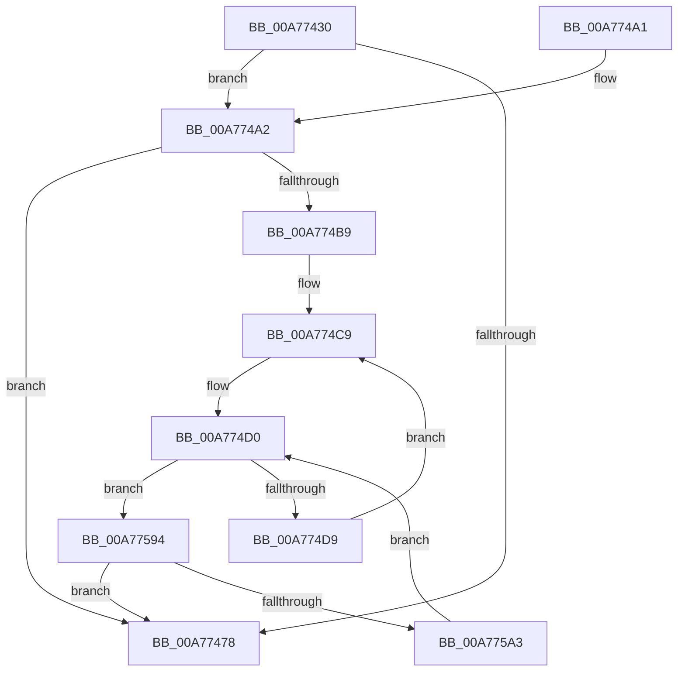

# PpmEventHeteroConfigUpdate

- RVA: `0x00A77430`–`0x00A775B3` (길이 `387` bytes)
- VA: `0x0000000140A77430`
- 실행 섹션: `PAGE`
- PDB 이름 있음: `예`; PDB Function 태그: `아니요`
- unwind 정보 RVA: `0x000B5E2C`
- 디코드: `90`개 명령, `387/387` bytes 표시
- 미해석 바이트: `0` (있으면 어셈블리에 `.byte`로 보존)

> 이 문서는 커널 이미지의 기계어와 PDB 기호를 분석해 생성했습니다. 4번과 5번은 함수 원형과 자료형을 바이너리 사용 방식에서 추정한 C 해석이며 원본 소스 복구 결과는 아닙니다.

## 1. Dependencies

- 직접 호출 지점: **4**; 고유 호출 대상: **4**
- 직접 호출자로 확인된 함수: **1**
- RIP 상대 이미지 참조: **7**

### Outgoing calls
- `0x00A7747F` → [_security_check_cookie](../../text/6A/_security_check_cookie_function_006AC640.md) (function, `0x006AC640`)
- `0x00A774B0` → [EtwEventEnabled](../../text/39/EtwEventEnabled_function_00392450.md) (function, `0x00392450`)
- `0x00A774F9` → [KeGetPrcb](../../text/2D/KeGetPrcb_function_002D85D0.md) (function, `0x002D85D0`)
- `0x00A7758A` → [EtwWrite](../../text/41/EtwWrite_function_0041C720.md) (function, `0x0041C720`)

### Direct callers
- [PopInitializeHeteroProcessors](../A5/PopInitializeHeteroProcessors_function_00A53570.md) at `0x00A538E4`

### Static image references
- `0x00A7744F` → RVA `0x00E0A740` (`.data`; read)
- `0x00A7745F` → RVA `0x00E67A39` (`.data`; read)
- `0x00A774A2` → RVA `0x00F083E8` (`.data`; read)
- `0x00A774A9` → RVA `0x0001BA90` (`.rdata`; read)
- `0x00A774B9` → RVA `0x00E0B5A8` (`.data`; read)
- `0x00A774C9` → RVA `0x00E0B5A0` (`.data`; read)
- `0x00A774EF` → RVA `0x00F231B8` (`.data`; read)

## 2. Other-region calls and transfers

- 다른 실행 섹션으로 향하는 call: **4**
  - `0x00A7747F` → [_security_check_cookie](../../text/6A/_security_check_cookie_function_006AC640.md) (`PAGE` → `.text`)
  - `0x00A774B0` → [EtwEventEnabled](../../text/39/EtwEventEnabled_function_00392450.md) (`PAGE` → `.text`)
  - `0x00A774F9` → [KeGetPrcb](../../text/2D/KeGetPrcb_function_002D85D0.md) (`PAGE` → `.text`)
  - `0x00A7758A` → [EtwWrite](../../text/41/EtwWrite_function_0041C720.md) (`PAGE` → `.text`)
- 별도 외부 분기/꼬리 이동을 확인하지 못했습니다.

## 3. Assembly (complete function range)

```asm
00A77430  48 8B C4                        mov rax, rsp
00A77433  48 89 58 08                     mov qword ptr [rax + 8], rbx
00A77437  48 89 70 10                     mov qword ptr [rax + 0x10], rsi
00A7743B  48 89 78 18                     mov qword ptr [rax + 0x18], rdi
00A7743F  4C 89 70 20                     mov qword ptr [rax + 0x20], r14
00A77443  55                              push rbp
00A77444  48 8D 68 A1                     lea rbp, [rax - 0x5f]
00A77448  48 81 EC A0 00 00 00            sub rsp, 0xa0
00A7744F  48 8B 05 EA 32 39 00            mov rax, qword ptr [rip + 0x3932ea]
00A77456  48 33 C4                        xor rax, rsp
00A77459  48 89 45 47                     mov qword ptr [rbp + 0x47], rax
00A7745D  33 F6                           xor esi, esi
00A7745F  40 38 35 D3 05 3F 00            cmp byte ptr [rip + 0x3f05d3], sil
00A77466  40 88 75 E7                     mov byte ptr [rbp - 0x19], sil
00A7746A  40 88 75 E9                     mov byte ptr [rbp - 0x17], sil
00A7746E  66 89 75 EB                     mov word ptr [rbp - 0x15], si
00A77472  40 88 75 E8                     mov byte ptr [rbp - 0x18], sil
00A77476  75 2A                           jne 0x140a774a2
00A77478  48 8B 4D 47                     mov rcx, qword ptr [rbp + 0x47]
00A7747C  48 33 CC                        xor rcx, rsp
00A7747F  E8 BC 51 C3 FF                  call 0x1406ac640
00A77484  4C 8D 9C 24 A0 00 00 00         lea r11, [rsp + 0xa0]
00A7748C  49 8B 5B 10                     mov rbx, qword ptr [r11 + 0x10]
00A77490  49 8B 73 18                     mov rsi, qword ptr [r11 + 0x18]
00A77494  49 8B 7B 20                     mov rdi, qword ptr [r11 + 0x20]
00A77498  4D 8B 73 28                     mov r14, qword ptr [r11 + 0x28]
00A7749C  49 8B E3                        mov rsp, r11
00A7749F  5D                              pop rbp
00A774A0  C3                              ret
00A774A1  CC                              int3
00A774A2  48 8B 0D 3F 0F 49 00            mov rcx, qword ptr [rip + 0x490f3f]
00A774A9  48 8D 15 E0 45 5A FF            lea rdx, [rip - 0xa5ba20]
00A774B0  E8 9B AF 91 FF                  call 0x140392450
00A774B5  84 C0                           test al, al
00A774B7  74 BF                           je 0x140a77478
00A774B9  48 8B 3D E8 40 39 00            mov rdi, qword ptr [rip + 0x3940e8]
00A774C0  0F B7 DE                        movzx ebx, si
00A774C3  41 BE 01 00 00 00               mov r14d, 1
00A774C9  0F B7 0D D0 40 39 00            movzx ecx, word ptr [rip + 0x3940d0]
00A774D0  48 85 FF                        test rdi, rdi
00A774D3  0F 84 BB 00 00 00               je 0x140a77594
00A774D9  48 0F BC D7                     bsf rdx, rdi
00A774DD  0F B7 CB                        movzx ecx, bx
00A774E0  0F B6 C2                        movzx eax, dl
00A774E3  48 0F B3 C7                     btr rdi, rax
00A774E7  C1 E1 06                        shl ecx, 6
00A774EA  0F B6 C2                        movzx eax, dl
00A774ED  03 C8                           add ecx, eax
00A774EF  48 8B 05 C2 BC 4A 00            mov rax, qword ptr [rip + 0x4abcc2]
00A774F6  8B 0C 88                        mov ecx, dword ptr [rax + rcx*4]
00A774F9  E8 D2 10 86 FF                  call 0x1402d85d0
00A774FE  48 8B D0                        mov rdx, rax
00A77501  41 B9 05 00 00 00               mov r9d, 5
00A77507  45 33 C0                        xor r8d, r8d
00A7750A  8A 88 08 8A 00 00               mov cl, byte ptr [rax + 0x8a08]
00A77510  88 4D E7                        mov byte ptr [rbp - 0x19], cl
00A77513  0F B6 88 D0 00 00 00            movzx ecx, byte ptr [rax + 0xd0]
00A7751A  48 8D 45 EB                     lea rax, [rbp - 0x15]
00A7751E  48 89 45 F7                     mov qword ptr [rbp - 9], rax
00A77522  48 8D 45 E7                     lea rax, [rbp - 0x19]
00A77526  48 89 45 17                     mov qword ptr [rbp + 0x17], rax
00A7752A  66 89 4D EB                     mov word ptr [rbp - 0x15], cx
00A7752E  48 8D 8A D1 00 00 00            lea rcx, [rdx + 0xd1]
00A77535  48 89 4D 07                     mov qword ptr [rbp + 7], rcx
00A77539  48 C7 45 FF 02 00 00 00         mov qword ptr [rbp - 1], 2
00A77541  4C 89 75 0F                     mov qword ptr [rbp + 0xf], r14
00A77545  4C 89 75 1F                     mov qword ptr [rbp + 0x1f], r14
00A77549  8A 82 09 8A 00 00               mov al, byte ptr [rdx + 0x8a09]
00A7754F  88 45 E8                        mov byte ptr [rbp - 0x18], al
00A77552  48 8D 45 E8                     lea rax, [rbp - 0x18]
00A77556  48 89 45 27                     mov qword ptr [rbp + 0x27], rax
00A7755A  4C 89 75 2F                     mov qword ptr [rbp + 0x2f], r14
00A7755E  8A 82 0A 8A 00 00               mov al, byte ptr [rdx + 0x8a0a]
00A77564  48 8D 15 25 45 5A FF            lea rdx, [rip - 0xa5badb]
00A7756B  48 8B 0D 76 0E 49 00            mov rcx, qword ptr [rip + 0x490e76]
00A77572  88 45 E9                        mov byte ptr [rbp - 0x17], al
00A77575  48 8D 45 E9                     lea rax, [rbp - 0x17]
00A77579  48 89 45 37                     mov qword ptr [rbp + 0x37], rax
00A7757D  48 8D 45 F7                     lea rax, [rbp - 9]
00A77581  48 89 44 24 20                  mov qword ptr [rsp + 0x20], rax
00A77586  4C 89 75 3F                     mov qword ptr [rbp + 0x3f], r14
00A7758A  E8 91 51 9A FF                  call 0x14041c720
00A7758F  E9 35 FF FF FF                  jmp 0x140a774c9
00A77594  66 41 03 DE                     add bx, r14w
00A77598  0F B7 DB                        movzx ebx, bx
00A7759B  3B D9                           cmp ebx, ecx
00A7759D  0F 83 D5 FE FF FF               jae 0x140a77478
00A775A3  48 8D 3D FE 3F 39 00            lea rdi, [rip + 0x393ffe]
00A775AA  48 8B 3C DF                     mov rdi, qword ptr [rdi + rbx*8]
00A775AE  E9 1D FF FF FF                  jmp 0x140a774d0
```

## 4. C-style interpretation (structured pseudocode)

```c
__int64 __fastcall PpmEventHeteroConfigUpdate(__int64 a1, __int64 a2, int a3)
{
    __int64 result;
    __int64 v_rbx;
    __int64 v_rsi;
    __int64 v_rsp;
    unsigned __int64 v_stack_m8;
    unsigned __int64 v_stack_m80;

    *(unsigned __int64 *)(v_rsp + 8) = v_rbx;
    *(unsigned __int64 *)(v_rsp + 16) = v_rsi;
    *(unsigned __int64 *)(v_rsp + 24) = v_rdi;
    *(unsigned __int64 *)(v_rsp + 32) = v_r14;
    v_rsp = (v_rsp) - (160);
    result = (*(unsigned __int64 *)(v_rip + 3748586)) ^ (v_rsp);
    *(unsigned __int64 *)(v_rsp - 95 + 71) = result;
    v_rsi = 0;
    *(unsigned __int8 *)(v_rsp - 95 - 25) = 0;
    *(unsigned __int8 *)(v_rsp - 95 - 23) = 0;
    *(unsigned __int16 *)(v_rsp - 95 - 21) = 0;
    *(unsigned __int8 *)(v_rsp - 95 - 24) = 0;
    if ((*(unsigned __int8 *)(v_rip + 4130259)) != 0) goto loc_00A774A2;
loc_00A77478:
    a1 = (*(unsigned __int64 *)(v_rsp - 95 + 71)) ^ (v_rsp);
    result = _security_check_cookie(a1, a2, a3, a4);
    return result;
loc_00A774A2:
    result = EtwEventEnabled(*(unsigned __int64 *)(v_rip + 4788031), v_rip - 10861088, a3, a4);
    if ((unsigned __int8)(result) == 0) goto loc_00A77478;
loc_00A774C9:
loc_00A774D0:
    if (*(unsigned __int64 *)(v_rip + 3752168) == 0) goto loc_00A77594;
    a1 = (unsigned int)(((unsigned __int16)((unsigned __int16)(*(unsigned __int64 *)(v_stack_m8 + 24)))) << (6));
    a1 = (unsigned int)((a1) + ((unsigned int)((unsigned __int8)(v_rip - 10861088))));
    result = KeGetPrcb((unsigned int)(*(unsigned int *)(*(unsigned __int64 *)(v_rip + 4897986) + a1 * 4)), v_rip - 10861088, a3, a4);
    a3 = 0;
    *(unsigned __int8 *)(v_rsp - 95 - 25) = (unsigned __int8)(*(unsigned __int8 *)(result + 35336));
    *(unsigned __int64 *)(v_rsp - 95 - 9) = v_rsp - 95 - 21;
    *(unsigned __int64 *)(v_rsp - 95 + 23) = v_rsp - 95 - 25;
    *(unsigned __int16 *)(v_rsp - 95 - 21) = (unsigned __int16)(*(unsigned __int8 *)(result + 208));
    *(unsigned __int64 *)(v_rsp - 95 + 7) = result + 209;
    *(unsigned __int64 *)(v_rsp - 95 - 1) = 2;
    *(unsigned __int64 *)(v_rsp - 95 + 15) = 1;
    *(unsigned __int64 *)(v_rsp - 95 + 31) = 1;
    *(unsigned __int8 *)(v_rsp - 95 - 24) = (unsigned __int8)(*(unsigned __int8 *)(result + 35337));
    *(unsigned __int64 *)(v_rsp - 95 + 39) = v_rsp - 95 - 24;
    *(unsigned __int64 *)(v_rsp - 95 + 47) = 1;
    *(unsigned __int8 *)(v_rsp - 95 - 23) = (unsigned __int8)(*(unsigned __int8 *)(result + 35338));
    *(unsigned __int64 *)(v_rsp - 95 + 55) = v_rsp - 95 - 23;
    v_stack_m80 = v_rsp - 95 - 9;
    *(unsigned __int64 *)(v_rsp - 95 + 63) = 1;
    result = EtwWrite(*(unsigned __int64 *)(v_rip + 4787830), v_rip - 10861275, a3, 5);
    goto loc_00A774C9;
loc_00A77594:
    v_rbx = (unsigned __int16)(((unsigned __int16)(*(unsigned __int64 *)(v_stack_m8 + 24))) + (1));
    if (((unsigned int)((unsigned __int16)(v_rbx))) >= ((unsigned int)(*(unsigned __int64 *)(v_rip + 4787830)))) goto loc_00A77478;
    goto loc_00A774D0;
}
```

## 5. (Beta) C Style

```c
int64_t PpmEventHeteroConfigUpdate(int64_t Arg1, int64_t Arg2, int32_t Arg3)
{
    int64_t result;
    int64_t local_rbx;
    int64_t local_rsi;
    int64_t local_rsp;
    uint64_t v_stack_m8;
    uint64_t v_stack_m80;

    *(uint64_t *)(local_rsp + 0x8) = local_rbx;
    *(uint64_t *)(local_rsp + 0x10) = local_rsi;
    *(uint64_t *)(local_rsp + 0x18) = local_rdi;
    *(uint64_t *)(local_rsp + 0x20) = local_r14;
    local_rsp = (local_rsp) - (160);
    result = (*(uint64_t *)(v_rip + 0x3932EA)) ^ (local_rsp);
    *(uint64_t *)(local_rsp - 0x5F + 0x47) = result;
    local_rsi = 0;
    *(uint8_t *)(local_rsp - 0x5F - 0x19) = 0;
    *(uint8_t *)(local_rsp - 0x5F - 0x17) = 0;
    *(uint16_t *)(local_rsp - 0x5F - 0x15) = 0;
    *(uint8_t *)(local_rsp - 0x5F - 0x18) = 0;
    if ((*(uint8_t *)(v_rip + 0x3F05D3)) != 0) goto loc_00A774A2;
loc_00A77478:
    Arg1 = (*(uint64_t *)(local_rsp - 0x5F + 0x47)) ^ (local_rsp);
    result = _security_check_cookie(Arg1, Arg2, Arg3, a4);
    return result;
loc_00A774A2:
    result = EtwEventEnabled(*(uint64_t *)(v_rip + 0x490F3F), v_rip - 10861088, Arg3, a4);
    if ((uint8_t)(result) == 0) goto loc_00A77478;
loc_00A774C9:
loc_00A774D0:
    if (*(uint64_t *)(v_rip + 0x3940E8) == 0) goto loc_00A77594;
    Arg1 = (uint32_t)(((uint16_t)((uint16_t)(*(uint64_t *)(v_stack_m8 + 0x18)))) << (6));
    Arg1 = (uint32_t)((Arg1) + ((uint32_t)((uint8_t)(v_rip - 10861088))));
    result = KeGetPrcb((uint32_t)(*(uint32_t *)(*(uint64_t *)(v_rip + 0x4ABCC2) + Arg1 * 4)), v_rip - 10861088, Arg3, a4);
    Arg3 = 0;
    *(uint8_t *)(local_rsp - 0x5F - 0x19) = (uint8_t)(*(uint8_t *)(result + 0x8A08));
    *(uint64_t *)(local_rsp - 0x5F - 0x9) = local_rsp - 95 - 21;
    *(uint64_t *)(local_rsp - 0x5F + 0x17) = local_rsp - 95 - 25;
    *(uint16_t *)(local_rsp - 0x5F - 0x15) = (uint16_t)(*(uint8_t *)(result + 0xD0));
    *(uint64_t *)(local_rsp - 0x5F + 0x7) = result + 209;
    *(uint64_t *)(local_rsp - 0x5F - 0x1) = 2;
    *(uint64_t *)(local_rsp - 0x5F + 0xF) = 1;
    *(uint64_t *)(local_rsp - 0x5F + 0x1F) = 1;
    *(uint8_t *)(local_rsp - 0x5F - 0x18) = (uint8_t)(*(uint8_t *)(result + 0x8A09));
    *(uint64_t *)(local_rsp - 0x5F + 0x27) = local_rsp - 95 - 24;
    *(uint64_t *)(local_rsp - 0x5F + 0x2F) = 1;
    *(uint8_t *)(local_rsp - 0x5F - 0x17) = (uint8_t)(*(uint8_t *)(result + 0x8A0A));
    *(uint64_t *)(local_rsp - 0x5F + 0x37) = local_rsp - 95 - 23;
    v_stack_m80 = local_rsp - 95 - 9;
    *(uint64_t *)(local_rsp - 0x5F + 0x3F) = 1;
    result = EtwWrite(*(uint64_t *)(v_rip + 0x490E76), v_rip - 10861275, Arg3, 5);
    goto loc_00A774C9;
loc_00A77594:
    local_rbx = (uint16_t)(((uint16_t)(*(uint64_t *)(v_stack_m8 + 0x18))) + (1));
    if (((uint32_t)((uint16_t)(local_rbx))) >= ((uint32_t)(*(uint64_t *)(v_rip + 0x490E76)))) goto loc_00A77478;
    goto loc_00A774D0;
}
```

## 6. Execution-region graph

[열기: 2D/3D 그래프와 함수 탐색 컨트롤 패널](../../../control-panel.html?section=page&rva=0x00A77430&view=graph)

- 2D 그래프는 위에서 아래로 흐르고, 3D 그래프는 빈 공간을 드래그해 회전합니다. Shift+드래그는 이동, 휠은 확대·축소, 함수 노드 선택은 대상 보고서 이동입니다.

### Static fallback


