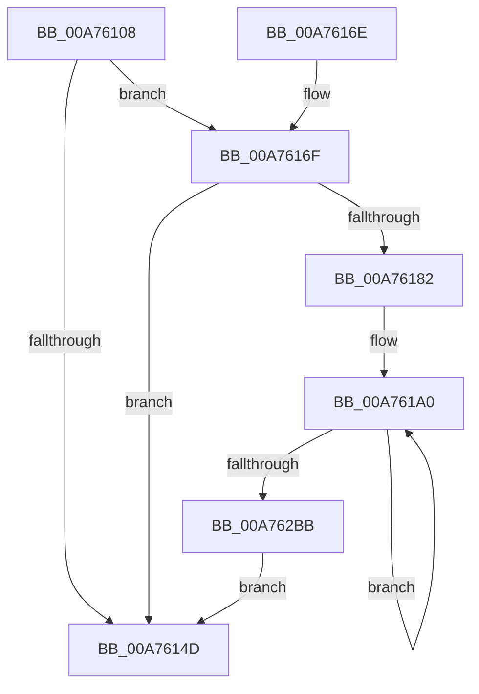

# PpmEventQosClassPolicy

- RVA: `0x00A76108`–`0x00A762C0` (길이 `440` bytes)
- VA: `0x0000000140A76108`
- 실행 섹션: `PAGE`
- PDB 이름 있음: `예`; PDB Function 태그: `아니요`
- unwind 정보 RVA: `0x000B5A68`
- 디코드: `97`개 명령, `440/440` bytes 표시
- 미해석 바이트: `0` (있으면 어셈블리에 `.byte`로 보존)

> 이 문서는 커널 이미지의 기계어와 PDB 기호를 분석해 생성했습니다. 4번과 5번은 함수 원형과 자료형을 바이너리 사용 방식에서 추정한 C 해석이며 원본 소스 복구 결과는 아닙니다.

## 1. Dependencies

- 직접 호출 지점: **3**; 고유 호출 대상: **3**
- 직접 호출자로 확인된 함수: **2**
- RIP 상대 이미지 참조: **5**

### Outgoing calls
- `0x00A76154` → [_security_check_cookie](../../text/6A/_security_check_cookie_function_006AC640.md) (function, `0x006AC640`)
- `0x00A76179` → [EtwEventEnabled](../../text/39/EtwEventEnabled_function_00392450.md) (function, `0x00392450`)
- `0x00A762A3` → [EtwWrite](../../text/41/EtwWrite_function_0041C720.md) (function, `0x0041C720`)

### Direct callers
- [PpmPerfCalculateQosClassPolicies](../../text/42/PpmPerfCalculateQosClassPolicies_function_0042BFC8.md) at `0x0042C492`
- [PpmEventTraceControlCallback](../A5/PpmEventTraceControlCallback_function_00A51F60.md) at `0x00A52074`

### Static image references
- `0x00A7611F` → RVA `0x00E0A740` (`.data`; read)
- `0x00A7612F` → RVA `0x0001BA68` (`.rdata`; read)
- `0x00A76136` → RVA `0x0001BA78` (`.rdata`; read)
- `0x00A76144` → RVA `0x00E67A39` (`.data`; read)
- `0x00A7616F` → RVA `0x00F083E8` (`.data`; read)

## 2. Other-region calls and transfers

- 다른 실행 섹션으로 향하는 call: **3**
  - `0x00A76154` → [_security_check_cookie](../../text/6A/_security_check_cookie_function_006AC640.md) (`PAGE` → `.text`)
  - `0x00A76179` → [EtwEventEnabled](../../text/39/EtwEventEnabled_function_00392450.md) (`PAGE` → `.text`)
  - `0x00A762A3` → [EtwWrite](../../text/41/EtwWrite_function_0041C720.md) (`PAGE` → `.text`)
- 별도 외부 분기/꼬리 이동을 확인하지 못했습니다.

## 3. Assembly (complete function range)

```asm
00A76108  48 89 5C 24 08                  mov qword ptr [rsp + 8], rbx
00A7610D  48 89 7C 24 10                  mov qword ptr [rsp + 0x10], rdi
00A76112  55                              push rbp
00A76113  48 8D 6C 24 A9                  lea rbp, [rsp - 0x57]
00A76118  48 81 EC C0 00 00 00            sub rsp, 0xc0
00A7611F  48 8B 05 1A 46 39 00            mov rax, qword ptr [rip + 0x39461a]
00A76126  48 33 C4                        xor rax, rsp
00A76129  48 89 45 47                     mov qword ptr [rbp + 0x47], rax
00A7612D  84 D2                           test dl, dl
00A7612F  48 8D 05 32 59 5A FF            lea rax, [rip - 0xa5a6ce]
00A76136  48 8D 1D 3B 59 5A FF            lea rbx, [rip - 0xa5a6c5]
00A7613D  48 8B F9                        mov rdi, rcx
00A76140  48 0F 44 D8                     cmove rbx, rax
00A76144  80 3D EE 18 3F 00 00            cmp byte ptr [rip + 0x3f18ee], 0
00A7614B  75 22                           jne 0x140a7616f
00A7614D  48 8B 4D 47                     mov rcx, qword ptr [rbp + 0x47]
00A76151  48 33 CC                        xor rcx, rsp
00A76154  E8 E7 64 C3 FF                  call 0x1406ac640
00A76159  4C 8D 9C 24 C0 00 00 00         lea r11, [rsp + 0xc0]
00A76161  49 8B 5B 10                     mov rbx, qword ptr [r11 + 0x10]
00A76165  49 8B 7B 18                     mov rdi, qword ptr [r11 + 0x18]
00A76169  49 8B E3                        mov rsp, r11
00A7616C  5D                              pop rbp
00A7616D  C3                              ret
00A7616E  CC                              int3
00A7616F  48 8B 0D 72 22 49 00            mov rcx, qword ptr [rip + 0x492272]
00A76176  48 8B D3                        mov rdx, rbx
00A76179  E8 D2 C2 91 FF                  call 0x140392450
00A7617E  84 C0                           test al, al
00A76180  74 CB                           je 0x140a7614d
00A76182  83 65 03 00                     and dword ptr [rbp + 3], 0
00A76186  48 8D 87 B8 01 00 00            lea rax, [rdi + 0x1b8]
00A7618D  83 65 C7 00                     and dword ptr [rbp - 0x39], 0
00A76191  48 89 45 F7                     mov qword ptr [rbp - 9], rax
00A76195  33 C0                           xor eax, eax
00A76197  33 C9                           xor ecx, ecx
00A76199  C7 45 FF 04 00 00 00            mov dword ptr [rbp - 1], 4
00A761A0  83 65 13 00                     and dword ptr [rbp + 0x13], 0
00A761A4  48 8D 55 C7                     lea rdx, [rbp - 0x39]
00A761A8  83 65 23 00                     and dword ptr [rbp + 0x23], 0
00A761AC  41 B9 05 00 00 00               mov r9d, 5
00A761B2  48 89 55 07                     mov qword ptr [rbp + 7], rdx
00A761B6  45 33 C0                        xor r8d, r8d
00A761B9  C7 45 0F 04 00 00 00            mov dword ptr [rbp + 0xf], 4
00A761C0  C7 45 1F 04 00 00 00            mov dword ptr [rbp + 0x1f], 4
00A761C7  8B D1                           mov edx, ecx
00A761C9  8B C8                           mov ecx, eax
00A761CB  48 81 C1 BE 00 00 00            add rcx, 0xbe
00A761D2  48 8D 0C 8F                     lea rcx, [rdi + rcx*4]
00A761D6  48 89 4D 17                     mov qword ptr [rbp + 0x17], rcx
00A761DA  0F B7 84 57 14 03 00 00         movzx eax, word ptr [rdi + rdx*2 + 0x314]
00A761E2  83 65 33 00                     and dword ptr [rbp + 0x33], 0
00A761E6  48 8B 0D FB 21 49 00            mov rcx, qword ptr [rip + 0x4921fb]
00A761ED  89 45 CB                        mov dword ptr [rbp - 0x35], eax
00A761F0  48 8D 45 CB                     lea rax, [rbp - 0x35]
00A761F4  48 89 45 27                     mov qword ptr [rbp + 0x27], rax
00A761F8  48 C1 E2 05                     shl rdx, 5
00A761FC  C7 45 2F 04 00 00 00            mov dword ptr [rbp + 0x2f], 4
00A76203  0F B6 84 3A 2D 02 00 00         movzx eax, byte ptr [rdx + rdi + 0x22d]
00A7620B  89 45 DE                        mov dword ptr [rbp - 0x22], eax
00A7620E  8B 84 3A 24 02 00 00            mov eax, dword ptr [rdx + rdi + 0x224]
00A76215  89 45 D5                        mov dword ptr [rbp - 0x2b], eax
00A76218  8A 84 3A 28 02 00 00            mov al, byte ptr [rdx + rdi + 0x228]
00A7621F  88 45 D9                        mov byte ptr [rbp - 0x27], al
00A76222  8A 84 3A 2F 02 00 00            mov al, byte ptr [rdx + rdi + 0x22f]
00A76229  88 45 E3                        mov byte ptr [rbp - 0x1d], al
00A7622C  0F B7 84 3A 1C 02 00 00         movzx eax, word ptr [rdx + rdi + 0x21c]
00A76234  66 89 45 D1                     mov word ptr [rbp - 0x2f], ax
00A76238  0F B7 84 3A 18 02 00 00         movzx eax, word ptr [rdx + rdi + 0x218]
00A76240  66 89 45 CF                     mov word ptr [rbp - 0x31], ax
00A76244  0F B7 84 3A 20 02 00 00         movzx eax, word ptr [rdx + rdi + 0x220]
00A7624C  66 89 45 D3                     mov word ptr [rbp - 0x2d], ax
00A76250  8A 84 3A 2E 02 00 00            mov al, byte ptr [rdx + rdi + 0x22e]
00A76257  88 45 E2                        mov byte ptr [rbp - 0x1e], al
00A7625A  0F B6 84 3A 2C 02 00 00         movzx eax, byte ptr [rdx + rdi + 0x22c]
00A76262  89 45 DA                        mov dword ptr [rbp - 0x26], eax
00A76265  0F B6 84 3A 31 02 00 00         movzx eax, byte ptr [rdx + rdi + 0x231]
00A7626D  89 45 E4                        mov dword ptr [rbp - 0x1c], eax
00A76270  8A 84 3A 30 02 00 00            mov al, byte ptr [rdx + rdi + 0x230]
00A76277  88 45 E8                        mov byte ptr [rbp - 0x18], al
00A7627A  8A 84 3A 34 02 00 00            mov al, byte ptr [rdx + rdi + 0x234]
00A76281  48 8B D3                        mov rdx, rbx
00A76284  83 65 43 00                     and dword ptr [rbp + 0x43], 0
00A76288  88 45 E9                        mov byte ptr [rbp - 0x17], al
00A7628B  48 8D 45 CF                     lea rax, [rbp - 0x31]
00A7628F  48 89 45 37                     mov qword ptr [rbp + 0x37], rax
00A76293  48 8D 45 F7                     lea rax, [rbp - 9]
00A76297  48 89 44 24 20                  mov qword ptr [rsp + 0x20], rax
00A7629C  C7 45 3F 1B 00 00 00            mov dword ptr [rbp + 0x3f], 0x1b
00A762A3  E8 78 64 9A FF                  call 0x14041c720
00A762A8  8B 45 C7                        mov eax, dword ptr [rbp - 0x39]
00A762AB  FF C0                           inc eax
00A762AD  89 45 C7                        mov dword ptr [rbp - 0x39], eax
00A762B0  8B C8                           mov ecx, eax
00A762B2  83 F8 07                        cmp eax, 7
00A762B5  0F 82 E5 FE FF FF               jb 0x140a761a0
00A762BB  E9 8D FE FF FF                  jmp 0x140a7614d
```

## 4. C-style interpretation (structured pseudocode)

```c
__int64 __fastcall PpmEventQosClassPolicy(__int64 a1, unsigned __int8 a2, int a3)
{
    __int64 result;
    __int64 v_rbx;
    __int64 v_rsp;
    unsigned __int64 v_stack_m18;
    unsigned int v_stack_m1C;
    unsigned int v_stack_m20;
    unsigned __int64 v_stack_m28;
    unsigned int v_stack_m2C;
    unsigned int v_stack_m30;
    unsigned __int64 v_stack_m38;
    unsigned int v_stack_m3C;
    unsigned int v_stack_m40;
    unsigned __int64 v_stack_m48;
    unsigned int v_stack_m4C;
    unsigned int v_stack_m50;
    unsigned __int64 v_stack_m58;
    unsigned int v_stack_m5C;
    unsigned __int64 v_stack_m5F;
    unsigned int v_stack_m60;
    unsigned __int64 v_stack_m68;
    unsigned __int8 v_stack_m76;
    unsigned __int8 v_stack_m77;
    unsigned int v_stack_m7B;
    unsigned __int8 v_stack_m7C;
    unsigned __int8 v_stack_m7D;
    unsigned __int64 v_stack_m8;
    unsigned int v_stack_m81;
    unsigned int v_stack_m85;
    unsigned __int8 v_stack_m86;
    unsigned int v_stack_m8A;
    unsigned __int16 v_stack_m8C;
    unsigned __int16 v_stack_m8E;
    unsigned __int16 v_stack_m90;
    unsigned int v_stack_m94;
    unsigned int v_stack_m98;
    unsigned __int64 v_stack_mA0;
    unsigned __int64 v_stack_p10;
    unsigned __int64 v_stack_p8;

    v_stack_p8 = v_rbx;
    v_stack_p10 = v_rdi;
    v_rsp = (v_rsp) - (192);
    result = (*(unsigned __int64 *)(v_rip + 3753498)) ^ (v_rsp);
    v_stack_m18 = result;
    v_rbx = v_rip - 10856133;
    if (a2 == 0) { v_rbx = v_rip - 10856142; }
    if ((*(unsigned __int8 *)(v_rip + 4135150)) != 0) goto loc_00A7616F;
loc_00A7614D:
    a1 = (v_stack_m18) ^ (v_rsp);
    result = _security_check_cookie(a1, a2, a3, a4);
    return result;
loc_00A7616F:
    result = EtwEventEnabled(*(unsigned __int64 *)(v_rip + 4792946), *(unsigned __int64 *)(v_stack_m8 + 16), a3, a4);
    if ((unsigned __int8)(result) == 0) goto loc_00A7614D;
    v_stack_m68 = *(unsigned __int64 *)(v_stack_m8 + 24) + 440;
    result = 0;
    a1 = 0;
    v_stack_m60 = 4;
loc_00A761A0:
    v_stack_m58 = v_stack_m98;
    a3 = 0;
    v_stack_m50 = 4;
    v_stack_m40 = 4;
    a1 = (0) + (190);
    v_stack_m48 = *(unsigned __int64 *)(v_stack_m8 + 24) + a1 * 4;
    v_stack_m94 = (unsigned int)(*(unsigned __int16 *)(*(unsigned __int64 *)(v_stack_m8 + 24) + 0 * 2 + 788));
    v_stack_m38 = v_stack_m94;
    a2 = (0) << (5);
    v_stack_m30 = 4;
    v_stack_m81 = (unsigned int)(*(unsigned __int8 *)(a2 + *(unsigned __int64 *)(v_stack_m8 + 24) * 1 + 557));
    v_stack_m8A = (unsigned int)((unsigned int)(*(unsigned int *)(a2 + *(unsigned __int64 *)(v_stack_m8 + 24) * 1 + 548)));
    v_stack_m86 = (unsigned __int8)(*(unsigned __int8 *)(a2 + *(unsigned __int64 *)(v_stack_m8 + 24) * 1 + 552));
    v_stack_m7C = (unsigned __int8)(*(unsigned __int8 *)(a2 + *(unsigned __int64 *)(v_stack_m8 + 24) * 1 + 559));
    v_stack_m8E = (unsigned __int16)(*(unsigned __int16 *)(a2 + *(unsigned __int64 *)(v_stack_m8 + 24) * 1 + 540));
    v_stack_m90 = (unsigned __int16)(*(unsigned __int16 *)(a2 + *(unsigned __int64 *)(v_stack_m8 + 24) * 1 + 536));
    v_stack_m8C = (unsigned __int16)(*(unsigned __int16 *)(a2 + *(unsigned __int64 *)(v_stack_m8 + 24) * 1 + 544));
    v_stack_m7D = (unsigned __int8)(*(unsigned __int8 *)(a2 + *(unsigned __int64 *)(v_stack_m8 + 24) * 1 + 558));
    v_stack_m85 = (unsigned int)(*(unsigned __int8 *)(a2 + *(unsigned __int64 *)(v_stack_m8 + 24) * 1 + 556));
    v_stack_m7B = (unsigned int)(*(unsigned __int8 *)(a2 + *(unsigned __int64 *)(v_stack_m8 + 24) * 1 + 561));
    v_stack_m77 = (unsigned __int8)(*(unsigned __int8 *)(a2 + *(unsigned __int64 *)(v_stack_m8 + 24) * 1 + 560));
    v_stack_m76 = (unsigned __int8)(*(unsigned __int8 *)(a2 + *(unsigned __int64 *)(v_stack_m8 + 24) * 1 + 564));
    v_stack_m28 = v_stack_m90;
    v_stack_mA0 = v_stack_m68;
    v_stack_m20 = 27;
    result = EtwWrite(*(unsigned __int64 *)(v_rip + 4792827), *(unsigned __int64 *)(v_stack_m8 + 16), a3, 5);
    result = (unsigned int)(((unsigned int)(v_stack_m98)) + 1);
    v_stack_m98 = (unsigned int)(result);
    if (((unsigned int)(result)) < 7) goto loc_00A761A0;
    goto loc_00A7614D;
}
```

## 5. (Beta) C Style

```c
int64_t PpmEventQosClassPolicy(void *Arg1, uint8_t Arg2, int32_t Arg3)
{
    uint8_t *arg1 = (uint8_t *)Arg1;

    int64_t result;
    int64_t local_rbx;
    int64_t local_rsp;
    uint64_t v_stack_m18;
    uint32_t v_stack_m1C;
    uint32_t v_stack_m20;
    uint64_t v_stack_m28;
    uint32_t v_stack_m2C;
    uint32_t v_stack_m30;
    uint64_t v_stack_m38;
    uint32_t v_stack_m3C;
    uint32_t v_stack_m40;
    uint64_t v_stack_m48;
    uint32_t v_stack_m4C;
    uint32_t v_stack_m50;
    uint64_t v_stack_m58;
    uint32_t v_stack_m5C;
    uint64_t v_stack_m5F;
    uint32_t v_stack_m60;
    uint64_t v_stack_m68;
    uint8_t v_stack_m76;
    uint8_t v_stack_m77;
    uint32_t v_stack_m7B;
    uint8_t v_stack_m7C;
    uint8_t v_stack_m7D;
    uint64_t v_stack_m8;
    uint32_t v_stack_m81;
    uint32_t v_stack_m85;
    uint8_t v_stack_m86;
    uint32_t v_stack_m8A;
    uint16_t v_stack_m8C;
    uint16_t v_stack_m8E;
    uint16_t v_stack_m90;
    uint32_t v_stack_m94;
    uint32_t v_stack_m98;
    uint64_t v_stack_mA0;
    uint64_t v_stack_p10;
    uint64_t v_stack_p8;

    v_stack_p8 = local_rbx;
    v_stack_p10 = local_rdi;
    local_rsp = (local_rsp) - (192);
    result = (*(uint64_t *)(v_rip + 0x39461A)) ^ (local_rsp);
    v_stack_m18 = result;
    local_rbx = v_rip - 10856133;
    if (Arg2 == 0) { local_rbx = v_rip - 10856142; }
    if ((*(uint8_t *)(v_rip + 0x3F18EE)) != 0) goto loc_00A7616F;
loc_00A7614D:
    Arg1 = (v_stack_m18) ^ (local_rsp);
    result = _security_check_cookie(Arg1, Arg2, Arg3, a4);
    return result;
loc_00A7616F:
    result = EtwEventEnabled(*(uint64_t *)(v_rip + 0x492272), *(uint64_t *)(v_stack_m8 + 0x10), Arg3, a4);
    if ((uint8_t)(result) == 0) goto loc_00A7614D;
    v_stack_m68 = *(uint64_t *)(v_stack_m8 + 0x18) + 440;
    result = 0;
    Arg1 = 0;
    v_stack_m60 = 4;
loc_00A761A0:
    v_stack_m58 = v_stack_m98;
    Arg3 = 0;
    v_stack_m50 = 4;
    v_stack_m40 = 4;
    Arg1 = (0) + (190);
    v_stack_m48 = *(uint64_t *)(v_stack_m8 + 0x18) + Arg1 * 4;
    v_stack_m94 = (uint32_t)(*(uint16_t *)(*(uint64_t *)(v_stack_m8 + 0x18) + 0x0 * 2 + 0x314));
    v_stack_m38 = v_stack_m94;
    Arg2 = (0) << (5);
    v_stack_m30 = 4;
    v_stack_m81 = (uint32_t)(*(uint8_t *)(Arg2 + *(uint64_t *)(v_stack_m8 + 0x18) * 1 + 0x22D));
    v_stack_m8A = (uint32_t)((uint32_t)(*(uint32_t *)(Arg2 + *(uint64_t *)(v_stack_m8 + 0x18) * 1 + 0x224)));
    v_stack_m86 = (uint8_t)(*(uint8_t *)(Arg2 + *(uint64_t *)(v_stack_m8 + 0x18) * 1 + 0x228));
    v_stack_m7C = (uint8_t)(*(uint8_t *)(Arg2 + *(uint64_t *)(v_stack_m8 + 0x18) * 1 + 0x22F));
    v_stack_m8E = (uint16_t)(*(uint16_t *)(Arg2 + *(uint64_t *)(v_stack_m8 + 0x18) * 1 + 0x21C));
    v_stack_m90 = (uint16_t)(*(uint16_t *)(Arg2 + *(uint64_t *)(v_stack_m8 + 0x18) * 1 + 0x218));
    v_stack_m8C = (uint16_t)(*(uint16_t *)(Arg2 + *(uint64_t *)(v_stack_m8 + 0x18) * 1 + 0x220));
    v_stack_m7D = (uint8_t)(*(uint8_t *)(Arg2 + *(uint64_t *)(v_stack_m8 + 0x18) * 1 + 0x22E));
    v_stack_m85 = (uint32_t)(*(uint8_t *)(Arg2 + *(uint64_t *)(v_stack_m8 + 0x18) * 1 + 0x22C));
    v_stack_m7B = (uint32_t)(*(uint8_t *)(Arg2 + *(uint64_t *)(v_stack_m8 + 0x18) * 1 + 0x231));
    v_stack_m77 = (uint8_t)(*(uint8_t *)(Arg2 + *(uint64_t *)(v_stack_m8 + 0x18) * 1 + 0x230));
    v_stack_m76 = (uint8_t)(*(uint8_t *)(Arg2 + *(uint64_t *)(v_stack_m8 + 0x18) * 1 + 0x234));
    v_stack_m28 = v_stack_m90;
    v_stack_mA0 = v_stack_m68;
    v_stack_m20 = 27;
    result = EtwWrite(*(uint64_t *)(v_rip + 0x4921FB), *(uint64_t *)(v_stack_m8 + 0x10), Arg3, 5);
    result = (uint32_t)(((uint32_t)(v_stack_m98)) + 1);
    v_stack_m98 = (uint32_t)(result);
    if (((uint32_t)(result)) < 7) goto loc_00A761A0;
    goto loc_00A7614D;
}
```

### 관측된 메모리 오프셋

구조체 형식이 확인되지 않은 접근은 인자 기준의 오프셋으로만 기록했습니다.

| 기준 인자 | 오프셋 표현 | 폭 (bit) | 접근 |
|---|---:|---:|---|
| `Arg1` | `+ 0x0 + rcx*4` | `64` | `R` |
| `Arg1` | `+ 0x1B8` | `64` | `R` |
| `Arg1` | `+ 0x314 + rdx*2` | `16` | `R` |

## 6. Execution-region graph

[열기: 2D/3D 그래프와 함수 탐색 컨트롤 패널](../../../control-panel.html?section=page&rva=0x00A76108&view=graph)

- 2D 그래프는 위에서 아래로 흐르고, 3D 그래프는 빈 공간을 드래그해 회전합니다. Shift+드래그는 이동, 휠은 확대·축소, 함수 노드 선택은 대상 보고서 이동입니다.

### Static fallback


