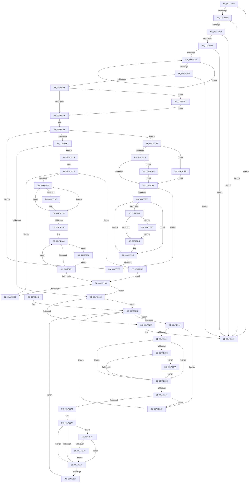

# PpmHeteroComputeRelativePerformance

- RVA: `0x00A7E038`–`0x00A7E306` (길이 `718` bytes)
- VA: `0x0000000140A7E038`
- 실행 섹션: `PAGE`
- PDB 이름 있음: `예`; PDB Function 태그: `아니요`
- unwind 정보 RVA: `0x000B6B98`
- 디코드: `184`개 명령, `718/718` bytes 표시
- 미해석 바이트: `0` (있으면 어셈블리에 `.byte`로 보존)

> 이 문서는 커널 이미지의 기계어와 PDB 기호를 분석해 생성했습니다. 4번과 5번은 함수 원형과 자료형을 바이너리 사용 방식에서 추정한 C 해석이며 원본 소스 복구 결과는 아닙니다.

## 1. Dependencies

- 직접 호출 지점: **3**; 고유 호출 대상: **3**
- 직접 호출자로 확인된 함수: **1**
- RIP 상대 이미지 참조: **6**

### Outgoing calls
- `0x00A7E053` → [KeIsEmptyAffinityEx](../../text/2D/KeIsEmptyAffinityEx_function_002D1580.md) (function, `0x002D1580`)
- `0x00A7E06E` → [KeIsEqualAffinityEx](../../text/30/KeIsEqualAffinityEx_function_00305230.md) (function, `0x00305230`)
- `0x00A7E0DB` → [KeGetPrcb](../../text/2D/KeGetPrcb_function_002D85D0.md) (function, `0x002D85D0`)

### Direct callers
- [PopInitializeHeteroProcessors](../A5/PopInitializeHeteroProcessors_function_00A53570.md) at `0x00A5364F`

### Static image references
- `0x00A7E04C` → RVA `0x00E0B5A0` (`.data`; read)
- `0x00A7E067` → RVA `0x00E0B430` (`.data`; read)
- `0x00A7E07B` → RVA `0x00FC6CF0` (`ALMOSTRO`; read)
- `0x00A7E088` → RVA `0x00FC6BA8` (`ALMOSTRO`; read)
- `0x00A7E111` → RVA `0x00FC6B6E` (`ALMOSTRO`; write)
- `0x00A7E122` → RVA `0x00FC6B6D` (`ALMOSTRO`; write)

## 2. Other-region calls and transfers

- 다른 실행 섹션으로 향하는 call: **3**
  - `0x00A7E053` → [KeIsEmptyAffinityEx](../../text/2D/KeIsEmptyAffinityEx_function_002D1580.md) (`PAGE` → `.text`)
  - `0x00A7E06E` → [KeIsEqualAffinityEx](../../text/30/KeIsEqualAffinityEx_function_00305230.md) (`PAGE` → `.text`)
  - `0x00A7E0DB` → [KeGetPrcb](../../text/2D/KeGetPrcb_function_002D85D0.md) (`PAGE` → `.text`)
- 별도 외부 분기/꼬리 이동을 확인하지 못했습니다.

## 3. Assembly (complete function range)

```asm
00A7E038  48 89 5C 24 08                  mov qword ptr [rsp + 8], rbx
00A7E03D  48 89 6C 24 10                  mov qword ptr [rsp + 0x10], rbp
00A7E042  48 89 74 24 18                  mov qword ptr [rsp + 0x18], rsi
00A7E047  57                              push rdi
00A7E048  48 83 EC 20                     sub rsp, 0x20
00A7E04C  48 8D 0D 4D D5 38 00            lea rcx, [rip + 0x38d54d]
00A7E053  E8 28 35 85 FF                  call 0x1402d1580
00A7E058  85 C0                           test eax, eax
00A7E05A  0F 85 C9 00 00 00               jne 0x140a7e129
00A7E060  48 8D 15 39 D5 38 00            lea rdx, [rip + 0x38d539]
00A7E067  48 8D 0D C2 D3 38 00            lea rcx, [rip + 0x38d3c2]
00A7E06E  E8 BD 71 88 FF                  call 0x140305230
00A7E073  85 C0                           test eax, eax
00A7E075  0F 84 AE 00 00 00               je 0x140a7e129
00A7E07B  83 3D 6E 8C 54 00 01            cmp dword ptr [rip + 0x548c6e], 1
00A7E082  0F 84 A1 00 00 00               je 0x140a7e129
00A7E088  48 8B 0D 19 8B 54 00            mov rcx, qword ptr [rip + 0x548b19]
00A7E08F  48 8D 2D 12 8B 54 00            lea rbp, [rip + 0x548b12]
00A7E096  33 DB                           xor ebx, ebx
00A7E098  48 3B CD                        cmp rcx, rbp
00A7E09B  0F 84 88 00 00 00               je 0x140a7e129
00A7E0A1  48 8B 81 E0 01 00 00            mov rax, qword ptr [rcx + 0x1e0]
00A7E0A8  48 8B 09                        mov rcx, qword ptr [rcx]
00A7E0AB  48 3B D8                        cmp rbx, rax
00A7E0AE  48 0F 47 C3                     cmova rax, rbx
00A7E0B2  48 8B D8                        mov rbx, rax
00A7E0B5  48 3B CD                        cmp rcx, rbp
00A7E0B8  75 E7                           jne 0x140a7e0a1
00A7E0BA  48 85 C0                        test rax, rax
00A7E0BD  74 6A                           je 0x140a7e129
00A7E0BF  33 FF                           xor edi, edi
00A7E0C1  33 C9                           xor ecx, ecx
00A7E0C3  48 B8 FF FF FF FF FF 7F 00 00   movabs rax, 0x7fffffffffff
00A7E0CD  48 3B D8                        cmp rbx, rax
00A7E0D0  0F 83 FB 01 00 00               jae 0x140a7e2d1
00A7E0D6  48 D3 EB                        shr rbx, cl
00A7E0D9  33 C9                           xor ecx, ecx
00A7E0DB  E8 F0 A4 85 FF                  call 0x1402d85d0
00A7E0E0  4C 8B 05 C1 8A 54 00            mov r8, qword ptr [rip + 0x548ac1]
00A7E0E7  48 8B B0 B0 89 00 00            mov rsi, qword ptr [rax + 0x89b0]
00A7E0EE  4C 3B C5                        cmp r8, rbp
00A7E0F1  0F 85 B8 00 00 00               jne 0x140a7e1af
00A7E0F7  8B 15 F3 8B 54 00               mov edx, dword ptr [rip + 0x548bf3]
00A7E0FD  45 33 C9                        xor r9d, r9d
00A7E100  45 32 C0                        xor r8b, r8b
00A7E103  83 CB FF                        or ebx, 0xffffffff
00A7E106  85 D2                           test edx, edx
00A7E108  0F 85 62 01 00 00               jne 0x140a7e270
00A7E10E  45 32 C9                        xor r9b, r9b
00A7E111  44 88 05 56 8A 54 00            mov byte ptr [rip + 0x548a56], r8b
00A7E118  32 D2                           xor dl, dl
00A7E11A  45 33 D2                        xor r10d, r10d
00A7E11D  45 84 C0                        test r8b, r8b
00A7E120  75 1F                           jne 0x140a7e141
00A7E122  44 88 0D 44 8A 54 00            mov byte ptr [rip + 0x548a44], r9b
00A7E129  48 8B 5C 24 30                  mov rbx, qword ptr [rsp + 0x30]
00A7E12E  32 C0                           xor al, al
00A7E130  48 8B 6C 24 38                  mov rbp, qword ptr [rsp + 0x38]
00A7E135  48 8B 74 24 40                  mov rsi, qword ptr [rsp + 0x40]
00A7E13A  48 83 C4 20                     add rsp, 0x20
00A7E13E  5F                              pop rdi
00A7E13F  C3                              ret
00A7E140  CC                              int3
00A7E141  41 3A D0                        cmp dl, r8b
00A7E144  73 DC                           jae 0x140a7e122
00A7E146  48 8B 05 5B 8A 54 00            mov rax, qword ptr [rip + 0x548a5b]
00A7E14D  8B CB                           mov ecx, ebx
00A7E14F  48 3B C5                        cmp rax, rbp
00A7E152  74 54                           je 0x140a7e1a8
00A7E154  38 90 2D 01 00 00               cmp byte ptr [rax + 0x12d], dl
00A7E15A  75 10                           jne 0x140a7e16c
00A7E15C  44 8B 98 C4 01 00 00            mov r11d, dword ptr [rax + 0x1c4]
00A7E163  4D 3B DA                        cmp r11, r10
00A7E166  0F 87 8E 01 00 00               ja 0x140a7e2fa
00A7E16C  48 8B 00                        mov rax, qword ptr [rax]
00A7E16F  48 3B C5                        cmp rax, rbp
00A7E172  75 E0                           jne 0x140a7e154
00A7E174  3B CB                           cmp ecx, ebx
00A7E176  74 30                           je 0x140a7e1a8
00A7E178  48 8B 05 29 8A 54 00            mov rax, qword ptr [rip + 0x548a29]
00A7E17F  38 90 2D 01 00 00               cmp byte ptr [rax + 0x12d], dl
00A7E185  74 10                           je 0x140a7e197
00A7E187  48 8B 00                        mov rax, qword ptr [rax]
00A7E18A  48 3B C5                        cmp rax, rbp
00A7E18D  75 F0                           jne 0x140a7e17f
00A7E18F  44 8B D1                        mov r10d, ecx
00A7E192  41 FE C1                        inc r9b
00A7E195  EB AA                           jmp 0x140a7e141
00A7E197  39 88 C4 01 00 00               cmp dword ptr [rax + 0x1c4], ecx
00A7E19D  75 E8                           jne 0x140a7e187
00A7E19F  44 88 88 2E 01 00 00            mov byte ptr [rax + 0x12e], r9b
00A7E1A6  EB DF                           jmp 0x140a7e187
00A7E1A8  FE C2                           inc dl
00A7E1AA  45 33 D2                        xor r10d, r10d
00A7E1AD  EB 92                           jmp 0x140a7e141
00A7E1AF  4D 8B 90 E0 01 00 00            mov r10, qword ptr [r8 + 0x1e0]
00A7E1B6  33 D2                           xor edx, edx
00A7E1B8  4D 8B CA                        mov r9, r10
00A7E1BB  8B CF                           mov ecx, edi
00A7E1BD  49 D3 E9                        shr r9, cl
00A7E1C0  49 6B C1 64                     imul rax, r9, 0x64
00A7E1C4  48 F7 F3                        div rbx
00A7E1C7  41 88 80 E8 01 00 00            mov byte ptr [r8 + 0x1e8], al
00A7E1CE  4C 3B CB                        cmp r9, rbx
00A7E1D1  0F 84 91 00 00 00               je 0x140a7e268
00A7E1D7  49 C1 E1 10                     shl r9, 0x10
00A7E1DB  33 D2                           xor edx, edx
00A7E1DD  48 8B C3                        mov rax, rbx
00A7E1E0  48 D1 E8                        shr rax, 1
00A7E1E3  49 03 C1                        add rax, r9
00A7E1E6  48 F7 F3                        div rbx
00A7E1E9  4C 8B C8                        mov r9, rax
00A7E1EC  48 83 F8 01                     cmp rax, 1
00A7E1F0  0F 86 F4 00 00 00               jbe 0x140a7e2ea
00A7E1F6  8B 86 C0 01 00 00               mov eax, dword ptr [rsi + 0x1c0]
00A7E1FC  33 D2                           xor edx, edx
00A7E1FE  41 8B 88 C0 01 00 00            mov ecx, dword ptr [r8 + 0x1c0]
00A7E205  48 0F AF 8E E0 01 00 00         imul rcx, qword ptr [rsi + 0x1e0]
00A7E20D  49 0F AF C2                     imul rax, r10
00A7E211  45 33 D2                        xor r10d, r10d
00A7E214  48 C1 E0 10                     shl rax, 0x10
00A7E218  48 F7 F1                        div rcx
00A7E21B  4C 8B D8                        mov r11, rax
00A7E21E  45 39 90 28 01 00 00            cmp dword ptr [r8 + 0x128], r10d
00A7E225  76 30                           jbe 0x140a7e257
00A7E227  41 8B CA                        mov ecx, r10d
00A7E22A  48 69 D1 A8 04 00 00            imul rdx, rcx, 0x4a8
00A7E231  49 8B 88 38 01 00 00            mov rcx, qword ptr [r8 + 0x138]
00A7E238  48 8B 04 0A                     mov rax, qword ptr [rdx + rcx]
00A7E23C  48 85 C0                        test rax, rax
00A7E23F  74 0A                           je 0x140a7e24b
00A7E241  80 78 44 00                     cmp byte ptr [rax + 0x44], 0
00A7E245  75 18                           jne 0x140a7e25f
00A7E247  44 89 48 40                     mov dword ptr [rax + 0x40], r9d
00A7E24B  41 FF C2                        inc r10d
00A7E24E  45 3B 90 28 01 00 00            cmp r10d, dword ptr [r8 + 0x128]
00A7E255  72 D0                           jb 0x140a7e227
00A7E257  4D 8B 00                        mov r8, qword ptr [r8]
00A7E25A  E9 8F FE FF FF                  jmp 0x140a7e0ee
00A7E25F  44 89 98 08 FD FF FF            mov dword ptr [rax - 0x2f8], r11d
00A7E266  EB DF                           jmp 0x140a7e247
00A7E268  41 B9 00 00 01 00               mov r9d, 0x10000
00A7E26E  EB 86                           jmp 0x140a7e1f6
00A7E270  49 83 CB FF                     or r11, 0xffffffffffffffff
00A7E274  48 8B 05 2D 89 54 00            mov rax, qword ptr [rip + 0x54892d]
00A7E27B  49 8B CB                        mov rcx, r11
00A7E27E  48 3B C5                        cmp rax, rbp
00A7E281  74 72                           je 0x140a7e2f5
00A7E283  4C 8B 90 E0 01 00 00            mov r10, qword ptr [rax + 0x1e0]
00A7E28A  4D 3B D1                        cmp r10, r9
00A7E28D  76 07                           jbe 0x140a7e296
00A7E28F  49 3B CA                        cmp rcx, r10
00A7E292  49 0F 43 CA                     cmovae rcx, r10
00A7E296  48 8B 00                        mov rax, qword ptr [rax]
00A7E299  48 3B C5                        cmp rax, rbp
00A7E29C  75 E5                           jne 0x140a7e283
00A7E29E  48 8B 05 03 89 54 00            mov rax, qword ptr [rip + 0x548903]
00A7E2A5  4C 8B C9                        mov r9, rcx
00A7E2A8  48 39 88 E0 01 00 00            cmp qword ptr [rax + 0x1e0], rcx
00A7E2AF  74 15                           je 0x140a7e2c6
00A7E2B1  48 8B 00                        mov rax, qword ptr [rax]
00A7E2B4  48 3B C5                        cmp rax, rbp
00A7E2B7  75 EF                           jne 0x140a7e2a8
00A7E2B9  41 FE C0                        inc r8b
00A7E2BC  85 D2                           test edx, edx
00A7E2BE  0F 84 4A FE FF FF               je 0x140a7e10e
00A7E2C4  EB AE                           jmp 0x140a7e274
00A7E2C6  44 88 80 2D 01 00 00            mov byte ptr [rax + 0x12d], r8b
00A7E2CD  03 D3                           add edx, ebx
00A7E2CF  EB E0                           jmp 0x140a7e2b1
00A7E2D1  48 8B C3                        mov rax, rbx
00A7E2D4  48 C1 E8 20                     shr rax, 0x20
00A7E2D8  05 FF FF 00 00                  add eax, 0xffff
00A7E2DD  0F BD F8                        bsr edi, eax
00A7E2E0  83 C7 F2                        add edi, -0xe
00A7E2E3  8B CF                           mov ecx, edi
00A7E2E5  E9 EC FD FF FF                  jmp 0x140a7e0d6
00A7E2EA  41 B9 01 00 00 00               mov r9d, 1
00A7E2F0  E9 01 FF FF FF                  jmp 0x140a7e1f6
00A7E2F5  4D 8B CB                        mov r9, r11
00A7E2F8  EB BF                           jmp 0x140a7e2b9
00A7E2FA  41 3B CB                        cmp ecx, r11d
00A7E2FD  41 0F 43 CB                     cmovae ecx, r11d
00A7E301  E9 66 FE FF FF                  jmp 0x140a7e16c
```

## 4. C-style interpretation (structured pseudocode)

```c
__int64 __fastcall PpmHeteroComputeRelativePerformance(__int64 a1, __int64 a2, __int64 a3, int a4)
{
    __int64 result;
    __int64 v_r10;
    __int64 v_r11;
    __int64 v_rbx;
    __int64 v_rdi;
    __int64 v_rsp;
    unsigned __int64 v_stack_p10;
    unsigned __int64 v_stack_p18;
    unsigned __int64 v_stack_p8;

    v_stack_p8 = v_rbx;
    v_stack_p10 = v_rbp;
    v_stack_p18 = v_rsi;
    v_rsp = (v_rsp) - (32);
    result = KeIsEmptyAffinityEx(v_rip + 3724621, a2, a3, a4);
    if ((unsigned int)(result) != 0) goto loc_00A7E129;
    result = KeIsEqualAffinityEx(v_rip + 3724226, v_rip + 3724601, a3, a4);
    if ((unsigned int)(result) == 0) goto loc_00A7E129;
    if ((*(unsigned int *)(v_rip + 5540974)) == 1) goto loc_00A7E129;
    v_rbx = 0;
    if ((*(unsigned __int64 *)(v_rip + 5540633)) == (v_rip + 5540626)) goto loc_00A7E129;
loc_00A7E0A1:
    result = *(unsigned __int64 *)(*(unsigned __int64 *)(v_rip + 5540633) + 480);
    if (0 > (*(unsigned __int64 *)(*(unsigned __int64 *)(v_rip + 5540633) + 480))) { result = 0; }
    if ((*(unsigned __int64 *)(*(unsigned __int64 *)(v_rip + 5540633))) != (v_rip + 5540626)) goto loc_00A7E0A1;
    if (result == 0) goto loc_00A7E129;
    v_rdi = 0;
    a1 = 0;
    if (result >= result) goto loc_00A7E2D1;
loc_00A7E0D6:
    v_rbx = (result) >> (0);
    a1 = 0;
    result = KeGetPrcb(a1, v_rip + 3724601, a3, a4);
loc_00A7E0EE:
    if ((*(unsigned __int64 *)(v_rip + 5540545)) != (v_rip + 5540626)) goto loc_00A7E1AF;
    a4 = 0;
    a3 = 0;
    v_rbx = (unsigned int)((v_rbx) | (0xFFFFFFFFULL));
    if ((unsigned int)((unsigned int)(*(unsigned int *)(v_rip + 5540851))) != 0) goto loc_00A7E270;
loc_00A7E10E:
    a4 = 0;
    *(unsigned __int8 *)(v_rip + 5540438) = 0;
    a2 = 0;
    v_r10 = 0;
    if (0 != 0) goto loc_00A7E141;
loc_00A7E122:
    *(unsigned __int8 *)(v_rip + 5540420) = 0;
loc_00A7E129:
    result = 0;
    v_rsp = (v_rsp) + (32);
    return result;
loc_00A7E141:
    if (0 >= 0) goto loc_00A7E122;
    if ((*(unsigned __int64 *)(v_rip + 5540443)) == v_stack_p10) goto loc_00A7E1A8;
loc_00A7E154:
    if ((*(unsigned __int8 *)(*(unsigned __int64 *)(v_rip + 5540443) + 301)) != 0) goto loc_00A7E16C;
    if (((unsigned int)(*(unsigned int *)(*(unsigned __int64 *)(v_rip + 5540443) + 452))) > 0) goto loc_00A7E2FA;
loc_00A7E16C:
    if ((*(unsigned __int64 *)(*(unsigned __int64 *)(v_rip + 5540443))) != v_stack_p10) goto loc_00A7E154;
    if (((unsigned int)((unsigned int)((unsigned int)(v_stack_p8)))) == ((unsigned int)(v_stack_p8))) goto loc_00A7E1A8;
loc_00A7E17F:
    if ((*(unsigned __int8 *)(*(unsigned __int64 *)(v_rip + 5540393) + 301)) == 0) goto loc_00A7E197;
loc_00A7E187:
    if ((*(unsigned __int64 *)(*(unsigned __int64 *)(v_rip + 5540393))) != v_stack_p10) goto loc_00A7E17F;
    a4 = (unsigned __int8)((a4) + 1);
    goto loc_00A7E141;
loc_00A7E197:
    if ((*(unsigned int *)(*(unsigned __int64 *)(*(unsigned __int64 *)(v_rip + 5540393)) + 452)) != ((unsigned int)((unsigned int)((unsigned int)(v_stack_p8))))) goto loc_00A7E187;
    *(unsigned __int8 *)(*(unsigned __int64 *)(*(unsigned __int64 *)(v_rip + 5540393)) + 302) = (unsigned __int8)(a4);
    goto loc_00A7E187;
loc_00A7E1A8:
    a2 = (unsigned __int8)((a2) + 1);
    v_r10 = 0;
    goto loc_00A7E141;
loc_00A7E1AF:
    a2 = 0;
    a4 = (*(unsigned __int64 *)(a3 + 480)) >> (0);
    result = (*(unsigned __int64 *)(*(unsigned __int64 *)(v_rip + 5540393))) * (a4);
    *(unsigned __int8 *)(a3 + 488) = (unsigned __int8)(result);
    if (a4 == v_stack_p8) goto loc_00A7E268;
    a4 = (a4) << (16);
    a2 = 0;
    result = (v_stack_p8) >> (1);
    result = (result) + (a4);
    if (result <= 1) goto loc_00A7E2EA;
loc_00A7E1F6:
    a2 = 0;
    a1 = ((unsigned int)(*(unsigned int *)(a3 + 448))) * (*(unsigned __int64 *)(v_stack_p18 + 480));
    result = ((unsigned int)(*(unsigned int *)(v_stack_p18 + 448))) * (*(unsigned __int64 *)(a3 + 480));
    v_r10 = 0;
    result = (result) << (16);
    if ((*(unsigned int *)(a3 + 296)) <= 0) goto loc_00A7E257;
loc_00A7E227:
    a2 = (a2) * (0);
    if (*(unsigned __int64 *)(a2 + *(unsigned __int64 *)(a3 + 312) * 1) == 0) goto loc_00A7E24B;
    if ((*(unsigned __int8 *)(*(unsigned __int64 *)(a2 + *(unsigned __int64 *)(a3 + 312) * 1) + 68)) != 0) goto loc_00A7E25F;
loc_00A7E247:
    *(unsigned int *)(*(unsigned __int64 *)(a2 + *(unsigned __int64 *)(a3 + 312) * 1) + 64) = (unsigned int)(result);
loc_00A7E24B:
    v_r10 = (unsigned int)((v_r10) + 1);
    if (((unsigned int)(v_r10)) < (*(unsigned int *)(a3 + 296))) goto loc_00A7E227;
loc_00A7E257:
    goto loc_00A7E0EE;
loc_00A7E25F:
    *(unsigned int *)(*(unsigned __int64 *)(a2 + *(unsigned __int64 *)(a3 + 312) * 1) - 760) = (unsigned int)(result);
    goto loc_00A7E247;
loc_00A7E268:
    goto loc_00A7E1F6;
loc_00A7E270:
    v_r11 = (result) | (-1);
loc_00A7E274:
    if ((*(unsigned __int64 *)(v_rip + 5540141)) == v_stack_p10) goto loc_00A7E2F5;
loc_00A7E283:
    if ((*(unsigned __int64 *)(*(unsigned __int64 *)(v_rip + 5540141) + 480)) >= = ((unsigned int)(0x10000ULL))) {
        a1 = v_r11;
        if (v_r11 >= (*(unsigned __int64 *)(*(unsigned __int64 *)(v_rip + 5540141) + 480))) { a1 = *(unsigned __int64 *)(*(unsigned __int64 *)(v_rip + 5540141) + 480); }
    }
    if ((*(unsigned __int64 *)(*(unsigned __int64 *)(v_rip + 5540141))) != v_stack_p10) goto loc_00A7E283;
loc_00A7E2A8:
    if ((*(unsigned __int64 *)(*(unsigned __int64 *)(v_rip + 5540099) + 480)) == a1) goto loc_00A7E2C6;
loc_00A7E2B1:
    if ((*(unsigned __int64 *)(*(unsigned __int64 *)(v_rip + 5540099))) != v_stack_p10) goto loc_00A7E2A8;
loc_00A7E2B9:
    a3 = (unsigned __int8)((*(unsigned __int64 *)(a3)) + 1);
    if ((unsigned int)(a2) == 0) goto loc_00A7E10E;
    goto loc_00A7E274;
loc_00A7E2C6:
    *(unsigned __int8 *)(*(unsigned __int64 *)(*(unsigned __int64 *)(v_rip + 5540099)) + 301) = (unsigned __int8)(a3);
    a2 = (unsigned int)((a2) + ((unsigned int)(v_stack_p8)));
    goto loc_00A7E2B1;
loc_00A7E2D1:
    result = (v_stack_p8) >> (32);
    result = (unsigned int)((result) + (0xFFFFULL));
    v_rdi = (unsigned int)((v_rdi) + (-14));
    goto loc_00A7E0D6;
loc_00A7E2EA:
    goto loc_00A7E1F6;
loc_00A7E2F5:
    goto loc_00A7E2B9;
loc_00A7E2FA:
    a1 = (unsigned int)((unsigned int)(v_rdi));
    if (((unsigned int)((unsigned int)((unsigned int)(v_rdi)))) >= ((unsigned int)(v_r11))) { a1 = (unsigned int)(v_r11); }
    goto loc_00A7E16C;
}
```

## 5. (Beta) C Style

```c
int64_t PpmHeteroComputeRelativePerformance(int64_t Arg1, int64_t Arg2, int64_t Arg3, int32_t Arg4)
{
    int64_t result;
    int64_t local_r10;
    int64_t local_r11;
    int64_t local_rbx;
    int64_t local_rdi;
    int64_t local_rsp;
    uint64_t v_stack_p10;
    uint64_t v_stack_p18;
    uint64_t v_stack_p8;

    v_stack_p8 = local_rbx;
    v_stack_p10 = local_rbp;
    v_stack_p18 = local_rsi;
    local_rsp = (local_rsp) - (32);
    result = KeIsEmptyAffinityEx(v_rip + 3724621, Arg2, Arg3, Arg4);
    if ((uint32_t)(result) != 0) goto loc_00A7E129;
    result = KeIsEqualAffinityEx(v_rip + 3724226, v_rip + 3724601, Arg3, Arg4);
    if ((uint32_t)(result) == 0) goto loc_00A7E129;
    if ((*(uint32_t *)(v_rip + 0x548C6E)) == 1) goto loc_00A7E129;
    local_rbx = 0;
    if ((*(uint64_t *)(v_rip + 0x548B19)) == (v_rip + 5540626)) goto loc_00A7E129;
loc_00A7E0A1:
    result = *(uint64_t *)(*(uint64_t *)(v_rip + 0x548B19) + 0x1E0);
    if (0 > (*(uint64_t *)(*(uint64_t *)(v_rip + 0x548B19) + 0x1E0))) { result = 0; }
    if ((*(uint64_t *)(*(uint64_t *)(v_rip + 0x548B19))) != (v_rip + 5540626)) goto loc_00A7E0A1;
    if (result == 0) goto loc_00A7E129;
    local_rdi = 0;
    Arg1 = 0;
    if (result >= result) goto loc_00A7E2D1;
loc_00A7E0D6:
    local_rbx = (result) >> (0);
    Arg1 = 0;
    result = KeGetPrcb(Arg1, v_rip + 3724601, Arg3, Arg4);
loc_00A7E0EE:
    if ((*(uint64_t *)(v_rip + 0x548AC1)) != (v_rip + 5540626)) goto loc_00A7E1AF;
    Arg4 = 0;
    Arg3 = 0;
    local_rbx = (uint32_t)((local_rbx) | (0xFFFFFFFFULL));
    if ((uint32_t)((uint32_t)(*(uint32_t *)(v_rip + 0x548BF3))) != 0) goto loc_00A7E270;
loc_00A7E10E:
    Arg4 = 0;
    *(uint8_t *)(v_rip + 0x548A56) = 0;
    Arg2 = 0;
    local_r10 = 0;
    if (0 != 0) goto loc_00A7E141;
loc_00A7E122:
    *(uint8_t *)(v_rip + 0x548A44) = 0;
loc_00A7E129:
    result = 0;
    local_rsp = (local_rsp) + (32);
    return result;
loc_00A7E141:
    if (0 >= 0) goto loc_00A7E122;
    if ((*(uint64_t *)(v_rip + 0x548A5B)) == v_stack_p10) goto loc_00A7E1A8;
loc_00A7E154:
    if ((*(uint8_t *)(*(uint64_t *)(v_rip + 0x548A5B) + 0x12D)) != 0) goto loc_00A7E16C;
    if (((uint32_t)(*(uint32_t *)(*(uint64_t *)(v_rip + 0x548A5B) + 0x1C4))) > 0) goto loc_00A7E2FA;
loc_00A7E16C:
    if ((*(uint64_t *)(*(uint64_t *)(v_rip + 0x548A5B))) != v_stack_p10) goto loc_00A7E154;
    if (((uint32_t)((uint32_t)((uint32_t)(v_stack_p8)))) == ((uint32_t)(v_stack_p8))) goto loc_00A7E1A8;
loc_00A7E17F:
    if ((*(uint8_t *)(*(uint64_t *)(v_rip + 0x548A29) + 0x12D)) == 0) goto loc_00A7E197;
loc_00A7E187:
    if ((*(uint64_t *)(*(uint64_t *)(v_rip + 0x548A29))) != v_stack_p10) goto loc_00A7E17F;
    Arg4 = (uint8_t)((Arg4) + 1);
    goto loc_00A7E141;
loc_00A7E197:
    if ((*(uint32_t *)(*(uint64_t *)(*(uint64_t *)(v_rip + 0x548A29)) + 0x1C4)) != ((uint32_t)((uint32_t)((uint32_t)(v_stack_p8))))) goto loc_00A7E187;
    *(uint8_t *)(*(uint64_t *)(*(uint64_t *)(v_rip + 0x548A29)) + 0x12E) = (uint8_t)(Arg4);
    goto loc_00A7E187;
loc_00A7E1A8:
    Arg2 = (uint8_t)((Arg2) + 1);
    local_r10 = 0;
    goto loc_00A7E141;
loc_00A7E1AF:
    Arg2 = 0;
    Arg4 = (*(uint64_t *)(Arg3 + 0x1E0)) >> (0);
    result = (*(uint64_t *)(*(uint64_t *)(v_rip + 0x548A29))) * (Arg4);
    *(uint8_t *)(Arg3 + 0x1E8) = (uint8_t)(result);
    if (Arg4 == v_stack_p8) goto loc_00A7E268;
    Arg4 = (Arg4) << (16);
    Arg2 = 0;
    result = (v_stack_p8) >> (1);
    result = (result) + (Arg4);
    if (result <= 1) goto loc_00A7E2EA;
loc_00A7E1F6:
    Arg2 = 0;
    Arg1 = ((uint32_t)(*(uint32_t *)(Arg3 + 0x1C0))) * (*(uint64_t *)(v_stack_p18 + 0x1E0));
    result = ((uint32_t)(*(uint32_t *)(v_stack_p18 + 0x1C0))) * (*(uint64_t *)(Arg3 + 0x1E0));
    local_r10 = 0;
    result = (result) << (16);
    if ((*(uint32_t *)(Arg3 + 0x128)) <= 0) goto loc_00A7E257;
loc_00A7E227:
    Arg2 = (Arg2) * (0);
    if (*(uint64_t *)(Arg2 + *(uint64_t *)(Arg3 + 0x138) * 1) == 0) goto loc_00A7E24B;
    if ((*(uint8_t *)(*(uint64_t *)(Arg2 + *(uint64_t *)(Arg3 + 0x138) * 1) + 0x44)) != 0) goto loc_00A7E25F;
loc_00A7E247:
    *(uint32_t *)(*(uint64_t *)(Arg2 + *(uint64_t *)(Arg3 + 0x138) * 1) + 0x40) = (uint32_t)(result);
loc_00A7E24B:
    local_r10 = (uint32_t)((local_r10) + 1);
    if (((uint32_t)(local_r10)) < (*(uint32_t *)(Arg3 + 0x128))) goto loc_00A7E227;
loc_00A7E257:
    goto loc_00A7E0EE;
loc_00A7E25F:
    *(uint32_t *)(*(uint64_t *)(Arg2 + *(uint64_t *)(Arg3 + 0x138) * 1) - 0x2F8) = (uint32_t)(result);
    goto loc_00A7E247;
loc_00A7E268:
    goto loc_00A7E1F6;
loc_00A7E270:
    local_r11 = (result) | (-1);
loc_00A7E274:
    if ((*(uint64_t *)(v_rip + 0x54892D)) == v_stack_p10) goto loc_00A7E2F5;
loc_00A7E283:
    if ((*(uint64_t *)(*(uint64_t *)(v_rip + 0x54892D) + 0x1E0)) >= = ((uint32_t)(0x10000ULL))) {
        Arg1 = local_r11;
        if (local_r11 >= (*(uint64_t *)(*(uint64_t *)(v_rip + 0x54892D) + 0x1E0))) { Arg1 = *(uint64_t *)(*(uint64_t *)(v_rip + 0x54892D) + 0x1E0); }
    }
    if ((*(uint64_t *)(*(uint64_t *)(v_rip + 0x54892D))) != v_stack_p10) goto loc_00A7E283;
loc_00A7E2A8:
    if ((*(uint64_t *)(*(uint64_t *)(v_rip + 0x548903) + 0x1E0)) == Arg1) goto loc_00A7E2C6;
loc_00A7E2B1:
    if ((*(uint64_t *)(*(uint64_t *)(v_rip + 0x548903))) != v_stack_p10) goto loc_00A7E2A8;
loc_00A7E2B9:
    Arg3 = (uint8_t)((*(uint64_t *)(Arg3)) + 1);
    if ((uint32_t)(Arg2) == 0) goto loc_00A7E10E;
    goto loc_00A7E274;
loc_00A7E2C6:
    *(uint8_t *)(*(uint64_t *)(*(uint64_t *)(v_rip + 0x548903)) + 0x12D) = (uint8_t)(Arg3);
    Arg2 = (uint32_t)((Arg2) + ((uint32_t)(v_stack_p8)));
    goto loc_00A7E2B1;
loc_00A7E2D1:
    result = (v_stack_p8) >> (32);
    result = (uint32_t)((result) + (0xFFFFULL));
    local_rdi = (uint32_t)((local_rdi) + (-14));
    goto loc_00A7E0D6;
loc_00A7E2EA:
    goto loc_00A7E1F6;
loc_00A7E2F5:
    goto loc_00A7E2B9;
loc_00A7E2FA:
    Arg1 = (uint32_t)((uint32_t)(local_rdi));
    if (((uint32_t)((uint32_t)((uint32_t)(local_rdi)))) >= ((uint32_t)(local_r11))) { Arg1 = (uint32_t)(local_r11); }
    goto loc_00A7E16C;
}
```

## 6. Execution-region graph

[열기: 2D/3D 그래프와 함수 탐색 컨트롤 패널](../../../control-panel.html?section=page&rva=0x00A7E038&view=graph)

- 2D 그래프는 위에서 아래로 흐르고, 3D 그래프는 빈 공간을 드래그해 회전합니다. Shift+드래그는 이동, 휠은 확대·축소, 함수 노드 선택은 대상 보고서 이동입니다.

### Static fallback


