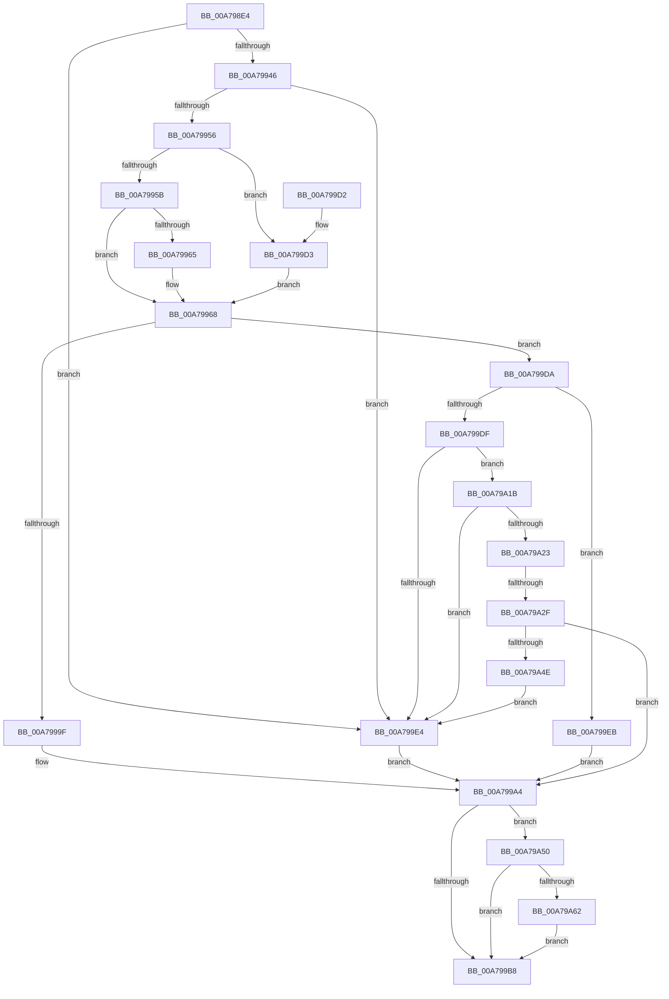

# PpmIdleGetConcurrencyStats

- RVA: `0x00A798E4`–`0x00A79A76` (길이 `402` bytes)
- VA: `0x0000000140A798E4`
- 실행 섹션: `PAGE`
- PDB 이름 있음: `예`; PDB Function 태그: `예`
- unwind 정보 RVA: `0x000B6290`
- 디코드: `110`개 명령, `402/402` bytes 표시
- 미해석 바이트: `0` (있으면 어셈블리에 `.byte`로 보존)

> 이 문서는 커널 이미지의 기계어와 PDB 기호를 분석해 생성했습니다. 4번과 5번은 함수 원형과 자료형을 바이너리 사용 방식에서 추정한 C 해석이며 원본 소스 복구 결과는 아닙니다.

## 1. Dependencies

- 직접 호출 지점: **6**; 고유 호출 대상: **6**
- 직접 호출자로 확인된 함수: **1**
- RIP 상대 이미지 참조: **1**

### Outgoing calls
- `0x00A7992B` → [PpmAcquireLock](../../text/2D/PpmAcquireLock_function_002D9AA4.md) (function, `0x002D9AA4`)
- `0x00A79935` → [PpmParkGetParkNode](../../text/4A/PpmParkGetParkNode_function_004A0B4C.md) (function, `0x004A0B4C`)
- `0x00A7998E` → [ExAllocatePool2](../../poolcode/B8/ExAllocatePool2_function_00B820F0.md) (function, `0x00B820F0`)
- `0x00A799AB` → [PpmReleaseLock](../../text/2D/PpmReleaseLock_function_002DA428.md) (function, `0x002DA428`)
- `0x00A79A08` → [memcpy](../../text/6C/memcpy_function_006C6840.md) (function, `0x006C6840`)
- `0x00A79A67` → [ExFreePoolWithTag](../../poolcode/B8/ExFreePoolWithTag_function_00B82870.md) (function, `0x00B82870`)

### Direct callers
- [PopPowerInformationInternal](../A8/PopPowerInformationInternal_function_00A8B7C0.md) at `0x00A8CC62`

### Static image references
- `0x00A79911` → RVA `0x00F0CC00` (`.data`; read)

## 2. Other-region calls and transfers

- 다른 실행 섹션으로 향하는 call: **6**
  - `0x00A7992B` → [PpmAcquireLock](../../text/2D/PpmAcquireLock_function_002D9AA4.md) (`PAGE` → `.text`)
  - `0x00A79935` → [PpmParkGetParkNode](../../text/4A/PpmParkGetParkNode_function_004A0B4C.md) (`PAGE` → `.text`)
  - `0x00A7998E` → [ExAllocatePool2](../../poolcode/B8/ExAllocatePool2_function_00B820F0.md) (`PAGE` → `POOLCODE`)
  - `0x00A799AB` → [PpmReleaseLock](../../text/2D/PpmReleaseLock_function_002DA428.md) (`PAGE` → `.text`)
  - `0x00A79A08` → [memcpy](../../text/6C/memcpy_function_006C6840.md) (`PAGE` → `.text`)
  - `0x00A79A67` → [ExFreePoolWithTag](../../poolcode/B8/ExFreePoolWithTag_function_00B82870.md) (`PAGE` → `POOLCODE`)
- call이 아닌 외부 분기/꼬리 이동: **1**
  - `0x00A79A29` → [sub_00B41F0A](../B4/Unknown_function_00B41F0A.md) (`tail-transfer`)

## 3. Assembly (complete function range)

```asm
00A798E4  48 89 5C 24 08                  mov qword ptr [rsp + 8], rbx
00A798E9  4C 89 4C 24 20                  mov qword ptr [rsp + 0x20], r9
00A798EE  4C 89 44 24 18                  mov qword ptr [rsp + 0x18], r8
00A798F3  55                              push rbp
00A798F4  56                              push rsi
00A798F5  57                              push rdi
00A798F6  41 54                           push r12
00A798F8  41 55                           push r13
00A798FA  41 56                           push r14
00A798FC  41 57                           push r15
00A798FE  48 83 EC 40                     sub rsp, 0x40
00A79902  83 64 24 20 00                  and dword ptr [rsp + 0x20], 0
00A79907  33 C0                           xor eax, eax
00A79909  49 21 00                        and qword ptr [r8], rax
00A7990C  8B E9                           mov ebp, ecx
00A7990E  41 21 01                        and dword ptr [r9], eax
00A79911  48 8D 0D E8 32 49 00            lea rcx, [rip + 0x4932e8]
00A79918  33 FF                           xor edi, edi
00A7991A  89 44 24 24                     mov dword ptr [rsp + 0x24], eax
00A7991E  89 7C 24 28                     mov dword ptr [rsp + 0x28], edi
00A79922  4D 8B E9                        mov r13, r9
00A79925  4D 8B E0                        mov r12, r8
00A79928  0F B7 DA                        movzx ebx, dx
00A7992B  E8 74 01 86 FF                  call 0x1402d9aa4
00A79930  33 D2                           xor edx, edx
00A79932  0F B7 CB                        movzx ecx, bx
00A79935  E8 12 72 A2 FF                  call 0x1404a0b4c
00A7993A  48 8B F0                        mov rsi, rax
00A7993D  48 85 C0                        test rax, rax
00A79940  0F 84 9E 00 00 00               je 0x140a799e4
00A79946  48 8B 90 50 04 00 00            mov rdx, qword ptr [rax + 0x450]
00A7994D  48 85 D2                        test rdx, rdx
00A79950  0F 84 8E 00 00 00               je 0x140a799e4
00A79956  83 FD 4C                        cmp ebp, 0x4c
00A79959  74 78                           je 0x140a799d3
00A7995B  0F B6 40 0C                     movzx eax, byte ptr [rax + 0xc]
00A7995F  8B C8                           mov ecx, eax
00A79961  3C 02                           cmp al, 2
00A79963  77 03                           ja 0x140a79968
00A79965  8D 4F 02                        lea ecx, [rdi + 2]
00A79968  8B 42 08                        mov eax, dword ptr [rdx + 8]
00A7996B  41 B8 4D 65 6D 20               mov r8d, 0x206d654d
00A79971  03 C1                           add eax, ecx
00A79973  4C 8B FE                        mov r15, rsi
00A79976  B9 00 01 00 00                  mov ecx, 0x100
00A7997B  41 BE 0C 00 00 00               mov r14d, 0xc
00A79981  8D 04 C5 08 00 00 00            lea eax, [rax*8 + 8]
00A79988  8B D0                           mov edx, eax
00A7998A  41 89 45 00                     mov dword ptr [r13], eax
00A7998E  E8 5D 87 10 00                  call 0x140b820f0
00A79993  49 89 04 24                     mov qword ptr [r12], rax
00A79997  48 8B D8                        mov rbx, rax
00A7999A  48 85 C0                        test rax, rax
00A7999D  75 3B                           jne 0x140a799da
00A7999F  BF 9A 00 00 C0                  mov edi, 0xc000009a
00A799A4  48 8D 0D 55 32 49 00            lea rcx, [rip + 0x493255]
00A799AB  E8 78 0A 86 FF                  call 0x1402da428
00A799B0  85 FF                           test edi, edi
00A799B2  0F 88 98 00 00 00               js 0x140a79a50
00A799B8  48 8B 9C 24 80 00 00 00         mov rbx, qword ptr [rsp + 0x80]
00A799C0  8B C7                           mov eax, edi
00A799C2  48 83 C4 40                     add rsp, 0x40
00A799C6  41 5F                           pop r15
00A799C8  41 5E                           pop r14
00A799CA  41 5D                           pop r13
00A799CC  41 5C                           pop r12
00A799CE  5F                              pop rdi
00A799CF  5E                              pop rsi
00A799D0  5D                              pop rbp
00A799D1  C3                              ret
00A799D2  CC                              int3
00A799D3  B9 01 00 00 00                  mov ecx, 1
00A799D8  EB 8E                           jmp 0x140a79968
00A799DA  83 FD 4C                        cmp ebp, 0x4c
00A799DD  74 0C                           je 0x140a799eb
00A799DF  83 FD 4D                        cmp ebp, 0x4d
00A799E2  74 37                           je 0x140a79a1b
00A799E4  BF BB 00 00 C0                  mov edi, 0xc00000bb
00A799E9  EB B9                           jmp 0x140a799a4
00A799EB  48 8B 96 50 04 00 00            mov rdx, qword ptr [rsi + 0x450]
00A799F2  48 8D 48 08                     lea rcx, [rax + 8]
00A799F6  44 8B 42 08                     mov r8d, dword ptr [rdx + 8]
00A799FA  48 81 C2 48 01 00 00            add rdx, 0x148
00A79A01  41 FF C0                        inc r8d
00A79A04  49 C1 E0 03                     shl r8, 3
00A79A08  E8 33 CE C4 FF                  call 0x1406c6840
00A79A0D  48 8B 86 50 04 00 00            mov rax, qword ptr [rsi + 0x450]
00A79A14  8B 48 08                        mov ecx, dword ptr [rax + 8]
00A79A17  89 0B                           mov dword ptr [rbx], ecx
00A79A19  EB 89                           jmp 0x140a799a4
00A79A1B  33 ED                           xor ebp, ebp
00A79A1D  43 38 3C 37                     cmp byte ptr [r15 + r14], dil
00A79A21  76 C1                           jbe 0x140a799e4
00A79A23  48 8B F8                        mov rdi, rax
00A79A26  83 FD 02                        cmp ebp, 2
00A79A29  0F 82 DB 84 0C 00               jb 0x140b41f0a
00A79A2F  83 7C 24 24 00                  cmp dword ptr [rsp + 0x24], 0
00A79A34  8B 7C 24 28                     mov edi, dword ptr [rsp + 0x28]
00A79A38  4C 8B A4 24 90 00 00 00         mov r12, qword ptr [rsp + 0x90]
00A79A40  4C 8B AC 24 98 00 00 00         mov r13, qword ptr [rsp + 0x98]
00A79A48  0F 85 56 FF FF FF               jne 0x140a799a4
00A79A4E  EB 94                           jmp 0x140a799e4
00A79A50  41 83 65 00 00                  and dword ptr [r13], 0
00A79A55  49 8B 0C 24                     mov rcx, qword ptr [r12]
00A79A59  48 85 C9                        test rcx, rcx
00A79A5C  0F 84 56 FF FF FF               je 0x140a799b8
00A79A62  BA 4D 65 6D 20                  mov edx, 0x206d654d
00A79A67  E8 04 8E 10 00                  call 0x140b82870
00A79A6C  49 83 24 24 00                  and qword ptr [r12], 0
00A79A71  E9 42 FF FF FF                  jmp 0x140a799b8
```

## 4. C-style interpretation (structured pseudocode)

```c
__int64 __fastcall PpmIdleGetConcurrencyStats(int a1, int a2, __int64 a3, __int64 a4)
{
    __int64 result;
    __int64 v_rbp;
    __int64 v_rdi;
    __int64 v_rsp;
    unsigned int v_stack_m50;
    unsigned int v_stack_m54;
    unsigned int v_stack_m58;
    unsigned __int64 v_stack_p18;
    unsigned __int64 v_stack_p20;
    unsigned int v_stack_p24;
    unsigned int v_stack_p28;
    unsigned __int64 v_stack_p8;
    unsigned __int64 v_stack_p90;
    unsigned __int64 v_stack_p98;

    v_stack_p8 = v_rbx;
    v_stack_p20 = a4;
    v_stack_p18 = a3;
    v_rsp = (v_rsp) - (64);
    result = 0;
    v_rdi = 0;
    v_stack_m54 = 0;
    v_stack_m50 = 0;
    result = PpmAcquireLock(v_rip + 4797160, a2, a3, a4);
    a2 = 0;
    result = PpmParkGetParkNode((unsigned __int16)((unsigned __int16)(a2)), a2, a3, a4);
    if (result == 0) goto loc_00A799E4;
    if (*(unsigned __int64 *)(result + 1104) == 0) goto loc_00A799E4;
    if (((unsigned int)((unsigned int)(a1))) == 76) goto loc_00A799D3;
    if (((unsigned __int8)(*(unsigned __int8 *)(result + 12))) <= 2) {
        a1 = v_rdi + 2;
    }
    result = (unsigned int)(((unsigned int)(*(unsigned int *)(*(unsigned __int64 *)(result + 1104) + 8))) + (a1));
    *(unsigned int *)(a4) = (unsigned int)(result * 8 + 8);
    result = ExAllocatePool2(256, (unsigned int)((unsigned int)(result * 8 + 8)), (unsigned int)(0x206D654DULL), a4);
    *(unsigned __int64 *)(a3) = result;
    if (result != 0) goto loc_00A799DA;
loc_00A799A4:
    result = PpmReleaseLock(v_rip + 4797013, (unsigned int)((unsigned int)(result * 8 + 8)), (unsigned int)(0x206D654DULL), a4);
    if (sign_flag) goto loc_00A79A50;
loc_00A799B8:
    v_rsp = (v_rsp) + (64);
    return (unsigned int)((unsigned int)((unsigned int)(0xC000009AULL)));
loc_00A799D3:
    goto loc_00A79968;
loc_00A799DA:
    if (((unsigned int)((unsigned int)(a1))) == 76) goto loc_00A799EB;
    if (((unsigned int)((unsigned int)(a1))) == 77) goto loc_00A79A1B;
loc_00A799E4:
    goto loc_00A799A4;
loc_00A799EB:
    a2 = (*(unsigned __int64 *)(result + 1104)) + (328);
    a3 = (unsigned int)(((unsigned int)(*(unsigned int *)(*(unsigned __int64 *)(result + 1104) + 8))) + 1);
    a3 = (a3) << (3);
    result = memcpy((unsigned int)((unsigned int)((unsigned int)(0xC000009AULL))) + 8, a2, a3, a4);
    *(unsigned int *)(v_stack_p8) = (unsigned int)((unsigned int)(*(unsigned int *)(*(unsigned __int64 *)(result + 1104) + 8)));
    goto loc_00A799A4;
loc_00A79A1B:
    v_rbp = 0;
    if ((*(unsigned __int8 *)(result + 12 * 1)) <= ((unsigned __int8)((unsigned int)(0xC00000BBULL)))) goto loc_00A799E4;
    if (v_stack_p24 != 0) goto loc_00A799A4;
    goto loc_00A799E4;
loc_00A79A50:
    if (*(unsigned __int64 *)(v_stack_p90) == 0) goto loc_00A799B8;
    result = ExFreePoolWithTag(*(unsigned __int64 *)(v_stack_p90), (unsigned int)(0x206D654DULL), a3, a4);
    goto loc_00A799B8;
}
```

## 5. (Beta) C Style

```c
int64_t PpmIdleGetConcurrencyStats(int32_t Arg1, int32_t Arg2, void *Arg3, void *Arg4)
{
    uint8_t *arg3 = (uint8_t *)Arg3;
    uint8_t *arg4 = (uint8_t *)Arg4;

    int64_t result;
    int64_t local_rbp;
    int64_t local_rdi;
    int64_t local_rsp;
    uint32_t v_stack_m50;
    uint32_t v_stack_m54;
    uint32_t v_stack_m58;
    uint64_t v_stack_p18;
    uint64_t v_stack_p20;
    uint32_t v_stack_p24;
    uint32_t v_stack_p28;
    uint64_t v_stack_p8;
    uint64_t v_stack_p90;
    uint64_t v_stack_p98;

    v_stack_p8 = local_rbx;
    v_stack_p20 = Arg4;
    v_stack_p18 = Arg3;
    local_rsp = (local_rsp) - (64);
    result = 0;
    local_rdi = 0;
    v_stack_m54 = 0;
    v_stack_m50 = 0;
    result = PpmAcquireLock(v_rip + 4797160, Arg2, Arg3, Arg4);
    Arg2 = 0;
    result = PpmParkGetParkNode((uint16_t)((uint16_t)(Arg2)), Arg2, Arg3, Arg4);
    if (result == 0) goto loc_00A799E4;
    if (*(uint64_t *)(result + 0x450) == 0) goto loc_00A799E4;
    if (((uint32_t)((uint32_t)(Arg1))) == 76) goto loc_00A799D3;
    if (((uint8_t)(*(uint8_t *)(result + 0xC))) <= 2) {
        Arg1 = local_rdi + 2;
    }
    result = (uint32_t)(((uint32_t)(*(uint32_t *)(*(uint64_t *)(result + 0x450) + 0x8))) + (Arg1));
    *(uint32_t *)(arg4) = (uint32_t)(result * 8 + 8);
    result = ExAllocatePool2(256, (uint32_t)((uint32_t)(result * 8 + 8)), (uint32_t)(0x206D654DULL), Arg4);
    *(uint64_t *)(arg3) = result;
    if (result != 0) goto loc_00A799DA;
loc_00A799A4:
    result = PpmReleaseLock(v_rip + 4797013, (uint32_t)((uint32_t)(result * 8 + 8)), (uint32_t)(0x206D654DULL), Arg4);
    if (sign_flag) goto loc_00A79A50;
loc_00A799B8:
    local_rsp = (local_rsp) + (64);
    return (uint32_t)((uint32_t)((uint32_t)(0xC000009AULL)));
loc_00A799D3:
    goto loc_00A79968;
loc_00A799DA:
    if (((uint32_t)((uint32_t)(Arg1))) == 76) goto loc_00A799EB;
    if (((uint32_t)((uint32_t)(Arg1))) == 77) goto loc_00A79A1B;
loc_00A799E4:
    goto loc_00A799A4;
loc_00A799EB:
    Arg2 = (*(uint64_t *)(result + 0x450)) + (328);
    Arg3 = (uint32_t)(((uint32_t)(*(uint32_t *)(*(uint64_t *)(result + 0x450) + 0x8))) + 1);
    Arg3 = (Arg3) << (3);
    result = memcpy((uint32_t)((uint32_t)((uint32_t)(0xC000009AULL))) + 8, Arg2, Arg3, Arg4);
    *(uint32_t *)(v_stack_p8) = (uint32_t)((uint32_t)(*(uint32_t *)(*(uint64_t *)(result + 0x450) + 0x8)));
    goto loc_00A799A4;
loc_00A79A1B:
    local_rbp = 0;
    if ((*(uint8_t *)(result + 0xC * 1)) <= ((uint8_t)((uint32_t)(0xC00000BBULL)))) goto loc_00A799E4;
    if (v_stack_p24 != 0) goto loc_00A799A4;
    goto loc_00A799E4;
loc_00A79A50:
    if (*(uint64_t *)(v_stack_p90) == 0) goto loc_00A799B8;
    result = ExFreePoolWithTag(*(uint64_t *)(v_stack_p90), (uint32_t)(0x206D654DULL), Arg3, Arg4);
    goto loc_00A799B8;
}
```

### 관측된 메모리 오프셋

구조체 형식이 확인되지 않은 접근은 인자 기준의 오프셋으로만 기록했습니다.

| 기준 인자 | 오프셋 표현 | 폭 (bit) | 접근 |
|---|---:|---:|---|
| `Arg3` | `+ 0x0` | `64` | `R/W` |
| `Arg3` | `+ 0x0` | `64` | `W` |
| `Arg4` | `+ 0x0` | `32` | `R/W` |
| `Arg4` | `+ 0x0` | `32` | `W` |

## 6. Execution-region graph

[열기: 2D/3D 그래프와 함수 탐색 컨트롤 패널](../../../control-panel.html?section=page&rva=0x00A798E4&view=graph)

- 2D 그래프는 위에서 아래로 흐르고, 3D 그래프는 빈 공간을 드래그해 회전합니다. Shift+드래그는 이동, 휠은 확대·축소, 함수 노드 선택은 대상 보고서 이동입니다.

### Static fallback


