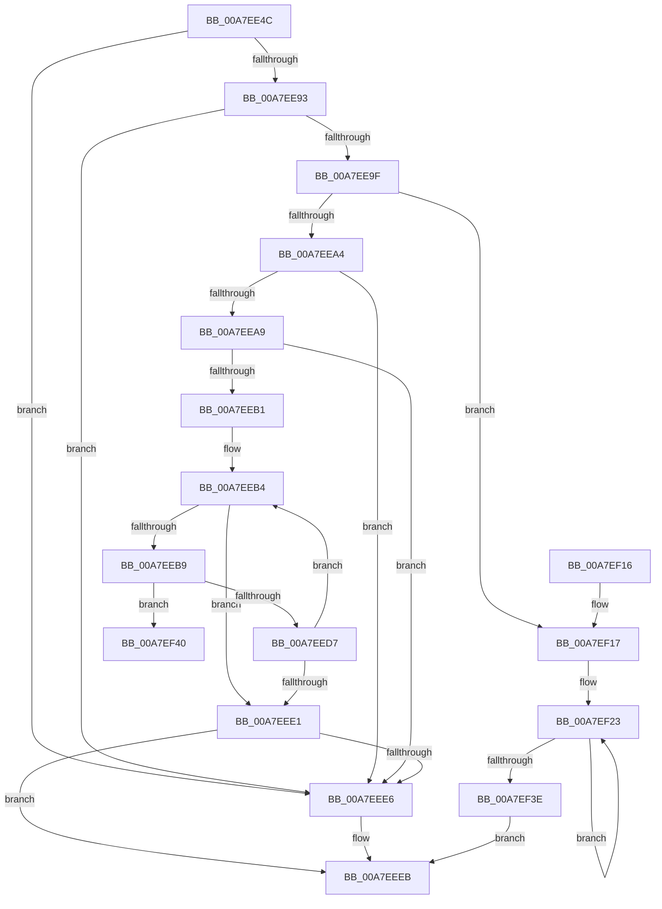

# PpmIdleGetPackageIdleIntervalStats

- RVA: `0x00A7EE4C`–`0x00A7EF5F` (길이 `275` bytes)
- VA: `0x0000000140A7EE4C`
- 실행 섹션: `PAGE`
- PDB 이름 있음: `예`; PDB Function 태그: `예`
- unwind 정보 RVA: `0x000B6D4C`
- 디코드: `81`개 명령, `275/275` bytes 표시
- 미해석 바이트: `0` (있으면 어셈블리에 `.byte`로 보존)

> 이 문서는 커널 이미지의 기계어와 PDB 기호를 분석해 생성했습니다. 4번과 5번은 함수 원형과 자료형을 바이너리 사용 방식에서 추정한 C 해석이며 원본 소스 복구 결과는 아닙니다.

## 1. Dependencies

- 직접 호출 지점: **4**; 고유 호출 대상: **4**
- 직접 호출자로 확인된 함수: **1**
- RIP 상대 이미지 참조: **1**

### Outgoing calls
- `0x00A7EE7C` → [PpmAcquireLock](../../text/2D/PpmAcquireLock_function_002D9AA4.md) (function, `0x002D9AA4`)
- `0x00A7EE86` → [PpmParkGetParkNode](../../text/4A/PpmParkGetParkNode_function_004A0B4C.md) (function, `0x004A0B4C`)
- `0x00A7EEF2` → [PpmReleaseLock](../../text/2D/PpmReleaseLock_function_002DA428.md) (function, `0x002DA428`)
- `0x00A7EF2C` → [PpmConvertTimeTo](../../text/43/PpmConvertTimeTo_function_0043B3CC.md) (function, `0x0043B3CC`)

### Direct callers
- [PopPowerInformationInternal](../A8/PopPowerInformationInternal_function_00A8B7C0.md) at `0x00A8CCDB`

### Static image references
- `0x00A7EE6C` → RVA `0x00F0CC00` (`.data`; read)

## 2. Other-region calls and transfers

- 다른 실행 섹션으로 향하는 call: **4**
  - `0x00A7EE7C` → [PpmAcquireLock](../../text/2D/PpmAcquireLock_function_002D9AA4.md) (`PAGE` → `.text`)
  - `0x00A7EE86` → [PpmParkGetParkNode](../../text/4A/PpmParkGetParkNode_function_004A0B4C.md) (`PAGE` → `.text`)
  - `0x00A7EEF2` → [PpmReleaseLock](../../text/2D/PpmReleaseLock_function_002DA428.md) (`PAGE` → `.text`)
  - `0x00A7EF2C` → [PpmConvertTimeTo](../../text/43/PpmConvertTimeTo_function_0043B3CC.md) (`PAGE` → `.text`)
- call이 아닌 외부 분기/꼬리 이동: **1**
  - `0x00A7EF5A` → [sub_00B42B88](../B4/Unknown_function_00B42B88.md) (`tail-transfer`)

## 3. Assembly (complete function range)

```asm
00A7EE4C  48 89 5C 24 08                  mov qword ptr [rsp + 8], rbx
00A7EE51  48 89 6C 24 10                  mov qword ptr [rsp + 0x10], rbp
00A7EE56  48 89 74 24 18                  mov qword ptr [rsp + 0x18], rsi
00A7EE5B  57                              push rdi
00A7EE5C  41 54                           push r12
00A7EE5E  41 55                           push r13
00A7EE60  41 56                           push r14
00A7EE62  41 57                           push r15
00A7EE64  48 83 EC 20                     sub rsp, 0x20
00A7EE68  8B E9                           mov ebp, ecx
00A7EE6A  33 FF                           xor edi, edi
00A7EE6C  48 8D 0D 8D DD 48 00            lea rcx, [rip + 0x48dd8d]
00A7EE73  44 8B E7                        mov r12d, edi
00A7EE76  4D 8B F0                        mov r14, r8
00A7EE79  0F B7 DA                        movzx ebx, dx
00A7EE7C  E8 23 AC 85 FF                  call 0x1402d9aa4
00A7EE81  33 D2                           xor edx, edx
00A7EE83  0F B7 CB                        movzx ecx, bx
00A7EE86  E8 C1 1C A2 FF                  call 0x1404a0b4c
00A7EE8B  48 8B F0                        mov rsi, rax
00A7EE8E  48 85 C0                        test rax, rax
00A7EE91  74 53                           je 0x140a7eee6
00A7EE93  48 8B 98 50 04 00 00            mov rbx, qword ptr [rax + 0x450]
00A7EE9A  48 85 DB                        test rbx, rbx
00A7EE9D  74 47                           je 0x140a7eee6
00A7EE9F  83 FD 4A                        cmp ebp, 0x4a
00A7EEA2  74 73                           je 0x140a7ef17
00A7EEA4  83 FD 4B                        cmp ebp, 0x4b
00A7EEA7  75 3D                           jne 0x140a7eee6
00A7EEA9  8B DF                           mov ebx, edi
00A7EEAB  40 38 78 0C                     cmp byte ptr [rax + 0xc], dil
00A7EEAF  76 35                           jbe 0x140a7eee6
00A7EEB1  8D 6F 25                        lea ebp, [rdi + 0x25]
00A7EEB4  83 FB 02                        cmp ebx, 2
00A7EEB7  73 28                           jae 0x140a7eee1
00A7EEB9  48 8B 86 08 05 00 00            mov rax, qword ptr [rsi + 0x508]
00A7EEC0  8B D3                           mov edx, ebx
00A7EEC2  48 8D 0C 92                     lea rcx, [rdx + rdx*4]
00A7EEC6  48 C1 E1 07                     shl rcx, 7
00A7EECA  4C 8B 84 01 38 02 00 00         mov r8, qword ptr [rcx + rax + 0x238]
00A7EED2  4D 85 C0                        test r8, r8
00A7EED5  75 69                           jne 0x140a7ef40
00A7EED7  0F B6 46 0C                     movzx eax, byte ptr [rsi + 0xc]
00A7EEDB  FF C3                           inc ebx
00A7EEDD  3B D8                           cmp ebx, eax
00A7EEDF  72 D3                           jb 0x140a7eeb4
00A7EEE1  45 85 E4                        test r12d, r12d
00A7EEE4  75 05                           jne 0x140a7eeeb
00A7EEE6  BF BB 00 00 C0                  mov edi, 0xc00000bb
00A7EEEB  48 8D 0D 0E DD 48 00            lea rcx, [rip + 0x48dd0e]
00A7EEF2  E8 31 B5 85 FF                  call 0x1402da428
00A7EEF7  48 8B 5C 24 50                  mov rbx, qword ptr [rsp + 0x50]
00A7EEFC  8B C7                           mov eax, edi
00A7EEFE  48 8B 6C 24 58                  mov rbp, qword ptr [rsp + 0x58]
00A7EF03  48 8B 74 24 60                  mov rsi, qword ptr [rsp + 0x60]
00A7EF08  48 83 C4 20                     add rsp, 0x20
00A7EF0C  41 5F                           pop r15
00A7EF0E  41 5E                           pop r14
00A7EF10  41 5D                           pop r13
00A7EF12  41 5C                           pop r12
00A7EF14  5F                              pop rdi
00A7EF15  C3                              ret
00A7EF16  CC                              int3
00A7EF17  48 83 C3 20                     add rbx, 0x20
00A7EF1B  BD 25 00 00 00                  mov ebp, 0x25
00A7EF20  49 2B DE                        sub rbx, r14
00A7EF23  4A 8B 0C 33                     mov rcx, qword ptr [rbx + r14]
00A7EF27  BA 80 96 98 00                  mov edx, 0x989680
00A7EF2C  E8 9B C4 9B FF                  call 0x14043b3cc
00A7EF31  49 89 06                        mov qword ptr [r14], rax
00A7EF34  4D 8D 76 08                     lea r14, [r14 + 8]
00A7EF38  48 83 ED 01                     sub rbp, 1
00A7EF3C  75 E5                           jne 0x140a7ef23
00A7EF3E  EB AB                           jmp 0x140a7eeeb
00A7EF40  4C 69 FA 28 01 00 00            imul r15, rdx, 0x128
00A7EF47  4D 8D 68 20                     lea r13, [r8 + 0x20]
00A7EF4B  41 BC 01 00 00 00               mov r12d, 1
00A7EF51  4D 03 FE                        add r15, r14
00A7EF54  48 8B FD                        mov rdi, rbp
00A7EF57  4D 2B EF                        sub r13, r15
00A7EF5A  E9 29 3C 0C 00                  jmp 0x140b42b88
```

## 4. C-style interpretation (structured pseudocode)

```c
__int64 __fastcall PpmIdleGetPackageIdleIntervalStats(int a1, int a2, __int64 a3)
{
    __int64 result;
    __int64 v_r13;
    __int64 v_r15;
    __int64 v_rbp;
    __int64 v_rbx;
    __int64 v_rdi;
    __int64 v_rsp;
    unsigned __int64 v_stack_p10;
    unsigned __int64 v_stack_p18;
    unsigned __int64 v_stack_p8;

    v_stack_p8 = v_rbx;
    v_stack_p10 = v_rbp;
    v_stack_p18 = v_rsi;
    v_rsp = (v_rsp) - (32);
    v_rdi = 0;
    result = PpmAcquireLock(v_rip + 4775309, a2, a3, a4);
    a2 = 0;
    result = PpmParkGetParkNode((unsigned __int16)((unsigned __int16)(a2)), a2, a3, a4);
    if (result == 0) goto loc_00A7EEE6;
    if (*(unsigned __int64 *)(result + 1104) == 0) goto loc_00A7EEE6;
    if (((unsigned int)((unsigned int)(a1))) == 74) goto loc_00A7EF17;
    if (((unsigned int)((unsigned int)(a1))) != 75) goto loc_00A7EEE6;
    if ((*(unsigned __int8 *)(result + 12)) <= 0) goto loc_00A7EEE6;
loc_00A7EEB4:
    if (0 >= 2) goto loc_00A7EEE1;
    a1 = (0 + 0 * 4) << (7);
    if (*(unsigned __int64 *)(a1 + *(unsigned __int64 *)(result + 1288) * 1 + 568) != 0) goto loc_00A7EF40;
    v_rbx = (unsigned int)((0) + 1);
    if (((unsigned int)(v_rbx)) < ((unsigned int)(*(unsigned __int8 *)(result + 12)))) goto loc_00A7EEB4;
loc_00A7EEE1:
    if (0 == 0) {
        v_rdi = 0xC00000BBULL;
    }
    result = PpmReleaseLock(v_rip + 4775182, 0, *(unsigned __int64 *)(a1 + *(unsigned __int64 *)(result + 1288) * 1 + 568), a4);
    v_rsp = (v_rsp) + (32);
    return (unsigned int)((unsigned int)(v_rdi));
loc_00A7EF17:
    v_rbx = (v_stack_p8) + (32);
    v_rbx = (v_rbx) - (a3);
loc_00A7EF23:
    result = PpmConvertTimeTo(*(unsigned __int64 *)(v_rbx + a3 * 1), (unsigned int)(0x989680ULL), *(unsigned __int64 *)(a1 + *(unsigned __int64 *)(result + 1288) * 1 + 568), a4);
    *(unsigned __int64 *)(a3) = result;
    v_rbp = (37) - (1);
    if (condition_is_not_equal) goto loc_00A7EF23;
    goto loc_00A7EEEB;
loc_00A7EF40:
    v_r15 = (v_r15) * ((unsigned int)(0x989680ULL));
    v_r15 = (v_r15) + (a3 + 8);
    v_r13 = (*(unsigned __int64 *)(a1 + *(unsigned __int64 *)(result + 1288) * 1 + 568) + 32) - (v_r15);
}
```

## 5. (Beta) C Style

```c
int64_t PpmIdleGetPackageIdleIntervalStats(int32_t Arg1, int32_t Arg2, void *Arg3)
{
    uint8_t *arg3 = (uint8_t *)Arg3;

    int64_t result;
    int64_t local_r13;
    int64_t local_r15;
    int64_t local_rbp;
    int64_t local_rbx;
    int64_t local_rdi;
    int64_t local_rsp;
    uint64_t v_stack_p10;
    uint64_t v_stack_p18;
    uint64_t v_stack_p8;

    v_stack_p8 = local_rbx;
    v_stack_p10 = local_rbp;
    v_stack_p18 = local_rsi;
    local_rsp = (local_rsp) - (32);
    local_rdi = 0;
    result = PpmAcquireLock(v_rip + 4775309, Arg2, Arg3, a4);
    Arg2 = 0;
    result = PpmParkGetParkNode((uint16_t)((uint16_t)(Arg2)), Arg2, Arg3, a4);
    if (result == 0) goto loc_00A7EEE6;
    if (*(uint64_t *)(result + 0x450) == 0) goto loc_00A7EEE6;
    if (((uint32_t)((uint32_t)(Arg1))) == 74) goto loc_00A7EF17;
    if (((uint32_t)((uint32_t)(Arg1))) != 75) goto loc_00A7EEE6;
    if ((*(uint8_t *)(result + 0xC)) <= 0) goto loc_00A7EEE6;
loc_00A7EEB4:
    if (0 >= 2) goto loc_00A7EEE1;
    Arg1 = (0 + 0 * 4) << (7);
    if (*(uint64_t *)(Arg1 + *(uint64_t *)(result + 0x508) * 1 + 0x238) != 0) goto loc_00A7EF40;
    local_rbx = (uint32_t)((0) + 1);
    if (((uint32_t)(local_rbx)) < ((uint32_t)(*(uint8_t *)(result + 0xC)))) goto loc_00A7EEB4;
loc_00A7EEE1:
    if (0 == 0) {
        local_rdi = 0xC00000BBULL;
    }
    result = PpmReleaseLock(v_rip + 4775182, 0, *(uint64_t *)(Arg1 + *(uint64_t *)(result + 0x508) * 1 + 0x238), a4);
    local_rsp = (local_rsp) + (32);
    return (uint32_t)((uint32_t)(local_rdi));
loc_00A7EF17:
    local_rbx = (v_stack_p8) + (32);
    local_rbx = (local_rbx) - (Arg3);
loc_00A7EF23:
    result = PpmConvertTimeTo(*(uint64_t *)(local_rbx + arg3 * 1), (uint32_t)(0x989680ULL), *(uint64_t *)(Arg1 + *(uint64_t *)(result + 0x508) * 1 + 0x238), a4);
    *(uint64_t *)(arg3) = result;
    local_rbp = (37) - (1);
    if (condition_is_not_equal) goto loc_00A7EF23;
    goto loc_00A7EEEB;
loc_00A7EF40:
    local_r15 = (local_r15) * ((uint32_t)(0x989680ULL));
    local_r15 = (local_r15) + (Arg3 + 8);
    local_r13 = (*(uint64_t *)(Arg1 + *(uint64_t *)(result + 0x508) * 1 + 0x238) + 32) - (local_r15);
}
```

### 관측된 메모리 오프셋

구조체 형식이 확인되지 않은 접근은 인자 기준의 오프셋으로만 기록했습니다.

| 기준 인자 | 오프셋 표현 | 폭 (bit) | 접근 |
|---|---:|---:|---|
| `Arg3` | `+ 0x0` | `64` | `W` |
| `Arg3` | `+ 0x8` | `64` | `R` |

## 6. Execution-region graph

[열기: 2D/3D 그래프와 함수 탐색 컨트롤 패널](../../../control-panel.html?section=page&rva=0x00A7EE4C&view=graph)

- 2D 그래프는 위에서 아래로 흐르고, 3D 그래프는 빈 공간을 드래그해 회전합니다. Shift+드래그는 이동, 휠은 확대·축소, 함수 노드 선택은 대상 보고서 이동입니다.

### Static fallback


