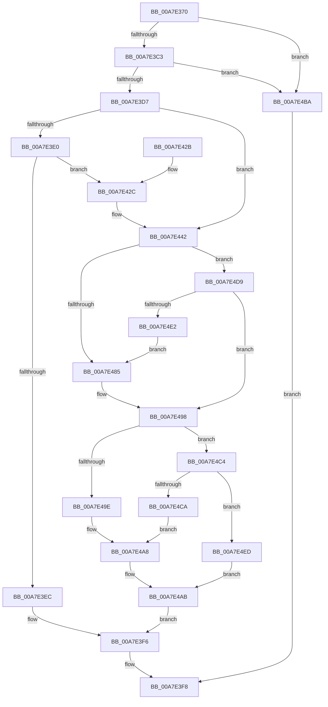

# PpmUpdateIdleStates

- RVA: `0x00A7E370`–`0x00A7E4FC` (길이 `396` bytes)
- VA: `0x0000000140A7E370`
- 실행 섹션: `PAGE`
- PDB 이름 있음: `예`; PDB Function 태그: `아니요`
- unwind 정보 RVA: `0x000B6C14`
- 디코드: `96`개 명령, `396/396` bytes 표시
- 미해석 바이트: `0` (있으면 어셈블리에 `.byte`로 보존)

> 이 문서는 커널 이미지의 기계어와 PDB 기호를 분석해 생성했습니다. 4번과 5번은 함수 원형과 자료형을 바이너리 사용 방식에서 추정한 C 해석이며 원본 소스 복구 결과는 아닙니다.

## 1. Dependencies

- 직접 호출 지점: **9**; 고유 호출 대상: **8**
- 직접 호출자로 확인된 함수: **0**
- RIP 상대 이미지 참조: **9**

### Outgoing calls
- `0x00A7E3A9` → [memset](../../text/6C/memset_function_006C6C40.md) (function, `0x006C6C40`)
- `0x00A7E3B5` → [PopAcquireRwLockExclusive](../../text/43/PopAcquireRwLockExclusive_function_00430B44.md) (function, `0x00430B44`)
- `0x00A7E3C7` → [KeGetProcessorIndexFromNumber](../../text/2D/KeGetProcessorIndexFromNumber_function_002DD2D0.md) (function, `0x002DD2D0`)
- `0x00A7E3D7` → [PpmHvUseNativeAlgorithms](../../text/4B/PpmHvUseNativeAlgorithms_function_004BDBB4.md) (function, `0x004BDBB4`)
- `0x00A7E3F1` → [PpmUpdateIdleContext](../70/PpmUpdateIdleContext_function_00701FB4.md) (function, `0x00701FB4`)
- `0x00A7E3FF` → [PopReleaseRwLock](../../text/2D/PopReleaseRwLock_function_002DFBBC.md) (function, `0x002DFBBC`)
- `0x00A7E40D` → [_security_check_cookie](../../text/6A/_security_check_cookie_function_006AC640.md) (function, `0x006AC640`)
- `0x00A7E462` → [memset](../../text/6C/memset_function_006C6C40.md) (function, `0x006C6C40`)
- `0x00A7E4B0` → [PopExecuteOnTargetProcessors](../../text/2D/PopExecuteOnTargetProcessors_function_002DD834.md) (function, `0x002DD834`)

### Direct callers
- 이 함수 시작 RVA로 연결되는 직접 call은 확인되지 않았습니다. 간접 호출은 완전히 역산할 수 없습니다.

### Static image references
- `0x00A7E38B` → RVA `0x00E0A740` (`.data`; read)
- `0x00A7E3AE` → RVA `0x00F0CA70` (`.data`; read)
- `0x00A7E3E0` → RVA `0x00FC6AB8` (`ALMOSTRO`; read)
- `0x00A7E42C` → RVA `0x005DD0E0` (`PpmIdleGuestPreExecute`; read)
- `0x00A7E437` → RVA `0x0048B720` (`PpmIdleGuestComplete`; read)
- `0x00A7E467` → RVA `0x00F231B0` (`.data`; read)
- `0x00A7E4A1` → RVA `0x004ABCC0` (`PpmUpdateIdleStatesInplace`; read)
- `0x00A7E4D0` → RVA `0x00446E80` (`PpmInstallNewIdleStates`; read)
- `0x00A7E4F0` → RVA `0x005D0730` (`PpmRemoveIdleStates`; read)

## 2. Other-region calls and transfers

- 다른 실행 섹션으로 향하는 call: **8**
  - `0x00A7E3A9` → [memset](../../text/6C/memset_function_006C6C40.md) (`PAGE` → `.text`)
  - `0x00A7E3B5` → [PopAcquireRwLockExclusive](../../text/43/PopAcquireRwLockExclusive_function_00430B44.md) (`PAGE` → `.text`)
  - `0x00A7E3C7` → [KeGetProcessorIndexFromNumber](../../text/2D/KeGetProcessorIndexFromNumber_function_002DD2D0.md) (`PAGE` → `.text`)
  - `0x00A7E3D7` → [PpmHvUseNativeAlgorithms](../../text/4B/PpmHvUseNativeAlgorithms_function_004BDBB4.md) (`PAGE` → `.text`)
  - `0x00A7E3FF` → [PopReleaseRwLock](../../text/2D/PopReleaseRwLock_function_002DFBBC.md) (`PAGE` → `.text`)
  - `0x00A7E40D` → [_security_check_cookie](../../text/6A/_security_check_cookie_function_006AC640.md) (`PAGE` → `.text`)
  - `0x00A7E462` → [memset](../../text/6C/memset_function_006C6C40.md) (`PAGE` → `.text`)
  - `0x00A7E4B0` → [PopExecuteOnTargetProcessors](../../text/2D/PopExecuteOnTargetProcessors_function_002DD834.md) (`PAGE` → `.text`)
- 별도 외부 분기/꼬리 이동을 확인하지 못했습니다.

## 3. Assembly (complete function range)

```asm
00A7E370  48 8B C4                        mov rax, rsp
00A7E373  48 89 58 10                     mov qword ptr [rax + 0x10], rbx
00A7E377  48 89 78 18                     mov qword ptr [rax + 0x18], rdi
00A7E37B  4C 89 70 20                     mov qword ptr [rax + 0x20], r14
00A7E37F  55                              push rbp
00A7E380  48 8D 68 B8                     lea rbp, [rax - 0x48]
00A7E384  48 81 EC 40 01 00 00            sub rsp, 0x140
00A7E38B  48 8B 05 AE C3 38 00            mov rax, qword ptr [rip + 0x38c3ae]
00A7E392  48 33 C4                        xor rax, rsp
00A7E395  48 89 45 30                     mov qword ptr [rbp + 0x30], rax
00A7E399  48 8B D9                        mov rbx, rcx
00A7E39C  33 D2                           xor edx, edx
00A7E39E  48 8D 4C 24 20                  lea rcx, [rsp + 0x20]
00A7E3A3  41 B8 08 01 00 00               mov r8d, 0x108
00A7E3A9  E8 92 88 C4 FF                  call 0x1406c6c40
00A7E3AE  48 8D 0D BB E6 48 00            lea rcx, [rip + 0x48e6bb]
00A7E3B5  E8 8A 27 9B FF                  call 0x140430b44
00A7E3BA  48 85 DB                        test rbx, rbx
00A7E3BD  0F 84 F7 00 00 00               je 0x140a7e4ba
00A7E3C3  48 8D 4B 04                     lea rcx, [rbx + 4]
00A7E3C7  E8 04 EF 85 FF                  call 0x1402dd2d0
00A7E3CC  8B F8                           mov edi, eax
00A7E3CE  83 F8 FF                        cmp eax, -1
00A7E3D1  0F 84 E3 00 00 00               je 0x140a7e4ba
00A7E3D7  E8 D8 F7 A3 FF                  call 0x1404bdbb4
00A7E3DC  84 C0                           test al, al
00A7E3DE  75 62                           jne 0x140a7e442
00A7E3E0  F7 05 CE 86 54 00 00 00 00 10   test dword ptr [rip + 0x5486ce], 0x10000000
00A7E3EA  75 40                           jne 0x140a7e42c
00A7E3EC  48 8B D3                        mov rdx, rbx
00A7E3EF  8B CF                           mov ecx, edi
00A7E3F1  E8 BE 3B C8 FF                  call 0x140701fb4
00A7E3F6  8B D8                           mov ebx, eax
00A7E3F8  48 8D 0D 71 E6 48 00            lea rcx, [rip + 0x48e671]
00A7E3FF  E8 B8 17 86 FF                  call 0x1402dfbbc
00A7E404  8B C3                           mov eax, ebx
00A7E406  48 8B 4D 30                     mov rcx, qword ptr [rbp + 0x30]
00A7E40A  48 33 CC                        xor rcx, rsp
00A7E40D  E8 2E E2 C2 FF                  call 0x1406ac640
00A7E412  4C 8D 9C 24 40 01 00 00         lea r11, [rsp + 0x140]
00A7E41A  49 8B 5B 18                     mov rbx, qword ptr [r11 + 0x18]
00A7E41E  49 8B 7B 20                     mov rdi, qword ptr [r11 + 0x20]
00A7E422  4D 8B 73 28                     mov r14, qword ptr [r11 + 0x28]
00A7E426  49 8B E3                        mov rsp, r11
00A7E429  5D                              pop rbp
00A7E42A  C3                              ret
00A7E42B  CC                              int3
00A7E42C  48 8D 05 AD EC B5 FF            lea rax, [rip - 0x4a1353]
00A7E433  48 89 43 30                     mov qword ptr [rbx + 0x30], rax
00A7E437  48 8D 05 E2 D2 A0 FF            lea rax, [rip - 0x5f2d1e]
00A7E43E  48 89 43 48                     mov qword ptr [rbx + 0x48], rax
00A7E442  83 64 24 24 00                  and dword ptr [rsp + 0x24], 0
00A7E447  48 8D 4C 24 28                  lea rcx, [rsp + 0x28]
00A7E44C  33 D2                           xor edx, edx
00A7E44E  C7 44 24 20 01 00 20 00         mov dword ptr [rsp + 0x20], 0x200001
00A7E456  41 B8 00 01 00 00               mov r8d, 0x100
00A7E45C  41 BE 01 00 00 00               mov r14d, 1
00A7E462  E8 D9 87 C4 FF                  call 0x1406c6c40
00A7E467  48 8B 05 42 4D 4A 00            mov rax, qword ptr [rip + 0x4a4d42]
00A7E46E  44 8B 04 B8                     mov r8d, dword ptr [rax + rdi*4]
00A7E472  41 8B C8                        mov ecx, r8d
00A7E475  0F B7 44 24 20                  movzx eax, word ptr [rsp + 0x20]
00A7E47A  41 83 E0 3F                     and r8d, 0x3f
00A7E47E  C1 E9 06                        shr ecx, 6
00A7E481  3B C1                           cmp eax, ecx
00A7E483  76 54                           jbe 0x140a7e4d9
00A7E485  8B D1                           mov edx, ecx
00A7E487  48 8B 4C CC 28                  mov rcx, qword ptr [rsp + rcx*8 + 0x28]
00A7E48C  41 8B C0                        mov eax, r8d
00A7E48F  48 0F AB C1                     bts rcx, rax
00A7E493  48 89 4C D4 28                  mov qword ptr [rsp + rdx*8 + 0x28], rcx
00A7E498  80 7B 11 00                     cmp byte ptr [rbx + 0x11], 0
00A7E49C  74 26                           je 0x140a7e4c4
00A7E49E  45 33 C9                        xor r9d, r9d
00A7E4A1  48 8D 15 18 D8 A2 FF            lea rdx, [rip - 0x5d27e8]
00A7E4A8  4C 8B C3                        mov r8, rbx
00A7E4AB  48 8D 4C 24 20                  lea rcx, [rsp + 0x20]
00A7E4B0  E8 7F F3 85 FF                  call 0x1402dd834
00A7E4B5  E9 3C FF FF FF                  jmp 0x140a7e3f6
00A7E4BA  BB 0D 00 00 C0                  mov ebx, 0xc000000d
00A7E4BF  E9 34 FF FF FF                  jmp 0x140a7e3f8
00A7E4C4  83 7B 60 00                     cmp dword ptr [rbx + 0x60], 0
00A7E4C8  74 23                           je 0x140a7e4ed
00A7E4CA  41 B9 03 00 00 00               mov r9d, 3
00A7E4D0  48 8D 15 A9 89 9C FF            lea rdx, [rip - 0x637657]
00A7E4D7  EB CF                           jmp 0x140a7e4a8
00A7E4D9  0F B7 44 24 22                  movzx eax, word ptr [rsp + 0x22]
00A7E4DE  3B C1                           cmp eax, ecx
00A7E4E0  76 B6                           jbe 0x140a7e498
00A7E4E2  41 8D 04 0E                     lea eax, [r14 + rcx]
00A7E4E6  66 89 44 24 20                  mov word ptr [rsp + 0x20], ax
00A7E4EB  EB 98                           jmp 0x140a7e485
00A7E4ED  45 33 C9                        xor r9d, r9d
00A7E4F0  48 8D 15 39 22 B5 FF            lea rdx, [rip - 0x4addc7]
00A7E4F7  45 33 C0                        xor r8d, r8d
00A7E4FA  EB AF                           jmp 0x140a7e4ab
```

## 4. C-style interpretation (structured pseudocode)

```c
__int64 __fastcall PpmUpdateIdleStates(__int64 a1, int a2, __int64 a3, int a4)
{
    __int64 result;
    __int64 v_rsp;
    unsigned __int64 v_stack_m118;
    unsigned int v_stack_m11C;
    unsigned __int16 v_stack_m11E;
    unsigned int v_stack_m120;
    unsigned __int64 v_stack_m128;
    unsigned __int64 v_stack_m8;

    *(unsigned __int64 *)(v_rsp + 16) = v_rbx;
    *(unsigned __int64 *)(v_rsp + 24) = v_rdi;
    *(unsigned __int64 *)(v_rsp + 32) = v_r14;
    v_rsp = (v_rsp) - (320);
    result = (*(unsigned __int64 *)(v_rip + 3720110)) ^ (v_rsp);
    *(unsigned __int64 *)(v_rsp - 72 + 48) = result;
    a2 = 0;
    result = memset(v_stack_m128, a2, 264, a4);
    result = PopAcquireRwLockExclusive(v_rip + 4777659, a2, 264, a4);
    if (a1 == 0) goto loc_00A7E4BA;
    result = KeGetProcessorIndexFromNumber(a1 + 4, a2, 264, a4);
    if (((unsigned int)(result)) == -1) goto loc_00A7E4BA;
    result = PpmHvUseNativeAlgorithms(a1 + 4, a2, 264, a4);
    if ((unsigned __int8)(result) != 0) goto loc_00A7E442;
    if (((*(unsigned int *)(v_rip + 5539534)) & (0x10000000ULL)) != 0) goto loc_00A7E42C;
    result = PpmUpdateIdleContext((unsigned int)((unsigned int)((unsigned int)((unsigned int)(result)))), a1, 264, a4);
loc_00A7E3F6:
loc_00A7E3F8:
    result = PopReleaseRwLock(v_rip + 4777585, a1, 264, a4);
    a1 = (*(unsigned __int64 *)(v_rsp - 72 + 48)) ^ (v_rsp);
    result = _security_check_cookie(a1, a1, 264, a4);
    return result;
loc_00A7E42C:
    *(unsigned __int64 *)(*(unsigned __int64 *)(v_stack_m8 + 24) + 48) = v_rip - 4854611;
    *(unsigned __int64 *)(*(unsigned __int64 *)(v_stack_m8 + 24) + 72) = v_rip - 6237470;
loc_00A7E442:
    a2 = 0;
    v_stack_m120 = 0x200001ULL;
    result = memset(v_stack_m118, a2, 256, a4);
    a3 = (unsigned int)(((unsigned int)(*(unsigned int *)(*(unsigned __int64 *)(v_rip + 4869442) + *(unsigned __int64 *)(v_stack_m8 + 32) * 4))) & (63));
    a1 = (unsigned int)(((unsigned int)((unsigned int)((unsigned int)(*(unsigned int *)(*(unsigned __int64 *)(v_rip + 4869442) + *(unsigned __int64 *)(v_stack_m8 + 32) * 4))))) >> (6));
    if (((unsigned int)(v_stack_m120)) <= ((unsigned int)(a1))) goto loc_00A7E4D9;
loc_00A7E485:
    *(unsigned __int64 *)(v_stack_m8 + (unsigned int)((unsigned int)(a1)) * 8 + 40) = *(unsigned __int64 *)(v_stack_m8 + a1 * 8 + 40);
loc_00A7E498:
    if ((*(unsigned __int8 *)(*(unsigned __int64 *)(v_stack_m8 + 24) + 17)) == 0) goto loc_00A7E4C4;
    a4 = 0;
loc_00A7E4A8:
loc_00A7E4AB:
    result = PopExecuteOnTargetProcessors(v_stack_m120, v_rip - 6105064, *(unsigned __int64 *)(v_stack_m8 + 24), a4);
    goto loc_00A7E3F6;
loc_00A7E4BA:
    goto loc_00A7E3F8;
loc_00A7E4C4:
    if ((*(unsigned int *)((unsigned int)(0xC000000DULL) + 96)) == 0) goto loc_00A7E4ED;
    goto loc_00A7E4A8;
loc_00A7E4D9:
    if (((unsigned int)(v_stack_m11E)) <= ((unsigned int)(v_stack_m120))) goto loc_00A7E498;
    v_stack_m120 = (unsigned __int16)(1 + v_stack_m120 * 1);
    goto loc_00A7E485;
loc_00A7E4ED:
    a4 = 0;
    a3 = 0;
    goto loc_00A7E4AB;
}
```

## 5. (Beta) C Style

```c
int64_t PpmUpdateIdleStates(int64_t Arg1, int32_t Arg2, int64_t Arg3, int32_t Arg4)
{
    int64_t result;
    int64_t local_rsp;
    uint64_t v_stack_m118;
    uint32_t v_stack_m11C;
    uint16_t v_stack_m11E;
    uint32_t v_stack_m120;
    uint64_t v_stack_m128;
    uint64_t v_stack_m8;

    *(uint64_t *)(local_rsp + 0x10) = local_rbx;
    *(uint64_t *)(local_rsp + 0x18) = local_rdi;
    *(uint64_t *)(local_rsp + 0x20) = local_r14;
    local_rsp = (local_rsp) - (320);
    result = (*(uint64_t *)(v_rip + 0x38C3AE)) ^ (local_rsp);
    *(uint64_t *)(local_rsp - 0x48 + 0x30) = result;
    Arg2 = 0;
    result = memset(v_stack_m128, Arg2, 264, Arg4);
    result = PopAcquireRwLockExclusive(v_rip + 4777659, Arg2, 264, Arg4);
    if (Arg1 == 0) goto loc_00A7E4BA;
    result = KeGetProcessorIndexFromNumber(Arg1 + 4, Arg2, 264, Arg4);
    if (((uint32_t)(result)) == -1) goto loc_00A7E4BA;
    result = PpmHvUseNativeAlgorithms(Arg1 + 4, Arg2, 264, Arg4);
    if ((uint8_t)(result) != 0) goto loc_00A7E442;
    if (((*(uint32_t *)(v_rip + 0x5486CE)) & (0x10000000ULL)) != 0) goto loc_00A7E42C;
    result = PpmUpdateIdleContext((uint32_t)((uint32_t)((uint32_t)((uint32_t)(result)))), Arg1, 264, Arg4);
loc_00A7E3F6:
loc_00A7E3F8:
    result = PopReleaseRwLock(v_rip + 4777585, Arg1, 264, Arg4);
    Arg1 = (*(uint64_t *)(local_rsp - 0x48 + 0x30)) ^ (local_rsp);
    result = _security_check_cookie(Arg1, Arg1, 264, Arg4);
    return result;
loc_00A7E42C:
    *(uint64_t *)(*(uint64_t *)(v_stack_m8 + 0x18) + 0x30) = v_rip - 4854611;
    *(uint64_t *)(*(uint64_t *)(v_stack_m8 + 0x18) + 0x48) = v_rip - 6237470;
loc_00A7E442:
    Arg2 = 0;
    v_stack_m120 = 0x200001ULL;
    result = memset(v_stack_m118, Arg2, 256, Arg4);
    Arg3 = (uint32_t)(((uint32_t)(*(uint32_t *)(*(uint64_t *)(v_rip + 0x4A4D42) + *(uint64_t *)(v_stack_m8 + 0x20) * 4))) & (63));
    Arg1 = (uint32_t)(((uint32_t)((uint32_t)((uint32_t)(*(uint32_t *)(*(uint64_t *)(v_rip + 0x4A4D42) + *(uint64_t *)(v_stack_m8 + 0x20) * 4))))) >> (6));
    if (((uint32_t)(v_stack_m120)) <= ((uint32_t)(Arg1))) goto loc_00A7E4D9;
loc_00A7E485:
    *(uint64_t *)(v_stack_m8 + (uint32_t)((uint32_t)(Arg1)) * 8 + 0x28) = *(uint64_t *)(v_stack_m8 + Arg1 * 8 + 0x28);
loc_00A7E498:
    if ((*(uint8_t *)(*(uint64_t *)(v_stack_m8 + 0x18) + 0x11)) == 0) goto loc_00A7E4C4;
    Arg4 = 0;
loc_00A7E4A8:
loc_00A7E4AB:
    result = PopExecuteOnTargetProcessors(v_stack_m120, v_rip - 6105064, *(uint64_t *)(v_stack_m8 + 0x18), Arg4);
    goto loc_00A7E3F6;
loc_00A7E4BA:
    goto loc_00A7E3F8;
loc_00A7E4C4:
    if ((*(uint32_t *)((uint32_t)(0xC000000DULL) + 0x60)) == 0) goto loc_00A7E4ED;
    goto loc_00A7E4A8;
loc_00A7E4D9:
    if (((uint32_t)(v_stack_m11E)) <= ((uint32_t)(v_stack_m120))) goto loc_00A7E498;
    v_stack_m120 = (uint16_t)(1 + v_stack_m120 * 1);
    goto loc_00A7E485;
loc_00A7E4ED:
    Arg4 = 0;
    Arg3 = 0;
    goto loc_00A7E4AB;
}
```

## 6. Execution-region graph

[열기: 2D/3D 그래프와 함수 탐색 컨트롤 패널](../../../control-panel.html?section=page&rva=0x00A7E370&view=graph)

- 2D 그래프는 위에서 아래로 흐르고, 3D 그래프는 빈 공간을 드래그해 회전합니다. Shift+드래그는 이동, 휠은 확대·축소, 함수 노드 선택은 대상 보고서 이동입니다.

### Static fallback


