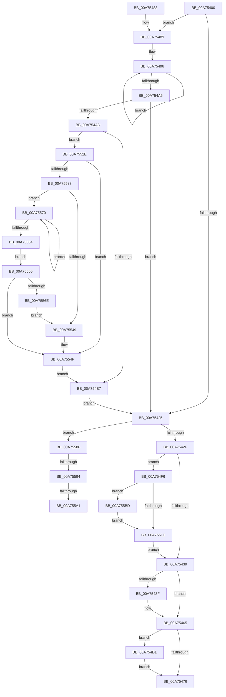

# PsSetProcessFaultInformation

- RVA: `0x00A75400`–`0x00A755D1` (길이 `465` bytes)
- VA: `0x0000000140A75400`
- 실행 섹션: `PAGE`
- PDB 이름 있음: `예`; PDB Function 태그: `예`
- unwind 정보 RVA: `0x000B598C`
- 디코드: `116`개 명령, `465/465` bytes 표시
- 미해석 바이트: `0` (있으면 어셈블리에 `.byte`로 보존)

> 이 문서는 커널 이미지의 기계어와 PDB 기호를 분석해 생성했습니다. 4번과 5번은 함수 원형과 자료형을 바이너리 사용 방식에서 추정한 C 해석이며 원본 소스 복구 결과는 아닙니다.

## 1. Dependencies

- 직접 호출 지점: **11**; 고유 호출 대상: **9**
- 직접 호출자로 확인된 함수: **1**
- RIP 상대 이미지 참조: **9**

### Outgoing calls
- `0x00A7544E` → [PspLockProcessExclusive](../../text/46/PspLockProcessExclusive_function_00460164.md) (function, `0x00460164`)
- `0x00A75460` → [PspUnlockProcessExclusive](../../text/46/PspUnlockProcessExclusive_function_004601C0.md) (function, `0x004601C0`)
- `0x00A7546C` → [ExGetExtensionTable](../../text/42/ExGetExtensionTable_function_00428814.md) (function, `0x00428814`)
- `0x00A754BA` → [PspRecordCrashedProcessIntoBlackbox](../8A/PspRecordCrashedProcessIntoBlackbox_function_008A3514.md) (function, `0x008A3514`)
- `0x00A754C7` → [PsSetProcessTelemetryAppState](../8A/PsSetProcessTelemetryAppState_function_008A35F0.md) (function, `0x008A35F0`)
- `0x00A754E3` → [guard_dispatch_icall](../../text/6B/guard_dispatch_icall_function_006BAAD0.md) (function, `0x006BAAD0`)
- `0x00A754EF` → [ExReleaseExtensionTable](../../text/45/ExReleaseExtensionTable_function_00456DC0.md) (function, `0x00456DC0`)
- `0x00A75505` → [PspLockProcessExclusive](../../text/46/PspLockProcessExclusive_function_00460164.md) (function, `0x00460164`)
- `0x00A75524` → [PspUnlockProcessExclusive](../../text/46/PspUnlockProcessExclusive_function_004601C0.md) (function, `0x004601C0`)
- `0x00A75556` → [EtwTelemetryCoverageReport](../../text/46/EtwTelemetryCoverageReport_function_00460430.md) (function, `0x00460430`)
- `0x00A755AD` → [TelemetryCoverageStringHashInternal](../../text/4D/TelemetryCoverageStringHashInternal_function_004D51A0.md) (function, `0x004D51A0`)

### Direct callers
- [NtSetInformationProcess](../AE/NtSetInformationProcess_function_00AE5370.md) at `0x00AE8DBD`

### Static image references
- `0x00A75465` → RVA `0x00FC7040` (`ALMOSTRO`; read)
- `0x00A754AF` → RVA `0x00E08684` (`.data`; read)
- `0x00A7552E` → RVA `0x00E08680` (`.data`; read)
- `0x00A75537` → RVA `0x00E08678` (`.data`; read)
- `0x00A75549` → RVA `0x00E08680` (`.data`; write)
- `0x00A75588` → RVA `0x00E0869C` (`.data`; read)
- `0x00A75594` → RVA `0x00E08698` (`.data`; read)
- `0x00A755A1` → RVA `0x00E08690` (`.data`; read)
- `0x00A755B2` → RVA `0x00E08698` (`.data`; write)

## 2. Other-region calls and transfers

- 다른 실행 섹션으로 향하는 call: **9**
  - `0x00A7544E` → [PspLockProcessExclusive](../../text/46/PspLockProcessExclusive_function_00460164.md) (`PAGE` → `.text`)
  - `0x00A75460` → [PspUnlockProcessExclusive](../../text/46/PspUnlockProcessExclusive_function_004601C0.md) (`PAGE` → `.text`)
  - `0x00A7546C` → [ExGetExtensionTable](../../text/42/ExGetExtensionTable_function_00428814.md) (`PAGE` → `.text`)
  - `0x00A754E3` → [guard_dispatch_icall](../../text/6B/guard_dispatch_icall_function_006BAAD0.md) (`PAGE` → `.text`)
  - `0x00A754EF` → [ExReleaseExtensionTable](../../text/45/ExReleaseExtensionTable_function_00456DC0.md) (`PAGE` → `.text`)
  - `0x00A75505` → [PspLockProcessExclusive](../../text/46/PspLockProcessExclusive_function_00460164.md) (`PAGE` → `.text`)
  - `0x00A75524` → [PspUnlockProcessExclusive](../../text/46/PspUnlockProcessExclusive_function_004601C0.md) (`PAGE` → `.text`)
  - `0x00A75556` → [EtwTelemetryCoverageReport](../../text/46/EtwTelemetryCoverageReport_function_00460430.md) (`PAGE` → `.text`)
  - `0x00A755AD` → [TelemetryCoverageStringHashInternal](../../text/4D/TelemetryCoverageStringHashInternal_function_004D51A0.md) (`PAGE` → `.text`)
- call이 아닌 외부 분기/꼬리 이동: **3**
  - `0x00A7558E` → [sub_00B4102A + 0xC](../B4/Unknown_function_00B4102A.md) (`tail-transfer`)
  - `0x00A7559B` → [sub_00B4102A](../B4/Unknown_function_00B4102A.md) (`tail-transfer`)
  - `0x00A755B8` → [sub_00B4102A](../B4/Unknown_function_00B4102A.md) (`tail-transfer`)

## 3. Assembly (complete function range)

```asm
00A75400  48 89 5C 24 08                  mov qword ptr [rsp + 8], rbx
00A75405  48 89 74 24 18                  mov qword ptr [rsp + 0x18], rsi
00A7540A  57                              push rdi
00A7540B  48 83 EC 20                     sub rsp, 0x20
00A7540F  8B 02                           mov eax, dword ptr [rdx]
00A75411  48 8B F2                        mov rsi, rdx
00A75414  48 8B F9                        mov rdi, rcx
00A75417  48 BB 7C 03 00 00 80 F7 FF FF   movabs rbx, 0xfffff7800000037c
00A75421  A8 01                           test al, 1
00A75423  75 64                           jne 0x140a75489
00A75425  8B 06                           mov eax, dword ptr [rsi]
00A75427  A8 02                           test al, 2
00A75429  0F 85 57 01 00 00               jne 0x140a75586
00A7542F  8B 06                           mov eax, dword ptr [rsi]
00A75431  A8 04                           test al, 4
00A75433  0F 85 BD 00 00 00               jne 0x140a754f6
00A75439  8B 06                           mov eax, dword ptr [rsi]
00A7543B  A8 08                           test al, 8
00A7543D  74 26                           je 0x140a75465
00A7543F  65 48 8B 1C 25 88 01 00 00      mov rbx, qword ptr gs:[0x188]
00A75448  48 8B CF                        mov rcx, rdi
00A7544B  48 8B D3                        mov rdx, rbx
00A7544E  E8 11 AD 9E FF                  call 0x140460164
00A75453  80 8F FB 05 00 00 40            or byte ptr [rdi + 0x5fb], 0x40
00A7545A  48 8B D3                        mov rdx, rbx
00A7545D  48 8B CF                        mov rcx, rdi
00A75460  E8 5B AD 9E FF                  call 0x1404601c0
00A75465  48 8B 0D D4 1B 55 00            mov rcx, qword ptr [rip + 0x551bd4]
00A7546C  E8 A3 33 9B FF                  call 0x140428814
00A75471  48 85 C0                        test rax, rax
00A75474  75 5B                           jne 0x140a754d1
00A75476  48 8B 5C 24 30                  mov rbx, qword ptr [rsp + 0x30]
00A7547B  33 C0                           xor eax, eax
00A7547D  48 8B 74 24 40                  mov rsi, qword ptr [rsp + 0x40]
00A75482  48 83 C4 20                     add rsp, 0x20
00A75486  5F                              pop rdi
00A75487  C3                              ret
00A75488  CC                              int3
00A75489  0F 0D 89 FC 05 00 00            prefetchw byte ptr [rcx + 0x5fc]
00A75490  8B 81 FC 05 00 00               mov eax, dword ptr [rcx + 0x5fc]
00A75496  8B C8                           mov ecx, eax
00A75498  83 C9 04                        or ecx, 4
00A7549B  F0 0F B1 8F FC 05 00 00         lock cmpxchg dword ptr [rdi + 0x5fc], ecx
00A754A3  75 F1                           jne 0x140a75496
00A754A5  A8 04                           test al, 4
00A754A7  0F 85 78 FF FF FF               jne 0x140a75425
00A754AD  8B 03                           mov eax, dword ptr [rbx]
00A754AF  39 05 CF 31 39 00               cmp dword ptr [rip + 0x3931cf], eax
00A754B5  72 77                           jb 0x140a7552e
00A754B7  48 8B CF                        mov rcx, rdi
00A754BA  E8 55 E0 E2 FF                  call 0x1408a3514
00A754BF  BA 04 00 00 00                  mov edx, 4
00A754C4  48 8B CF                        mov rcx, rdi
00A754C7  E8 24 E1 E2 FF                  call 0x1408a35f0
00A754CC  E9 54 FF FF FF                  jmp 0x140a75425
00A754D1  65 48 8B 14 25 88 01 00 00      mov rdx, qword ptr gs:[0x188]
00A754DA  4C 8B C6                        mov r8, rsi
00A754DD  48 8B 00                        mov rax, qword ptr [rax]
00A754E0  48 8B CF                        mov rcx, rdi
00A754E3  E8 E8 55 C4 FF                  call 0x1406baad0
00A754E8  48 8B 0D 51 1B 55 00            mov rcx, qword ptr [rip + 0x551b51]
00A754EF  E8 CC 18 9E FF                  call 0x140456dc0
00A754F4  EB 80                           jmp 0x140a75476
00A754F6  65 48 8B 1C 25 88 01 00 00      mov rbx, qword ptr gs:[0x188]
00A754FF  48 8B CF                        mov rcx, rdi
00A75502  48 8B D3                        mov rdx, rbx
00A75505  E8 5A AC 9E FF                  call 0x140460164
00A7550A  8A 8F FB 05 00 00               mov cl, byte ptr [rdi + 0x5fb]
00A75510  B2 38                           mov dl, 0x38
00A75512  8A C1                           mov al, cl
00A75514  22 C2                           and al, dl
00A75516  3A C2                           cmp al, dl
00A75518  0F 82 9F 00 00 00               jb 0x140a755bd
00A7551E  48 8B D3                        mov rdx, rbx
00A75521  48 8B CF                        mov rcx, rdi
00A75524  E8 97 AC 9E FF                  call 0x1404601c0
00A75529  E9 0B FF FF FF                  jmp 0x140a75439
00A7552E  83 3D 4B 31 39 00 00            cmp dword ptr [rip + 0x39314b], 0
00A75535  75 18                           jne 0x140a7554f
00A75537  48 8B 15 3A 31 39 00            mov rdx, qword ptr [rip + 0x39313a]
00A7553E  B9 C5 9D 1C 81                  mov ecx, 0x811c9dc5
00A75543  8A 02                           mov al, byte ptr [rdx]
00A75545  84 C0                           test al, al
00A75547  75 27                           jne 0x140a75570
00A75549  89 0D 31 31 39 00               mov dword ptr [rip + 0x393131], ecx
00A7554F  48 8D 0D 22 31 39 00            lea rcx, [rip + 0x393122]
00A75556  E8 D5 AE 9E FF                  call 0x140460430
00A7555B  E9 57 FF FF FF                  jmp 0x140a754b7
00A75560  C7 05 16 31 39 00 01 00 00 00   mov dword ptr [rip + 0x393116], 1
00A7556A  85 C9                           test ecx, ecx
00A7556C  74 E1                           je 0x140a7554f
00A7556E  EB D9                           jmp 0x140a75549
00A75570  69 C9 93 01 00 01               imul ecx, ecx, 0x1000193
00A75576  48 FF C2                        inc rdx
00A75579  0F BE C0                        movsx eax, al
00A7557C  03 C8                           add ecx, eax
00A7557E  8A 02                           mov al, byte ptr [rdx]
00A75580  84 C0                           test al, al
00A75582  75 EC                           jne 0x140a75570
00A75584  EB DA                           jmp 0x140a75560
00A75586  8B 03                           mov eax, dword ptr [rbx]
00A75588  39 05 0E 31 39 00               cmp dword ptr [rip + 0x39310e], eax
00A7558E  0F 83 A2 BA 0C 00               jae 0x140b41036
00A75594  83 3D FD 30 39 00 00            cmp dword ptr [rip + 0x3930fd], 0
00A7559B  0F 85 89 BA 0C 00               jne 0x140b4102a
00A755A1  48 8B 0D E8 30 39 00            mov rcx, qword ptr [rip + 0x3930e8]
00A755A8  48 8D 54 24 38                  lea rdx, [rsp + 0x38]
00A755AD  E8 EE FB A5 FF                  call 0x1404d51a0
00A755B2  89 05 E0 30 39 00               mov dword ptr [rip + 0x3930e0], eax
00A755B8  E9 6D BA 0C 00                  jmp 0x140b4102a
00A755BD  8D 41 08                        lea eax, [rcx + 8]
00A755C0  32 C1                           xor al, cl
00A755C2  22 C2                           and al, dl
00A755C4  32 C1                           xor al, cl
00A755C6  88 87 FB 05 00 00               mov byte ptr [rdi + 0x5fb], al
00A755CC  E9 4D FF FF FF                  jmp 0x140a7551e
```

## 4. C-style interpretation (structured pseudocode)

```c
__int64 __fastcall PsSetProcessFaultInformation(__int64 a1, __int64 a2)
{
    __int64 result;
    __int64 v_rbx;
    __int64 v_rsp;
    unsigned __int64 v_stack_p18;
    unsigned __int64 v_stack_p38;
    unsigned __int64 v_stack_p8;

    v_stack_p8 = v_rbx;
    v_stack_p18 = v_rsi;
    v_rsp = (v_rsp) - (32);
    if ((((unsigned __int8)((unsigned int)(*(unsigned int *)(a2)))) & (1)) != 0) goto loc_00A75489;
loc_00A75425:
    if ((((unsigned __int8)((unsigned int)(*(unsigned int *)(a2)))) & (2)) != 0) goto loc_00A75586;
    if ((((unsigned __int8)((unsigned int)(*(unsigned int *)(a2)))) & (4)) != 0) goto loc_00A754F6;
loc_00A75439:
    result = (unsigned int)(*(unsigned int *)(a2));
    if ((((unsigned __int8)((unsigned int)(*(unsigned int *)(a2)))) & (8)) != 0) {
        v_rbx = *(unsigned __int64 *)(gs_base + (0 + 392));
        a1 = a1;
        a2 = v_rbx;
        result = PspLockProcessExclusive(a1, a2, a3, a4);
        a2 = v_rbx;
        a1 = a1;
        result = PspUnlockProcessExclusive(a1, a2, a3, a4);
    }
    result = ExGetExtensionTable(*(unsigned __int64 *)(v_rip + 5577684), a2, a3, a4);
    if (result != 0) goto loc_00A754D1;
loc_00A75476:
    result = 0;
    v_rsp = (v_rsp) + (32);
    return result;
loc_00A75489:
loc_00A75496:
    a1 = (unsigned int)(((unsigned int)((unsigned int)((unsigned int)(*(unsigned int *)(*(unsigned __int64 *)(v_rip + 5577684) + 1532))))) | (4));
    if (condition_is_not_equal) goto loc_00A75496;
    if ((((unsigned __int8)((unsigned int)(*(unsigned int *)(*(unsigned __int64 *)(v_rip + 5577684) + 1532)))) & (4)) != 0) goto loc_00A75425;
    if ((*(unsigned int *)(v_rip + 3748303)) < ((unsigned int)((unsigned int)(*(unsigned int *)(v_stack_p8))))) goto loc_00A7552E;
loc_00A754B7:
    result = PspRecordCrashedProcessIntoBlackbox(a1, a2, a3, a4);
    result = PsSetProcessTelemetryAppState(a1, 4, a3, a4);
    goto loc_00A75425;
loc_00A754D1:
    result = guard_dispatch_icall(a1, *(unsigned __int64 *)(gs_base + (0 + 392)), v_stack_p18, a4);
    result = ExReleaseExtensionTable(*(unsigned __int64 *)(v_rip + 5577553), *(unsigned __int64 *)(gs_base + (0 + 392)), v_stack_p18, a4);
    goto loc_00A75476;
loc_00A754F6:
    result = PspLockProcessExclusive(a1, *(unsigned __int64 *)(gs_base + (0 + 392)), v_stack_p18, a4);
    result = (unsigned __int8)(((unsigned __int8)(*(unsigned __int8 *)(a1 + 1531))) & (56));
    if (((unsigned __int8)(result)) < 56) goto loc_00A755BD;
loc_00A7551E:
    result = PspUnlockProcessExclusive(a1, *(unsigned __int64 *)(gs_base + (0 + 392)), v_stack_p18, a4);
    goto loc_00A75439;
loc_00A7552E:
    if ((*(unsigned int *)(v_rip + 3748171)) != 0) goto loc_00A7554F;
    if ((unsigned __int8)(*(unsigned __int8 *)(*(unsigned __int64 *)(v_rip + 3748154))) != 0) goto loc_00A75570;
loc_00A75549:
    *(unsigned int *)(v_rip + 3748145) = (unsigned int)((unsigned int)(0x811C9DC5ULL));
loc_00A7554F:
    result = EtwTelemetryCoverageReport(v_rip + 3748130, *(unsigned __int64 *)(v_rip + 3748154), v_stack_p18, a4);
    goto loc_00A754B7;
loc_00A75560:
    *(unsigned int *)(v_rip + 3748118) = 1;
    if ((unsigned int)(v_rip + 3748130) == 0) goto loc_00A7554F;
    goto loc_00A75549;
loc_00A75570:
    a1 = (unsigned int)((v_rip + 3748130) * ((unsigned int)(v_rip + 3748130)));
    a2 = (*(unsigned __int64 *)(v_rip + 3748154)) + 1;
    a1 = (unsigned int)((a1) + ((unsigned int)((__int8)((unsigned __int8)(result)))));
    if ((unsigned __int8)(*(unsigned __int8 *)(a2)) != 0) goto loc_00A75570;
    goto loc_00A75560;
loc_00A75586:
    result = TelemetryCoverageStringHashInternal(*(unsigned __int64 *)(v_rip + 3748072), v_stack_p38, v_stack_p18, a4);
    *(unsigned int *)(v_rip + 3748064) = (unsigned int)(result);
loc_00A755BD:
    result = (unsigned __int8)((*(unsigned __int64 *)(v_rip + 3748072) + 8) ^ ((unsigned __int8)(*(unsigned __int64 *)(v_rip + 3748072))));
    result = (unsigned __int8)((result) & ((unsigned __int8)(v_stack_p38)));
    result = (unsigned __int8)((result) ^ ((unsigned __int8)(*(unsigned __int64 *)(v_rip + 3748072))));
    *(unsigned __int8 *)(a1 + 1531) = (unsigned __int8)(result);
    goto loc_00A7551E;
}
```

## 5. (Beta) C Style

```c
int64_t PsSetProcessFaultInformation(void *Arg1, void *Arg2)
{
    uint8_t *arg1 = (uint8_t *)Arg1;
    uint8_t *arg2 = (uint8_t *)Arg2;

    int64_t result;
    int64_t local_rbx;
    int64_t local_rsp;
    uint64_t v_stack_p18;
    uint64_t v_stack_p38;
    uint64_t v_stack_p8;

    v_stack_p8 = local_rbx;
    v_stack_p18 = local_rsi;
    local_rsp = (local_rsp) - (32);
    if ((((uint8_t)((uint32_t)(*(uint32_t *)(arg2)))) & (1)) != 0) goto loc_00A75489;
loc_00A75425:
    if ((((uint8_t)((uint32_t)(*(uint32_t *)(arg2)))) & (2)) != 0) goto loc_00A75586;
    if ((((uint8_t)((uint32_t)(*(uint32_t *)(arg2)))) & (4)) != 0) goto loc_00A754F6;
loc_00A75439:
    result = (uint32_t)(*(uint32_t *)(arg2));
    if ((((uint8_t)((uint32_t)(*(uint32_t *)(arg2)))) & (8)) != 0) {
        local_rbx = *(uint64_t *)(gs_base + (0 + 0x188));
        Arg1 = Arg1;
        Arg2 = local_rbx;
        result = PspLockProcessExclusive(Arg1, Arg2, a3, a4);
        Arg2 = local_rbx;
        Arg1 = Arg1;
        result = PspUnlockProcessExclusive(Arg1, Arg2, a3, a4);
    }
    result = ExGetExtensionTable(*(uint64_t *)(v_rip + 0x551BD4), Arg2, a3, a4);
    if (result != 0) goto loc_00A754D1;
loc_00A75476:
    result = 0;
    local_rsp = (local_rsp) + (32);
    return result;
loc_00A75489:
loc_00A75496:
    Arg1 = (uint32_t)(((uint32_t)((uint32_t)((uint32_t)(*(uint32_t *)(*(uint64_t *)(v_rip + 0x551BD4) + 0x5FC))))) | (4));
    if (condition_is_not_equal) goto loc_00A75496;
    if ((((uint8_t)((uint32_t)(*(uint32_t *)(*(uint64_t *)(v_rip + 0x551BD4) + 0x5FC)))) & (4)) != 0) goto loc_00A75425;
    if ((*(uint32_t *)(v_rip + 0x3931CF)) < ((uint32_t)((uint32_t)(*(uint32_t *)(v_stack_p8))))) goto loc_00A7552E;
loc_00A754B7:
    result = PspRecordCrashedProcessIntoBlackbox(Arg1, Arg2, a3, a4);
    result = PsSetProcessTelemetryAppState(Arg1, 4, a3, a4);
    goto loc_00A75425;
loc_00A754D1:
    result = guard_dispatch_icall(Arg1, *(uint64_t *)(gs_base + (0 + 0x188)), v_stack_p18, a4);
    result = ExReleaseExtensionTable(*(uint64_t *)(v_rip + 0x551B51), *(uint64_t *)(gs_base + (0 + 0x188)), v_stack_p18, a4);
    goto loc_00A75476;
loc_00A754F6:
    result = PspLockProcessExclusive(Arg1, *(uint64_t *)(gs_base + (0 + 0x188)), v_stack_p18, a4);
    result = (uint8_t)(((uint8_t)(*(uint8_t *)(arg1 + 0x5FB))) & (56));
    if (((uint8_t)(result)) < 56) goto loc_00A755BD;
loc_00A7551E:
    result = PspUnlockProcessExclusive(Arg1, *(uint64_t *)(gs_base + (0 + 0x188)), v_stack_p18, a4);
    goto loc_00A75439;
loc_00A7552E:
    if ((*(uint32_t *)(v_rip + 0x39314B)) != 0) goto loc_00A7554F;
    if ((uint8_t)(*(uint8_t *)(*(uint64_t *)(v_rip + 0x39313A))) != 0) goto loc_00A75570;
loc_00A75549:
    *(uint32_t *)(v_rip + 0x393131) = (uint32_t)((uint32_t)(0x811C9DC5ULL));
loc_00A7554F:
    result = EtwTelemetryCoverageReport(v_rip + 3748130, *(uint64_t *)(v_rip + 0x39313A), v_stack_p18, a4);
    goto loc_00A754B7;
loc_00A75560:
    *(uint32_t *)(v_rip + 0x393116) = 1;
    if ((uint32_t)(v_rip + 3748130) == 0) goto loc_00A7554F;
    goto loc_00A75549;
loc_00A75570:
    Arg1 = (uint32_t)((v_rip + 3748130) * ((uint32_t)(v_rip + 3748130)));
    Arg2 = (*(uint64_t *)(v_rip + 0x39313A)) + 1;
    Arg1 = (uint32_t)((Arg1) + ((uint32_t)((int8_t)((uint8_t)(result)))));
    if ((uint8_t)(*(uint8_t *)(arg2)) != 0) goto loc_00A75570;
    goto loc_00A75560;
loc_00A75586:
    result = TelemetryCoverageStringHashInternal(*(uint64_t *)(v_rip + 0x3930E8), v_stack_p38, v_stack_p18, a4);
    *(uint32_t *)(v_rip + 0x3930E0) = (uint32_t)(result);
loc_00A755BD:
    result = (uint8_t)((*(uint64_t *)(v_rip + 0x3930E8) + 8) ^ ((uint8_t)(*(uint64_t *)(v_rip + 0x3930E8))));
    result = (uint8_t)((result) & ((uint8_t)(v_stack_p38)));
    result = (uint8_t)((result) ^ ((uint8_t)(*(uint64_t *)(v_rip + 0x3930E8))));
    *(uint8_t *)(arg1 + 0x5FB) = (uint8_t)(result);
    goto loc_00A7551E;
}
```

### 관측된 메모리 오프셋

구조체 형식이 확인되지 않은 접근은 인자 기준의 오프셋으로만 기록했습니다.

| 기준 인자 | 오프셋 표현 | 폭 (bit) | 접근 |
|---|---:|---:|---|
| `Arg1` | `+ 0x5FB` | `8` | `R` |
| `Arg1` | `+ 0x5FB` | `8` | `R/W` |
| `Arg1` | `+ 0x5FB` | `8` | `W` |
| `Arg1` | `+ 0x5FC` | `8` | `R` |
| `Arg1` | `+ 0x5FC` | `32` | `R` |
| `Arg2` | `+ 0x0` | `32` | `R` |

## 6. Execution-region graph

[열기: 2D/3D 그래프와 함수 탐색 컨트롤 패널](../../../control-panel.html?section=page&rva=0x00A75400&view=graph)

- 2D 그래프는 위에서 아래로 흐르고, 3D 그래프는 빈 공간을 드래그해 회전합니다. Shift+드래그는 이동, 휠은 확대·축소, 함수 노드 선택은 대상 보고서 이동입니다.

### Static fallback


