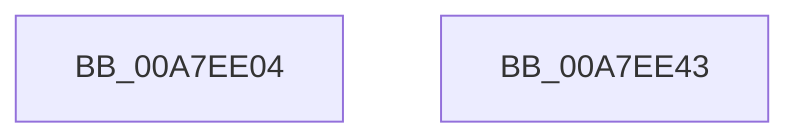

# PspAdjustKeepAliveCountProcess

- RVA: `0x00A7EE04`–`0x00A7EE44` (길이 `64` bytes)
- VA: `0x0000000140A7EE04`
- 실행 섹션: `PAGE`
- PDB 이름 있음: `예`; PDB Function 태그: `아니요`
- unwind 정보 RVA: `0x00063458`
- 디코드: `18`개 명령, `64/64` bytes 표시
- 미해석 바이트: `0` (있으면 어셈블리에 `.byte`로 보존)

> 이 문서는 커널 이미지의 기계어와 PDB 기호를 분석해 생성했습니다. 4번과 5번은 함수 원형과 자료형을 바이너리 사용 방식에서 추정한 C 해석이며 원본 소스 복구 결과는 아닙니다.

## 1. Dependencies

- 직접 호출 지점: **1**; 고유 호출 대상: **1**
- 직접 호출자로 확인된 함수: **3**
- RIP 상대 이미지 참조: **0**

### Outgoing calls
- `0x00A7EE35` → [PspChargeProcessWakeCounter](../88/PspChargeProcessWakeCounter_function_0088D2A0.md) (function, `0x0088D2A0`)

### Direct callers
- [sub_0038C58B](../../text/38/Unknown_function_0038C58B.md) at `0x0038C89A`
- [IoIncrementKeepAliveCount](../../text/42/IoIncrementKeepAliveCount_function_0042EAD0.md) at `0x0042EBD9`
- [IopKeepAliveWorker](../../text/49/IopKeepAliveWorker_function_00494FD0.md) at `0x00495133`
- [IopKeepAliveWorker](../../text/49/IopKeepAliveWorker_function_00494FD0.md) at `0x00495175`
- [IopKeepAliveWorker](../../text/49/IopKeepAliveWorker_function_00494FD0.md) at `0x0049519A`

### Static image references
- 디코드된 RIP-relative 메모리 참조가 없습니다.

## 2. Other-region calls and transfers

- 다른 실행 섹션으로 향하는 call: **0**
- 별도 외부 분기/꼬리 이동을 확인하지 못했습니다.

## 3. Assembly (complete function range)

```asm
00A7EE04  48 83 EC 48                     sub rsp, 0x48
00A7EE08  83 64 24 68 00                  and dword ptr [rsp + 0x68], 0
00A7EE0D  8B C2                           mov eax, edx
00A7EE0F  41 F6 D9                        neg r9b
00A7EE12  4C 8D 4C 24 68                  lea r9, [rsp + 0x68]
00A7EE17  4C 89 4C 24 30                  mov qword ptr [rsp + 0x30], r9
00A7EE1C  1B D2                           sbb edx, edx
00A7EE1E  F7 D2                           not edx
00A7EE20  C6 44 24 28 00                  mov byte ptr [rsp + 0x28], 0
00A7EE25  4D 8B C8                        mov r9, r8
00A7EE28  89 44 24 20                     mov dword ptr [rsp + 0x20], eax
00A7EE2C  83 E2 02                        and edx, 2
00A7EE2F  41 B8 01 00 00 00               mov r8d, 1
00A7EE35  E8 66 E4 E0 FF                  call 0x14088d2a0
00A7EE3A  8B 44 24 68                     mov eax, dword ptr [rsp + 0x68]
00A7EE3E  48 83 C4 48                     add rsp, 0x48
00A7EE42  C3                              ret
00A7EE43  CC                              int3
```

## 4. C-style interpretation (structured pseudocode)

```c
__int64 __fastcall PspAdjustKeepAliveCountProcess(__int64 a1, int a2, __int64 a3, unsigned __int8 a4)
{
    __int64 result;
    __int64 v_rsp;
    unsigned __int64 v_stack_m18;
    unsigned __int8 v_stack_m20;
    unsigned int v_stack_m28;
    unsigned int v_stack_p20;

    v_rsp = (v_rsp) - (72);
    a4 = (unsigned __int8)(-(a4));
    v_stack_m18 = v_stack_p20;
    a2 = (unsigned int)(~(a2));
    v_stack_m20 = 0;
    v_stack_m28 = (unsigned int)((unsigned int)(a2));
    a2 = (unsigned int)((a2) & (2));
    result = PspChargeProcessWakeCounter(a1, a2, 1, a3);
    v_rsp = (v_rsp) + (72);
    return (unsigned int)(v_stack_p20);
}
```

## 5. (Beta) C Style

```c
int64_t PspAdjustKeepAliveCountProcess(int64_t Arg1, int32_t Arg2, int64_t Arg3, uint8_t Arg4)
{
    int64_t result;
    int64_t local_rsp;
    uint64_t v_stack_m18;
    uint8_t v_stack_m20;
    uint32_t v_stack_m28;
    uint32_t v_stack_p20;

    local_rsp = (local_rsp) - (72);
    Arg4 = (uint8_t)(-(Arg4));
    v_stack_m18 = v_stack_p20;
    Arg2 = (uint32_t)(~(Arg2));
    v_stack_m20 = 0;
    v_stack_m28 = (uint32_t)((uint32_t)(Arg2));
    Arg2 = (uint32_t)((Arg2) & (2));
    result = PspChargeProcessWakeCounter(Arg1, Arg2, 1, Arg3);
    local_rsp = (local_rsp) + (72);
    return (uint32_t)(v_stack_p20);
}
```

## 6. Execution-region graph

[열기: 2D/3D 그래프와 함수 탐색 컨트롤 패널](../../../control-panel.html?section=page&rva=0x00A7EE04&view=graph)

- 2D 그래프는 위에서 아래로 흐르고, 3D 그래프는 빈 공간을 드래그해 회전합니다. Shift+드래그는 이동, 휠은 확대·축소, 함수 노드 선택은 대상 보고서 이동입니다.

### Static fallback


