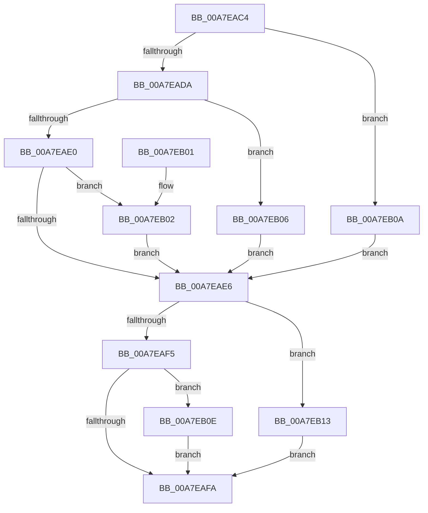

# PspDecodeMitigationExecuteOptions

- RVA: `0x00A7EAC4`–`0x00A7EB18` (길이 `84` bytes)
- VA: `0x0000000140A7EAC4`
- 실행 섹션: `PAGE`
- PDB 이름 있음: `예`; PDB Function 태그: `아니요`
- unwind 정보 RVA: `0x00068370`
- 디코드: `32`개 명령, `84/84` bytes 표시
- 미해석 바이트: `0` (있으면 어셈블리에 `.byte`로 보존)

> 이 문서는 커널 이미지의 기계어와 PDB 기호를 분석해 생성했습니다. 4번과 5번은 함수 원형과 자료형을 바이너리 사용 방식에서 추정한 C 해석이며 원본 소스 복구 결과는 아닙니다.

## 1. Dependencies

- 직접 호출 지점: **0**; 고유 호출 대상: **0**
- 직접 호출자로 확인된 함수: **1**
- RIP 상대 이미지 참조: **0**

### Outgoing calls
- 직접 디코드된 call 명령이 없습니다.

### Direct callers
- [PspApplyMitigationOptions](../A6/PspApplyMitigationOptions_function_00A699AC.md) at `0x00A6A508`

### Static image references
- 디코드된 RIP-relative 메모리 참조가 없습니다.

## 2. Other-region calls and transfers

- 다른 실행 섹션으로 향하는 call: **0**
- 별도 외부 분기/꼬리 이동을 확인하지 못했습니다.

## 3. Assembly (complete function range)

```asm
00A7EAC4  48 83 EC 28                     sub rsp, 0x28
00A7EAC8  8B 01                           mov eax, dword ptr [rcx]
00A7EACA  32 D2                           xor dl, dl
00A7EACC  44 0F B6 C0                     movzx r8d, al
00A7EAD0  41 83 E0 03                     and r8d, 3
00A7EAD4  41 83 E8 01                     sub r8d, 1
00A7EAD8  74 30                           je 0x140a7eb0a
00A7EADA  41 83 E8 01                     sub r8d, 1
00A7EADE  74 26                           je 0x140a7eb06
00A7EAE0  41 83 F8 01                     cmp r8d, 1
00A7EAE4  74 1C                           je 0x140a7eb02
00A7EAE6  48 8B 09                        mov rcx, qword ptr [rcx]
00A7EAE9  48 C1 E9 04                     shr rcx, 4
00A7EAED  83 E1 03                        and ecx, 3
00A7EAF0  83 E9 01                        sub ecx, 1
00A7EAF3  74 1E                           je 0x140a7eb13
00A7EAF5  83 F9 01                        cmp ecx, 1
00A7EAF8  74 14                           je 0x140a7eb0e
00A7EAFA  8A C2                           mov al, dl
00A7EAFC  48 83 C4 28                     add rsp, 0x28
00A7EB00  C3                              ret
00A7EB01  CC                              int3
00A7EB02  B2 09                           mov dl, 9
00A7EB04  EB E0                           jmp 0x140a7eae6
00A7EB06  B2 3A                           mov dl, 0x3a
00A7EB08  EB DC                           jmp 0x140a7eae6
00A7EB0A  B2 0D                           mov dl, 0xd
00A7EB0C  EB D8                           jmp 0x140a7eae6
00A7EB0E  80 CA 48                        or dl, 0x48
00A7EB11  EB E7                           jmp 0x140a7eafa
00A7EB13  80 CA 08                        or dl, 8
00A7EB16  EB E2                           jmp 0x140a7eafa
```

## 4. C-style interpretation (structured pseudocode)

```c
__int64 __fastcall PspDecodeMitigationExecuteOptions(__int64 a1, unsigned __int8 a2)
{
    __int64 v_rsp;

    v_rsp = (v_rsp) - (40);
    a2 = 0;
    a3 = (unsigned int)(((unsigned __int8)((unsigned int)(*(unsigned int *)(a1)))) & (3));
    a3 = (unsigned int)((a3) - (1));
    if (condition_is_equal) goto loc_00A7EB0A;
    a3 = (unsigned int)((a3) - (1));
    if (condition_is_equal) goto loc_00A7EB06;
    if (((unsigned int)(a3)) == 1) goto loc_00A7EB02;
loc_00A7EAE6:
    a1 = (*(unsigned __int64 *)(a1)) >> (4);
    a1 = (unsigned int)((a1) & (3));
    a1 = (unsigned int)((a1) - (1));
    if (condition_is_equal) goto loc_00A7EB13;
    if (((unsigned int)(a1)) == 1) goto loc_00A7EB0E;
loc_00A7EAFA:
    v_rsp = (v_rsp) + (40);
    return 0;
loc_00A7EB02:
    goto loc_00A7EAE6;
loc_00A7EB06:
    goto loc_00A7EAE6;
loc_00A7EB0A:
    goto loc_00A7EAE6;
loc_00A7EB0E:
    a2 = (unsigned __int8)((13) | (72));
    goto loc_00A7EAFA;
loc_00A7EB13:
    a2 = (unsigned __int8)((a2) | (8));
    goto loc_00A7EAFA;
}
```

## 5. (Beta) C Style

```c
int64_t PspDecodeMitigationExecuteOptions(void *Arg1, uint8_t Arg2)
{
    uint8_t *arg1 = (uint8_t *)Arg1;

    int64_t local_rsp;

    local_rsp = (local_rsp) - (40);
    Arg2 = 0;
    a3 = (uint32_t)(((uint8_t)((uint32_t)(*(uint32_t *)(arg1)))) & (3));
    a3 = (uint32_t)((a3) - (1));
    if (condition_is_equal) goto loc_00A7EB0A;
    a3 = (uint32_t)((a3) - (1));
    if (condition_is_equal) goto loc_00A7EB06;
    if (((uint32_t)(a3)) == 1) goto loc_00A7EB02;
loc_00A7EAE6:
    Arg1 = (*(uint64_t *)(arg1)) >> (4);
    Arg1 = (uint32_t)((Arg1) & (3));
    Arg1 = (uint32_t)((Arg1) - (1));
    if (condition_is_equal) goto loc_00A7EB13;
    if (((uint32_t)(Arg1)) == 1) goto loc_00A7EB0E;
loc_00A7EAFA:
    local_rsp = (local_rsp) + (40);
    return 0;
loc_00A7EB02:
    goto loc_00A7EAE6;
loc_00A7EB06:
    goto loc_00A7EAE6;
loc_00A7EB0A:
    goto loc_00A7EAE6;
loc_00A7EB0E:
    Arg2 = (uint8_t)((13) | (72));
    goto loc_00A7EAFA;
loc_00A7EB13:
    Arg2 = (uint8_t)((Arg2) | (8));
    goto loc_00A7EAFA;
}
```

### 관측된 메모리 오프셋

구조체 형식이 확인되지 않은 접근은 인자 기준의 오프셋으로만 기록했습니다.

| 기준 인자 | 오프셋 표현 | 폭 (bit) | 접근 |
|---|---:|---:|---|
| `Arg1` | `+ 0x0` | `32` | `R` |
| `Arg1` | `+ 0x0` | `64` | `R` |

## 6. Execution-region graph

[열기: 2D/3D 그래프와 함수 탐색 컨트롤 패널](../../../control-panel.html?section=page&rva=0x00A7EAC4&view=graph)

- 2D 그래프는 위에서 아래로 흐르고, 3D 그래프는 빈 공간을 드래그해 회전합니다. Shift+드래그는 이동, 휠은 확대·축소, 함수 노드 선택은 대상 보고서 이동입니다.

### Static fallback


