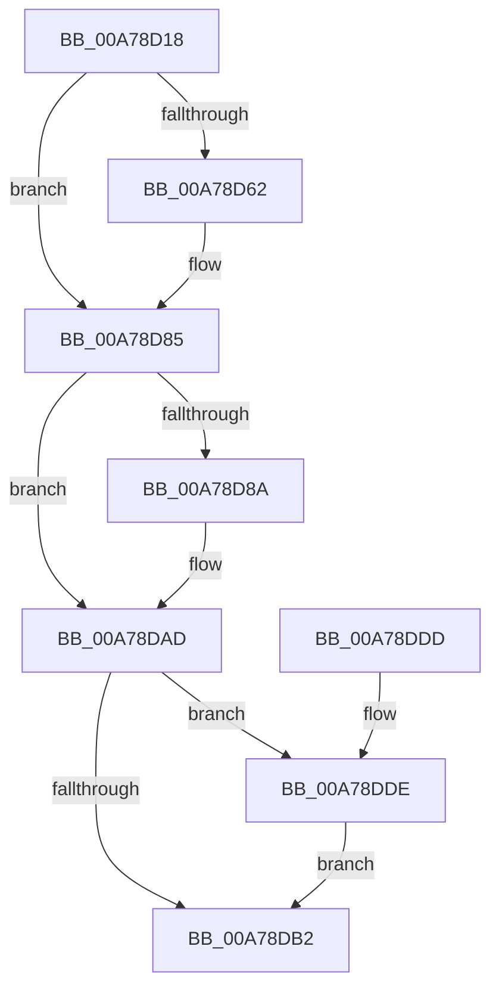

# PspDeleteUserStack

- RVA: `0x00A78D18`–`0x00A78E10` (길이 `248` bytes)
- VA: `0x0000000140A78D18`
- 실행 섹션: `PAGE`
- PDB 이름 있음: `예`; PDB Function 태그: `아니요`
- unwind 정보 RVA: `0x000B60F8`
- 디코드: `65`개 명령, `248/248` bytes 표시
- 미해석 바이트: `0` (있으면 어셈블리에 `.byte`로 보존)

> 이 문서는 커널 이미지의 기계어와 PDB 기호를 분석해 생성했습니다. 4번과 5번은 함수 원형과 자료형을 바이너리 사용 방식에서 추정한 C 해석이며 원본 소스 복구 결과는 아닙니다.

## 1. Dependencies

- 직접 호출 지점: **6**; 고유 호출 대상: **5**
- 직접 호출자로 확인된 함수: **2**
- RIP 상대 이미지 참조: **1**

### Outgoing calls
- `0x00A78D54` → [KiStackAttachProcess](../../text/21/KiStackAttachProcess_function_00216820.md) (function, `0x00216820`)
- `0x00A78D80` → [ZwFreeVirtualMemory](../../text/6A/ZwFreeVirtualMemory_function_006AD490.md) (function, `0x006AD490`)
- `0x00A78DA8` → [ZwFreeVirtualMemory](../../text/6A/ZwFreeVirtualMemory_function_006AD490.md) (function, `0x006AD490`)
- `0x00A78DB8` → [KiUnstackDetachProcess](../../text/21/KiUnstackDetachProcess_function_00217D30.md) (function, `0x00217D30`)
- `0x00A78DC4` → [_security_check_cookie](../../text/6A/_security_check_cookie_function_006AC640.md) (function, `0x006AC640`)
- `0x00A78E09` → [MmFreeVirtualMemory](../87/MmFreeVirtualMemory_function_0087FED0.md) (function, `0x0087FED0`)

### Direct callers
- [PspInsertThread](../9F/PspInsertThread_function_009F0314.md) at `0x009F062D`
- [PspInsertThread](../9F/PspInsertThread_function_009F0314.md) at `0x009F0AEC`
- [sub_00B30C5A](../B3/Unknown_function_00B30C5A.md) at `0x00B30D5D`

### Static image references
- `0x00A78D2B` → RVA `0x00E0A740` (`.data`; read)

## 2. Other-region calls and transfers

- 다른 실행 섹션으로 향하는 call: **5**
  - `0x00A78D54` → [KiStackAttachProcess](../../text/21/KiStackAttachProcess_function_00216820.md) (`PAGE` → `.text`)
  - `0x00A78D80` → [ZwFreeVirtualMemory](../../text/6A/ZwFreeVirtualMemory_function_006AD490.md) (`PAGE` → `.text`)
  - `0x00A78DA8` → [ZwFreeVirtualMemory](../../text/6A/ZwFreeVirtualMemory_function_006AD490.md) (`PAGE` → `.text`)
  - `0x00A78DB8` → [KiUnstackDetachProcess](../../text/21/KiUnstackDetachProcess_function_00217D30.md) (`PAGE` → `.text`)
  - `0x00A78DC4` → [_security_check_cookie](../../text/6A/_security_check_cookie_function_006AC640.md) (`PAGE` → `.text`)
- 별도 외부 분기/꼬리 이동을 확인하지 못했습니다.

## 3. Assembly (complete function range)

```asm
00A78D18  48 89 5C 24 10                  mov qword ptr [rsp + 0x10], rbx
00A78D1D  55                              push rbp
00A78D1E  57                              push rdi
00A78D1F  41 57                           push r15
00A78D21  48 8B EC                        mov rbp, rsp
00A78D24  48 81 EC 80 00 00 00            sub rsp, 0x80
00A78D2B  48 8B 05 0E 1A 39 00            mov rax, qword ptr [rip + 0x391a0e]
00A78D32  48 33 C4                        xor rax, rsp
00A78D35  48 89 45 F0                     mov qword ptr [rbp - 0x10], rax
00A78D39  0F 57 C0                        xorps xmm0, xmm0
00A78D3C  49 8B D8                        mov rbx, r8
00A78D3F  4C 8D 45 C0                     lea r8, [rbp - 0x40]
00A78D43  33 D2                           xor edx, edx
00A78D45  0F 11 45 C0                     movups xmmword ptr [rbp - 0x40], xmm0
00A78D49  49 8B F9                        mov rdi, r9
00A78D4C  0F 11 45 D0                     movups xmmword ptr [rbp - 0x30], xmm0
00A78D50  0F 11 45 E0                     movups xmmword ptr [rbp - 0x20], xmm0
00A78D54  E8 C7 DA 79 FF                  call 0x140216820
00A78D59  49 83 CF FF                     or r15, 0xffffffffffffffff
00A78D5D  F6 07 02                        test byte ptr [rdi], 2
00A78D60  74 23                           je 0x140a78d85
00A78D62  48 8B 43 20                     mov rax, qword ptr [rbx + 0x20]
00A78D66  4C 8D 45 B0                     lea r8, [rbp - 0x50]
00A78D6A  48 83 65 B0 00                  and qword ptr [rbp - 0x50], 0
00A78D6F  48 8D 55 B8                     lea rdx, [rbp - 0x48]
00A78D73  41 B9 00 80 00 00               mov r9d, 0x8000
00A78D79  48 89 45 B8                     mov qword ptr [rbp - 0x48], rax
00A78D7D  49 8B CF                        mov rcx, r15
00A78D80  E8 0B 47 C3 FF                  call 0x1406ad490
00A78D85  F6 07 04                        test byte ptr [rdi], 4
00A78D88  74 23                           je 0x140a78dad
00A78D8A  48 8B 43 38                     mov rax, qword ptr [rbx + 0x38]
00A78D8E  4C 8D 45 B8                     lea r8, [rbp - 0x48]
00A78D92  48 83 65 B8 00                  and qword ptr [rbp - 0x48], 0
00A78D97  48 8D 55 B0                     lea rdx, [rbp - 0x50]
00A78D9B  41 B9 00 80 00 00               mov r9d, 0x8000
00A78DA1  48 89 45 B0                     mov qword ptr [rbp - 0x50], rax
00A78DA5  49 8B CF                        mov rcx, r15
00A78DA8  E8 E3 46 C3 FF                  call 0x1406ad490
00A78DAD  F6 07 08                        test byte ptr [rdi], 8
00A78DB0  75 2C                           jne 0x140a78dde
00A78DB2  33 D2                           xor edx, edx
00A78DB4  48 8D 4D C0                     lea rcx, [rbp - 0x40]
00A78DB8  E8 73 EF 79 FF                  call 0x140217d30
00A78DBD  48 8B 4D F0                     mov rcx, qword ptr [rbp - 0x10]
00A78DC1  48 33 CC                        xor rcx, rsp
00A78DC4  E8 77 38 C3 FF                  call 0x1406ac640
00A78DC9  48 8B 9C 24 A8 00 00 00         mov rbx, qword ptr [rsp + 0xa8]
00A78DD1  48 81 C4 80 00 00 00            add rsp, 0x80
00A78DD8  41 5F                           pop r15
00A78DDA  5F                              pop rdi
00A78DDB  5D                              pop rbp
00A78DDC  C3                              ret
00A78DDD  CC                              int3
00A78DDE  48 8B 43 40                     mov rax, qword ptr [rbx + 0x40]
00A78DE2  4C 8D 45 B8                     lea r8, [rbp - 0x48]
00A78DE6  48 83 65 B8 00                  and qword ptr [rbp - 0x48], 0
00A78DEB  48 8D 55 B0                     lea rdx, [rbp - 0x50]
00A78DEF  C7 44 24 28 00 00 00 40         mov dword ptr [rsp + 0x28], 0x40000000
00A78DF7  41 B9 00 80 00 00               mov r9d, 0x8000
00A78DFD  49 8B CF                        mov rcx, r15
00A78E00  48 89 45 B0                     mov qword ptr [rbp - 0x50], rax
00A78E04  C6 44 24 20 00                  mov byte ptr [rsp + 0x20], 0
00A78E09  E8 C2 70 E0 FF                  call 0x14087fed0
00A78E0E  EB A2                           jmp 0x140a78db2
```

## 4. C-style interpretation (structured pseudocode)

```c
__int64 __fastcall PspDeleteUserStack(__int64 a1, int a2, __int64 a3, __int64 a4)
{
    __int64 result;
    __int64 v_r15;
    __int64 v_rsp;
    unsigned __int64 v_stack_m28;
    unsigned __int64 v_stack_m38;
    unsigned __int64 v_stack_m48;
    unsigned __int64 v_stack_m58;
    unsigned __int64 v_stack_m60;
    unsigned __int64 v_stack_m68;
    unsigned __int64 v_stack_p10;
    unsigned __int8 v_stack_p20;
    unsigned int v_stack_p28;

    v_stack_p10 = v_rbx;
    v_rsp = (v_rsp) - (128);
    result = (*(unsigned __int64 *)(v_rip + 3742222)) ^ (v_rsp);
    v_stack_m28 = result;
    a2 = 0;
    v_stack_m58 = v_xmm0;
    v_stack_m48 = v_xmm0;
    v_stack_m38 = v_xmm0;
    result = KiStackAttachProcess(a1, a2, v_stack_m58, a4);
    v_r15 = (v_r15) | (-1);
    if (((*(unsigned __int8 *)(a4)) & (2)) != 0) {
        result = *(unsigned __int64 *)(a3 + 32);
        a3 = v_stack_m68;
        a2 = v_stack_m60;
        a4 = 0x8000ULL;
        v_stack_m60 = result;
        a1 = v_r15;
        result = ZwFreeVirtualMemory(a1, a2, a3, a4);
    }
    if (((*(unsigned __int8 *)(a4)) & (4)) != 0) {
        result = *(unsigned __int64 *)(a3 + 56);
        a3 = v_stack_m60;
        a2 = v_stack_m68;
        a4 = 0x8000ULL;
        v_stack_m68 = result;
        a1 = v_r15;
        result = ZwFreeVirtualMemory(a1, a2, a3, a4);
    }
    if (((*(unsigned __int8 *)(a4)) & (8)) != 0) goto loc_00A78DDE;
loc_00A78DB2:
    a2 = 0;
    result = KiUnstackDetachProcess(v_stack_m58, a2, a3, a4);
    a1 = (v_stack_m28) ^ (v_rsp);
    result = _security_check_cookie(a1, a2, a3, a4);
    v_rsp = (v_rsp) + (128);
    return result;
loc_00A78DDE:
    v_stack_p28 = 0x40000000ULL;
    v_stack_m68 = *(unsigned __int64 *)(v_stack_p10 + 64);
    v_stack_p20 = 0;
    result = MmFreeVirtualMemory(v_r15, v_stack_m68, v_stack_m60, (unsigned int)(0x8000ULL));
    goto loc_00A78DB2;
}
```

## 5. (Beta) C Style

```c
int64_t PspDeleteUserStack(int64_t Arg1, int32_t Arg2, void *Arg3, void *Arg4)
{
    uint8_t *arg3 = (uint8_t *)Arg3;
    uint8_t *arg4 = (uint8_t *)Arg4;

    int64_t result;
    int64_t local_r15;
    int64_t local_rsp;
    uint64_t v_stack_m28;
    uint64_t v_stack_m38;
    uint64_t v_stack_m48;
    uint64_t v_stack_m58;
    uint64_t v_stack_m60;
    uint64_t v_stack_m68;
    uint64_t v_stack_p10;
    uint8_t v_stack_p20;
    uint32_t v_stack_p28;

    v_stack_p10 = local_rbx;
    local_rsp = (local_rsp) - (128);
    result = (*(uint64_t *)(v_rip + 0x391A0E)) ^ (local_rsp);
    v_stack_m28 = result;
    Arg2 = 0;
    v_stack_m58 = v_xmm0;
    v_stack_m48 = v_xmm0;
    v_stack_m38 = v_xmm0;
    result = KiStackAttachProcess(Arg1, Arg2, v_stack_m58, Arg4);
    local_r15 = (local_r15) | (-1);
    if (((*(uint8_t *)(arg4)) & (2)) != 0) {
        result = *(uint64_t *)(arg3 + 0x20);
        Arg3 = v_stack_m68;
        Arg2 = v_stack_m60;
        Arg4 = 0x8000ULL;
        v_stack_m60 = result;
        Arg1 = local_r15;
        result = ZwFreeVirtualMemory(Arg1, Arg2, Arg3, Arg4);
    }
    if (((*(uint8_t *)(arg4)) & (4)) != 0) {
        result = *(uint64_t *)(arg3 + 0x38);
        Arg3 = v_stack_m60;
        Arg2 = v_stack_m68;
        Arg4 = 0x8000ULL;
        v_stack_m68 = result;
        Arg1 = local_r15;
        result = ZwFreeVirtualMemory(Arg1, Arg2, Arg3, Arg4);
    }
    if (((*(uint8_t *)(arg4)) & (8)) != 0) goto loc_00A78DDE;
loc_00A78DB2:
    Arg2 = 0;
    result = KiUnstackDetachProcess(v_stack_m58, Arg2, Arg3, Arg4);
    Arg1 = (v_stack_m28) ^ (local_rsp);
    result = _security_check_cookie(Arg1, Arg2, Arg3, Arg4);
    local_rsp = (local_rsp) + (128);
    return result;
loc_00A78DDE:
    v_stack_p28 = 0x40000000ULL;
    v_stack_m68 = *(uint64_t *)(v_stack_p10 + 0x40);
    v_stack_p20 = 0;
    result = MmFreeVirtualMemory(local_r15, v_stack_m68, v_stack_m60, (uint32_t)(0x8000ULL));
    goto loc_00A78DB2;
}
```

### 관측된 메모리 오프셋

구조체 형식이 확인되지 않은 접근은 인자 기준의 오프셋으로만 기록했습니다.

| 기준 인자 | 오프셋 표현 | 폭 (bit) | 접근 |
|---|---:|---:|---|
| `Arg3` | `+ 0x20` | `64` | `R` |
| `Arg3` | `+ 0x38` | `64` | `R` |
| `Arg3` | `+ 0x40` | `64` | `R` |
| `Arg4` | `+ 0x0` | `8` | `R` |

## 6. Execution-region graph

[열기: 2D/3D 그래프와 함수 탐색 컨트롤 패널](../../../control-panel.html?section=page&rva=0x00A78D18&view=graph)

- 2D 그래프는 위에서 아래로 흐르고, 3D 그래프는 빈 공간을 드래그해 회전합니다. Shift+드래그는 이동, 휠은 확대·축소, 함수 노드 선택은 대상 보고서 이동입니다.

### Static fallback


