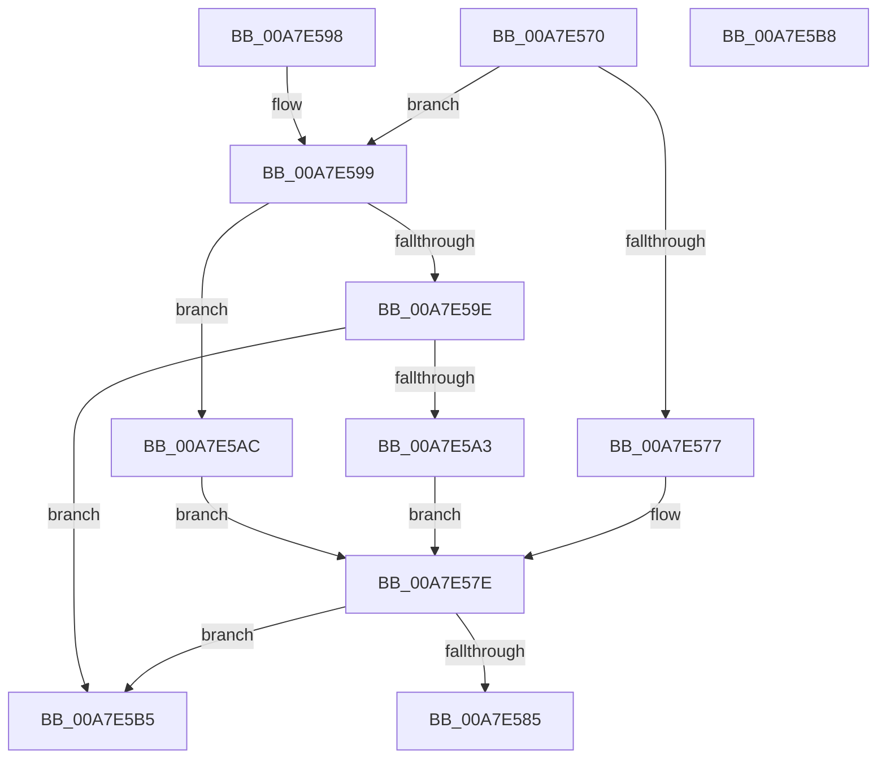

# PspEnumerateCallback

- RVA: `0x00A7E570`–`0x00A7E5B9` (길이 `73` bytes)
- VA: `0x0000000140A7E570`
- 실행 섹션: `PAGE`
- PDB 이름 있음: `예`; PDB Function 태그: `아니요`
- unwind 정보 RVA: `0x000DB714`
- 디코드: `25`개 명령, `73/73` bytes 표시
- 미해석 바이트: `0` (있으면 어셈블리에 `.byte`로 보존)

> 이 문서는 커널 이미지의 기계어와 PDB 기호를 분석해 생성했습니다. 4번과 5번은 함수 원형과 자료형을 바이너리 사용 방식에서 추정한 C 해석이며 원본 소스 복구 결과는 아닙니다.

## 1. Dependencies

- 직접 호출 지점: **0**; 고유 호출 대상: **0**
- 직접 호출자로 확인된 함수: **0**
- RIP 상대 이미지 참조: **3**

### Outgoing calls
- 직접 디코드된 call 명령이 없습니다.

### Direct callers
- 이 함수 시작 RVA로 연결되는 직접 call은 확인되지 않았습니다. 간접 호출은 완전히 역산할 수 없습니다.

### Static image references
- `0x00A7E577` → RVA `0x00F06120` (`.data`; read)
- `0x00A7E5A3` → RVA `0x00F05F20` (`.data`; read)
- `0x00A7E5AC` → RVA `0x00F06320` (`.data`; read)

## 2. Other-region calls and transfers

- 다른 실행 섹션으로 향하는 call: **0**
- 별도 외부 분기/꼬리 이동을 확인하지 못했습니다.

## 3. Assembly (complete function range)

```asm
00A7E570  4C 8B CA                        mov r9, rdx
00A7E573  85 C9                           test ecx, ecx
00A7E575  75 22                           jne 0x140a7e599
00A7E577  48 8D 0D A2 7B 48 00            lea rcx, [rip + 0x487ba2]
00A7E57E  8B 12                           mov edx, dword ptr [rdx]
00A7E580  83 FA 40                        cmp edx, 0x40
00A7E583  73 30                           jae 0x140a7e5b5
00A7E585  8D 42 01                        lea eax, [rdx + 1]
00A7E588  48 8D 0C D1                     lea rcx, [rcx + rdx*8]
00A7E58C  49 89 08                        mov qword ptr [r8], rcx
00A7E58F  41 89 01                        mov dword ptr [r9], eax
00A7E592  B8 01 00 00 00                  mov eax, 1
00A7E597  C3                              ret
00A7E598  CC                              int3
00A7E599  83 E9 01                        sub ecx, 1
00A7E59C  74 0E                           je 0x140a7e5ac
00A7E59E  83 F9 01                        cmp ecx, 1
00A7E5A1  75 12                           jne 0x140a7e5b5
00A7E5A3  48 8D 0D 76 79 48 00            lea rcx, [rip + 0x487976]
00A7E5AA  EB D2                           jmp 0x140a7e57e
00A7E5AC  48 8D 0D 6D 7D 48 00            lea rcx, [rip + 0x487d6d]
00A7E5B3  EB C9                           jmp 0x140a7e57e
00A7E5B5  33 C0                           xor eax, eax
00A7E5B7  C3                              ret
00A7E5B8  CC                              int3
```

## 4. C-style interpretation (structured pseudocode)

```c
__int64 __fastcall PspEnumerateCallback(int a1, __int64 a2, __int64 a3)
{
    __int64 result;

    if (a1 != 0) goto loc_00A7E599;
loc_00A7E57E:
    if (((unsigned int)((unsigned int)(*(unsigned int *)(a2)))) >= 64) goto loc_00A7E5B5;
    *(unsigned __int64 *)(a3) = v_rip + 4750242 + (unsigned int)(*(unsigned int *)(a2)) * 8;
    *(unsigned int *)(a2) = (unsigned int)((unsigned int)(*(unsigned int *)(a2)) + 1);
    return 1;
loc_00A7E599:
    a1 = (unsigned int)((v_rip + 4750242 + (unsigned int)(*(unsigned int *)(a2)) * 8) - (1));
    if (condition_is_equal) goto loc_00A7E5AC;
    if (a1 != 1) goto loc_00A7E5B5;
    goto loc_00A7E57E;
loc_00A7E5AC:
    goto loc_00A7E57E;
loc_00A7E5B5:
    result = 0;
    return result;
}
```

## 5. (Beta) C Style

```c
int64_t PspEnumerateCallback(int32_t Arg1, void *Arg2, void *Arg3)
{
    uint8_t *arg2 = (uint8_t *)Arg2;
    uint8_t *arg3 = (uint8_t *)Arg3;

    int64_t result;

    if (Arg1 != 0) goto loc_00A7E599;
loc_00A7E57E:
    if (((uint32_t)((uint32_t)(*(uint32_t *)(arg2)))) >= 64) goto loc_00A7E5B5;
    *(uint64_t *)(arg3) = v_rip + 4750242 + (uint32_t)(*(uint32_t *)(arg2)) * 8;
    *(uint32_t *)(arg2) = (uint32_t)((uint32_t)(*(uint32_t *)(arg2)) + 1);
    return 1;
loc_00A7E599:
    Arg1 = (uint32_t)((v_rip + 4750242 + (uint32_t)(*(uint32_t *)(arg2)) * 8) - (1));
    if (condition_is_equal) goto loc_00A7E5AC;
    if (Arg1 != 1) goto loc_00A7E5B5;
    goto loc_00A7E57E;
loc_00A7E5AC:
    goto loc_00A7E57E;
loc_00A7E5B5:
    result = 0;
    return result;
}
```

### 관측된 메모리 오프셋

구조체 형식이 확인되지 않은 접근은 인자 기준의 오프셋으로만 기록했습니다.

| 기준 인자 | 오프셋 표현 | 폭 (bit) | 접근 |
|---|---:|---:|---|
| `Arg2` | `+ 0x0` | `32` | `R` |
| `Arg2` | `+ 0x0` | `32` | `W` |
| `Arg3` | `+ 0x0` | `64` | `W` |

## 6. Execution-region graph

[열기: 2D/3D 그래프와 함수 탐색 컨트롤 패널](../../../control-panel.html?section=page&rva=0x00A7E570&view=graph)

- 2D 그래프는 위에서 아래로 흐르고, 3D 그래프는 빈 공간을 드래그해 회전합니다. Shift+드래그는 이동, 휠은 확대·축소, 함수 노드 선택은 대상 보고서 이동입니다.

### Static fallback


