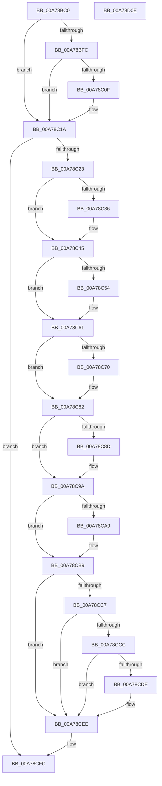

# PspHardenMitigationOptions

- RVA: `0x00A78BC0`–`0x00A78D0F` (길이 `335` bytes)
- VA: `0x0000000140A78BC0`
- 실행 섹션: `PAGE`
- PDB 이름 있음: `예`; PDB Function 태그: `아니요`
- unwind 정보 RVA: `0x000B60E4`
- 디코드: `91`개 명령, `335/335` bytes 표시
- 미해석 바이트: `0` (있으면 어셈블리에 `.byte`로 보존)

> 이 문서는 커널 이미지의 기계어와 PDB 기호를 분석해 생성했습니다. 4번과 5번은 함수 원형과 자료형을 바이너리 사용 방식에서 추정한 C 해석이며 원본 소스 복구 결과는 아닙니다.

## 1. Dependencies

- 직접 호출 지점: **1**; 고유 호출 대상: **1**
- 직접 호출자로 확인된 함수: **1**
- RIP 상대 이미지 참조: **5**

### Outgoing calls
- `0x00A78D03` → [_security_check_cookie](../../text/6A/_security_check_cookie_function_006AC640.md) (function, `0x006AC640`)

### Direct callers
- [PspAllocateProcess](../A1/PspAllocateProcess_function_00A13B3C.md) at `0x00A157C9`

### Static image references
- `0x00A78BC9` → RVA `0x00E0A740` (`.data`; read)
- `0x00A78BEF` → RVA `0x00FC7568` (`ALMOSTRO`; read)
- `0x00A78C06` → RVA `0x00FC7570` (`ALMOSTRO`; read)
- `0x00A78C13` → RVA `0x00FC7578` (`ALMOSTRO`; read)
- `0x00A78CCC` → RVA `0x00FC7108` (`ALMOSTRO`; read)

## 2. Other-region calls and transfers

- 다른 실행 섹션으로 향하는 call: **1**
  - `0x00A78D03` → [_security_check_cookie](../../text/6A/_security_check_cookie_function_006AC640.md) (`PAGE` → `.text`)
- 별도 외부 분기/꼬리 이동을 확인하지 못했습니다.

## 3. Assembly (complete function range)

```asm
00A78BC0  40 55                           push rbp
00A78BC2  48 8B EC                        mov rbp, rsp
00A78BC5  48 83 EC 40                     sub rsp, 0x40
00A78BC9  48 8B 05 70 1B 39 00            mov rax, qword ptr [rip + 0x391b70]
00A78BD0  48 33 C4                        xor rax, rsp
00A78BD3  48 89 45 F8                     mov qword ptr [rbp - 8], rax
00A78BD7  0F 10 09                        movups xmm1, xmmword ptr [rcx]
00A78BDA  4C 8B C1                        mov r8, rcx
00A78BDD  F2 0F 10 51 10                  movsd xmm2, qword ptr [rcx + 0x10]
00A78BE2  66 48 0F 7E CA                  movq rdx, xmm1
00A78BE7  F2 0F 11 55 F0                  movsd qword ptr [rbp - 0x10], xmm2
00A78BEC  48 8B CA                        mov rcx, rdx
00A78BEF  48 2B 0D 72 E9 54 00            sub rcx, qword ptr [rip + 0x54e972]
00A78BF6  0F 11 4D E0                     movups xmmword ptr [rbp - 0x20], xmm1
00A78BFA  75 1E                           jne 0x140a78c1a
00A78BFC  66 0F 73 D9 08                  psrldq xmm1, 8
00A78C01  66 48 0F 7E C9                  movq rcx, xmm1
00A78C06  48 2B 0D 63 E9 54 00            sub rcx, qword ptr [rip + 0x54e963]
00A78C0D  75 0B                           jne 0x140a78c1a
00A78C0F  48 8B 4D F0                     mov rcx, qword ptr [rbp - 0x10]
00A78C13  48 2B 0D 5E E9 54 00            sub rcx, qword ptr [rip + 0x54e95e]
00A78C1A  48 85 C9                        test rcx, rcx
00A78C1D  0F 84 D9 00 00 00               je 0x140a78cfc
00A78C23  8B 4D E0                        mov ecx, dword ptr [rbp - 0x20]
00A78C26  41 B1 03                        mov r9b, 3
00A78C29  8A C1                           mov al, cl
00A78C2B  41 B2 01                        mov r10b, 1
00A78C2E  41 22 C1                        and al, r9b
00A78C31  41 3A C2                        cmp al, r10b
00A78C34  74 0F                           je 0x140a78c45
00A78C36  48 83 E2 FC                     and rdx, 0xfffffffffffffffc
00A78C3A  48 0F BA EA 00                  bts rdx, 0
00A78C3F  48 89 55 E0                     mov qword ptr [rbp - 0x20], rdx
00A78C43  8A CA                           mov cl, dl
00A78C45  48 8B C2                        mov rax, rdx
00A78C48  48 C1 E8 08                     shr rax, 8
00A78C4C  41 22 C1                        and al, r9b
00A78C4F  41 3A C1                        cmp al, r9b
00A78C52  74 0D                           je 0x140a78c61
00A78C54  48 81 CA 00 03 00 00            or rdx, 0x300
00A78C5B  48 89 55 E0                     mov qword ptr [rbp - 0x20], rdx
00A78C5F  8A CA                           mov cl, dl
00A78C61  48 8B C2                        mov rax, rdx
00A78C64  48 C1 E8 0C                     shr rax, 0xc
00A78C68  41 22 C1                        and al, r9b
00A78C6B  41 3A C2                        cmp al, r10b
00A78C6E  74 12                           je 0x140a78c82
00A78C70  48 81 E2 FF CF FF FF            and rdx, 0xffffffffffffcfff
00A78C77  48 0F BA EA 0C                  bts rdx, 0xc
00A78C7C  48 89 55 E0                     mov qword ptr [rbp - 0x20], rdx
00A78C80  8A CA                           mov cl, dl
00A78C82  C0 E9 04                        shr cl, 4
00A78C85  41 22 C9                        and cl, r9b
00A78C88  41 3A CA                        cmp cl, r10b
00A78C8B  74 0D                           je 0x140a78c9a
00A78C8D  48 83 E2 CF                     and rdx, 0xffffffffffffffcf
00A78C91  48 0F BA EA 04                  bts rdx, 4
00A78C96  48 89 55 E0                     mov qword ptr [rbp - 0x20], rdx
00A78C9A  48 8B C2                        mov rax, rdx
00A78C9D  48 C1 E8 10                     shr rax, 0x10
00A78CA1  41 22 C1                        and al, r9b
00A78CA4  41 3A C2                        cmp al, r10b
00A78CA7  74 10                           je 0x140a78cb9
00A78CA9  48 81 E2 FF FF FC FF            and rdx, 0xfffffffffffcffff
00A78CB0  48 0F BA EA 10                  bts rdx, 0x10
00A78CB5  48 89 55 E0                     mov qword ptr [rbp - 0x20], rdx
00A78CB9  48 8B C2                        mov rax, rdx
00A78CBC  48 C1 E8 14                     shr rax, 0x14
00A78CC0  41 22 C1                        and al, r9b
00A78CC3  3C 02                           cmp al, 2
00A78CC5  74 27                           je 0x140a78cee
00A78CC7  41 3A C2                        cmp al, r10b
00A78CCA  74 22                           je 0x140a78cee
00A78CCC  48 8B 05 35 E4 54 00            mov rax, qword ptr [rip + 0x54e435]
00A78CD3  48 C1 E8 14                     shr rax, 0x14
00A78CD7  41 22 C1                        and al, r9b
00A78CDA  3C 02                           cmp al, 2
00A78CDC  74 10                           je 0x140a78cee
00A78CDE  48 81 E2 FF FF CF FF            and rdx, 0xffffffffffcfffff
00A78CE5  48 0F BA EA 14                  bts rdx, 0x14
00A78CEA  48 89 55 E0                     mov qword ptr [rbp - 0x20], rdx
00A78CEE  0F 10 45 E0                     movups xmm0, xmmword ptr [rbp - 0x20]
00A78CF2  41 0F 11 00                     movups xmmword ptr [r8], xmm0
00A78CF6  F2 41 0F 11 50 10               movsd qword ptr [r8 + 0x10], xmm2
00A78CFC  48 8B 4D F8                     mov rcx, qword ptr [rbp - 8]
00A78D00  48 33 CC                        xor rcx, rsp
00A78D03  E8 38 39 C3 FF                  call 0x1406ac640
00A78D08  48 83 C4 40                     add rsp, 0x40
00A78D0C  5D                              pop rbp
00A78D0D  C3                              ret
00A78D0E  CC                              int3
```

## 4. C-style interpretation (structured pseudocode)

```c
__int64 __fastcall PspHardenMitigationOptions(__int64 a1)
{
    __int64 result;
    __int64 v_rsp;
    unsigned __int64 v_stack_m10;
    unsigned __int64 v_stack_m18;
    unsigned __int64 v_stack_m28;

    v_rsp = (v_rsp) - (64);
    result = (*(unsigned __int64 *)(v_rip + 3742576)) ^ (v_rsp);
    v_stack_m10 = result;
    v_stack_m18 = v_xmm2;
    a1 = (a2) - (*(unsigned __int64 *)(v_rip + 5564786));
    v_stack_m28 = v_xmm1;
    if (condition_is_not_equal) goto loc_00A78C1A;
    a1 = (a1) - (*(unsigned __int64 *)(v_rip + 5564771));
    if (!(condition_is_not_equal)) {
        a1 = v_stack_m18;
        a1 = (a1) - (*(unsigned __int64 *)(v_rip + 5564766));
    }
    if (a1 == 0) goto loc_00A78CFC;
    result = (unsigned __int8)(((unsigned __int8)((unsigned int)(v_stack_m28))) & (3));
    if (((unsigned __int8)(result)) != 1) {
        a2 = (a2) & (-4);
        v_stack_m28 = a2;
        a1 = (unsigned __int8)(a2);
    }
    result = (a2) >> (8);
    result = (unsigned __int8)((result) & (3));
    if (((unsigned __int8)(result)) != 3) {
        a2 = (a2) | (768);
        v_stack_m28 = a2;
        a1 = (unsigned __int8)(a2);
    }
    result = (a2) >> (12);
    result = (unsigned __int8)((result) & (3));
    if (((unsigned __int8)(result)) != 1) {
        a2 = (a2) & (0xFFFFFFFFFFFFCFFFULL);
        v_stack_m28 = a2;
        a1 = (unsigned __int8)(a2);
    }
    a1 = (unsigned __int8)((a1) >> (4));
    a1 = (unsigned __int8)((a1) & (3));
    if (((unsigned __int8)(a1)) != 1) {
        a2 = (a2) & (-49);
        v_stack_m28 = a2;
    }
    result = (a2) >> (16);
    result = (unsigned __int8)((result) & (3));
    if (((unsigned __int8)(result)) != 1) {
        a2 = (a2) & (0xFFFFFFFFFFFCFFFFULL);
        v_stack_m28 = a2;
    }
    result = (a2) >> (20);
    result = (unsigned __int8)((result) & (3));
    if (((unsigned __int8)(result)) == 2) goto loc_00A78CEE;
    if (((unsigned __int8)(result)) == 1) goto loc_00A78CEE;
    result = (*(unsigned __int64 *)(v_rip + 5563445)) >> (20);
    result = (unsigned __int8)((result) & (3));
    if (((unsigned __int8)(result)) != 2) {
        a2 = (a2) & (0xFFFFFFFFFFCFFFFFULL);
        v_stack_m28 = a2;
    }
    *(unsigned __int64 *)(a1) = v_xmm0;
    *(unsigned __int64 *)(a1 + 16) = v_xmm2;
loc_00A78CFC:
    a1 = (v_stack_m10) ^ (v_rsp);
    result = _security_check_cookie(a1, a2, a1, 3);
    v_rsp = (v_rsp) + (64);
    return result;
}
```

## 5. (Beta) C Style

```c
int64_t PspHardenMitigationOptions(void *Arg1)
{
    uint8_t *arg1 = (uint8_t *)Arg1;

    int64_t result;
    int64_t local_rsp;
    uint64_t v_stack_m10;
    uint64_t v_stack_m18;
    uint64_t v_stack_m28;

    local_rsp = (local_rsp) - (64);
    result = (*(uint64_t *)(v_rip + 0x391B70)) ^ (local_rsp);
    v_stack_m10 = result;
    v_stack_m18 = v_xmm2;
    Arg1 = (a2) - (*(uint64_t *)(v_rip + 0x54E972));
    v_stack_m28 = v_xmm1;
    if (condition_is_not_equal) goto loc_00A78C1A;
    Arg1 = (Arg1) - (*(uint64_t *)(v_rip + 0x54E963));
    if (!(condition_is_not_equal)) {
        Arg1 = v_stack_m18;
        Arg1 = (Arg1) - (*(uint64_t *)(v_rip + 0x54E95E));
    }
    if (Arg1 == NULL) goto loc_00A78CFC;
    result = (uint8_t)(((uint8_t)((uint32_t)(v_stack_m28))) & (3));
    if (((uint8_t)(result)) != 1) {
        a2 = (a2) & (-4);
        v_stack_m28 = a2;
        Arg1 = (uint8_t)(a2);
    }
    result = (a2) >> (8);
    result = (uint8_t)((result) & (3));
    if (((uint8_t)(result)) != 3) {
        a2 = (a2) | (768);
        v_stack_m28 = a2;
        Arg1 = (uint8_t)(a2);
    }
    result = (a2) >> (12);
    result = (uint8_t)((result) & (3));
    if (((uint8_t)(result)) != 1) {
        a2 = (a2) & (0xFFFFFFFFFFFFCFFFULL);
        v_stack_m28 = a2;
        Arg1 = (uint8_t)(a2);
    }
    Arg1 = (uint8_t)((Arg1) >> (4));
    Arg1 = (uint8_t)((Arg1) & (3));
    if (((uint8_t)(Arg1)) != 1) {
        a2 = (a2) & (-49);
        v_stack_m28 = a2;
    }
    result = (a2) >> (16);
    result = (uint8_t)((result) & (3));
    if (((uint8_t)(result)) != 1) {
        a2 = (a2) & (0xFFFFFFFFFFFCFFFFULL);
        v_stack_m28 = a2;
    }
    result = (a2) >> (20);
    result = (uint8_t)((result) & (3));
    if (((uint8_t)(result)) == 2) goto loc_00A78CEE;
    if (((uint8_t)(result)) == 1) goto loc_00A78CEE;
    result = (*(uint64_t *)(v_rip + 0x54E435)) >> (20);
    result = (uint8_t)((result) & (3));
    if (((uint8_t)(result)) != 2) {
        a2 = (a2) & (0xFFFFFFFFFFCFFFFFULL);
        v_stack_m28 = a2;
    }
    *(uint64_t *)(arg1) = v_xmm0;
    *(uint64_t *)(arg1 + 0x10) = v_xmm2;
loc_00A78CFC:
    Arg1 = (v_stack_m10) ^ (local_rsp);
    result = _security_check_cookie(Arg1, a2, Arg1, 3);
    local_rsp = (local_rsp) + (64);
    return result;
}
```

### 관측된 메모리 오프셋

구조체 형식이 확인되지 않은 접근은 인자 기준의 오프셋으로만 기록했습니다.

| 기준 인자 | 오프셋 표현 | 폭 (bit) | 접근 |
|---|---:|---:|---|
| `Arg1` | `+ 0x0` | `128` | `R` |
| `Arg1` | `+ 0x10` | `64` | `R` |
| `Arg1` | `+ 0x10` | `64` | `W` |

## 6. Execution-region graph

[열기: 2D/3D 그래프와 함수 탐색 컨트롤 패널](../../../control-panel.html?section=page&rva=0x00A78BC0&view=graph)

- 2D 그래프는 위에서 아래로 흐르고, 3D 그래프는 빈 공간을 드래그해 회전합니다. Shift+드래그는 이동, 휠은 확대·축소, 함수 노드 선택은 대상 보고서 이동입니다.

### Static fallback


