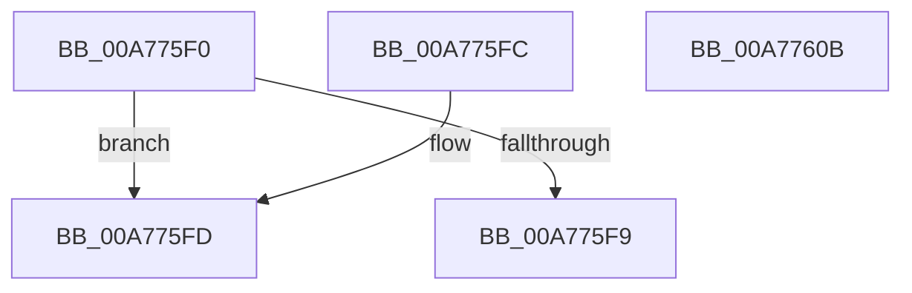

# PspIsSetJobIoAttributionJobPreCallback

- RVA: `0x00A775F0`–`0x00A7760C` (길이 `28` bytes)
- VA: `0x0000000140A775F0`
- 실행 섹션: `PAGE`
- PDB 이름 있음: `예`; PDB Function 태그: `아니요`
- unwind 정보 RVA: `0x000DB714`
- 디코드: `11`개 명령, `28/28` bytes 표시
- 미해석 바이트: `0` (있으면 어셈블리에 `.byte`로 보존)

> 이 문서는 커널 이미지의 기계어와 PDB 기호를 분석해 생성했습니다. 4번과 5번은 함수 원형과 자료형을 바이너리 사용 방식에서 추정한 C 해석이며 원본 소스 복구 결과는 아닙니다.

## 1. Dependencies

- 직접 호출 지점: **0**; 고유 호출 대상: **0**
- 직접 호출자로 확인된 함수: **0**
- RIP 상대 이미지 참조: **0**

### Outgoing calls
- 직접 디코드된 call 명령이 없습니다.

### Direct callers
- 이 함수 시작 RVA로 연결되는 직접 call은 확인되지 않았습니다. 간접 호출은 완전히 역산할 수 없습니다.

### Static image references
- 디코드된 RIP-relative 메모리 참조가 없습니다.

## 2. Other-region calls and transfers

- 다른 실행 섹션으로 향하는 call: **0**
- 별도 외부 분기/꼬리 이동을 확인하지 못했습니다.

## 3. Assembly (complete function range)

```asm
00A775F0  83 B9 2C 06 00 00 00            cmp dword ptr [rcx + 0x62c], 0
00A775F7  75 04                           jne 0x140a775fd
00A775F9  33 C0                           xor eax, eax
00A775FB  C3                              ret
00A775FC  CC                              int3
00A775FD  48 2B CA                        sub rcx, rdx
00A77600  48 F7 D9                        neg rcx
00A77603  1B C0                           sbb eax, eax
00A77605  25 18 07 00 C0                  and eax, 0xc0000718
00A7760A  C3                              ret
00A7760B  CC                              int3
```

## 4. C-style interpretation (structured pseudocode)

```c
__int64 __fastcall PspIsSetJobIoAttributionJobPreCallback(__int64 a1, __int64 a2)
{
    __int64 result;

    if ((*(unsigned int *)(a1 + 1580)) != 0) goto loc_00A775FD;
    result = 0;
    return result;
loc_00A775FD:
    a1 = (a1) - (a2);
    a1 = -(a1);
    result = (unsigned int)((result) & (0xC0000718ULL));
    return result;
}
```

## 5. (Beta) C Style

```c
int64_t PspIsSetJobIoAttributionJobPreCallback(void *Arg1, int64_t Arg2)
{
    uint8_t *arg1 = (uint8_t *)Arg1;

    int64_t result;

    if ((*(uint32_t *)(arg1 + 0x62C)) != 0) goto loc_00A775FD;
    result = 0;
    return result;
loc_00A775FD:
    Arg1 = (Arg1) - (Arg2);
    Arg1 = -(Arg1);
    result = (uint32_t)((result) & (0xC0000718ULL));
    return result;
}
```

### 관측된 메모리 오프셋

구조체 형식이 확인되지 않은 접근은 인자 기준의 오프셋으로만 기록했습니다.

| 기준 인자 | 오프셋 표현 | 폭 (bit) | 접근 |
|---|---:|---:|---|
| `Arg1` | `+ 0x62C` | `32` | `R` |

## 6. Execution-region graph

[열기: 2D/3D 그래프와 함수 탐색 컨트롤 패널](../../../control-panel.html?section=page&rva=0x00A775F0&view=graph)

- 2D 그래프는 위에서 아래로 흐르고, 3D 그래프는 빈 공간을 드래그해 회전합니다. Shift+드래그는 이동, 휠은 확대·축소, 함수 노드 선택은 대상 보고서 이동입니다.

### Static fallback


