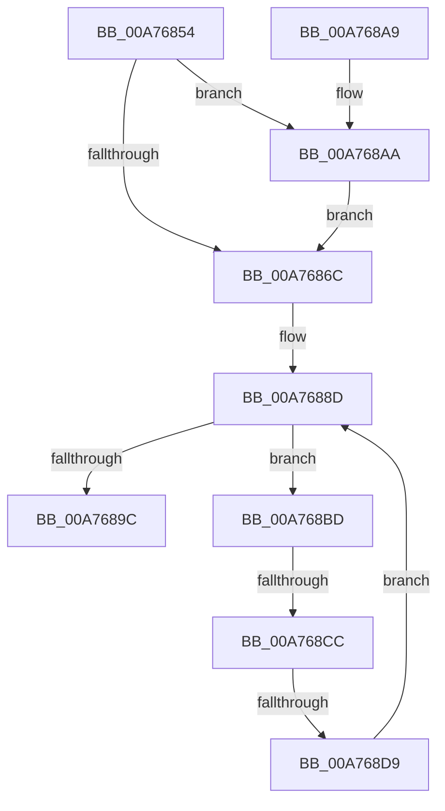

# PspJobIoRateControlDisable

- RVA: `0x00A76854`–`0x00A768FD` (길이 `169` bytes)
- VA: `0x0000000140A76854`
- 실행 섹션: `PAGE`
- PDB 이름 있음: `예`; PDB Function 태그: `예`
- unwind 정보 RVA: `0x000B5B54`
- 디코드: `44`개 명령, `169/169` bytes 표시
- 미해석 바이트: `0` (있으면 어셈블리에 `.byte`로 보존)

> 이 문서는 커널 이미지의 기계어와 PDB 기호를 분석해 생성했습니다. 4번과 5번은 함수 원형과 자료형을 바이너리 사용 방식에서 추정한 C 해석이며 원본 소스 복구 결과는 아닙니다.

## 1. Dependencies

- 직접 호출 지점: **4**; 고유 호출 대상: **3**
- 직접 호출자로 확인된 함수: **2**
- RIP 상대 이미지 참조: **0**

### Outgoing calls
- `0x00A76888` → [PspJobIoRateVolumeEntryRemoveAll](../../text/49/PspJobIoRateVolumeEntryRemoveAll_function_00499D44.md) (function, `0x00499D44`)
- `0x00A768B1` → [PspIoRateEntryDeactivate](../9F/PspIoRateEntryDeactivate_function_009F7BD4.md) (function, `0x009F7BD4`)
- `0x00A768EA` → [PspIoRateEntryDeactivate](../9F/PspIoRateEntryDeactivate_function_009F7BD4.md) (function, `0x009F7BD4`)
- `0x00A768F4` → [ExFreePoolWithTag](../../poolcode/B8/ExFreePoolWithTag_function_00B82870.md) (function, `0x00B82870`)

### Direct callers
- [PspJobDelete](../../text/4B/PspJobDelete_function_004BF8F0.md) at `0x004BF9EF`
- [PspSetJobIoRateControl](../9F/PspSetJobIoRateControl_function_009F78EC.md) at `0x009F7BB8`

### Static image references
- 디코드된 RIP-relative 메모리 참조가 없습니다.

## 2. Other-region calls and transfers

- 다른 실행 섹션으로 향하는 call: **2**
  - `0x00A76888` → [PspJobIoRateVolumeEntryRemoveAll](../../text/49/PspJobIoRateVolumeEntryRemoveAll_function_00499D44.md) (`PAGE` → `.text`)
  - `0x00A768F4` → [ExFreePoolWithTag](../../poolcode/B8/ExFreePoolWithTag_function_00B82870.md) (`PAGE` → `POOLCODE`)
- call이 아닌 외부 분기/꼬리 이동: **2**
  - `0x00A768C6` → [sub_00B414CA](../B4/Unknown_function_00B414CA.md) (`tail-transfer`)
  - `0x00A768D3` → [sub_00B414CA](../B4/Unknown_function_00B414CA.md) (`tail-transfer`)

## 3. Assembly (complete function range)

```asm
00A76854  48 89 5C 24 08                  mov qword ptr [rsp + 8], rbx
00A76859  57                              push rdi
00A7685A  48 83 EC 30                     sub rsp, 0x30
00A7685E  33 FF                           xor edi, edi
00A76860  48 8B D9                        mov rbx, rcx
00A76863  48 39 B9 88 06 00 00            cmp qword ptr [rcx + 0x688], rdi
00A7686A  75 3E                           jne 0x140a768aa
00A7686C  48 8D 44 24 20                  lea rax, [rsp + 0x20]
00A76871  48 8B CB                        mov rcx, rbx
00A76874  48 89 44 24 28                  mov qword ptr [rsp + 0x28], rax
00A76879  48 8D 54 24 20                  lea rdx, [rsp + 0x20]
00A7687E  48 8D 44 24 20                  lea rax, [rsp + 0x20]
00A76883  48 89 44 24 20                  mov qword ptr [rsp + 0x20], rax
00A76888  E8 B7 34 A2 FF                  call 0x140499d44
00A7688D  48 8B 5C 24 20                  mov rbx, qword ptr [rsp + 0x20]
00A76892  48 8D 44 24 20                  lea rax, [rsp + 0x20]
00A76897  48 3B D8                        cmp rbx, rax
00A7689A  75 21                           jne 0x140a768bd
00A7689C  48 8B 5C 24 40                  mov rbx, qword ptr [rsp + 0x40]
00A768A1  8B C7                           mov eax, edi
00A768A3  48 83 C4 30                     add rsp, 0x30
00A768A7  5F                              pop rdi
00A768A8  C3                              ret
00A768A9  CC                              int3
00A768AA  48 81 C1 60 06 00 00            add rcx, 0x660
00A768B1  E8 1E 13 F8 FF                  call 0x1409f7bd4
00A768B6  BF 01 00 00 00                  mov edi, 1
00A768BB  EB AF                           jmp 0x140a7686c
00A768BD  48 8D 44 24 20                  lea rax, [rsp + 0x20]
00A768C2  48 39 43 08                     cmp qword ptr [rbx + 8], rax
00A768C6  0F 85 FE AB 0C 00               jne 0x140b414ca
00A768CC  48 8B 03                        mov rax, qword ptr [rbx]
00A768CF  48 39 58 08                     cmp qword ptr [rax + 8], rbx
00A768D3  0F 85 F1 AB 0C 00               jne 0x140b414ca
00A768D9  48 8D 4C 24 20                  lea rcx, [rsp + 0x20]
00A768DE  48 89 44 24 20                  mov qword ptr [rsp + 0x20], rax
00A768E3  48 89 48 08                     mov qword ptr [rax + 8], rcx
00A768E7  48 8B CB                        mov rcx, rbx
00A768EA  E8 E5 12 F8 FF                  call 0x1409f7bd4
00A768EF  33 D2                           xor edx, edx
00A768F1  48 8B CB                        mov rcx, rbx
00A768F4  E8 77 BF 10 00                  call 0x140b82870
00A768F9  FF C7                           inc edi
00A768FB  EB 90                           jmp 0x140a7688d
```

## 4. C-style interpretation (structured pseudocode)

```c
__int64 __fastcall PspJobIoRateControlDisable(__int64 a1)
{
    __int64 result;
    __int64 v_rdi;
    __int64 v_rsp;
    unsigned __int64 v_stack_m10;
    unsigned __int64 v_stack_m18;
    unsigned __int64 v_stack_p20;
    unsigned __int64 v_stack_p8;

    v_stack_p8 = v_rbx;
    v_rsp = (v_rsp) - (48);
    v_rdi = 0;
    if ((*(unsigned __int64 *)(a1 + 1672)) != 0) goto loc_00A768AA;
loc_00A7686C:
    v_stack_m10 = v_stack_m18;
    v_stack_m18 = v_stack_m18;
    result = PspJobIoRateVolumeEntryRemoveAll(a1, v_stack_m18, a3, a4);
loc_00A7688D:
    if (v_stack_m18 != v_stack_m18) goto loc_00A768BD;
    v_rsp = (v_rsp) + (48);
    return 0;
loc_00A768AA:
    a1 = (a1) + (0x660ULL);
    result = PspIoRateEntryDeactivate(a1, v_stack_m18, a3, a4);
    goto loc_00A7686C;
loc_00A768BD:
    v_stack_p20 = *(unsigned __int64 *)(v_stack_p8);
    *(unsigned __int64 *)(*(unsigned __int64 *)(v_stack_p8) + 8) = v_stack_p20;
    result = PspIoRateEntryDeactivate(v_stack_p8, v_stack_m18, a3, a4);
    a2 = 0;
    result = ExFreePoolWithTag(v_stack_p8, a2, a3, a4);
    v_rdi = (unsigned int)((1) + 1);
    goto loc_00A7688D;
}
```

## 5. (Beta) C Style

```c
int64_t PspJobIoRateControlDisable(void *Arg1)
{
    uint8_t *arg1 = (uint8_t *)Arg1;

    int64_t result;
    int64_t local_rdi;
    int64_t local_rsp;
    uint64_t v_stack_m10;
    uint64_t v_stack_m18;
    uint64_t v_stack_p20;
    uint64_t v_stack_p8;

    v_stack_p8 = local_rbx;
    local_rsp = (local_rsp) - (48);
    local_rdi = 0;
    if ((*(uint64_t *)(arg1 + 0x688)) != 0) goto loc_00A768AA;
loc_00A7686C:
    v_stack_m10 = v_stack_m18;
    v_stack_m18 = v_stack_m18;
    result = PspJobIoRateVolumeEntryRemoveAll(Arg1, v_stack_m18, a3, a4);
loc_00A7688D:
    if (v_stack_m18 != v_stack_m18) goto loc_00A768BD;
    local_rsp = (local_rsp) + (48);
    return 0;
loc_00A768AA:
    Arg1 = (Arg1) + (0x660ULL);
    result = PspIoRateEntryDeactivate(Arg1, v_stack_m18, a3, a4);
    goto loc_00A7686C;
loc_00A768BD:
    v_stack_p20 = *(uint64_t *)(v_stack_p8);
    *(uint64_t *)(*(uint64_t *)(v_stack_p8) + 0x8) = v_stack_p20;
    result = PspIoRateEntryDeactivate(v_stack_p8, v_stack_m18, a3, a4);
    a2 = 0;
    result = ExFreePoolWithTag(v_stack_p8, a2, a3, a4);
    local_rdi = (uint32_t)((1) + 1);
    goto loc_00A7688D;
}
```

### 관측된 메모리 오프셋

구조체 형식이 확인되지 않은 접근은 인자 기준의 오프셋으로만 기록했습니다.

| 기준 인자 | 오프셋 표현 | 폭 (bit) | 접근 |
|---|---:|---:|---|
| `Arg1` | `+ 0x688` | `64` | `R` |

## 6. Execution-region graph

[열기: 2D/3D 그래프와 함수 탐색 컨트롤 패널](../../../control-panel.html?section=page&rva=0x00A76854&view=graph)

- 2D 그래프는 위에서 아래로 흐르고, 3D 그래프는 빈 공간을 드래그해 회전합니다. Shift+드래그는 이동, 휠은 확대·축소, 함수 노드 선택은 대상 보고서 이동입니다.

### Static fallback


