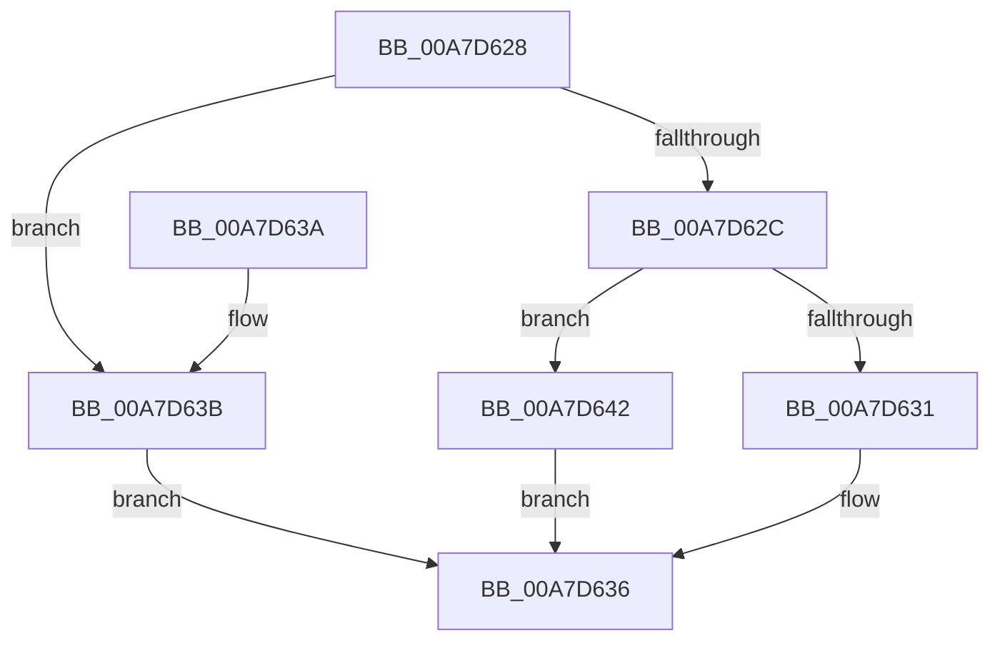

# PspLimitViolationRateControlToleranceLimitField

- RVA: `0x00A7D628`–`0x00A7D649` (길이 `33` bytes)
- VA: `0x0000000140A7D628`
- 실행 섹션: `PAGE`
- PDB 이름 있음: `예`; PDB Function 태그: `아니요`
- unwind 정보 RVA: `0x000DB714`
- 디코드: `12`개 명령, `33/33` bytes 표시
- 미해석 바이트: `0` (있으면 어셈블리에 `.byte`로 보존)

> 이 문서는 커널 이미지의 기계어와 PDB 기호를 분석해 생성했습니다. 4번과 5번은 함수 원형과 자료형을 바이너리 사용 방식에서 추정한 C 해석이며 원본 소스 복구 결과는 아닙니다.

## 1. Dependencies

- 직접 호출 지점: **0**; 고유 호출 대상: **0**
- 직접 호출자로 확인된 함수: **1**
- RIP 상대 이미지 참조: **0**

### Outgoing calls
- 직접 디코드된 call 명령이 없습니다.

### Direct callers
- [sub_00B316B4](../B3/Unknown_function_00B316B4.md) at `0x00B321DE`

### Static image references
- 디코드된 RIP-relative 메모리 참조가 없습니다.

## 2. Other-region calls and transfers

- 다른 실행 섹션으로 향하는 call: **0**
- 별도 외부 분기/꼬리 이동을 확인하지 못했습니다.

## 3. Assembly (complete function range)

```asm
00A7D628  85 D2                           test edx, edx
00A7D62A  74 0F                           je 0x140a7d63b
00A7D62C  83 FA 01                        cmp edx, 1
00A7D62F  74 11                           je 0x140a7d642
00A7D631  B8 4C 00 00 00                  mov eax, 0x4c
00A7D636  48 03 C1                        add rax, rcx
00A7D639  C3                              ret
00A7D63A  CC                              int3
00A7D63B  B8 64 00 00 00                  mov eax, 0x64
00A7D640  EB F4                           jmp 0x140a7d636
00A7D642  B8 5C 00 00 00                  mov eax, 0x5c
00A7D647  EB ED                           jmp 0x140a7d636
```

## 4. C-style interpretation (structured pseudocode)

```c
__int64 __fastcall PspLimitViolationRateControlToleranceLimitField(__int64 a1, int a2)
{
    __int64 result;

    if (a2 == 0) goto loc_00A7D63B;
    if (a2 == 1) goto loc_00A7D642;
loc_00A7D636:
    result = (76) + (a1);
    return result;
loc_00A7D63B:
    goto loc_00A7D636;
loc_00A7D642:
    goto loc_00A7D636;
}
```

## 5. (Beta) C Style

```c
int64_t PspLimitViolationRateControlToleranceLimitField(int64_t Arg1, int32_t Arg2)
{
    int64_t result;

    if (Arg2 == 0) goto loc_00A7D63B;
    if (Arg2 == 1) goto loc_00A7D642;
loc_00A7D636:
    result = (76) + (Arg1);
    return result;
loc_00A7D63B:
    goto loc_00A7D636;
loc_00A7D642:
    goto loc_00A7D636;
}
```

## 6. Execution-region graph

[열기: 2D/3D 그래프와 함수 탐색 컨트롤 패널](../../../control-panel.html?section=page&rva=0x00A7D628&view=graph)

- 2D 그래프는 위에서 아래로 흐르고, 3D 그래프는 빈 공간을 드래그해 회전합니다. Shift+드래그는 이동, 휠은 확대·축소, 함수 노드 선택은 대상 보고서 이동입니다.

### Static fallback


