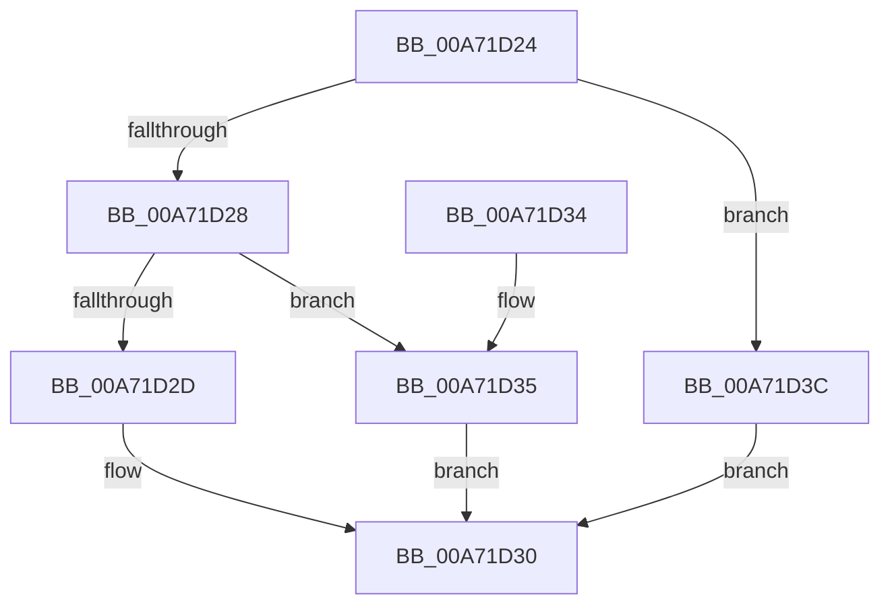

# PspNotificationLimitRateControlToleranceField

- RVA: `0x00A71D24`–`0x00A71D43` (길이 `31` bytes)
- VA: `0x0000000140A71D24`
- 실행 섹션: `PAGE`
- PDB 이름 있음: `예`; PDB Function 태그: `아니요`
- unwind 정보 RVA: `0x000DB714`
- 디코드: `12`개 명령, `31/31` bytes 표시
- 미해석 바이트: `0` (있으면 어셈블리에 `.byte`로 보존)

> 이 문서는 커널 이미지의 기계어와 PDB 기호를 분석해 생성했습니다. 4번과 5번은 함수 원형과 자료형을 바이너리 사용 방식에서 추정한 C 해석이며 원본 소스 복구 결과는 아닙니다.

## 1. Dependencies

- 직접 호출 지점: **0**; 고유 호출 대상: **0**
- 직접 호출자로 확인된 함수: **1**
- RIP 상대 이미지 참조: **0**

### Outgoing calls
- 직접 디코드된 call 명령이 없습니다.

### Direct callers
- [NtSetInformationJobObject](../9F/NtSetInformationJobObject_function_009F84C0.md) at `0x009FA51A`

### Static image references
- 디코드된 RIP-relative 메모리 참조가 없습니다.

## 2. Other-region calls and transfers

- 다른 실행 섹션으로 향하는 call: **0**
- 별도 외부 분기/꼬리 이동을 확인하지 못했습니다.

## 3. Assembly (complete function range)

```asm
00A71D24  85 D2                           test edx, edx
00A71D26  74 14                           je 0x140a71d3c
00A71D28  83 FA 01                        cmp edx, 1
00A71D2B  75 08                           jne 0x140a71d35
00A71D2D  8D 42 2B                        lea eax, [rdx + 0x2b]
00A71D30  48 03 C1                        add rax, rcx
00A71D33  C3                              ret
00A71D34  CC                              int3
00A71D35  B8 20 00 00 00                  mov eax, 0x20
00A71D3A  EB F4                           jmp 0x140a71d30
00A71D3C  B8 3C 00 00 00                  mov eax, 0x3c
00A71D41  EB ED                           jmp 0x140a71d30
```

## 4. C-style interpretation (structured pseudocode)

```c
__int64 __fastcall PspNotificationLimitRateControlToleranceField(__int64 a1, __int64 a2)
{
    __int64 result;

    if ((unsigned int)(a2) == 0) goto loc_00A71D3C;
    if (((unsigned int)(a2)) != 1) goto loc_00A71D35;
loc_00A71D30:
    result = (a2 + 43) + (a1);
    return result;
loc_00A71D35:
    goto loc_00A71D30;
loc_00A71D3C:
    goto loc_00A71D30;
}
```

## 5. (Beta) C Style

```c
int64_t PspNotificationLimitRateControlToleranceField(int64_t Arg1, int64_t Arg2)
{
    int64_t result;

    if ((uint32_t)(Arg2) == 0) goto loc_00A71D3C;
    if (((uint32_t)(Arg2)) != 1) goto loc_00A71D35;
loc_00A71D30:
    result = (Arg2 + 43) + (Arg1);
    return result;
loc_00A71D35:
    goto loc_00A71D30;
loc_00A71D3C:
    goto loc_00A71D30;
}
```

## 6. Execution-region graph

[열기: 2D/3D 그래프와 함수 탐색 컨트롤 패널](../../../control-panel.html?section=page&rva=0x00A71D24&view=graph)

- 2D 그래프는 위에서 아래로 흐르고, 3D 그래프는 빈 공간을 드래그해 회전합니다. Shift+드래그는 이동, 휠은 확대·축소, 함수 노드 선택은 대상 보고서 이동입니다.

### Static fallback


