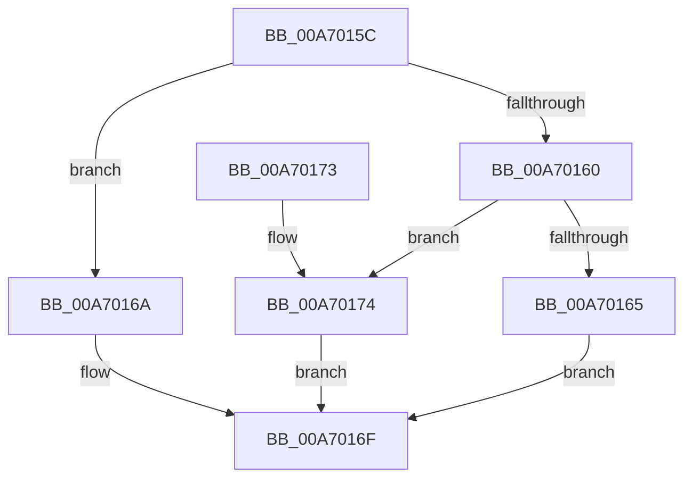

# PspNotificationLimitRateControlToleranceIntervalField

- RVA: `0x00A7015C`–`0x00A7017B` (길이 `31` bytes)
- VA: `0x0000000140A7015C`
- 실행 섹션: `PAGE`
- PDB 이름 있음: `예`; PDB Function 태그: `아니요`
- unwind 정보 RVA: `0x000DB714`
- 디코드: `12`개 명령, `31/31` bytes 표시
- 미해석 바이트: `0` (있으면 어셈블리에 `.byte`로 보존)

> 이 문서는 커널 이미지의 기계어와 PDB 기호를 분석해 생성했습니다. 4번과 5번은 함수 원형과 자료형을 바이너리 사용 방식에서 추정한 C 해석이며 원본 소스 복구 결과는 아닙니다.

## 1. Dependencies

- 직접 호출 지점: **0**; 고유 호출 대상: **0**
- 직접 호출자로 확인된 함수: **1**
- RIP 상대 이미지 참조: **0**

### Outgoing calls
- 직접 디코드된 call 명령이 없습니다.

### Direct callers
- [NtSetInformationJobObject](../9F/NtSetInformationJobObject_function_009F84C0.md) at `0x009FA52A`

### Static image references
- 디코드된 RIP-relative 메모리 참조가 없습니다.

## 2. Other-region calls and transfers

- 다른 실행 섹션으로 향하는 call: **0**
- 별도 외부 분기/꼬리 이동을 확인하지 못했습니다.

## 3. Assembly (complete function range)

```asm
00A7015C  85 D2                           test edx, edx
00A7015E  74 0A                           je 0x140a7016a
00A70160  83 FA 01                        cmp edx, 1
00A70163  75 0F                           jne 0x140a70174
00A70165  8D 42 37                        lea eax, [rdx + 0x37]
00A70168  EB 05                           jmp 0x140a7016f
00A7016A  B8 40 00 00 00                  mov eax, 0x40
00A7016F  48 03 C1                        add rax, rcx
00A70172  C3                              ret
00A70173  CC                              int3
00A70174  B8 24 00 00 00                  mov eax, 0x24
00A70179  EB F4                           jmp 0x140a7016f
```

## 4. C-style interpretation (structured pseudocode)

```c
__int64 __fastcall PspNotificationLimitRateControlToleranceIntervalField(__int64 a1, __int64 a2)
{
    __int64 result;

    if ((unsigned int)(a2) == 0) goto loc_00A7016A;
    if (((unsigned int)(a2)) != 1) goto loc_00A70174;
    goto loc_00A7016F;
loc_00A7016A:
loc_00A7016F:
    result = (64) + (a1);
    return result;
loc_00A70174:
    goto loc_00A7016F;
}
```

## 5. (Beta) C Style

```c
int64_t PspNotificationLimitRateControlToleranceIntervalField(int64_t Arg1, int64_t Arg2)
{
    int64_t result;

    if ((uint32_t)(Arg2) == 0) goto loc_00A7016A;
    if (((uint32_t)(Arg2)) != 1) goto loc_00A70174;
    goto loc_00A7016F;
loc_00A7016A:
loc_00A7016F:
    result = (64) + (Arg1);
    return result;
loc_00A70174:
    goto loc_00A7016F;
}
```

## 6. Execution-region graph

[열기: 2D/3D 그래프와 함수 탐색 컨트롤 패널](../../../control-panel.html?section=page&rva=0x00A7015C&view=graph)

- 2D 그래프는 위에서 아래로 흐르고, 3D 그래프는 빈 공간을 드래그해 회전합니다. Shift+드래그는 이동, 휠은 확대·축소, 함수 노드 선택은 대상 보고서 이동입니다.

### Static fallback


