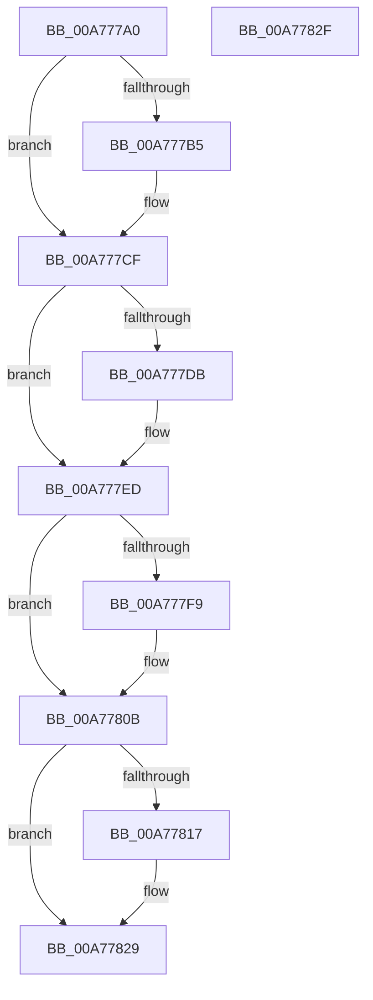

# PspSchedulerSharedDataRegionDelete

- RVA: `0x00A777A0`–`0x00A77830` (길이 `144` bytes)
- VA: `0x0000000140A777A0`
- 실행 섹션: `PAGE`
- PDB 이름 있음: `예`; PDB Function 태그: `아니요`
- unwind 정보 RVA: `0x0005CF00`
- 디코드: `33`개 명령, `144/144` bytes 표시
- 미해석 바이트: `0` (있으면 어셈블리에 `.byte`로 보존)

> 이 문서는 커널 이미지의 기계어와 PDB 기호를 분석해 생성했습니다. 4번과 5번은 함수 원형과 자료형을 바이너리 사용 방식에서 추정한 C 해석이며 원본 소스 복구 결과는 아닙니다.

## 1. Dependencies

- 직접 호출 지점: **4**; 고유 호출 대상: **3**
- 직접 호출자로 확인된 함수: **0**
- RIP 상대 이미지 참조: **0**

### Outgoing calls
- `0x00A777C2` → [MiUnmapViewOfSection](../88/MiUnmapViewOfSection_function_0088A4C4.md) (function, `0x0088A4C4`)
- `0x00A777E0` → [MiRemoveFromSystemSpace](../../text/29/MiRemoveFromSystemSpace_function_002962FC.md) (function, `0x002962FC`)
- `0x00A777FE` → [ObfDereferenceObjectWithTag](../../text/2F/ObfDereferenceObjectWithTag_function_002F78E0.md) (function, `0x002F78E0`)
- `0x00A7781C` → [ObfDereferenceObjectWithTag](../../text/2F/ObfDereferenceObjectWithTag_function_002F78E0.md) (function, `0x002F78E0`)

### Direct callers
- 이 함수 시작 RVA로 연결되는 직접 call은 확인되지 않았습니다. 간접 호출은 완전히 역산할 수 없습니다.

### Static image references
- 디코드된 RIP-relative 메모리 참조가 없습니다.

## 2. Other-region calls and transfers

- 다른 실행 섹션으로 향하는 call: **3**
  - `0x00A777E0` → [MiRemoveFromSystemSpace](../../text/29/MiRemoveFromSystemSpace_function_002962FC.md) (`PAGE` → `.text`)
  - `0x00A777FE` → [ObfDereferenceObjectWithTag](../../text/2F/ObfDereferenceObjectWithTag_function_002F78E0.md) (`PAGE` → `.text`)
  - `0x00A7781C` → [ObfDereferenceObjectWithTag](../../text/2F/ObfDereferenceObjectWithTag_function_002F78E0.md) (`PAGE` → `.text`)
- 별도 외부 분기/꼬리 이동을 확인하지 못했습니다.

## 3. Assembly (complete function range)

```asm
00A777A0  40 53                           push rbx
00A777A2  48 83 EC 20                     sub rsp, 0x20
00A777A6  48 8B 91 B8 00 00 00            mov rdx, qword ptr [rcx + 0xb8]
00A777AD  48 8B D9                        mov rbx, rcx
00A777B0  48 85 D2                        test rdx, rdx
00A777B3  74 1A                           je 0x140a777cf
00A777B5  48 8B 89 A0 00 00 00            mov rcx, qword ptr [rcx + 0xa0]
00A777BC  45 33 C9                        xor r9d, r9d
00A777BF  45 33 C0                        xor r8d, r8d
00A777C2  E8 FD 2C E1 FF                  call 0x14088a4c4
00A777C7  48 83 A3 B8 00 00 00 00         and qword ptr [rbx + 0xb8], 0
00A777CF  48 8B 8B B0 00 00 00            mov rcx, qword ptr [rbx + 0xb0]
00A777D6  48 85 C9                        test rcx, rcx
00A777D9  74 12                           je 0x140a777ed
00A777DB  BA 01 00 00 00                  mov edx, 1
00A777E0  E8 17 EB 81 FF                  call 0x1402962fc
00A777E5  48 83 A3 B0 00 00 00 00         and qword ptr [rbx + 0xb0], 0
00A777ED  48 8B 8B A8 00 00 00            mov rcx, qword ptr [rbx + 0xa8]
00A777F4  48 85 C9                        test rcx, rcx
00A777F7  74 12                           je 0x140a7780b
00A777F9  BA 50 73 53 61                  mov edx, 0x61537350
00A777FE  E8 DD 00 88 FF                  call 0x1402f78e0
00A77803  48 83 A3 A8 00 00 00 00         and qword ptr [rbx + 0xa8], 0
00A7780B  48 8B 8B A0 00 00 00            mov rcx, qword ptr [rbx + 0xa0]
00A77812  48 85 C9                        test rcx, rcx
00A77815  74 12                           je 0x140a77829
00A77817  BA 50 73 53 61                  mov edx, 0x61537350
00A7781C  E8 BF 00 88 FF                  call 0x1402f78e0
00A77821  48 83 A3 A0 00 00 00 00         and qword ptr [rbx + 0xa0], 0
00A77829  48 83 C4 20                     add rsp, 0x20
00A7782D  5B                              pop rbx
00A7782E  C3                              ret
00A7782F  CC                              int3
```

## 4. C-style interpretation (structured pseudocode)

```c
__int64 __fastcall PspSchedulerSharedDataRegionDelete(__int64 a1, __int64 a2, int a3, int a4)
{
    __int64 result;
    __int64 v_rsp;

    v_rsp = (v_rsp) - (32);
    if (*(unsigned __int64 *)(a1 + 184) != 0) {
        a1 = *(unsigned __int64 *)(a1 + 160);
        a4 = 0;
        a3 = 0;
        result = MiUnmapViewOfSection(a1, *(unsigned __int64 *)(a1 + 184), a3, a4);
    }
    if (*(unsigned __int64 *)(a1 + 176) != 0) {
        a2 = 1;
        result = MiRemoveFromSystemSpace(*(unsigned __int64 *)(a1 + 176), a2, a3, a4);
    }
    if (*(unsigned __int64 *)(a1 + 168) != 0) {
        a2 = 0x61537350ULL;
        result = ObfDereferenceObjectWithTag(*(unsigned __int64 *)(a1 + 168), a2, a3, a4);
    }
    if (*(unsigned __int64 *)(a1 + 160) != 0) {
        a2 = 0x61537350ULL;
        result = ObfDereferenceObjectWithTag(*(unsigned __int64 *)(a1 + 160), a2, a3, a4);
    }
    v_rsp = (v_rsp) + (32);
    return result;
}
```

## 5. (Beta) C Style

```c
int64_t PspSchedulerSharedDataRegionDelete(void *Arg1, int64_t Arg2, int32_t Arg3, int32_t Arg4)
{
    uint8_t *arg1 = (uint8_t *)Arg1;

    int64_t result;
    int64_t local_rsp;

    local_rsp = (local_rsp) - (32);
    if (*(uint64_t *)(arg1 + 0xB8) != 0) {
        Arg1 = *(uint64_t *)(arg1 + 0xA0);
        Arg4 = 0;
        Arg3 = 0;
        result = MiUnmapViewOfSection(Arg1, *(uint64_t *)(arg1 + 0xB8), Arg3, Arg4);
    }
    if (*(uint64_t *)(arg1 + 0xB0) != 0) {
        Arg2 = 1;
        result = MiRemoveFromSystemSpace(*(uint64_t *)(arg1 + 0xB0), Arg2, Arg3, Arg4);
    }
    if (*(uint64_t *)(arg1 + 0xA8) != 0) {
        Arg2 = 0x61537350ULL;
        result = ObfDereferenceObjectWithTag(*(uint64_t *)(arg1 + 0xA8), Arg2, Arg3, Arg4);
    }
    if (*(uint64_t *)(arg1 + 0xA0) != 0) {
        Arg2 = 0x61537350ULL;
        result = ObfDereferenceObjectWithTag(*(uint64_t *)(arg1 + 0xA0), Arg2, Arg3, Arg4);
    }
    local_rsp = (local_rsp) + (32);
    return result;
}
```

### 관측된 메모리 오프셋

구조체 형식이 확인되지 않은 접근은 인자 기준의 오프셋으로만 기록했습니다.

| 기준 인자 | 오프셋 표현 | 폭 (bit) | 접근 |
|---|---:|---:|---|
| `Arg1` | `+ 0xA0` | `64` | `R` |
| `Arg1` | `+ 0xA0` | `64` | `R/W` |
| `Arg1` | `+ 0xA8` | `64` | `R` |
| `Arg1` | `+ 0xA8` | `64` | `R/W` |
| `Arg1` | `+ 0xB0` | `64` | `R` |
| `Arg1` | `+ 0xB0` | `64` | `R/W` |
| `Arg1` | `+ 0xB8` | `64` | `R` |
| `Arg1` | `+ 0xB8` | `64` | `R/W` |

## 6. Execution-region graph

[열기: 2D/3D 그래프와 함수 탐색 컨트롤 패널](../../../control-panel.html?section=page&rva=0x00A777A0&view=graph)

- 2D 그래프는 위에서 아래로 흐르고, 3D 그래프는 빈 공간을 드래그해 회전합니다. Shift+드래그는 이동, 휠은 확대·축소, 함수 노드 선택은 대상 보고서 이동입니다.

### Static fallback


