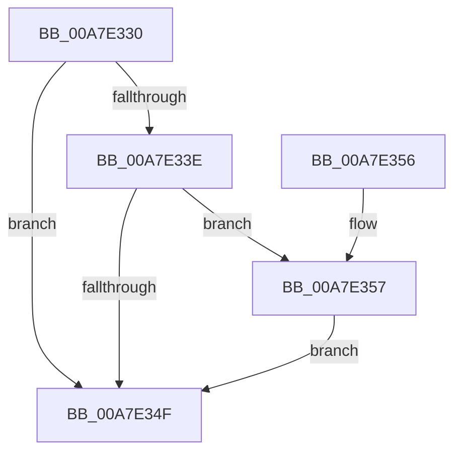

# PspSetProcessIoPriorityLimitCallback

- RVA: `0x00A7E330`–`0x00A7E362` (길이 `50` bytes)
- VA: `0x0000000140A7E330`
- 실행 섹션: `PAGE`
- PDB 이름 있음: `예`; PDB Function 태그: `아니요`
- unwind 정보 RVA: `0x00068784`
- 디코드: `15`개 명령, `50/50` bytes 표시
- 미해석 바이트: `0` (있으면 어셈블리에 `.byte`로 보존)

> 이 문서는 커널 이미지의 기계어와 PDB 기호를 분석해 생성했습니다. 4번과 5번은 함수 원형과 자료형을 바이너리 사용 방식에서 추정한 C 해석이며 원본 소스 복구 결과는 아닙니다.

## 1. Dependencies

- 직접 호출 지점: **1**; 고유 호출 대상: **1**
- 직접 호출자로 확인된 함수: **1**
- RIP 상대 이미지 참조: **0**

### Outgoing calls
- `0x00A7E35B` → [PspNotifyProcessEffectiveIoLimitChanged](../../text/3E/PspNotifyProcessEffectiveIoLimitChanged_function_003EC9C0.md) (function, `0x003EC9C0`)

### Direct callers
- [PspSetProcessBackgroundCountCallback](PspSetProcessBackgroundCountCallback_function_00A7E310.md) at `0x00A7E318`

### Static image references
- 디코드된 RIP-relative 메모리 참조가 없습니다.

## 2. Other-region calls and transfers

- 다른 실행 섹션으로 향하는 call: **1**
  - `0x00A7E35B` → [PspNotifyProcessEffectiveIoLimitChanged](../../text/3E/PspNotifyProcessEffectiveIoLimitChanged_function_003EC9C0.md) (`PAGE` → `.text`)
- 별도 외부 분기/꼬리 이동을 확인하지 못했습니다.

## 3. Assembly (complete function range)

```asm
00A7E330  48 83 EC 28                     sub rsp, 0x28
00A7E334  8B 81 F0 01 00 00               mov eax, dword ptr [rcx + 0x1f0]
00A7E33A  A8 01                           test al, 1
00A7E33C  75 11                           jne 0x140a7e34f
00A7E33E  48 8B 81 A0 02 00 00            mov rax, qword ptr [rcx + 0x2a0]
00A7E345  8B 12                           mov edx, dword ptr [rdx]
00A7E347  3B 90 3C 04 00 00               cmp edx, dword ptr [rax + 0x43c]
00A7E34D  75 08                           jne 0x140a7e357
00A7E34F  33 C0                           xor eax, eax
00A7E351  48 83 C4 28                     add rsp, 0x28
00A7E355  C3                              ret
00A7E356  CC                              int3
00A7E357  41 0F 92 C0                     setb r8b
00A7E35B  E8 60 E6 96 FF                  call 0x1403ec9c0
00A7E360  EB ED                           jmp 0x140a7e34f
```

## 4. C-style interpretation (structured pseudocode)

```c
__int64 __fastcall PspSetProcessIoPriorityLimitCallback(__int64 a1, __int64 a2)
{
    __int64 result;
    __int64 v_rsp;

    v_rsp = (v_rsp) - (40);
    if ((((unsigned __int8)((unsigned int)(*(unsigned int *)(a1 + 496)))) & (1)) != 0) goto loc_00A7E34F;
    if (((unsigned int)((unsigned int)(*(unsigned int *)(a2)))) != (*(unsigned int *)(*(unsigned __int64 *)(a1 + 672) + 1084))) goto loc_00A7E357;
loc_00A7E34F:
    result = 0;
    v_rsp = (v_rsp) + (40);
    return result;
loc_00A7E357:
    a3 = (condition_is_below) ? 1 : 0;
    result = PspNotifyProcessEffectiveIoLimitChanged(a1, (unsigned int)(*(unsigned int *)(a2)), a3, a4);
    goto loc_00A7E34F;
}
```

## 5. (Beta) C Style

```c
int64_t PspSetProcessIoPriorityLimitCallback(void *Arg1, void *Arg2)
{
    uint8_t *arg1 = (uint8_t *)Arg1;
    uint8_t *arg2 = (uint8_t *)Arg2;

    int64_t result;
    int64_t local_rsp;

    local_rsp = (local_rsp) - (40);
    if ((((uint8_t)((uint32_t)(*(uint32_t *)(arg1 + 0x1F0)))) & (1)) != 0) goto loc_00A7E34F;
    if (((uint32_t)((uint32_t)(*(uint32_t *)(arg2)))) != (*(uint32_t *)(*(uint64_t *)(arg1 + 0x2A0) + 0x43C))) goto loc_00A7E357;
loc_00A7E34F:
    result = 0;
    local_rsp = (local_rsp) + (40);
    return result;
loc_00A7E357:
    a3 = (condition_is_below) ? 1 : 0;
    result = PspNotifyProcessEffectiveIoLimitChanged(Arg1, (uint32_t)(*(uint32_t *)(arg2)), a3, a4);
    goto loc_00A7E34F;
}
```

### 관측된 메모리 오프셋

구조체 형식이 확인되지 않은 접근은 인자 기준의 오프셋으로만 기록했습니다.

| 기준 인자 | 오프셋 표현 | 폭 (bit) | 접근 |
|---|---:|---:|---|
| `Arg1` | `+ 0x1F0` | `32` | `R` |
| `Arg1` | `+ 0x2A0` | `64` | `R` |
| `Arg2` | `+ 0x0` | `32` | `R` |

## 6. Execution-region graph

[열기: 2D/3D 그래프와 함수 탐색 컨트롤 패널](../../../control-panel.html?section=page&rva=0x00A7E330&view=graph)

- 2D 그래프는 위에서 아래로 흐르고, 3D 그래프는 빈 공간을 드래그해 회전합니다. Shift+드래그는 이동, 휠은 확대·축소, 함수 노드 선택은 대상 보고서 이동입니다.

### Static fallback


