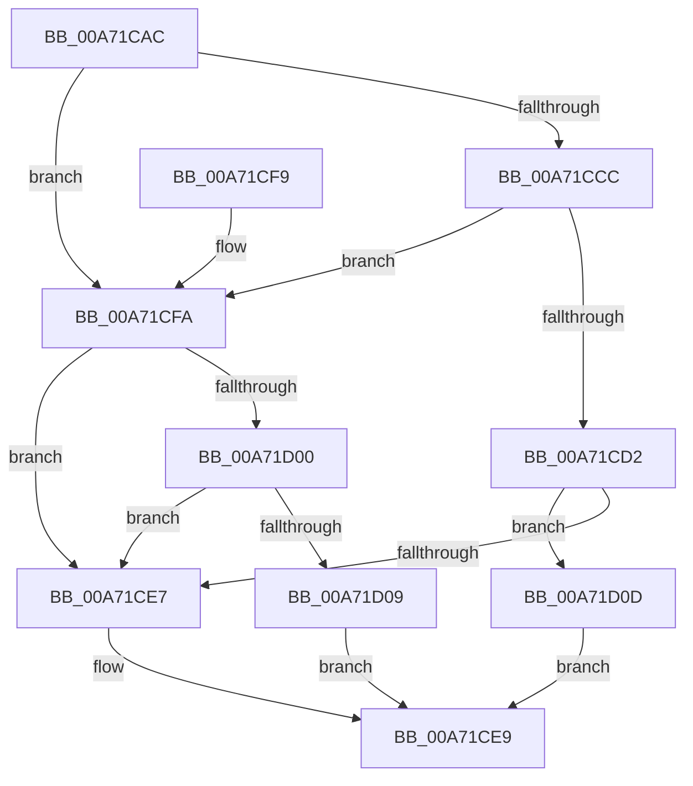

# PspValidateJobAssignmentSiloPolicy

- RVA: `0x00A71CAC`–`0x00A71D1D` (길이 `113` bytes)
- VA: `0x0000000140A71CAC`
- 실행 섹션: `PAGE`
- PDB 이름 있음: `예`; PDB Function 태그: `아니요`
- unwind 정보 RVA: `0x000B544C`
- 디코드: `36`개 명령, `113/113` bytes 표시
- 미해석 바이트: `0` (있으면 어셈블리에 `.byte`로 보존)

> 이 문서는 커널 이미지의 기계어와 PDB 기호를 분석해 생성했습니다. 4번과 5번은 함수 원형과 자료형을 바이너리 사용 방식에서 추정한 C 해석이며 원본 소스 복구 결과는 아닙니다.

## 1. Dependencies

- 직접 호출 지점: **4**; 고유 호출 대상: **3**
- 직접 호출자로 확인된 함수: **1**
- RIP 상대 이미지 참조: **0**

### Outgoing calls
- `0x00A71CD2` → [PsGetEffectiveServerSilo](../../text/22/PsGetEffectiveServerSilo_function_002257F0.md) (function, `0x002257F0`)
- `0x00A71CDD` → [PsGetEffectiveServerSilo](../../text/22/PsGetEffectiveServerSilo_function_002257F0.md) (function, `0x002257F0`)
- `0x00A71D00` → [PsIsServerSilo](../../text/22/PsIsServerSilo_function_00225828.md) (function, `0x00225828`)
- `0x00A71D10` → [PsGetProcessServerSilo](../../text/44/PsGetProcessServerSilo_function_0044BEE0.md) (function, `0x0044BEE0`)

### Direct callers
- [PspAssignProcessToJob](../A2/PspAssignProcessToJob_function_00A23370.md) at `0x00A2355D`

### Static image references
- 디코드된 RIP-relative 메모리 참조가 없습니다.

## 2. Other-region calls and transfers

- 다른 실행 섹션으로 향하는 call: **4**
  - `0x00A71CD2` → [PsGetEffectiveServerSilo](../../text/22/PsGetEffectiveServerSilo_function_002257F0.md) (`PAGE` → `.text`)
  - `0x00A71CDD` → [PsGetEffectiveServerSilo](../../text/22/PsGetEffectiveServerSilo_function_002257F0.md) (`PAGE` → `.text`)
  - `0x00A71D00` → [PsIsServerSilo](../../text/22/PsIsServerSilo_function_00225828.md) (`PAGE` → `.text`)
  - `0x00A71D10` → [PsGetProcessServerSilo](../../text/44/PsGetProcessServerSilo_function_0044BEE0.md) (`PAGE` → `.text`)
- 별도 외부 분기/꼬리 이동을 확인하지 못했습니다.

## 3. Assembly (complete function range)

```asm
00A71CAC  48 89 5C 24 08                  mov qword ptr [rsp + 8], rbx
00A71CB1  48 89 74 24 10                  mov qword ptr [rsp + 0x10], rsi
00A71CB6  57                              push rdi
00A71CB7  48 83 EC 20                     sub rsp, 0x20
00A71CBB  41 8D 41 FF                     lea eax, [r9 - 1]
00A71CBF  49 8B F8                        mov rdi, r8
00A71CC2  48 8B F2                        mov rsi, rdx
00A71CC5  A9 F9 FF FF FF                  test eax, 0xfffffff9
00A71CCA  75 2E                           jne 0x140a71cfa
00A71CCC  41 83 F9 07                     cmp r9d, 7
00A71CD0  74 28                           je 0x140a71cfa
00A71CD2  E8 19 3B 7B FF                  call 0x1402257f0
00A71CD7  48 8B CE                        mov rcx, rsi
00A71CDA  48 8B D8                        mov rbx, rax
00A71CDD  E8 0E 3B 7B FF                  call 0x1402257f0
00A71CE2  48 3B C3                        cmp rax, rbx
00A71CE5  75 26                           jne 0x140a71d0d
00A71CE7  B0 01                           mov al, 1
00A71CE9  48 8B 5C 24 30                  mov rbx, qword ptr [rsp + 0x30]
00A71CEE  48 8B 74 24 38                  mov rsi, qword ptr [rsp + 0x38]
00A71CF3  48 83 C4 20                     add rsp, 0x20
00A71CF7  5F                              pop rdi
00A71CF8  C3                              ret
00A71CF9  CC                              int3
00A71CFA  41 83 F9 04                     cmp r9d, 4
00A71CFE  75 E7                           jne 0x140a71ce7
00A71D00  E8 23 3B 7B FF                  call 0x140225828
00A71D05  84 C0                           test al, al
00A71D07  74 DE                           je 0x140a71ce7
00A71D09  32 C0                           xor al, al
00A71D0B  EB DC                           jmp 0x140a71ce9
00A71D0D  48 8B CF                        mov rcx, rdi
00A71D10  E8 CB A1 9D FF                  call 0x14044bee0
00A71D15  48 3B D8                        cmp rbx, rax
00A71D18  0F 94 C0                        sete al
00A71D1B  EB CC                           jmp 0x140a71ce9
```

## 4. C-style interpretation (structured pseudocode)

```c
__int64 __fastcall PspValidateJobAssignmentSiloPolicy(__int64 a1, __int64 a2, __int64 a3, __int64 a4)
{
    __int64 result;
    __int64 v_rsp;
    unsigned __int64 v_stack_p10;
    unsigned __int64 v_stack_p8;

    v_stack_p8 = v_rbx;
    v_stack_p10 = v_rsi;
    v_rsp = (v_rsp) - (32);
    if ((((unsigned int)(a4 - 1)) & (0xFFFFFFF9ULL)) != 0) goto loc_00A71CFA;
    if (((unsigned int)(a4)) == 7) goto loc_00A71CFA;
    result = PsGetEffectiveServerSilo(a1, a2, a3, a4);
    result = PsGetEffectiveServerSilo(a2, a2, a3, a4);
    if (result != result) goto loc_00A71D0D;
loc_00A71CE7:
loc_00A71CE9:
    v_rsp = (v_rsp) + (32);
    return 1;
loc_00A71CFA:
    if (((unsigned int)(a4)) != 4) goto loc_00A71CE7;
    result = PsIsServerSilo(a2, a2, a3, a4);
    if ((unsigned __int8)(result) == 0) goto loc_00A71CE7;
    result = 0;
    goto loc_00A71CE9;
loc_00A71D0D:
    result = PsGetProcessServerSilo(a3, a2, a3, a4);
    result = (v_stack_p8 == result) ? 1 : 0;
    goto loc_00A71CE9;
}
```

## 5. (Beta) C Style

```c
int64_t PspValidateJobAssignmentSiloPolicy(int64_t Arg1, int64_t Arg2, int64_t Arg3, void *Arg4)
{
    uint8_t *arg4 = (uint8_t *)Arg4;

    int64_t result;
    int64_t local_rsp;
    uint64_t v_stack_p10;
    uint64_t v_stack_p8;

    v_stack_p8 = local_rbx;
    v_stack_p10 = local_rsi;
    local_rsp = (local_rsp) - (32);
    if ((((uint32_t)(Arg4 - 1)) & (0xFFFFFFF9ULL)) != 0) goto loc_00A71CFA;
    if (((uint32_t)(Arg4)) == 7) goto loc_00A71CFA;
    result = PsGetEffectiveServerSilo(Arg1, Arg2, Arg3, Arg4);
    result = PsGetEffectiveServerSilo(Arg2, Arg2, Arg3, Arg4);
    if (result != result) goto loc_00A71D0D;
loc_00A71CE7:
loc_00A71CE9:
    local_rsp = (local_rsp) + (32);
    return 1;
loc_00A71CFA:
    if (((uint32_t)(Arg4)) != 4) goto loc_00A71CE7;
    result = PsIsServerSilo(Arg2, Arg2, Arg3, Arg4);
    if ((uint8_t)(result) == 0) goto loc_00A71CE7;
    result = 0;
    goto loc_00A71CE9;
loc_00A71D0D:
    result = PsGetProcessServerSilo(Arg3, Arg2, Arg3, Arg4);
    result = (v_stack_p8 == result) ? 1 : 0;
    goto loc_00A71CE9;
}
```

### 관측된 메모리 오프셋

구조체 형식이 확인되지 않은 접근은 인자 기준의 오프셋으로만 기록했습니다.

| 기준 인자 | 오프셋 표현 | 폭 (bit) | 접근 |
|---|---:|---:|---|
| `Arg4` | `- 0x1` | `32` | `R` |

## 6. Execution-region graph

[열기: 2D/3D 그래프와 함수 탐색 컨트롤 패널](../../../control-panel.html?section=page&rva=0x00A71CAC&view=graph)

- 2D 그래프는 위에서 아래로 흐르고, 3D 그래프는 빈 공간을 드래그해 회전합니다. Shift+드래그는 이동, 휠은 확대·축소, 함수 노드 선택은 대상 보고서 이동입니다.

### Static fallback


