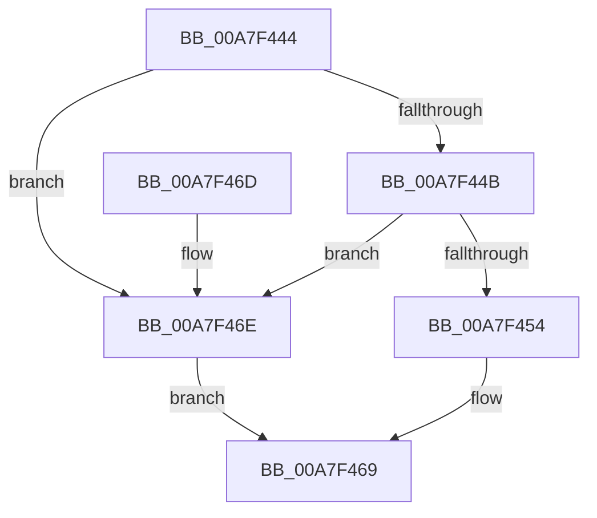

# RtlBootStatusItemInfo

- RVA: `0x00A7F444`–`0x00A7F476` (길이 `50` bytes)
- VA: `0x0000000140A7F444`
- 실행 섹션: `PAGE`
- PDB 이름 있음: `예`; PDB Function 태그: `아니요`
- unwind 정보 RVA: `0x000DB714`
- 디코드: `16`개 명령, `50/50` bytes 표시
- 미해석 바이트: `0` (있으면 어셈블리에 `.byte`로 보존)

> 이 문서는 커널 이미지의 기계어와 PDB 기호를 분석해 생성했습니다. 4번과 5번은 함수 원형과 자료형을 바이너리 사용 방식에서 추정한 C 해석이며 원본 소스 복구 결과는 아닙니다.

## 1. Dependencies

- 직접 호출 지점: **0**; 고유 호출 대상: **0**
- 직접 호출자로 확인된 함수: **1**
- RIP 상대 이미지 참조: **1**

### Outgoing calls
- 직접 디코드된 call 명령이 없습니다.

### Direct callers
- [RtlCheckBootStatusIntegrity](../79/RtlCheckBootStatusIntegrity_function_00790464.md) at `0x007904E3`

### Static image references
- `0x00A7F454` → RVA `0x0001BBA0` (`.rdata`; read)

## 2. Other-region calls and transfers

- 다른 실행 섹션으로 향하는 call: **0**
- 별도 외부 분기/꼬리 이동을 확인하지 못했습니다.

## 3. Assembly (complete function range)

```asm
00A7F444  45 33 C9                        xor r9d, r9d
00A7F447  85 C9                           test ecx, ecx
00A7F449  78 23                           js 0x140a7f46e
00A7F44B  48 63 C9                        movsxd rcx, ecx
00A7F44E  48 83 F9 13                     cmp rcx, 0x13
00A7F452  73 1A                           jae 0x140a7f46e
00A7F454  4C 8D 15 45 C7 59 FF            lea r10, [rip - 0xa638bb]
00A7F45B  41 8B 04 CA                     mov eax, dword ptr [r10 + rcx*8]
00A7F45F  89 02                           mov dword ptr [rdx], eax
00A7F461  41 8B 44 CA 04                  mov eax, dword ptr [r10 + rcx*8 + 4]
00A7F466  41 89 00                        mov dword ptr [r8], eax
00A7F469  41 8B C1                        mov eax, r9d
00A7F46C  C3                              ret
00A7F46D  CC                              int3
00A7F46E  41 B9 0D 00 00 C0               mov r9d, 0xc000000d
00A7F474  EB F3                           jmp 0x140a7f469
```

## 4. C-style interpretation (structured pseudocode)

```c
__int64 __fastcall RtlBootStatusItemInfo(int a1, __int64 a2, __int64 a3, int a4)
{
    a4 = 0;
    if (sign_flag) goto loc_00A7F46E;
    if (((int)(a1)) >= 19) goto loc_00A7F46E;
    *(unsigned int *)(a2) = (unsigned int)((unsigned int)(*(unsigned int *)(v_rip - 10893499 + (int)(a1) * 8)));
    *(unsigned int *)(a3) = (unsigned int)((unsigned int)(*(unsigned int *)(v_rip - 10893499 + (int)(a1) * 8 + 4)));
loc_00A7F469:
    return 0;
loc_00A7F46E:
    goto loc_00A7F469;
}
```

## 5. (Beta) C Style

```c
int64_t RtlBootStatusItemInfo(int32_t Arg1, void *Arg2, void *Arg3, int32_t Arg4)
{
    uint8_t *arg2 = (uint8_t *)Arg2;
    uint8_t *arg3 = (uint8_t *)Arg3;

    Arg4 = 0;
    if (sign_flag) goto loc_00A7F46E;
    if (((int32_t)(Arg1)) >= 19) goto loc_00A7F46E;
    *(uint32_t *)(arg2) = (uint32_t)((uint32_t)(*(uint32_t *)(v_rip - 0xA638BB + (int32_t)(Arg1) * 8)));
    *(uint32_t *)(arg3) = (uint32_t)((uint32_t)(*(uint32_t *)(v_rip - 0xA638BB + (int32_t)(Arg1) * 8 + 0x4)));
loc_00A7F469:
    return 0;
loc_00A7F46E:
    goto loc_00A7F469;
}
```

### 관측된 메모리 오프셋

구조체 형식이 확인되지 않은 접근은 인자 기준의 오프셋으로만 기록했습니다.

| 기준 인자 | 오프셋 표현 | 폭 (bit) | 접근 |
|---|---:|---:|---|
| `Arg2` | `+ 0x0` | `32` | `W` |
| `Arg3` | `+ 0x0` | `32` | `W` |

## 6. Execution-region graph

[열기: 2D/3D 그래프와 함수 탐색 컨트롤 패널](../../../control-panel.html?section=page&rva=0x00A7F444&view=graph)

- 2D 그래프는 위에서 아래로 흐르고, 3D 그래프는 빈 공간을 드래그해 회전합니다. Shift+드래그는 이동, 휠은 확대·축소, 함수 노드 선택은 대상 보고서 이동입니다.

### Static fallback


