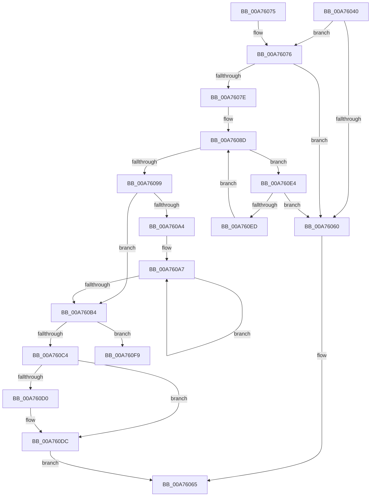

# RtlDeleteAce

- RVA: `0x00A76040`–`0x00A76102` (길이 `194` bytes)
- VA: `0x0000000140A76040`
- 실행 섹션: `PAGE`
- PDB 이름 있음: `예`; PDB Function 태그: `예`
- unwind 정보 RVA: `0x000A82E8`
- 디코드: `62`개 명령, `194/194` bytes 표시
- 미해석 바이트: `0` (있으면 어셈블리에 `.byte`로 보존)

> 이 문서는 커널 이미지의 기계어와 PDB 기호를 분석해 생성했습니다. 4번과 5번은 함수 원형과 자료형을 바이너리 사용 방식에서 추정한 C 해석이며 원본 소스 복구 결과는 아닙니다.

## 1. Dependencies

- 직접 호출 지점: **2**; 고유 호출 대상: **2**
- 직접 호출자로 확인된 함수: **1**
- RIP 상대 이미지 참조: **0**

### Outgoing calls
- `0x00A76054` → [RtlValidAcl](../92/RtlValidAcl_function_0092A7A0.md) (function, `0x0092A7A0`)
- `0x00A760D7` → [memset](../../text/6C/memset_function_006C6C40.md) (function, `0x006C6C40`)

### Direct callers
- [SepRemoveAceFromTokenDefaultDacl](../../text/40/SepRemoveAceFromTokenDefaultDacl_function_0040018C.md) at `0x004001F3`

### Static image references
- 디코드된 RIP-relative 메모리 참조가 없습니다.

## 2. Other-region calls and transfers

- 다른 실행 섹션으로 향하는 call: **1**
  - `0x00A760D7` → [memset](../../text/6C/memset_function_006C6C40.md) (`PAGE` → `.text`)
- call이 아닌 외부 분기/꼬리 이동: **1**
  - `0x00A760FD` → [sub_00B412C6](../B4/Unknown_function_00B412C6.md) (`tail-transfer`)

## 3. Assembly (complete function range)

```asm
00A76040  48 89 5C 24 08                  mov qword ptr [rsp + 8], rbx
00A76045  48 89 74 24 10                  mov qword ptr [rsp + 0x10], rsi
00A7604A  57                              push rdi
00A7604B  48 83 EC 20                     sub rsp, 0x20
00A7604F  8B FA                           mov edi, edx
00A76051  48 8B D9                        mov rbx, rcx
00A76054  E8 47 47 EB FF                  call 0x14092a7a0
00A76059  45 33 D2                        xor r10d, r10d
00A7605C  84 C0                           test al, al
00A7605E  75 16                           jne 0x140a76076
00A76060  B8 0D 00 00 C0                  mov eax, 0xc000000d
00A76065  48 8B 5C 24 30                  mov rbx, qword ptr [rsp + 0x30]
00A7606A  48 8B 74 24 38                  mov rsi, qword ptr [rsp + 0x38]
00A7606F  48 83 C4 20                     add rsp, 0x20
00A76073  5F                              pop rdi
00A76074  C3                              ret
00A76075  CC                              int3
00A76076  0F B7 4B 04                     movzx ecx, word ptr [rbx + 4]
00A7607A  3B F9                           cmp edi, ecx
00A7607C  73 E2                           jae 0x140a76060
00A7607E  4C 8D 4B 08                     lea r9, [rbx + 8]
00A76082  45 8B C2                        mov r8d, r10d
00A76085  49 8B D1                        mov rdx, r9
00A76088  BE 01 00 00 00                  mov esi, 1
00A7608D  0F B7 43 02                     movzx eax, word ptr [rbx + 2]
00A76091  48 03 C3                        add rax, rbx
00A76094  44 3B C1                        cmp r8d, ecx
00A76097  72 4B                           jb 0x140a760e4
00A76099  48 3B D0                        cmp rdx, rax
00A7609C  49 0F 47 D2                     cmova rdx, r10
00A760A0  85 FF                           test edi, edi
00A760A2  74 10                           je 0x140a760b4
00A760A4  48 8B CF                        mov rcx, rdi
00A760A7  41 0F B7 41 02                  movzx eax, word ptr [r9 + 2]
00A760AC  4C 03 C8                        add r9, rax
00A760AF  48 2B CE                        sub rcx, rsi
00A760B2  75 F3                           jne 0x140a760a7
00A760B4  45 0F B7 41 02                  movzx r8d, word ptr [r9 + 2]
00A760B9  41 2B D1                        sub edx, r9d
00A760BC  45 8B D0                        mov r10d, r8d
00A760BF  44 3B C2                        cmp r8d, edx
00A760C2  72 35                           jb 0x140a760f9
00A760C4  8B C2                           mov eax, edx
00A760C6  49 8B C8                        mov rcx, r8
00A760C9  41 2B C0                        sub eax, r8d
00A760CC  3B C2                           cmp eax, edx
00A760CE  73 0C                           jae 0x140a760dc
00A760D0  8B C8                           mov ecx, eax
00A760D2  33 D2                           xor edx, edx
00A760D4  49 03 C9                        add rcx, r9
00A760D7  E8 64 0B C5 FF                  call 0x1406c6c40
00A760DC  66 29 73 04                     sub word ptr [rbx + 4], si
00A760E0  33 C0                           xor eax, eax
00A760E2  EB 81                           jmp 0x140a76065
00A760E4  48 3B D0                        cmp rdx, rax
00A760E7  0F 83 73 FF FF FF               jae 0x140a76060
00A760ED  0F B7 42 02                     movzx eax, word ptr [rdx + 2]
00A760F1  44 03 C6                        add r8d, esi
00A760F4  48 03 D0                        add rdx, rax
00A760F7  EB 94                           jmp 0x140a7608d
00A760F9  4F 8D 1C 08                     lea r11, [r8 + r9]
00A760FD  E9 C4 B1 0C 00                  jmp 0x140b412c6
```

## 4. C-style interpretation (structured pseudocode)

```c
__int64 __fastcall RtlDeleteAce(__int64 a1, int a2)
{
    __int64 result;
    __int64 v_r10;
    __int64 v_rsp;
    unsigned __int64 v_stack_p10;
    unsigned __int64 v_stack_p8;

    v_stack_p8 = v_rbx;
    v_stack_p10 = v_rsi;
    v_rsp = (v_rsp) - (32);
    result = RtlValidAcl(a1, a2, a3, a4);
    v_r10 = 0;
    if ((unsigned __int8)(result) != 0) goto loc_00A76076;
loc_00A76060:
loc_00A76065:
    v_rsp = (v_rsp) + (32);
    return (unsigned int)(0xC000000DULL);
loc_00A76076:
    if (((unsigned int)((unsigned int)(a2))) >= ((unsigned int)(*(unsigned __int16 *)(v_stack_p8 + 4)))) goto loc_00A76060;
loc_00A7608D:
    result = (*(unsigned __int16 *)(v_stack_p8 + 2)) + (v_stack_p8);
    if (0 < ((unsigned int)(*(unsigned __int16 *)(v_stack_p8 + 4)))) goto loc_00A760E4;
    a2 = v_stack_p8 + 8;
    if ((v_stack_p8 + 8) > result) { a2 = 0; }
    if ((unsigned int)((unsigned int)(a2)) == 0) goto loc_00A760B4;
loc_00A760A7:
    a4 = (v_stack_p8 + 8) + (*(unsigned __int16 *)(v_stack_p8 + 8 + 2));
    a1 = ((unsigned int)(a2)) - (1);
    if (condition_is_not_equal) goto loc_00A760A7;
loc_00A760B4:
    a2 = (unsigned int)((a2) - ((unsigned int)(a4)));
    if (((unsigned int)(*(unsigned __int16 *)(a4 + 2))) < a2) goto loc_00A760F9;
    result = (unsigned int)(((unsigned int)(a2)) - ((unsigned int)(*(unsigned __int16 *)(a4 + 2))));
    if (((unsigned int)(result)) < a2) {
        a1 = (unsigned int)(result);
        a2 = 0;
        a1 = (a1) + (a4);
        result = memset(a1, a2, *(unsigned __int16 *)(a4 + 2), a4);
    }
    result = 0;
    goto loc_00A76065;
loc_00A760E4:
    if (0 >= 0) goto loc_00A76060;
    a3 = (unsigned int)((*(unsigned __int16 *)(a4 + 2)) + (1));
    a2 = (a2) + (*(unsigned __int16 *)(a2 + 2));
    goto loc_00A7608D;
loc_00A760F9:
}
```

## 5. (Beta) C Style

```c
int64_t RtlDeleteAce(void *Arg1, int32_t Arg2)
{
    uint8_t *arg1 = (uint8_t *)Arg1;

    int64_t result;
    int64_t local_r10;
    int64_t local_rsp;
    uint64_t v_stack_p10;
    uint64_t v_stack_p8;

    v_stack_p8 = local_rbx;
    v_stack_p10 = local_rsi;
    local_rsp = (local_rsp) - (32);
    result = RtlValidAcl(Arg1, Arg2, a3, a4);
    local_r10 = 0;
    if ((uint8_t)(result) != 0) goto loc_00A76076;
loc_00A76060:
loc_00A76065:
    local_rsp = (local_rsp) + (32);
    return (uint32_t)(0xC000000DULL);
loc_00A76076:
    if (((uint32_t)((uint32_t)(Arg2))) >= ((uint32_t)(*(uint16_t *)(v_stack_p8 + 0x4)))) goto loc_00A76060;
loc_00A7608D:
    result = (*(uint16_t *)(v_stack_p8 + 0x2)) + (v_stack_p8);
    if (0 < ((uint32_t)(*(uint16_t *)(v_stack_p8 + 0x4)))) goto loc_00A760E4;
    Arg2 = v_stack_p8 + 8;
    if ((v_stack_p8 + 8) > result) { Arg2 = 0; }
    if ((uint32_t)((uint32_t)(Arg2)) == 0) goto loc_00A760B4;
loc_00A760A7:
    a4 = (v_stack_p8 + 8) + (*(uint16_t *)(v_stack_p8 + 0x8 + 0x2));
    Arg1 = ((uint32_t)(Arg2)) - (1);
    if (condition_is_not_equal) goto loc_00A760A7;
loc_00A760B4:
    Arg2 = (uint32_t)((Arg2) - ((uint32_t)(a4)));
    if (((uint32_t)(*(uint16_t *)(a4 + 0x2))) < Arg2) goto loc_00A760F9;
    result = (uint32_t)(((uint32_t)(Arg2)) - ((uint32_t)(*(uint16_t *)(a4 + 0x2))));
    if (((uint32_t)(result)) < Arg2) {
        Arg1 = (uint32_t)(result);
        Arg2 = 0;
        Arg1 = (Arg1) + (a4);
        result = memset(Arg1, Arg2, *(uint16_t *)(a4 + 0x2), a4);
    }
    result = 0;
    goto loc_00A76065;
loc_00A760E4:
    if (0 >= 0) goto loc_00A76060;
    a3 = (uint32_t)((*(uint16_t *)(a4 + 0x2)) + (1));
    Arg2 = (Arg2) + (*(uint16_t *)(Arg2 + 0x2));
    goto loc_00A7608D;
loc_00A760F9:
}
```

### 관측된 메모리 오프셋

구조체 형식이 확인되지 않은 접근은 인자 기준의 오프셋으로만 기록했습니다.

| 기준 인자 | 오프셋 표현 | 폭 (bit) | 접근 |
|---|---:|---:|---|
| `Arg1` | `+ 0x2` | `16` | `R` |
| `Arg1` | `+ 0x4` | `16` | `R` |
| `Arg1` | `+ 0x4` | `16` | `R/W` |
| `Arg1` | `+ 0x8` | `64` | `R` |

## 6. Execution-region graph

[열기: 2D/3D 그래프와 함수 탐색 컨트롤 패널](../../../control-panel.html?section=page&rva=0x00A76040&view=graph)

- 2D 그래프는 위에서 아래로 흐르고, 3D 그래프는 빈 공간을 드래그해 회전합니다. Shift+드래그는 이동, 휠은 확대·축소, 함수 노드 선택은 대상 보고서 이동입니다.

### Static fallback


