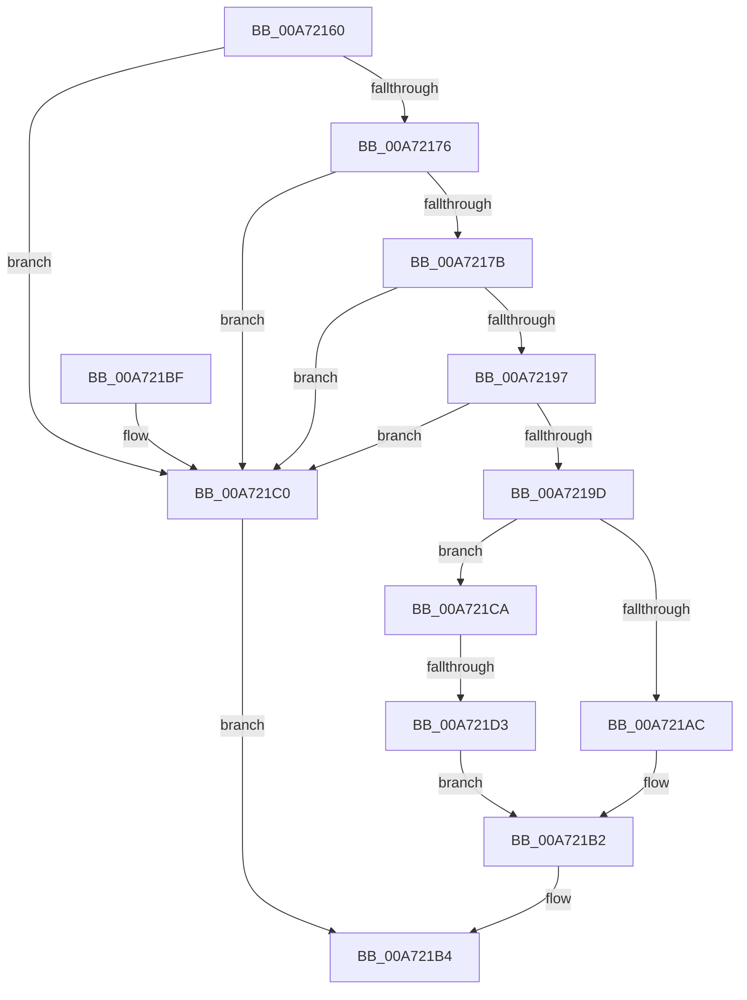

# RtlGetAppContainerSidType

- RVA: `0x00A72160`–`0x00A721DB` (길이 `123` bytes)
- VA: `0x0000000140A72160`
- 실행 섹션: `PAGE`
- PDB 이름 있음: `예`; PDB Function 태그: `예`
- unwind 정보 RVA: `0x0007CED0`
- 디코드: `36`개 명령, `123/123` bytes 표시
- 미해석 바이트: `0` (있으면 어셈블리에 `.byte`로 보존)

> 이 문서는 커널 이미지의 기계어와 PDB 기호를 분석해 생성했습니다. 4번과 5번은 함수 원형과 자료형을 바이너리 사용 방식에서 추정한 C 해석이며 원본 소스 복구 결과는 아닙니다.

## 1. Dependencies

- 직접 호출 지점: **2**; 고유 호출 대상: **2**
- 직접 호출자로 확인된 함수: **6**
- RIP 상대 이미지 참조: **1**

### Outgoing calls
- `0x00A7218C` → [RtlCompareMemory](../../text/6B/RtlCompareMemory_function_006BA670.md) (function, `0x006BA670`)
- `0x00A721A0` → [RtlSubAuthorityCountSid](../../text/46/RtlSubAuthorityCountSid_function_00468F10.md) (function, `0x00468F10`)

### Direct callers
- [SepCreateAppContainerToken](../../text/4F/SepCreateAppContainerToken_function_004F43AC.md) at `0x004F4677`
- [RtlIsParentOfChildAppContainer](../70/RtlIsParentOfChildAppContainer_function_007047CC.md) at `0x007047EE`
- [RtlIsParentOfChildAppContainer](../70/RtlIsParentOfChildAppContainer_function_007047CC.md) at `0x00704806`
- [RtlGetAppContainerParent](../78/RtlGetAppContainerParent_function_0078E4A0.md) at `0x0078E4C5`
- [RtlpGetTokenNamedObjectPath](../78/RtlpGetTokenNamedObjectPath_function_0078ED40.md) at `0x0078EF79`
- [SepValidateReferencedCachedHandles](../8F/SepValidateReferencedCachedHandles_function_008F4BB0.md) at `0x008F4E88`
- [NtCreateLowBoxToken](../AB/NtCreateLowBoxToken_function_00AB9880.md) at `0x00AB9EA2`

### Static image references
- `0x00A7217F` → RVA `0x0001A798` (`.rdata`; read)

## 2. Other-region calls and transfers

- 다른 실행 섹션으로 향하는 call: **2**
  - `0x00A7218C` → [RtlCompareMemory](../../text/6B/RtlCompareMemory_function_006BA670.md) (`PAGE` → `.text`)
  - `0x00A721A0` → [RtlSubAuthorityCountSid](../../text/46/RtlSubAuthorityCountSid_function_00468F10.md) (`PAGE` → `.text`)
- call이 아닌 외부 분기/꼬리 이동: **1**
  - `0x00A721CD` → [sub_00B403B6](../B4/Unknown_function_00B403B6.md) (`tail-transfer`)

## 3. Assembly (complete function range)

```asm
00A72160  48 89 5C 24 08                  mov qword ptr [rsp + 8], rbx
00A72165  57                              push rdi
00A72166  48 83 EC 20                     sub rsp, 0x20
00A7216A  80 79 01 02                     cmp byte ptr [rcx + 1], 2
00A7216E  48 8B DA                        mov rbx, rdx
00A72171  48 8B F9                        mov rdi, rcx
00A72174  72 4A                           jb 0x140a721c0
00A72176  80 39 01                        cmp byte ptr [rcx], 1
00A72179  75 45                           jne 0x140a721c0
00A7217B  48 83 C1 02                     add rcx, 2
00A7217F  48 8D 15 12 86 5A FF            lea rdx, [rip - 0xa579ee]
00A72186  41 B8 06 00 00 00               mov r8d, 6
00A7218C  E8 DF 84 C4 FF                  call 0x1406ba670
00A72191  48 83 F8 06                     cmp rax, 6
00A72195  75 29                           jne 0x140a721c0
00A72197  83 7F 08 02                     cmp dword ptr [rdi + 8], 2
00A7219B  75 23                           jne 0x140a721c0
00A7219D  48 8B CF                        mov rcx, rdi
00A721A0  E8 6B 6D 9F FF                  call 0x140468f10
00A721A5  8A 08                           mov cl, byte ptr [rax]
00A721A7  80 F9 08                        cmp cl, 8
00A721AA  75 1E                           jne 0x140a721ca
00A721AC  C7 03 02 00 00 00               mov dword ptr [rbx], 2
00A721B2  33 C0                           xor eax, eax
00A721B4  48 8B 5C 24 30                  mov rbx, qword ptr [rsp + 0x30]
00A721B9  48 83 C4 20                     add rsp, 0x20
00A721BD  5F                              pop rdi
00A721BE  C3                              ret
00A721BF  CC                              int3
00A721C0  83 23 00                        and dword ptr [rbx], 0
00A721C3  B8 00 A2 00 C0                  mov eax, 0xc000a200
00A721C8  EB EA                           jmp 0x140a721b4
00A721CA  80 F9 0C                        cmp cl, 0xc
00A721CD  0F 85 E3 E1 0C 00               jne 0x140b403b6
00A721D3  C7 03 01 00 00 00               mov dword ptr [rbx], 1
00A721D9  EB D7                           jmp 0x140a721b2
```

## 4. C-style interpretation (structured pseudocode)

```c
__int64 __fastcall RtlGetAppContainerSidType(__int64 a1, __int64 a2)
{
    __int64 result;
    __int64 v_rsp;
    unsigned __int64 v_stack_p8;

    v_stack_p8 = v_rbx;
    v_rsp = (v_rsp) - (32);
    if ((*(unsigned __int8 *)(a1 + 1)) < 2) goto loc_00A721C0;
    if ((*(unsigned __int8 *)(a1)) != 1) goto loc_00A721C0;
    a1 = (a1) + (2);
    result = RtlCompareMemory(a1, v_rip - 10844654, 6, a4);
    if (result != 6) goto loc_00A721C0;
    if ((*(unsigned int *)(a1 + 8)) != 2) goto loc_00A721C0;
    result = RtlSubAuthorityCountSid(a1, v_rip - 10844654, 6, a4);
    if (((unsigned __int8)(*(unsigned __int8 *)(result))) != 8) goto loc_00A721CA;
    *(unsigned int *)(a2) = 2;
loc_00A721B2:
    result = 0;
loc_00A721B4:
    v_rsp = (v_rsp) + (32);
    return result;
loc_00A721C0:
    goto loc_00A721B4;
loc_00A721CA:
    *(unsigned int *)(v_stack_p8) = 1;
    goto loc_00A721B2;
}
```

## 5. (Beta) C Style

```c
int64_t RtlGetAppContainerSidType(void *Arg1, void *Arg2)
{
    uint8_t *arg1 = (uint8_t *)Arg1;
    uint8_t *arg2 = (uint8_t *)Arg2;

    int64_t result;
    int64_t local_rsp;
    uint64_t v_stack_p8;

    v_stack_p8 = local_rbx;
    local_rsp = (local_rsp) - (32);
    if ((*(uint8_t *)(arg1 + 0x1)) < 2) goto loc_00A721C0;
    if ((*(uint8_t *)(arg1)) != 1) goto loc_00A721C0;
    Arg1 = (Arg1) + (2);
    result = RtlCompareMemory(Arg1, v_rip - 10844654, 6, a4);
    if (result != 6) goto loc_00A721C0;
    if ((*(uint32_t *)(arg1 + 0x8)) != 2) goto loc_00A721C0;
    result = RtlSubAuthorityCountSid(Arg1, v_rip - 10844654, 6, a4);
    if (((uint8_t)(*(uint8_t *)(result))) != 8) goto loc_00A721CA;
    *(uint32_t *)(arg2) = 2;
loc_00A721B2:
    result = 0;
loc_00A721B4:
    local_rsp = (local_rsp) + (32);
    return result;
loc_00A721C0:
    goto loc_00A721B4;
loc_00A721CA:
    *(uint32_t *)(v_stack_p8) = 1;
    goto loc_00A721B2;
}
```

### 관측된 메모리 오프셋

구조체 형식이 확인되지 않은 접근은 인자 기준의 오프셋으로만 기록했습니다.

| 기준 인자 | 오프셋 표현 | 폭 (bit) | 접근 |
|---|---:|---:|---|
| `Arg1` | `+ 0x0` | `8` | `R` |
| `Arg1` | `+ 0x1` | `8` | `R` |
| `Arg1` | `+ 0x8` | `32` | `R` |
| `Arg2` | `+ 0x0` | `32` | `R/W` |
| `Arg2` | `+ 0x0` | `32` | `W` |

## 6. Execution-region graph

[열기: 2D/3D 그래프와 함수 탐색 컨트롤 패널](../../../control-panel.html?section=page&rva=0x00A72160&view=graph)

- 2D 그래프는 위에서 아래로 흐르고, 3D 그래프는 빈 공간을 드래그해 회전합니다. Shift+드래그는 이동, 휠은 확대·축소, 함수 노드 선택은 대상 보고서 이동입니다.

### Static fallback


