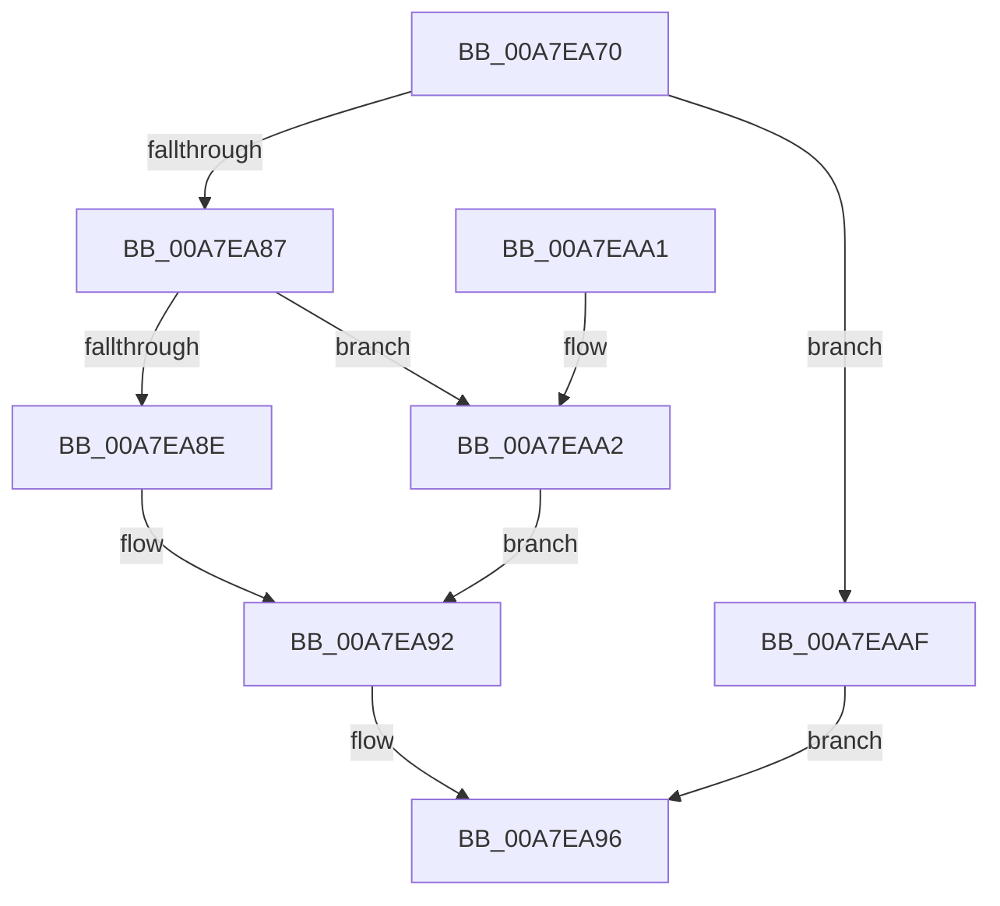

# RtlGetFirstRange

- RVA: `0x00A7EA70`–`0x00A7EABB` (길이 `75` bytes)
- VA: `0x0000000140A7EA70`
- 실행 섹션: `PAGE`
- PDB 이름 있음: `예`; PDB Function 태그: `아니요`
- unwind 정보 RVA: `0x000DB714`
- 디코드: `24`개 명령, `75/75` bytes 표시
- 미해석 바이트: `0` (있으면 어셈블리에 `.byte`로 보존)

> 이 문서는 커널 이미지의 기계어와 PDB 기호를 분석해 생성했습니다. 4번과 5번은 함수 원형과 자료형을 바이너리 사용 방식에서 추정한 C 해석이며 원본 소스 복구 결과는 아닙니다.

## 1. Dependencies

- 직접 호출 지점: **0**; 고유 호출 대상: **0**
- 직접 호출자로 확인된 함수: **2**
- RIP 상대 이미지 참조: **0**

### Outgoing calls
- 직접 디코드된 call 명령이 없습니다.

### Direct callers
- [ArbOverrideConflict](../70/ArbOverrideConflict_function_0070F1A0.md) at `0x0070F1E2`
- [ArbShareDriverExclusive](../70/ArbShareDriverExclusive_function_0070FB1C.md) at `0x0070FBC5`

### Static image references
- 디코드된 RIP-relative 메모리 참조가 없습니다.

## 2. Other-region calls and transfers

- 다른 실행 섹션으로 향하는 call: **0**
- 별도 외부 분기/꼬리 이동을 확인하지 못했습니다.

## 3. Assembly (complete function range)

```asm
00A7EA70  48 89 0A                        mov qword ptr [rdx], rcx
00A7EA73  45 33 C9                        xor r9d, r9d
00A7EA76  8B 41 18                        mov eax, dword ptr [rcx + 0x18]
00A7EA79  45 8B D9                        mov r11d, r9d
00A7EA7C  89 42 18                        mov dword ptr [rdx + 0x18], eax
00A7EA7F  4C 8B 11                        mov r10, qword ptr [rcx]
00A7EA82  4C 3B D1                        cmp r10, rcx
00A7EA85  74 28                           je 0x140a7eaaf
00A7EA87  41 F6 42 FA 01                  test byte ptr [r10 - 6], 1
00A7EA8C  75 14                           jne 0x140a7eaa2
00A7EA8E  4C 89 4A 08                     mov qword ptr [rdx + 8], r9
00A7EA92  4D 8D 4A D8                     lea r9, [r10 - 0x28]
00A7EA96  4C 89 4A 10                     mov qword ptr [rdx + 0x10], r9
00A7EA9A  41 8B C3                        mov eax, r11d
00A7EA9D  4D 89 08                        mov qword ptr [r8], r9
00A7EAA0  C3                              ret
00A7EAA1  CC                              int3
00A7EAA2  49 8D 42 E8                     lea rax, [r10 - 0x18]
00A7EAA6  48 89 42 08                     mov qword ptr [rdx + 8], rax
00A7EAAA  4C 8B 10                        mov r10, qword ptr [rax]
00A7EAAD  EB E3                           jmp 0x140a7ea92
00A7EAAF  4C 89 4A 08                     mov qword ptr [rdx + 8], r9
00A7EAB3  41 BB 1A 00 00 80               mov r11d, 0x8000001a
00A7EAB9  EB DB                           jmp 0x140a7ea96
```

## 4. C-style interpretation (structured pseudocode)

```c
__int64 __fastcall RtlGetFirstRange(__int64 a1, __int64 a2, __int64 a3, int a4)
{
    *(unsigned __int64 *)(a2) = a1;
    a4 = 0;
    *(unsigned int *)(a2 + 24) = (unsigned int)((unsigned int)(*(unsigned int *)(a1 + 24)));
    if ((*(unsigned __int64 *)(a1)) == a1) goto loc_00A7EAAF;
    if (((*(unsigned __int8 *)(*(unsigned __int64 *)(a1) - 6)) & (1)) != 0) goto loc_00A7EAA2;
    *(unsigned __int64 *)(a2 + 8) = 0;
loc_00A7EA92:
loc_00A7EA96:
    *(unsigned __int64 *)(a2 + 16) = *(unsigned __int64 *)(a1) - 40;
    *(unsigned __int64 *)(a3) = *(unsigned __int64 *)(a1) - 40;
    return 0;
loc_00A7EAA2:
    *(unsigned __int64 *)(a2 + 8) = *(unsigned __int64 *)(a1) - 24;
    goto loc_00A7EA92;
loc_00A7EAAF:
    *(unsigned __int64 *)(a2 + 8) = *(unsigned __int64 *)(a1) - 40;
    goto loc_00A7EA96;
}
```

## 5. (Beta) C Style

```c
int64_t RtlGetFirstRange(void *Arg1, void *Arg2, void *Arg3, int32_t Arg4)
{
    uint8_t *arg1 = (uint8_t *)Arg1;
    uint8_t *arg2 = (uint8_t *)Arg2;
    uint8_t *arg3 = (uint8_t *)Arg3;

    *(void **)(arg2) = Arg1;
    Arg4 = 0;
    *(uint32_t *)(arg2 + 0x18) = (uint32_t)((uint32_t)(*(uint32_t *)(arg1 + 0x18)));
    if ((*(uint64_t *)(arg1)) == Arg1) goto loc_00A7EAAF;
    if (((*(uint8_t *)(*(uint64_t *)(arg1) - 0x6)) & (1)) != 0) goto loc_00A7EAA2;
    *(uint64_t *)(arg2 + 0x8) = 0;
loc_00A7EA92:
loc_00A7EA96:
    *(uint64_t *)(arg2 + 0x10) = *(uint64_t *)(arg1) - 40;
    *(uint64_t *)(arg3) = *(uint64_t *)(arg1) - 40;
    return 0;
loc_00A7EAA2:
    *(uint64_t *)(arg2 + 0x8) = *(uint64_t *)(arg1) - 24;
    goto loc_00A7EA92;
loc_00A7EAAF:
    *(uint64_t *)(arg2 + 0x8) = *(uint64_t *)(arg1) - 40;
    goto loc_00A7EA96;
}
```

### 관측된 메모리 오프셋

구조체 형식이 확인되지 않은 접근은 인자 기준의 오프셋으로만 기록했습니다.

| 기준 인자 | 오프셋 표현 | 폭 (bit) | 접근 |
|---|---:|---:|---|
| `Arg1` | `+ 0x0` | `64` | `R` |
| `Arg1` | `+ 0x18` | `32` | `R` |
| `Arg2` | `+ 0x0` | `64` | `W` |
| `Arg2` | `+ 0x8` | `64` | `W` |
| `Arg2` | `+ 0x10` | `64` | `W` |
| `Arg2` | `+ 0x18` | `32` | `W` |
| `Arg3` | `+ 0x0` | `64` | `W` |

## 6. Execution-region graph

[열기: 2D/3D 그래프와 함수 탐색 컨트롤 패널](../../../control-panel.html?section=page&rva=0x00A7EA70&view=graph)

- 2D 그래프는 위에서 아래로 흐르고, 3D 그래프는 빈 공간을 드래그해 회전합니다. Shift+드래그는 이동, 휠은 확대·축소, 함수 노드 선택은 대상 보고서 이동입니다.

### Static fallback


