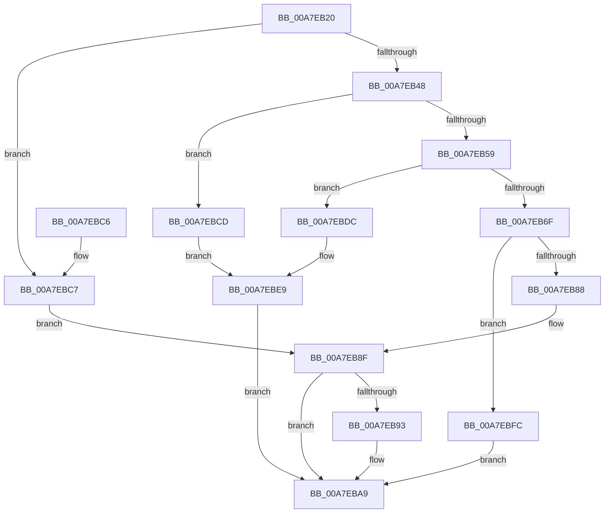

# SdbGetDatabaseID

- RVA: `0x00A7EB20`–`0x00A7EC20` (길이 `256` bytes)
- VA: `0x0000000140A7EB20`
- 실행 섹션: `PAGE`
- PDB 이름 있음: `예`; PDB Function 태그: `아니요`
- unwind 정보 RVA: `0x000B6D14`
- 디코드: `69`개 명령, `256/256` bytes 표시
- 미해석 바이트: `0` (있으면 어셈블리에 `.byte`로 보존)

> 이 문서는 커널 이미지의 기계어와 PDB 기호를 분석해 생성했습니다. 4번과 5번은 함수 원형과 자료형을 바이너리 사용 방식에서 추정한 C 해석이며 원본 소스 복구 결과는 아닙니다.

## 1. Dependencies

- 직접 호출 지점: **6**; 고유 호출 대상: **4**
- 직접 호출자로 확인된 함수: **2**
- RIP 상대 이미지 참조: **4**

### Outgoing calls
- `0x00A7EB50` → [SdbFindFirstTag](../95/SdbFindFirstTag_function_0095E34C.md) (function, `0x0095E34C`)
- `0x00A7EB64` → [SdbFindFirstTag](../95/SdbFindFirstTag_function_0095E34C.md) (function, `0x0095E34C`)
- `0x00A7EB7F` → [SdbReadBinaryTag](SdbReadBinaryTag_function_00A7EC28.md) (function, `0x00A7EC28`)
- `0x00A7EB9F` → [memcpy](../../text/6C/memcpy_function_006C6840.md) (function, `0x006C6840`)
- `0x00A7EBF5` → [AslLogCallPrintf](../95/AslLogCallPrintf_function_0095E4EC.md) (function, `0x0095E4EC`)
- `0x00A7EC19` → [AslLogCallPrintf](../95/AslLogCallPrintf_function_0095E4EC.md) (function, `0x0095E4EC`)

### Direct callers
- [SdbReadEntryInformation](../81/SdbReadEntryInformation_function_00813AEC.md) at `0x00813BE7`
- [SdbpValidateAndApplyCompatFlags](../AF/SdbpValidateAndApplyCompatFlags_function_00AF93D8.md) at `0x00AF94A7`

### Static image references
- `0x00A7EBCD` → RVA `0x0003B058` (`.rdata`; read)
- `0x00A7EBDC` → RVA `0x0003B4D8` (`.rdata`; read)
- `0x00A7EBE9` → RVA `0x0003B4F8` (`.rdata`; read)
- `0x00A7EBFC` → RVA `0x0003B4B0` (`.rdata`; read)

## 2. Other-region calls and transfers

- 다른 실행 섹션으로 향하는 call: **1**
  - `0x00A7EB9F` → [memcpy](../../text/6C/memcpy_function_006C6840.md) (`PAGE` → `.text`)
- 별도 외부 분기/꼬리 이동을 확인하지 못했습니다.

## 3. Assembly (complete function range)

```asm
00A7EB20  48 8B C4                        mov rax, rsp
00A7EB23  48 89 58 08                     mov qword ptr [rax + 8], rbx
00A7EB27  48 89 68 10                     mov qword ptr [rax + 0x10], rbp
00A7EB2B  48 89 70 18                     mov qword ptr [rax + 0x18], rsi
00A7EB2F  48 89 78 20                     mov qword ptr [rax + 0x20], rdi
00A7EB33  41 56                           push r14
00A7EB35  48 83 EC 30                     sub rsp, 0x30
00A7EB39  8B 41 18                        mov eax, dword ptr [rcx + 0x18]
00A7EB3C  33 FF                           xor edi, edi
00A7EB3E  4C 8B F2                        mov r14, rdx
00A7EB41  48 8B D9                        mov rbx, rcx
00A7EB44  A8 02                           test al, 2
00A7EB46  75 7F                           jne 0x140a7ebc7
00A7EB48  33 D2                           xor edx, edx
00A7EB4A  41 B8 01 70 00 00               mov r8d, 0x7001
00A7EB50  E8 F7 F7 ED FF                  call 0x14095e34c
00A7EB55  85 C0                           test eax, eax
00A7EB57  74 74                           je 0x140a7ebcd
00A7EB59  41 B8 07 90 00 00               mov r8d, 0x9007
00A7EB5F  8B D0                           mov edx, eax
00A7EB61  48 8B CB                        mov rcx, rbx
00A7EB64  E8 E3 F7 ED FF                  call 0x14095e34c
00A7EB69  8B E8                           mov ebp, eax
00A7EB6B  85 C0                           test eax, eax
00A7EB6D  74 6D                           je 0x140a7ebdc
00A7EB6F  48 8D 73 1C                     lea rsi, [rbx + 0x1c]
00A7EB73  8B D0                           mov edx, eax
00A7EB75  4C 8B C6                        mov r8, rsi
00A7EB78  44 8D 4F 10                     lea r9d, [rdi + 0x10]
00A7EB7C  48 8B CB                        mov rcx, rbx
00A7EB7F  E8 A4 00 00 00                  call 0x140a7ec28
00A7EB84  85 C0                           test eax, eax
00A7EB86  74 74                           je 0x140a7ebfc
00A7EB88  83 4B 18 02                     or dword ptr [rbx + 0x18], 2
00A7EB8C  8B 43 18                        mov eax, dword ptr [rbx + 0x18]
00A7EB8F  A8 02                           test al, 2
00A7EB91  74 16                           je 0x140a7eba9
00A7EB93  41 B8 10 00 00 00               mov r8d, 0x10
00A7EB99  48 8B D6                        mov rdx, rsi
00A7EB9C  49 8B CE                        mov rcx, r14
00A7EB9F  E8 9C 7C C4 FF                  call 0x1406c6840
00A7EBA4  BF 01 00 00 00                  mov edi, 1
00A7EBA9  48 8B 5C 24 40                  mov rbx, qword ptr [rsp + 0x40]
00A7EBAE  8B C7                           mov eax, edi
00A7EBB0  48 8B 7C 24 58                  mov rdi, qword ptr [rsp + 0x58]
00A7EBB5  48 8B 6C 24 48                  mov rbp, qword ptr [rsp + 0x48]
00A7EBBA  48 8B 74 24 50                  mov rsi, qword ptr [rsp + 0x50]
00A7EBBF  48 83 C4 30                     add rsp, 0x30
00A7EBC3  41 5E                           pop r14
00A7EBC5  C3                              ret
00A7EBC6  CC                              int3
00A7EBC7  48 8D 71 1C                     lea rsi, [rcx + 0x1c]
00A7EBCB  EB C2                           jmp 0x140a7eb8f
00A7EBCD  4C 8D 0D 84 C4 5B FF            lea r9, [rip - 0xa43b7c]
00A7EBD4  41 B8 37 02 00 00               mov r8d, 0x237
00A7EBDA  EB 0D                           jmp 0x140a7ebe9
00A7EBDC  4C 8D 0D F5 C8 5B FF            lea r9, [rip - 0xa4370b]
00A7EBE3  41 B8 3D 02 00 00               mov r8d, 0x23d
00A7EBE9  48 8D 15 08 C9 5B FF            lea rdx, [rip - 0xa436f8]
00A7EBF0  B9 01 00 00 00                  mov ecx, 1
00A7EBF5  E8 F2 F8 ED FF                  call 0x14095e4ec
00A7EBFA  EB AD                           jmp 0x140a7eba9
00A7EBFC  4C 8D 0D AD C8 5B FF            lea r9, [rip - 0xa43753]
00A7EC03  89 6C 24 20                     mov dword ptr [rsp + 0x20], ebp
00A7EC07  41 B8 42 02 00 00               mov r8d, 0x242
00A7EC0D  48 8D 15 E4 C8 5B FF            lea rdx, [rip - 0xa4371c]
00A7EC14  B9 01 00 00 00                  mov ecx, 1
00A7EC19  E8 CE F8 ED FF                  call 0x14095e4ec
00A7EC1E  EB 89                           jmp 0x140a7eba9
```

## 4. C-style interpretation (structured pseudocode)

```c
__int64 __fastcall SdbGetDatabaseID(__int64 a1, __int64 a2)
{
    __int64 result;
    __int64 v_rdi;
    __int64 v_rsp;
    unsigned __int64 v_stack_p10;
    unsigned __int64 v_stack_p18;
    unsigned __int64 v_stack_p20;
    unsigned __int64 v_stack_p8;

    *(unsigned __int64 *)(v_rsp + 8) = v_rbx;
    *(unsigned __int64 *)(v_rsp + 16) = v_rbp;
    *(unsigned __int64 *)(v_rsp + 24) = v_rsi;
    *(unsigned __int64 *)(v_rsp + 32) = v_rdi;
    v_rsp = (v_rsp) - (48);
    v_rdi = 0;
    if ((((unsigned __int8)((unsigned int)(*(unsigned int *)(a1 + 24)))) & (2)) != 0) goto loc_00A7EBC7;
    a2 = 0;
    result = SdbFindFirstTag(a1, a2, (unsigned int)(0x7001ULL), a4);
    if ((unsigned int)(result) == 0) goto loc_00A7EBCD;
    result = SdbFindFirstTag(a1, (unsigned int)((unsigned int)(result)), (unsigned int)(0x9007ULL), a4);
    if ((unsigned int)(result) == 0) goto loc_00A7EBDC;
    result = SdbReadBinaryTag(a1, (unsigned int)((unsigned int)(result)), a1 + 28, v_rdi + 16);
    if ((unsigned int)(result) == 0) goto loc_00A7EBFC;
loc_00A7EB8F:
    result = (unsigned int)(*(unsigned int *)(a1 + 24));
    if ((((unsigned __int8)((unsigned int)(*(unsigned int *)(a1 + 24)))) & (2)) != 0) {
        a3 = 16;
        a2 = a1 + 28;
        a1 = a2;
        result = memcpy(a1, a2, a3, v_rdi + 16);
        v_rdi = 1;
    }
    v_rsp = (v_rsp) + (48);
    return (unsigned int)((unsigned int)(v_rdi));
loc_00A7EBC7:
    goto loc_00A7EB8F;
loc_00A7EBCD:
    goto loc_00A7EBE9;
loc_00A7EBDC:
loc_00A7EBE9:
    result = AslLogCallPrintf(1, v_rip - 10761976, 573, v_rip - 10761995);
    goto loc_00A7EBA9;
loc_00A7EBFC:
    v_stack_p20 = (unsigned int)(v_stack_p10);
    result = AslLogCallPrintf(1, v_rip - 10762012, 578, v_rip - 10762067);
    goto loc_00A7EBA9;
}
```

## 5. (Beta) C Style

```c
int64_t SdbGetDatabaseID(void *Arg1, int64_t Arg2)
{
    uint8_t *arg1 = (uint8_t *)Arg1;

    int64_t result;
    int64_t local_rdi;
    int64_t local_rsp;
    uint64_t v_stack_p10;
    uint64_t v_stack_p18;
    uint64_t v_stack_p20;
    uint64_t v_stack_p8;

    *(uint64_t *)(local_rsp + 0x8) = local_rbx;
    *(uint64_t *)(local_rsp + 0x10) = local_rbp;
    *(uint64_t *)(local_rsp + 0x18) = local_rsi;
    *(uint64_t *)(local_rsp + 0x20) = local_rdi;
    local_rsp = (local_rsp) - (48);
    local_rdi = 0;
    if ((((uint8_t)((uint32_t)(*(uint32_t *)(arg1 + 0x18)))) & (2)) != 0) goto loc_00A7EBC7;
    Arg2 = 0;
    result = SdbFindFirstTag(Arg1, Arg2, (uint32_t)(0x7001ULL), a4);
    if ((uint32_t)(result) == 0) goto loc_00A7EBCD;
    result = SdbFindFirstTag(Arg1, (uint32_t)((uint32_t)(result)), (uint32_t)(0x9007ULL), a4);
    if ((uint32_t)(result) == 0) goto loc_00A7EBDC;
    result = SdbReadBinaryTag(Arg1, (uint32_t)((uint32_t)(result)), Arg1 + 28, local_rdi + 16);
    if ((uint32_t)(result) == 0) goto loc_00A7EBFC;
loc_00A7EB8F:
    result = (uint32_t)(*(uint32_t *)(arg1 + 0x18));
    if ((((uint8_t)((uint32_t)(*(uint32_t *)(arg1 + 0x18)))) & (2)) != 0) {
        a3 = 16;
        Arg2 = Arg1 + 28;
        Arg1 = Arg2;
        result = memcpy(Arg1, Arg2, a3, local_rdi + 16);
        local_rdi = 1;
    }
    local_rsp = (local_rsp) + (48);
    return (uint32_t)((uint32_t)(local_rdi));
loc_00A7EBC7:
    goto loc_00A7EB8F;
loc_00A7EBCD:
    goto loc_00A7EBE9;
loc_00A7EBDC:
loc_00A7EBE9:
    result = AslLogCallPrintf(1, v_rip - 10761976, 573, v_rip - 10761995);
    goto loc_00A7EBA9;
loc_00A7EBFC:
    v_stack_p20 = (uint32_t)(v_stack_p10);
    result = AslLogCallPrintf(1, v_rip - 10762012, 578, v_rip - 10762067);
    goto loc_00A7EBA9;
}
```

### 관측된 메모리 오프셋

구조체 형식이 확인되지 않은 접근은 인자 기준의 오프셋으로만 기록했습니다.

| 기준 인자 | 오프셋 표현 | 폭 (bit) | 접근 |
|---|---:|---:|---|
| `Arg1` | `+ 0x18` | `32` | `R` |
| `Arg1` | `+ 0x18` | `32` | `R/W` |
| `Arg1` | `+ 0x1C` | `64` | `R` |

## 6. Execution-region graph

[열기: 2D/3D 그래프와 함수 탐색 컨트롤 패널](../../../control-panel.html?section=page&rva=0x00A7EB20&view=graph)

- 2D 그래프는 위에서 아래로 흐르고, 3D 그래프는 빈 공간을 드래그해 회전합니다. Shift+드래그는 이동, 휠은 확대·축소, 함수 노드 선택은 대상 보고서 이동입니다.

### Static fallback


