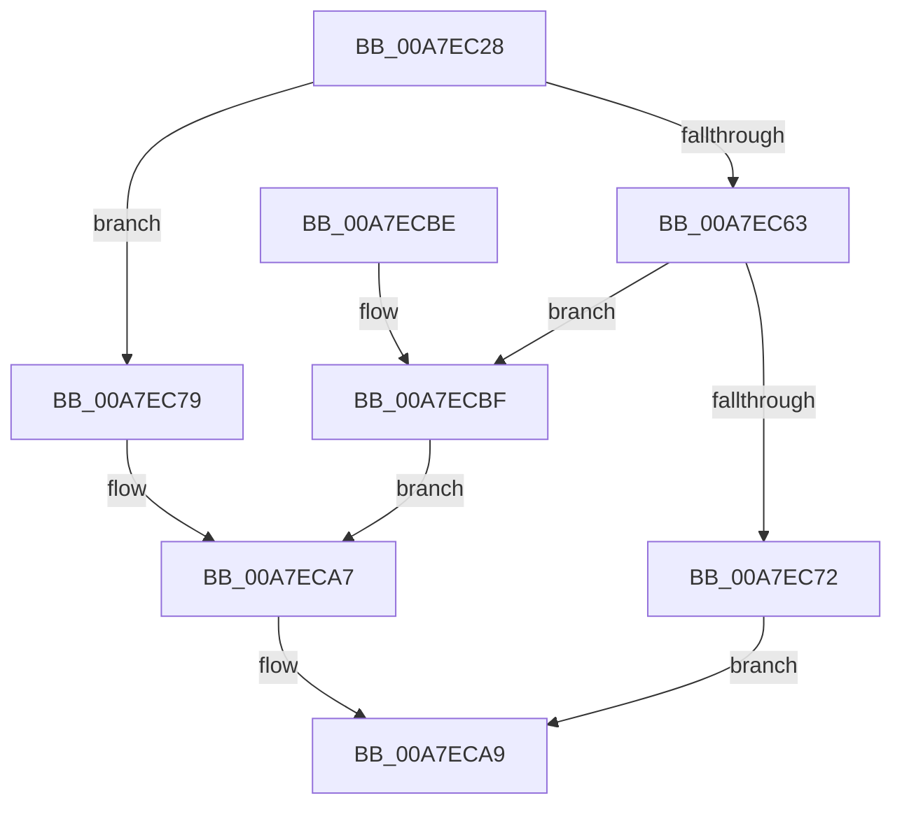

# SdbReadBinaryTag

- RVA: `0x00A7EC28`–`0x00A7ECDF` (길이 `183` bytes)
- VA: `0x0000000140A7EC28`
- 실행 섹션: `PAGE`
- PDB 이름 있음: `예`; PDB Function 태그: `아니요`
- unwind 정보 RVA: `0x0008B744`
- 디코드: `47`개 명령, `183/183` bytes 표시
- 미해석 바이트: `0` (있으면 어셈블리에 `.byte`로 보존)

> 이 문서는 커널 이미지의 기계어와 PDB 기호를 분석해 생성했습니다. 4번과 5번은 함수 원형과 자료형을 바이너리 사용 방식에서 추정한 C 해석이며 원본 소스 복구 결과는 아닙니다.

## 1. Dependencies

- 직접 호출 지점: **5**; 고유 호출 대상: **3**
- 직접 호출자로 확인된 함수: **5**
- RIP 상대 이미지 참조: **3**

### Outgoing calls
- `0x00A7EC47` → [SdbGetTagFromTagID](../95/SdbGetTagFromTagID_function_0095E3C0.md) (function, `0x0095E3C0`)
- `0x00A7EC69` → [SdbpReadTagData](../95/SdbpReadTagData_function_0095E170.md) (function, `0x0095E170`)
- `0x00A7EC79` → [SdbGetTagFromTagID](../95/SdbGetTagFromTagID_function_0095E3C0.md) (function, `0x0095E3C0`)
- `0x00A7ECA2` → [AslLogCallPrintf](../95/AslLogCallPrintf_function_0095E4EC.md) (function, `0x0095E4EC`)
- `0x00A7ECD8` → [AslLogCallPrintf](../95/AslLogCallPrintf_function_0095E4EC.md) (function, `0x0095E4EC`)

### Direct callers
- [SdbReadEntryInformation](../81/SdbReadEntryInformation_function_00813AEC.md) at `0x00813BBE`
- [SdbpGetExeEntryFlags](../81/SdbpGetExeEntryFlags_function_00815A00.md) at `0x00815A76`
- [SdbpGetMatchingTextAttributes](../81/SdbpGetMatchingTextAttributes_function_00815B38.md) at `0x00815C52`
- [SdbReadGUIDTag](../81/SdbReadGUIDTag_function_00817000.md) at `0x0081702A`
- [SdbGetDatabaseID](SdbGetDatabaseID_function_00A7EB20.md) at `0x00A7EB7F`

### Static image references
- `0x00A7EC81` → RVA `0x0001BB40` (`.rdata`; read)
- `0x00A7EC8C` → RVA `0x0001BB68` (`.rdata`; read)
- `0x00A7ECBF` → RVA `0x0001BB80` (`.rdata`; read)

## 2. Other-region calls and transfers

- 다른 실행 섹션으로 향하는 call: **0**
- 별도 외부 분기/꼬리 이동을 확인하지 못했습니다.

## 3. Assembly (complete function range)

```asm
00A7EC28  48 89 5C 24 08                  mov qword ptr [rsp + 8], rbx
00A7EC2D  48 89 6C 24 10                  mov qword ptr [rsp + 0x10], rbp
00A7EC32  48 89 74 24 18                  mov qword ptr [rsp + 0x18], rsi
00A7EC37  57                              push rdi
00A7EC38  48 83 EC 30                     sub rsp, 0x30
00A7EC3C  41 8B F1                        mov esi, r9d
00A7EC3F  49 8B E8                        mov rbp, r8
00A7EC42  8B DA                           mov ebx, edx
00A7EC44  48 8B F9                        mov rdi, rcx
00A7EC47  E8 74 F7 ED FF                  call 0x14095e3c0
00A7EC4C  B9 00 F0 00 00                  mov ecx, 0xf000
00A7EC51  8B D3                           mov edx, ebx
00A7EC53  66 23 C1                        and ax, cx
00A7EC56  B9 00 90 00 00                  mov ecx, 0x9000
00A7EC5B  66 3B C1                        cmp ax, cx
00A7EC5E  48 8B CF                        mov rcx, rdi
00A7EC61  75 16                           jne 0x140a7ec79
00A7EC63  44 8B CE                        mov r9d, esi
00A7EC66  4C 8B C5                        mov r8, rbp
00A7EC69  E8 02 F5 ED FF                  call 0x14095e170
00A7EC6E  85 C0                           test eax, eax
00A7EC70  74 4D                           je 0x140a7ecbf
00A7EC72  B8 01 00 00 00                  mov eax, 1
00A7EC77  EB 30                           jmp 0x140a7eca9
00A7EC79  E8 42 F7 ED FF                  call 0x14095e3c0
00A7EC7E  0F B7 C0                        movzx eax, ax
00A7EC81  4C 8D 0D B8 CE 59 FF            lea r9, [rip - 0xa63148]
00A7EC88  89 44 24 28                     mov dword ptr [rsp + 0x28], eax
00A7EC8C  48 8D 15 D5 CE 59 FF            lea rdx, [rip - 0xa6312b]
00A7EC93  41 B8 ED 03 00 00               mov r8d, 0x3ed
00A7EC99  89 5C 24 20                     mov dword ptr [rsp + 0x20], ebx
00A7EC9D  B9 01 00 00 00                  mov ecx, 1
00A7ECA2  E8 45 F8 ED FF                  call 0x14095e4ec
00A7ECA7  33 C0                           xor eax, eax
00A7ECA9  48 8B 5C 24 40                  mov rbx, qword ptr [rsp + 0x40]
00A7ECAE  48 8B 6C 24 48                  mov rbp, qword ptr [rsp + 0x48]
00A7ECB3  48 8B 74 24 50                  mov rsi, qword ptr [rsp + 0x50]
00A7ECB8  48 83 C4 30                     add rsp, 0x30
00A7ECBC  5F                              pop rdi
00A7ECBD  C3                              ret
00A7ECBE  CC                              int3
00A7ECBF  4C 8D 0D BA CE 59 FF            lea r9, [rip - 0xa63146]
00A7ECC6  41 B8 F2 03 00 00               mov r8d, 0x3f2
00A7ECCC  48 8D 15 95 CE 59 FF            lea rdx, [rip - 0xa6316b]
00A7ECD3  B9 01 00 00 00                  mov ecx, 1
00A7ECD8  E8 0F F8 ED FF                  call 0x14095e4ec
00A7ECDD  EB C8                           jmp 0x140a7eca7
```

## 4. C-style interpretation (structured pseudocode)

```c
__int64 __fastcall SdbReadBinaryTag(__int64 a1, int a2, __int64 a3, int a4)
{
    __int64 result;
    __int64 v_rsp;
    unsigned int v_stack_m10;
    unsigned int v_stack_m18;
    unsigned __int64 v_stack_p10;
    unsigned __int64 v_stack_p18;
    unsigned __int64 v_stack_p8;

    v_stack_p8 = v_rbx;
    v_stack_p10 = v_rbp;
    v_stack_p18 = v_rsi;
    v_rsp = (v_rsp) - (48);
    result = SdbGetTagFromTagID(a1, a2, a3, a4);
    result = (unsigned __int16)((result) & ((unsigned __int16)((unsigned int)(0xF000ULL))));
    if (((unsigned __int16)(result)) != ((unsigned __int16)((unsigned int)(0x9000ULL)))) goto loc_00A7EC79;
    result = SdbpReadTagData(a1, (unsigned int)((unsigned int)((unsigned int)(a2))), a3, (unsigned int)((unsigned int)((unsigned int)(a4))));
    if ((unsigned int)(result) == 0) goto loc_00A7ECBF;
    goto loc_00A7ECA9;
loc_00A7EC79:
    result = SdbGetTagFromTagID(a1, (unsigned int)((unsigned int)((unsigned int)(a2))), a3, (unsigned int)((unsigned int)((unsigned int)(a4))));
    v_stack_m10 = (unsigned int)((unsigned __int16)(result));
    v_stack_m18 = (unsigned int)((unsigned int)(a2));
    result = AslLogCallPrintf(1, v_rip - 10891563, (unsigned int)(0x3EDULL), v_rip - 10891592);
loc_00A7ECA7:
    result = 0;
loc_00A7ECA9:
    v_rsp = (v_rsp) + (48);
    return result;
loc_00A7ECBF:
    result = AslLogCallPrintf(1, v_rip - 10891627, (unsigned int)(0x3F2ULL), v_rip - 10891590);
    goto loc_00A7ECA7;
}
```

## 5. (Beta) C Style

```c
int64_t SdbReadBinaryTag(int64_t Arg1, int32_t Arg2, int64_t Arg3, int32_t Arg4)
{
    int64_t result;
    int64_t local_rsp;
    uint32_t v_stack_m10;
    uint32_t v_stack_m18;
    uint64_t v_stack_p10;
    uint64_t v_stack_p18;
    uint64_t v_stack_p8;

    v_stack_p8 = local_rbx;
    v_stack_p10 = local_rbp;
    v_stack_p18 = local_rsi;
    local_rsp = (local_rsp) - (48);
    result = SdbGetTagFromTagID(Arg1, Arg2, Arg3, Arg4);
    result = (uint16_t)((result) & ((uint16_t)((uint32_t)(0xF000ULL))));
    if (((uint16_t)(result)) != ((uint16_t)((uint32_t)(0x9000ULL)))) goto loc_00A7EC79;
    result = SdbpReadTagData(Arg1, (uint32_t)((uint32_t)((uint32_t)(Arg2))), Arg3, (uint32_t)((uint32_t)((uint32_t)(Arg4))));
    if ((uint32_t)(result) == 0) goto loc_00A7ECBF;
    goto loc_00A7ECA9;
loc_00A7EC79:
    result = SdbGetTagFromTagID(Arg1, (uint32_t)((uint32_t)((uint32_t)(Arg2))), Arg3, (uint32_t)((uint32_t)((uint32_t)(Arg4))));
    v_stack_m10 = (uint32_t)((uint16_t)(result));
    v_stack_m18 = (uint32_t)((uint32_t)(Arg2));
    result = AslLogCallPrintf(1, v_rip - 10891563, (uint32_t)(0x3EDULL), v_rip - 10891592);
loc_00A7ECA7:
    result = 0;
loc_00A7ECA9:
    local_rsp = (local_rsp) + (48);
    return result;
loc_00A7ECBF:
    result = AslLogCallPrintf(1, v_rip - 10891627, (uint32_t)(0x3F2ULL), v_rip - 10891590);
    goto loc_00A7ECA7;
}
```

## 6. Execution-region graph

[열기: 2D/3D 그래프와 함수 탐색 컨트롤 패널](../../../control-panel.html?section=page&rva=0x00A7EC28&view=graph)

- 2D 그래프는 위에서 아래로 흐르고, 3D 그래프는 빈 공간을 드래그해 회전합니다. Shift+드래그는 이동, 휠은 확대·축소, 함수 노드 선택은 대상 보고서 이동입니다.

### Static fallback


