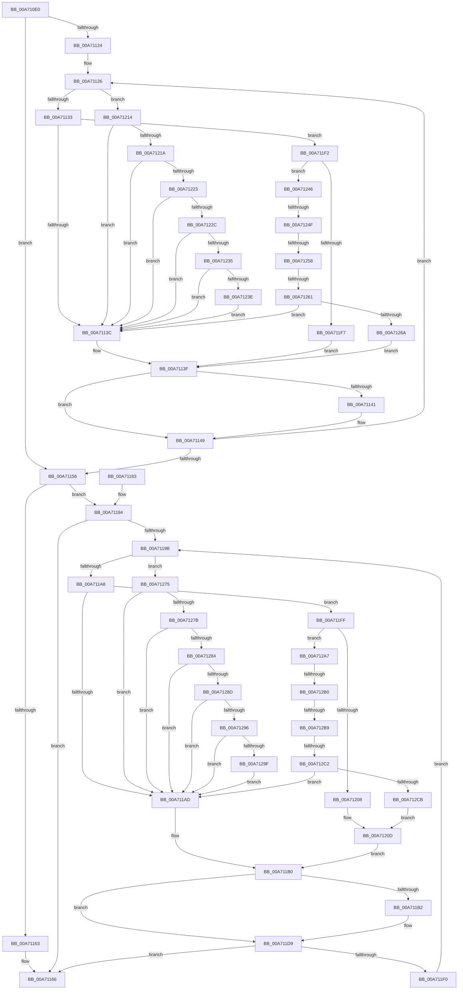

# SddlFilterSacl

- RVA: `0x00A710E0`–`0x00A712D5` (길이 `501` bytes)
- VA: `0x0000000140A710E0`
- 실행 섹션: `PAGE`
- PDB 이름 있음: `예`; PDB Function 태그: `예`
- unwind 정보 RVA: `0x000B52A4`
- 디코드: `136`개 명령, `501/501` bytes 표시
- 미해석 바이트: `0` (있으면 어셈블리에 `.byte`로 보존)

> 이 문서는 커널 이미지의 기계어와 PDB 기호를 분석해 생성했습니다. 4번과 5번은 함수 원형과 자료형을 바이너리 사용 방식에서 추정한 C 해석이며 원본 소스 복구 결과는 아닙니다.

## 1. Dependencies

- 직접 호출 지점: **1**; 고유 호출 대상: **1**
- 직접 호출자로 확인된 함수: **1**
- RIP 상대 이미지 참조: **0**

### Outgoing calls
- `0x00A711BD` → [memcpy](../../text/6C/memcpy_function_006C6840.md) (function, `0x006C6840`)

### Direct callers
- [LocalConvertSDToStringSD_Rev1](../92/LocalConvertSDToStringSD_Rev1_function_00924428.md) at `0x009249AF`
- [LocalConvertSDToStringSD_Rev1](../92/LocalConvertSDToStringSD_Rev1_function_00924428.md) at `0x009249D2`

### Static image references
- 디코드된 RIP-relative 메모리 참조가 없습니다.

## 2. Other-region calls and transfers

- 다른 실행 섹션으로 향하는 call: **1**
  - `0x00A711BD` → [memcpy](../../text/6C/memcpy_function_006C6840.md) (`PAGE` → `.text`)
- call이 아닌 외부 분기/꼬리 이동: **6**
  - `0x00A71249` → [sub_00B402DE + 0x15](../B4/Unknown_function_00B402DE.md) (`tail-transfer`)
  - `0x00A71252` → [sub_00B402DE + 0xD](../B4/Unknown_function_00B402DE.md) (`tail-transfer`)
  - `0x00A7125B` → [sub_00B402DE](../B4/Unknown_function_00B402DE.md) (`tail-transfer`)
  - `0x00A712AA` → [sub_00B402DE + 0x31](../B4/Unknown_function_00B402DE.md) (`tail-transfer`)
  - `0x00A712B3` → [sub_00B402DE + 0x27](../B4/Unknown_function_00B402DE.md) (`tail-transfer`)
  - `0x00A712BC` → [sub_00B402DE + 0x1D](../B4/Unknown_function_00B402DE.md) (`tail-transfer`)

## 3. Assembly (complete function range)

```asm
00A710E0  48 89 5C 24 08                  mov qword ptr [rsp + 8], rbx
00A710E5  48 89 6C 24 10                  mov qword ptr [rsp + 0x10], rbp
00A710EA  48 89 74 24 18                  mov qword ptr [rsp + 0x18], rsi
00A710EF  57                              push rdi
00A710F0  41 54                           push r12
00A710F2  41 55                           push r13
00A710F4  41 56                           push r14
00A710F6  41 57                           push r15
00A710F8  48 83 EC 20                     sub rsp, 0x20
00A710FC  0F B7 41 04                     movzx eax, word ptr [rcx + 4]
00A71100  48 8D 69 08                     lea rbp, [rcx + 8]
00A71104  41 BD 08 00 00 00               mov r13d, 8
00A7110A  4C 8B F2                        mov r14, rdx
00A7110D  33 D2                           xor edx, edx
00A7110F  41 8B D9                        mov ebx, r9d
00A71112  4C 8B F9                        mov r15, rcx
00A71115  45 8B D5                        mov r10d, r13d
00A71118  4C 8B DD                        mov r11, rbp
00A7111B  45 8D 65 F9                     lea r12d, [r13 - 7]
00A7111F  66 3B D0                        cmp dx, ax
00A71122  73 32                           jae 0x140a71156
00A71124  8B D0                           mov edx, eax
00A71126  41 0F B6 0B                     movzx ecx, byte ptr [r11]
00A7112A  83 F9 0F                        cmp ecx, 0xf
00A7112D  0F 86 E1 00 00 00               jbe 0x140a71214
00A71133  83 E9 10                        sub ecx, 0x10
00A71136  0F 85 B6 00 00 00               jne 0x140a711f2
00A7113C  41 84 DD                        test r13b, bl
00A7113F  74 08                           je 0x140a71149
00A71141  41 0F B7 43 02                  movzx eax, word ptr [r11 + 2]
00A71146  44 03 D0                        add r10d, eax
00A71149  41 0F B7 43 02                  movzx eax, word ptr [r11 + 2]
00A7114E  4C 03 D8                        add r11, rax
00A71151  49 2B D4                        sub rdx, r12
00A71154  75 D0                           jne 0x140a71126
00A71156  41 83 C2 03                     add r10d, 3
00A7115A  41 83 E2 FC                     and r10d, 0xfffffffc
00A7115E  45 39 10                        cmp dword ptr [r8], r10d
00A71161  73 21                           jae 0x140a71184
00A71163  45 89 10                        mov dword ptr [r8], r10d
00A71166  48 8B 5C 24 50                  mov rbx, qword ptr [rsp + 0x50]
00A7116B  48 8B 6C 24 58                  mov rbp, qword ptr [rsp + 0x58]
00A71170  48 8B 74 24 60                  mov rsi, qword ptr [rsp + 0x60]
00A71175  48 83 C4 20                     add rsp, 0x20
00A71179  41 5F                           pop r15
00A7117B  41 5E                           pop r14
00A7117D  41 5D                           pop r13
00A7117F  41 5C                           pop r12
00A71181  5F                              pop rdi
00A71182  C3                              ret
00A71183  CC                              int3
00A71184  49 8B 07                        mov rax, qword ptr [r15]
00A71187  49 8D 76 08                     lea rsi, [r14 + 8]
00A7118B  49 89 06                        mov qword ptr [r14], rax
00A7118E  8B FA                           mov edi, edx
00A71190  45 89 6E 02                     mov dword ptr [r14 + 2], r13d
00A71194  66 41 3B 57 04                  cmp dx, word ptr [r15 + 4]
00A71199  73 CB                           jae 0x140a71166
00A7119B  0F B6 4D 00                     movzx ecx, byte ptr [rbp]
00A7119F  83 F9 0F                        cmp ecx, 0xf
00A711A2  0F 86 CD 00 00 00               jbe 0x140a71275
00A711A8  83 E9 10                        sub ecx, 0x10
00A711AB  75 52                           jne 0x140a711ff
00A711AD  41 84 DD                        test r13b, bl
00A711B0  74 27                           je 0x140a711d9
00A711B2  44 0F B7 45 02                  movzx r8d, word ptr [rbp + 2]
00A711B7  48 8B D5                        mov rdx, rbp
00A711BA  48 8B CE                        mov rcx, rsi
00A711BD  E8 7E 56 C5 FF                  call 0x1406c6840
00A711C2  66 45 01 66 04                  add word ptr [r14 + 4], r12w
00A711C7  0F B7 45 02                     movzx eax, word ptr [rbp + 2]
00A711CB  66 41 01 46 02                  add word ptr [r14 + 2], ax
00A711D0  0F B7 45 02                     movzx eax, word ptr [rbp + 2]
00A711D4  48 03 F0                        add rsi, rax
00A711D7  33 D2                           xor edx, edx
00A711D9  0F B7 45 02                     movzx eax, word ptr [rbp + 2]
00A711DD  41 03 FC                        add edi, r12d
00A711E0  48 03 E8                        add rbp, rax
00A711E3  41 0F B7 47 04                  movzx eax, word ptr [r15 + 4]
00A711E8  3B F8                           cmp edi, eax
00A711EA  0F 83 76 FF FF FF               jae 0x140a71166
00A711F0  EB A9                           jmp 0x140a7119b
00A711F2  41 2B CC                        sub ecx, r12d
00A711F5  75 4F                           jne 0x140a71246
00A711F7  F6 C3 10                        test bl, 0x10
00A711FA  E9 40 FF FF FF                  jmp 0x140a7113f
00A711FF  41 2B CC                        sub ecx, r12d
00A71202  0F 85 9F 00 00 00               jne 0x140a712a7
00A71208  8B C3                           mov eax, ebx
00A7120A  C1 E8 04                        shr eax, 4
00A7120D  41 22 C4                        and al, r12b
00A71210  84 C0                           test al, al
00A71212  EB 9C                           jmp 0x140a711b0
00A71214  0F 84 22 FF FF FF               je 0x140a7113c
00A7121A  83 E9 02                        sub ecx, 2
00A7121D  0F 84 19 FF FF FF               je 0x140a7113c
00A71223  41 2B CC                        sub ecx, r12d
00A71226  0F 84 10 FF FF FF               je 0x140a7113c
00A7122C  83 E9 04                        sub ecx, 4
00A7122F  0F 84 07 FF FF FF               je 0x140a7113c
00A71235  41 2B CC                        sub ecx, r12d
00A71238  0F 84 FE FE FF FF               je 0x140a7113c
00A7123E  83 E9 05                        sub ecx, 5
00A71241  E9 F6 FE FF FF                  jmp 0x140a7113c
00A71246  41 2B CC                        sub ecx, r12d
00A71249  0F 84 A4 F0 0C 00               je 0x140b402f3
00A7124F  41 2B CC                        sub ecx, r12d
00A71252  0F 84 93 F0 0C 00               je 0x140b402eb
00A71258  41 2B CC                        sub ecx, r12d
00A7125B  0F 84 7D F0 0C 00               je 0x140b402de
00A71261  41 3B CC                        cmp ecx, r12d
00A71264  0F 85 D2 FE FF FF               jne 0x140a7113c
00A7126A  F7 C3 00 01 00 00               test ebx, 0x100
00A71270  E9 CA FE FF FF                  jmp 0x140a7113f
00A71275  0F 84 32 FF FF FF               je 0x140a711ad
00A7127B  83 E9 02                        sub ecx, 2
00A7127E  0F 84 29 FF FF FF               je 0x140a711ad
00A71284  41 2B CC                        sub ecx, r12d
00A71287  0F 84 20 FF FF FF               je 0x140a711ad
00A7128D  83 E9 04                        sub ecx, 4
00A71290  0F 84 17 FF FF FF               je 0x140a711ad
00A71296  41 2B CC                        sub ecx, r12d
00A71299  0F 84 0E FF FF FF               je 0x140a711ad
00A7129F  83 E9 05                        sub ecx, 5
00A712A2  E9 06 FF FF FF                  jmp 0x140a711ad
00A712A7  41 2B CC                        sub ecx, r12d
00A712AA  0F 84 5F F0 0C 00               je 0x140b4030f
00A712B0  41 2B CC                        sub ecx, r12d
00A712B3  0F 84 4C F0 0C 00               je 0x140b40305
00A712B9  41 2B CC                        sub ecx, r12d
00A712BC  0F 84 39 F0 0C 00               je 0x140b402fb
00A712C2  41 3B CC                        cmp ecx, r12d
00A712C5  0F 85 E2 FE FF FF               jne 0x140a711ad
00A712CB  8B C3                           mov eax, ebx
00A712CD  C1 E8 08                        shr eax, 8
00A712D0  E9 38 FF FF FF                  jmp 0x140a7120d
```

## 4. C-style interpretation (structured pseudocode)

```c
__int64 __fastcall SddlFilterSacl(__int64 a1, __int64 a2, __int64 a3, int a4)
{
    __int64 result;
    __int64 v_r10;
    __int64 v_r11;
    __int64 v_rbp;
    __int64 v_rdi;
    __int64 v_rsi;
    __int64 v_rsp;
    unsigned __int64 v_stack_p10;
    unsigned __int64 v_stack_p18;
    unsigned __int64 v_stack_p8;

    v_stack_p8 = v_rbx;
    v_stack_p10 = v_rbp;
    v_stack_p18 = v_rsi;
    v_rsp = (v_rsp) - (32);
    a2 = 0;
    if (0 >= ((unsigned __int16)(*(unsigned __int16 *)(a1 + 4)))) goto loc_00A71156;
loc_00A71126:
    if (((unsigned int)(*(unsigned __int8 *)(a1 + 8))) <= 15) goto loc_00A71214;
    a1 = (unsigned int)((*(unsigned __int8 *)(a1 + 8)) - (16));
    if (condition_is_not_equal) goto loc_00A711F2;
loc_00A7113C:
loc_00A7113F:
    result = *(unsigned __int16 *)(a1 + 4);
    v_r10 = 8;
    if (((8) & ((unsigned __int8)((unsigned int)(a4)))) != 0) {
        result = *(unsigned __int16 *)(a1 + 8 + 2);
        v_r10 = (unsigned int)((8) + ((unsigned int)(result)));
    }
    v_r11 = (a1 + 8) + (*(unsigned __int16 *)(a1 + 8 + 2));
    a2 = ((unsigned int)((unsigned int)(*(unsigned __int16 *)(a1 + 4)))) - (8 - 7);
    if (condition_is_not_equal) goto loc_00A71126;
loc_00A71156:
    v_r10 = (unsigned int)((v_r10) + (3));
    v_r10 = (unsigned int)((v_r10) & (0xFFFFFFFCULL));
    if ((*(unsigned int *)(a3)) >= ((unsigned int)(v_r10))) goto loc_00A71184;
    *(unsigned int *)(a3) = (unsigned int)(v_r10);
loc_00A71166:
    v_rsp = (v_rsp) + (32);
    return *(unsigned __int16 *)(a1 + 8 + 2);
loc_00A71184:
    *(unsigned __int64 *)(a2) = *(unsigned __int64 *)(a1);
    *(unsigned int *)(a2 + 2) = 8;
    if (((unsigned __int16)(a2)) >= (*(unsigned __int16 *)(a1 + 4))) goto loc_00A71166;
loc_00A7119B:
    if (((unsigned int)(*(unsigned __int8 *)(v_stack_p10))) <= 15) goto loc_00A71275;
    a1 = (unsigned int)((*(unsigned __int8 *)(v_stack_p10)) - (16));
    if (condition_is_not_equal) goto loc_00A711FF;
loc_00A711AD:
loc_00A711B0:
    result = *(unsigned __int64 *)(a1);
    v_rsi = a2 + 8;
    if (((8) & ((unsigned __int8)(v_stack_p8))) != 0) {
        a3 = *(unsigned __int16 *)(v_stack_p10 + 2);
        a2 = v_stack_p10;
        a1 = a2 + 8;
        result = memcpy(a1, a2, a3, a4);
        result = *(unsigned __int16 *)(v_stack_p10 + 2);
        result = *(unsigned __int16 *)(v_stack_p10 + 2);
        v_rsi = (a2 + 8) + (result);
        a2 = 0;
    }
    v_rdi = (unsigned int)(((unsigned int)((unsigned int)(a2))) + ((unsigned int)(8 - 7)));
    v_rbp = (v_stack_p10) + (*(unsigned __int16 *)(v_stack_p10 + 2));
    if (((unsigned int)(v_rdi)) >= ((unsigned int)(*(unsigned __int16 *)(a1 + 4)))) goto loc_00A71166;
    goto loc_00A7119B;
loc_00A711F2:
    a1 = (unsigned int)((a1) - ((unsigned int)(8 - 7)));
    if (condition_is_not_equal) goto loc_00A71246;
    goto loc_00A7113F;
loc_00A711FF:
    a1 = (unsigned int)((a1) - ((unsigned int)(8 - 7)));
    if (condition_is_not_equal) goto loc_00A712A7;
    result = (unsigned int)(((unsigned int)((unsigned int)(v_stack_p8))) >> (4));
loc_00A7120D:
    result = (unsigned __int8)((result) & ((unsigned __int8)(8 - 7)));
    goto loc_00A711B0;
loc_00A71214:
    if ((unsigned __int8)(result) == 0) goto loc_00A7113C;
    a1 = (unsigned int)((a1) - (2));
    if (condition_is_equal) goto loc_00A7113C;
    a1 = (unsigned int)((a1) - ((unsigned int)(8 - 7)));
    if (condition_is_equal) goto loc_00A7113C;
    a1 = (unsigned int)((a1) - (4));
    if (condition_is_equal) goto loc_00A7113C;
    a1 = (unsigned int)((a1) - ((unsigned int)(8 - 7)));
    if (condition_is_equal) goto loc_00A7113C;
    a1 = (unsigned int)((a1) - (5));
    goto loc_00A7113C;
loc_00A71246:
    a1 = (unsigned int)((a1) - ((unsigned int)(8 - 7)));
    a1 = (unsigned int)((a1) - ((unsigned int)(8 - 7)));
    a1 = (unsigned int)((a1) - ((unsigned int)(8 - 7)));
    if (((unsigned int)(a1)) != ((unsigned int)(8 - 7))) goto loc_00A7113C;
    goto loc_00A7113F;
loc_00A71275:
    if ((((unsigned int)(v_stack_p8)) & (256)) == 0) goto loc_00A711AD;
    a1 = (unsigned int)((a1) - (2));
    if (condition_is_equal) goto loc_00A711AD;
    a1 = (unsigned int)((a1) - ((unsigned int)(8 - 7)));
    if (condition_is_equal) goto loc_00A711AD;
    a1 = (unsigned int)((a1) - (4));
    if (condition_is_equal) goto loc_00A711AD;
    a1 = (unsigned int)((a1) - ((unsigned int)(8 - 7)));
    if (condition_is_equal) goto loc_00A711AD;
    a1 = (unsigned int)((a1) - (5));
    goto loc_00A711AD;
loc_00A712A7:
    a1 = (unsigned int)((a1) - ((unsigned int)(8 - 7)));
    a1 = (unsigned int)((a1) - ((unsigned int)(8 - 7)));
    a1 = (unsigned int)((a1) - ((unsigned int)(8 - 7)));
    if (((unsigned int)(a1)) != ((unsigned int)(8 - 7))) goto loc_00A711AD;
    result = (unsigned int)(((unsigned int)((unsigned int)(v_stack_p8))) >> (8));
    goto loc_00A7120D;
}
```

## 5. (Beta) C Style

```c
int64_t SddlFilterSacl(void *Arg1, void *Arg2, void *Arg3, int32_t Arg4)
{
    uint8_t *arg1 = (uint8_t *)Arg1;
    uint8_t *arg2 = (uint8_t *)Arg2;
    uint8_t *arg3 = (uint8_t *)Arg3;

    int64_t result;
    int64_t local_r10;
    int64_t local_r11;
    int64_t local_rbp;
    int64_t local_rdi;
    int64_t local_rsi;
    int64_t local_rsp;
    uint64_t v_stack_p10;
    uint64_t v_stack_p18;
    uint64_t v_stack_p8;

    v_stack_p8 = local_rbx;
    v_stack_p10 = local_rbp;
    v_stack_p18 = local_rsi;
    local_rsp = (local_rsp) - (32);
    Arg2 = 0;
    if (0 >= ((uint16_t)(*(uint16_t *)(arg1 + 0x4)))) goto loc_00A71156;
loc_00A71126:
    if (((uint32_t)(*(uint8_t *)(arg1 + 0x8))) <= 15) goto loc_00A71214;
    Arg1 = (uint32_t)((*(uint8_t *)(arg1 + 0x8)) - (16));
    if (condition_is_not_equal) goto loc_00A711F2;
loc_00A7113C:
loc_00A7113F:
    result = *(uint16_t *)(arg1 + 0x4);
    local_r10 = 8;
    if (((8) & ((uint8_t)((uint32_t)(Arg4)))) != 0) {
        result = *(uint16_t *)(arg1 + 0x8 + 0x2);
        local_r10 = (uint32_t)((8) + ((uint32_t)(result)));
    }
    local_r11 = (Arg1 + 8) + (*(uint16_t *)(arg1 + 0x8 + 0x2));
    Arg2 = ((uint32_t)((uint32_t)(*(uint16_t *)(arg1 + 0x4)))) - (8 - 7);
    if (condition_is_not_equal) goto loc_00A71126;
loc_00A71156:
    local_r10 = (uint32_t)((local_r10) + (3));
    local_r10 = (uint32_t)((local_r10) & (0xFFFFFFFCULL));
    if ((*(uint32_t *)(arg3)) >= ((uint32_t)(local_r10))) goto loc_00A71184;
    *(uint32_t *)(arg3) = (uint32_t)(local_r10);
loc_00A71166:
    local_rsp = (local_rsp) + (32);
    return *(uint16_t *)(arg1 + 0x8 + 0x2);
loc_00A71184:
    *(uint64_t *)(arg2) = *(uint64_t *)(arg1);
    *(uint32_t *)(arg2 + 0x2) = 8;
    if (((uint16_t)(Arg2)) >= (*(uint16_t *)(arg1 + 0x4))) goto loc_00A71166;
loc_00A7119B:
    if (((uint32_t)(*(uint8_t *)(v_stack_p10))) <= 15) goto loc_00A71275;
    Arg1 = (uint32_t)((*(uint8_t *)(v_stack_p10)) - (16));
    if (condition_is_not_equal) goto loc_00A711FF;
loc_00A711AD:
loc_00A711B0:
    result = *(uint64_t *)(arg1);
    local_rsi = Arg2 + 8;
    if (((8) & ((uint8_t)(v_stack_p8))) != 0) {
        Arg3 = *(uint16_t *)(v_stack_p10 + 0x2);
        Arg2 = v_stack_p10;
        Arg1 = Arg2 + 8;
        result = memcpy(Arg1, Arg2, Arg3, Arg4);
        result = *(uint16_t *)(v_stack_p10 + 0x2);
        result = *(uint16_t *)(v_stack_p10 + 0x2);
        local_rsi = (Arg2 + 8) + (result);
        Arg2 = 0;
    }
    local_rdi = (uint32_t)(((uint32_t)((uint32_t)(Arg2))) + ((uint32_t)(8 - 7)));
    local_rbp = (v_stack_p10) + (*(uint16_t *)(v_stack_p10 + 0x2));
    if (((uint32_t)(local_rdi)) >= ((uint32_t)(*(uint16_t *)(arg1 + 0x4)))) goto loc_00A71166;
    goto loc_00A7119B;
loc_00A711F2:
    Arg1 = (uint32_t)((Arg1) - ((uint32_t)(8 - 7)));
    if (condition_is_not_equal) goto loc_00A71246;
    goto loc_00A7113F;
loc_00A711FF:
    Arg1 = (uint32_t)((Arg1) - ((uint32_t)(8 - 7)));
    if (condition_is_not_equal) goto loc_00A712A7;
    result = (uint32_t)(((uint32_t)((uint32_t)(v_stack_p8))) >> (4));
loc_00A7120D:
    result = (uint8_t)((result) & ((uint8_t)(8 - 7)));
    goto loc_00A711B0;
loc_00A71214:
    if ((uint8_t)(result) == 0) goto loc_00A7113C;
    Arg1 = (uint32_t)((Arg1) - (2));
    if (condition_is_equal) goto loc_00A7113C;
    Arg1 = (uint32_t)((Arg1) - ((uint32_t)(8 - 7)));
    if (condition_is_equal) goto loc_00A7113C;
    Arg1 = (uint32_t)((Arg1) - (4));
    if (condition_is_equal) goto loc_00A7113C;
    Arg1 = (uint32_t)((Arg1) - ((uint32_t)(8 - 7)));
    if (condition_is_equal) goto loc_00A7113C;
    Arg1 = (uint32_t)((Arg1) - (5));
    goto loc_00A7113C;
loc_00A71246:
    Arg1 = (uint32_t)((Arg1) - ((uint32_t)(8 - 7)));
    Arg1 = (uint32_t)((Arg1) - ((uint32_t)(8 - 7)));
    Arg1 = (uint32_t)((Arg1) - ((uint32_t)(8 - 7)));
    if (((uint32_t)(Arg1)) != ((uint32_t)(8 - 7))) goto loc_00A7113C;
    goto loc_00A7113F;
loc_00A71275:
    if ((((uint32_t)(v_stack_p8)) & (256)) == 0) goto loc_00A711AD;
    Arg1 = (uint32_t)((Arg1) - (2));
    if (condition_is_equal) goto loc_00A711AD;
    Arg1 = (uint32_t)((Arg1) - ((uint32_t)(8 - 7)));
    if (condition_is_equal) goto loc_00A711AD;
    Arg1 = (uint32_t)((Arg1) - (4));
    if (condition_is_equal) goto loc_00A711AD;
    Arg1 = (uint32_t)((Arg1) - ((uint32_t)(8 - 7)));
    if (condition_is_equal) goto loc_00A711AD;
    Arg1 = (uint32_t)((Arg1) - (5));
    goto loc_00A711AD;
loc_00A712A7:
    Arg1 = (uint32_t)((Arg1) - ((uint32_t)(8 - 7)));
    Arg1 = (uint32_t)((Arg1) - ((uint32_t)(8 - 7)));
    Arg1 = (uint32_t)((Arg1) - ((uint32_t)(8 - 7)));
    if (((uint32_t)(Arg1)) != ((uint32_t)(8 - 7))) goto loc_00A711AD;
    result = (uint32_t)(((uint32_t)((uint32_t)(v_stack_p8))) >> (8));
    goto loc_00A7120D;
}
```

### 관측된 메모리 오프셋

구조체 형식이 확인되지 않은 접근은 인자 기준의 오프셋으로만 기록했습니다.

| 기준 인자 | 오프셋 표현 | 폭 (bit) | 접근 |
|---|---:|---:|---|
| `Arg1` | `+ 0x0` | `8` | `R` |
| `Arg1` | `+ 0x0` | `64` | `R` |
| `Arg1` | `+ 0x2` | `16` | `R` |
| `Arg1` | `+ 0x4` | `16` | `R` |
| `Arg1` | `+ 0x8` | `64` | `R` |
| `Arg2` | `+ 0x0` | `64` | `W` |
| `Arg2` | `+ 0x2` | `16` | `R/W` |
| `Arg2` | `+ 0x2` | `32` | `W` |
| `Arg2` | `+ 0x4` | `16` | `R/W` |
| `Arg2` | `+ 0x8` | `64` | `R` |
| `Arg3` | `+ 0x0` | `32` | `R` |
| `Arg3` | `+ 0x0` | `32` | `W` |

## 6. Execution-region graph

[열기: 2D/3D 그래프와 함수 탐색 컨트롤 패널](../../../control-panel.html?section=page&rva=0x00A710E0&view=graph)

- 2D 그래프는 위에서 아래로 흐르고, 3D 그래프는 빈 공간을 드래그해 회전합니다. Shift+드래그는 이동, 휠은 확대·축소, 함수 노드 선택은 대상 보고서 이동입니다.

### Static fallback


