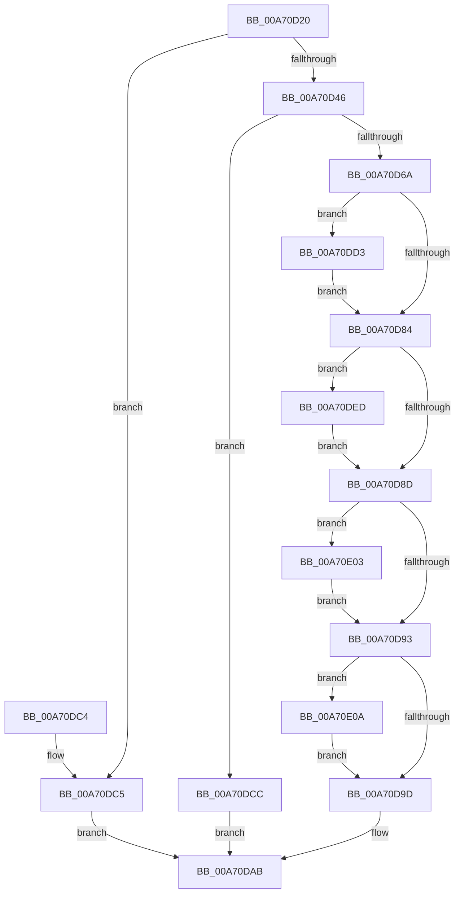

# SeAssignWorldSecurityDescriptor

- RVA: `0x00A70D20`–`0x00A70E15` (길이 `245` bytes)
- VA: `0x0000000140A70D20`
- 실행 섹션: `PAGE`
- PDB 이름 있음: `예`; PDB Function 태그: `아니요`
- unwind 정보 RVA: `0x000B51B4`
- 디코드: `79`개 명령, `245/245` bytes 표시
- 미해석 바이트: `0` (있으면 어셈블리에 `.byte`로 보존)

> 이 문서는 커널 이미지의 기계어와 PDB 기호를 분석해 생성했습니다. 4번과 5번은 함수 원형과 자료형을 바이너리 사용 방식에서 추정한 C 해석이며 원본 소스 복구 결과는 아닙니다.

## 1. Dependencies

- 직접 호출 지점: **2**; 고유 호출 대상: **1**
- 직접 호출자로 확인된 함수: **1**
- RIP 상대 이미지 참조: **1**

### Outgoing calls
- `0x00A70DDC` → [memcpy](../../text/6C/memcpy_function_006C6840.md) (function, `0x006C6840`)
- `0x00A70DF6` → [memcpy](../../text/6C/memcpy_function_006C6840.md) (function, `0x006C6840`)

### Direct callers
- [IopGetSetSecurityObject](../87/IopGetSetSecurityObject_function_00873A80.md) at `0x00873F8F`

### Static image references
- `0x00A70D46` → RVA `0x00E67D48` (`.data`; read)

## 2. Other-region calls and transfers

- 다른 실행 섹션으로 향하는 call: **2**
  - `0x00A70DDC` → [memcpy](../../text/6C/memcpy_function_006C6840.md) (`PAGE` → `.text`)
  - `0x00A70DF6` → [memcpy](../../text/6C/memcpy_function_006C6840.md) (`PAGE` → `.text`)
- 별도 외부 분기/꼬리 이동을 확인하지 못했습니다.

## 3. Assembly (complete function range)

```asm
00A70D20  48 89 5C 24 08                  mov qword ptr [rsp + 8], rbx
00A70D25  48 89 6C 24 10                  mov qword ptr [rsp + 0x10], rbp
00A70D2A  48 89 74 24 18                  mov qword ptr [rsp + 0x18], rsi
00A70D2F  57                              push rdi
00A70D30  41 56                           push r14
00A70D32  41 57                           push r15
00A70D34  48 83 EC 20                     sub rsp, 0x20
00A70D38  49 8B F8                        mov rdi, r8
00A70D3B  48 8B D9                        mov rbx, rcx
00A70D3E  4C 8B C2                        mov r8, rdx
00A70D41  48 85 FF                        test rdi, rdi
00A70D44  74 7F                           je 0x140a70dc5
00A70D46  4C 8B 35 FB 6F 3F 00            mov r14, qword ptr [rip + 0x3f6ffb]
00A70D4D  41 0F B6 46 01                  movzx eax, byte ptr [r14 + 1]
00A70D52  8D 14 85 08 00 00 00            lea edx, [rax*4 + 8]
00A70D59  41 8B 00                        mov eax, dword ptr [r8]
00A70D5C  8D 0C 55 14 00 00 00            lea ecx, [rdx*2 + 0x14]
00A70D63  41 89 08                        mov dword ptr [r8], ecx
00A70D66  3B C1                           cmp eax, ecx
00A70D68  72 62                           jb 0x140a70dcc
00A70D6A  33 C0                           xor eax, eax
00A70D6C  8B EA                           mov ebp, edx
00A70D6E  0F 57 C0                        xorps xmm0, xmm0
00A70D71  48 8D 73 14                     lea rsi, [rbx + 0x14]
00A70D75  0F 11 03                        movups xmmword ptr [rbx], xmm0
00A70D78  89 43 10                        mov dword ptr [rbx + 0x10], eax
00A70D7B  C6 03 01                        mov byte ptr [rbx], 1
00A70D7E  8B 07                           mov eax, dword ptr [rdi]
00A70D80  A8 01                           test al, 1
00A70D82  75 4F                           jne 0x140a70dd3
00A70D84  8B 07                           mov eax, dword ptr [rdi]
00A70D86  44 8B FB                        mov r15d, ebx
00A70D89  A8 02                           test al, 2
00A70D8B  75 60                           jne 0x140a70ded
00A70D8D  8B 07                           mov eax, dword ptr [rdi]
00A70D8F  A8 04                           test al, 4
00A70D91  75 70                           jne 0x140a70e03
00A70D93  8B 07                           mov eax, dword ptr [rdi]
00A70D95  0F B7 4B 02                     movzx ecx, word ptr [rbx + 2]
00A70D99  A8 08                           test al, 8
00A70D9B  75 6D                           jne 0x140a70e0a
00A70D9D  B8 00 80 00 00                  mov eax, 0x8000
00A70DA2  66 0B C8                        or cx, ax
00A70DA5  66 89 4B 02                     mov word ptr [rbx + 2], cx
00A70DA9  33 C0                           xor eax, eax
00A70DAB  48 8B 5C 24 40                  mov rbx, qword ptr [rsp + 0x40]
00A70DB0  48 8B 6C 24 48                  mov rbp, qword ptr [rsp + 0x48]
00A70DB5  48 8B 74 24 50                  mov rsi, qword ptr [rsp + 0x50]
00A70DBA  48 83 C4 20                     add rsp, 0x20
00A70DBE  41 5F                           pop r15
00A70DC0  41 5E                           pop r14
00A70DC2  5F                              pop rdi
00A70DC3  C3                              ret
00A70DC4  CC                              int3
00A70DC5  B8 22 00 00 C0                  mov eax, 0xc0000022
00A70DCA  EB DF                           jmp 0x140a70dab
00A70DCC  B8 23 00 00 C0                  mov eax, 0xc0000023
00A70DD1  EB D8                           jmp 0x140a70dab
00A70DD3  44 8B C2                        mov r8d, edx
00A70DD6  48 8B CE                        mov rcx, rsi
00A70DD9  49 8B D6                        mov rdx, r14
00A70DDC  E8 5F 5A C5 FF                  call 0x1406c6840
00A70DE1  8B C6                           mov eax, esi
00A70DE3  2B C3                           sub eax, ebx
00A70DE5  89 43 04                        mov dword ptr [rbx + 4], eax
00A70DE8  48 03 F5                        add rsi, rbp
00A70DEB  EB 97                           jmp 0x140a70d84
00A70DED  4C 8B C5                        mov r8, rbp
00A70DF0  49 8B D6                        mov rdx, r14
00A70DF3  48 8B CE                        mov rcx, rsi
00A70DF6  E8 45 5A C5 FF                  call 0x1406c6840
00A70DFB  41 2B F7                        sub esi, r15d
00A70DFE  89 73 08                        mov dword ptr [rbx + 8], esi
00A70E01  EB 8A                           jmp 0x140a70d8d
00A70E03  66 83 4B 02 04                  or word ptr [rbx + 2], 4
00A70E08  EB 89                           jmp 0x140a70d93
00A70E0A  66 83 4B 02 10                  or word ptr [rbx + 2], 0x10
00A70E0F  0F B7 4B 02                     movzx ecx, word ptr [rbx + 2]
00A70E13  EB 88                           jmp 0x140a70d9d
```

## 4. C-style interpretation (structured pseudocode)

```c
__int64 __fastcall SeAssignWorldSecurityDescriptor(__int64 a1, __int64 a2, __int64 a3)
{
    __int64 result;
    __int64 v_rsi;
    __int64 v_rsp;
    unsigned __int64 v_stack_p10;
    unsigned __int64 v_stack_p18;
    unsigned __int64 v_stack_p8;

    v_stack_p8 = v_rbx;
    v_stack_p10 = v_rbp;
    v_stack_p18 = v_rsi;
    v_rsp = (v_rsp) - (32);
    if (a3 == 0) goto loc_00A70DC5;
    *(unsigned int *)(a2) = (unsigned int)(*(unsigned __int8 *)(*(unsigned __int64 *)(v_rip + 4157435) + 1) * 4 + 8 * 2 + 20);
    if (((unsigned int)((unsigned int)(*(unsigned int *)(a2)))) < ((unsigned int)(*(unsigned __int8 *)(*(unsigned __int64 *)(v_rip + 4157435) + 1) * 4 + 8 * 2 + 20))) goto loc_00A70DCC;
    result = 0;
    *(unsigned __int64 *)(a1) = v_xmm0;
    *(unsigned int *)(a1 + 16) = 0;
    *(unsigned __int8 *)(a1) = 1;
    if ((((unsigned __int8)((unsigned int)(*(unsigned int *)(a3)))) & (1)) != 0) goto loc_00A70DD3;
loc_00A70D84:
    if ((((unsigned __int8)((unsigned int)(*(unsigned int *)(a3)))) & (2)) != 0) goto loc_00A70DED;
loc_00A70D8D:
    if ((((unsigned __int8)((unsigned int)(*(unsigned int *)(a3)))) & (4)) != 0) goto loc_00A70E03;
loc_00A70D93:
    if ((((unsigned __int8)((unsigned int)(*(unsigned int *)(a3)))) & (8)) != 0) goto loc_00A70E0A;
loc_00A70D9D:
    a1 = (unsigned __int16)((*(unsigned __int16 *)(a1 + 2)) | ((unsigned __int16)((unsigned int)(0x8000ULL))));
    *(unsigned __int16 *)(a1 + 2) = (unsigned __int16)(a1);
    result = 0;
loc_00A70DAB:
    v_rsp = (v_rsp) + (32);
    return result;
loc_00A70DC5:
    goto loc_00A70DAB;
loc_00A70DCC:
    goto loc_00A70DAB;
loc_00A70DD3:
    result = memcpy(v_stack_p18, *(unsigned __int64 *)(v_rip + 4157435), (unsigned int)((unsigned int)(*(unsigned __int8 *)(*(unsigned __int64 *)(v_rip + 4157435) + 1) * 4 + 8)), a4);
    result = (unsigned int)(((unsigned int)((unsigned int)(v_stack_p18))) - ((unsigned int)(v_stack_p8)));
    *(unsigned int *)(v_stack_p8 + 4) = (unsigned int)(result);
    v_rsi = (v_stack_p18) + (v_stack_p10);
    goto loc_00A70D84;
loc_00A70DED:
    result = memcpy(v_rsi, *(unsigned __int64 *)(v_rip + 4157435), v_stack_p10, a4);
    v_rsi = (unsigned int)((v_rsi) - ((unsigned int)((unsigned int)((unsigned int)(a1)))));
    *(unsigned int *)(v_stack_p8 + 8) = (unsigned int)(v_rsi);
    goto loc_00A70D8D;
loc_00A70E03:
    goto loc_00A70D93;
loc_00A70E0A:
    goto loc_00A70D9D;
}
```

## 5. (Beta) C Style

```c
int64_t SeAssignWorldSecurityDescriptor(void *Arg1, void *Arg2, int64_t Arg3)
{
    uint8_t *arg1 = (uint8_t *)Arg1;
    uint8_t *arg2 = (uint8_t *)Arg2;

    int64_t result;
    int64_t local_rsi;
    int64_t local_rsp;
    uint64_t v_stack_p10;
    uint64_t v_stack_p18;
    uint64_t v_stack_p8;

    v_stack_p8 = local_rbx;
    v_stack_p10 = local_rbp;
    v_stack_p18 = local_rsi;
    local_rsp = (local_rsp) - (32);
    if (Arg3 == 0) goto loc_00A70DC5;
    *(uint32_t *)(arg2) = (uint32_t)(*(uint8_t *)(*(uint64_t *)(v_rip + 0x3F6FFB) + 0x1) * 4 + 8 * 2 + 20);
    if (((uint32_t)((uint32_t)(*(uint32_t *)(arg2)))) < ((uint32_t)(*(uint8_t *)(*(uint64_t *)(v_rip + 0x3F6FFB) + 0x1) * 4 + 8 * 2 + 20))) goto loc_00A70DCC;
    result = 0;
    *(uint64_t *)(arg1) = v_xmm0;
    *(uint32_t *)(arg1 + 0x10) = 0;
    *(uint8_t *)(arg1) = 1;
    if ((((uint8_t)((uint32_t)(*(uint32_t *)(Arg3)))) & (1)) != 0) goto loc_00A70DD3;
loc_00A70D84:
    if ((((uint8_t)((uint32_t)(*(uint32_t *)(Arg3)))) & (2)) != 0) goto loc_00A70DED;
loc_00A70D8D:
    if ((((uint8_t)((uint32_t)(*(uint32_t *)(Arg3)))) & (4)) != 0) goto loc_00A70E03;
loc_00A70D93:
    if ((((uint8_t)((uint32_t)(*(uint32_t *)(Arg3)))) & (8)) != 0) goto loc_00A70E0A;
loc_00A70D9D:
    Arg1 = (uint16_t)((*(uint16_t *)(arg1 + 0x2)) | ((uint16_t)((uint32_t)(0x8000ULL))));
    *(uint16_t *)(arg1 + 0x2) = (uint16_t)(Arg1);
    result = 0;
loc_00A70DAB:
    local_rsp = (local_rsp) + (32);
    return result;
loc_00A70DC5:
    goto loc_00A70DAB;
loc_00A70DCC:
    goto loc_00A70DAB;
loc_00A70DD3:
    result = memcpy(v_stack_p18, *(uint64_t *)(v_rip + 0x3F6FFB), (uint32_t)((uint32_t)(*(uint8_t *)(*(uint64_t *)(v_rip + 0x3F6FFB) + 0x1) * 4 + 8)), a4);
    result = (uint32_t)(((uint32_t)((uint32_t)(v_stack_p18))) - ((uint32_t)(v_stack_p8)));
    *(uint32_t *)(v_stack_p8 + 0x4) = (uint32_t)(result);
    local_rsi = (v_stack_p18) + (v_stack_p10);
    goto loc_00A70D84;
loc_00A70DED:
    result = memcpy(local_rsi, *(uint64_t *)(v_rip + 0x3F6FFB), v_stack_p10, a4);
    local_rsi = (uint32_t)((local_rsi) - ((uint32_t)((uint32_t)((uint32_t)(Arg1)))));
    *(uint32_t *)(v_stack_p8 + 0x8) = (uint32_t)(local_rsi);
    goto loc_00A70D8D;
loc_00A70E03:
    goto loc_00A70D93;
loc_00A70E0A:
    goto loc_00A70D9D;
}
```

### 관측된 메모리 오프셋

구조체 형식이 확인되지 않은 접근은 인자 기준의 오프셋으로만 기록했습니다.

| 기준 인자 | 오프셋 표현 | 폭 (bit) | 접근 |
|---|---:|---:|---|
| `Arg1` | `+ 0x0` | `8` | `W` |
| `Arg1` | `+ 0x0` | `128` | `R` |
| `Arg1` | `+ 0x2` | `16` | `R` |
| `Arg1` | `+ 0x2` | `16` | `R/W` |
| `Arg1` | `+ 0x2` | `16` | `W` |
| `Arg1` | `+ 0x4` | `32` | `W` |
| `Arg1` | `+ 0x8` | `32` | `W` |
| `Arg1` | `+ 0x10` | `32` | `W` |
| `Arg1` | `+ 0x14` | `64` | `R` |
| `Arg2` | `+ 0x0` | `32` | `R` |
| `Arg2` | `+ 0x0` | `32` | `W` |

## 6. Execution-region graph

[열기: 2D/3D 그래프와 함수 탐색 컨트롤 패널](../../../control-panel.html?section=page&rva=0x00A70D20&view=graph)

- 2D 그래프는 위에서 아래로 흐르고, 3D 그래프는 빈 공간을 드래그해 회전합니다. Shift+드래그는 이동, 휠은 확대·축소, 함수 노드 선택은 대상 보고서 이동입니다.

### Static fallback


