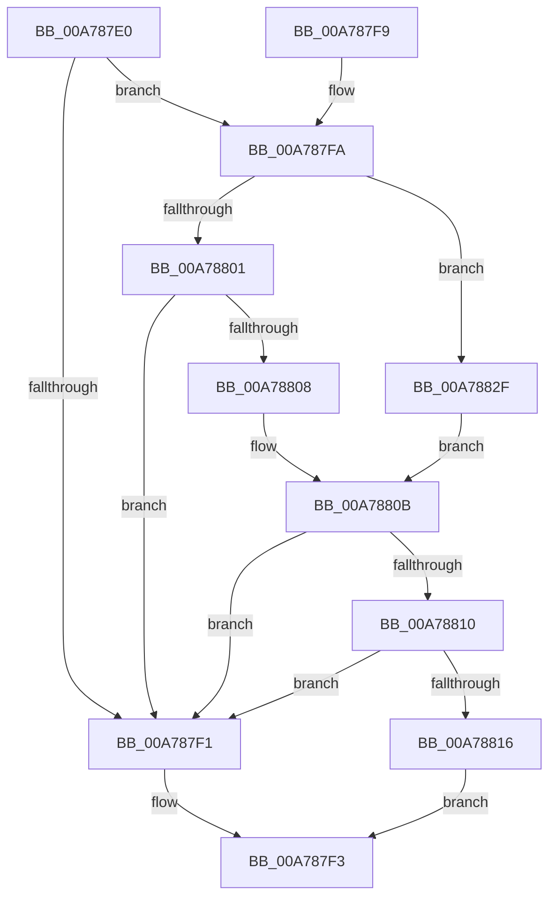

# SeAuditingHardLinkEventsWithContext

- RVA: `0x00A787E0`–`0x00A78835` (길이 `85` bytes)
- VA: `0x0000000140A787E0`
- 실행 섹션: `PAGE`
- PDB 이름 있음: `예`; PDB Function 태그: `아니요`
- unwind 정보 RVA: `0x000B4C5C`
- 디코드: `32`개 명령, `85/85` bytes 표시
- 미해석 바이트: `0` (있으면 어셈블리에 `.byte`로 보존)

> 이 문서는 커널 이미지의 기계어와 PDB 기호를 분석해 생성했습니다. 4번과 5번은 함수 원형과 자료형을 바이너리 사용 방식에서 추정한 C 해석이며 원본 소스 복구 결과는 아닙니다.

## 1. Dependencies

- 직접 호출 지점: **1**; 고유 호출 대상: **1**
- 직접 호출자로 확인된 함수: **0**
- RIP 상대 이미지 참조: **0**

### Outgoing calls
- `0x00A78823` → [SepAdtAuditThisEventWithContext](../87/SepAdtAuditThisEventWithContext_function_00870AC0.md) (function, `0x00870AC0`)

### Direct callers
- 이 함수 시작 RVA로 연결되는 직접 call은 확인되지 않았습니다. 간접 호출은 완전히 역산할 수 없습니다.

### Static image references
- 디코드된 RIP-relative 메모리 참조가 없습니다.

## 2. Other-region calls and transfers

- 다른 실행 섹션으로 향하는 call: **0**
- 별도 외부 분기/꼬리 이동을 확인하지 못했습니다.

## 3. Assembly (complete function range)

```asm
00A787E0  40 53                           push rbx
00A787E2  48 83 EC 20                     sub rsp, 0x20
00A787E6  0F B7 42 02                     movzx eax, word ptr [rdx + 2]
00A787EA  4D 8B C8                        mov r9, r8
00A787ED  A8 10                           test al, 0x10
00A787EF  75 09                           jne 0x140a787fa
00A787F1  32 C0                           xor al, al
00A787F3  48 83 C4 20                     add rsp, 0x20
00A787F7  5B                              pop rbx
00A787F8  C3                              ret
00A787F9  CC                              int3
00A787FA  33 DB                           xor ebx, ebx
00A787FC  66 85 C0                        test ax, ax
00A787FF  79 2E                           jns 0x140a7882f
00A78801  8B 42 0C                        mov eax, dword ptr [rdx + 0xc]
00A78804  85 C0                           test eax, eax
00A78806  74 E9                           je 0x140a787f1
00A78808  48 03 C2                        add rax, rdx
00A7880B  48 85 C0                        test rax, rax
00A7880E  74 E1                           je 0x140a787f1
00A78810  66 3B 58 04                     cmp bx, word ptr [rax + 4]
00A78814  74 DB                           je 0x140a787f1
00A78816  84 C9                           test cl, cl
00A78818  8A D1                           mov dl, cl
00A7881A  B9 75 00 00 00                  mov ecx, 0x75
00A7881F  41 0F 94 C0                     sete r8b
00A78823  E8 98 82 DF FF                  call 0x140870ac0
00A78828  84 C0                           test al, al
00A7882A  0F 95 C0                        setne al
00A7882D  EB C4                           jmp 0x140a787f3
00A7882F  48 8B 42 18                     mov rax, qword ptr [rdx + 0x18]
00A78833  EB D6                           jmp 0x140a7880b
```

## 4. C-style interpretation (structured pseudocode)

```c
__int64 __fastcall SeAuditingHardLinkEventsWithContext(unsigned __int8 a1, __int64 a2, __int64 a3)
{
    __int64 result;
    __int64 v_rbx;
    __int64 v_rsp;

    v_rsp = (v_rsp) - (32);
    if ((((unsigned __int8)(*(unsigned __int16 *)(a2 + 2))) & (16)) != 0) goto loc_00A787FA;
loc_00A787F1:
    result = 0;
loc_00A787F3:
    v_rsp = (v_rsp) + (32);
    return result;
loc_00A787FA:
    v_rbx = 0;
    if (!sign_flag) goto loc_00A7882F;
    if ((unsigned int)((unsigned int)(*(unsigned int *)(a2 + 12))) == 0) goto loc_00A787F1;
    result = ((unsigned int)(*(unsigned int *)(a2 + 12))) + (a2);
loc_00A7880B:
    if (result == 0) goto loc_00A787F1;
    if (0 == (*(unsigned __int16 *)(result + 4))) goto loc_00A787F1;
    a3 = (a1 == 0) ? 1 : 0;
    result = SepAdtAuditThisEventWithContext(117, a1, a3, a3);
    result = ((unsigned __int8)(result) != 0) ? 1 : 0;
    goto loc_00A787F3;
loc_00A7882F:
    goto loc_00A7880B;
}
```

## 5. (Beta) C Style

```c
int64_t SeAuditingHardLinkEventsWithContext(uint8_t Arg1, void *Arg2, int64_t Arg3)
{
    uint8_t *arg2 = (uint8_t *)Arg2;

    int64_t result;
    int64_t local_rbx;
    int64_t local_rsp;

    local_rsp = (local_rsp) - (32);
    if ((((uint8_t)(*(uint16_t *)(arg2 + 0x2))) & (16)) != 0) goto loc_00A787FA;
loc_00A787F1:
    result = 0;
loc_00A787F3:
    local_rsp = (local_rsp) + (32);
    return result;
loc_00A787FA:
    local_rbx = 0;
    if (!sign_flag) goto loc_00A7882F;
    if ((uint32_t)((uint32_t)(*(uint32_t *)(arg2 + 0xC))) == 0) goto loc_00A787F1;
    result = ((uint32_t)(*(uint32_t *)(arg2 + 0xC))) + (Arg2);
loc_00A7880B:
    if (result == 0) goto loc_00A787F1;
    if (0 == (*(uint16_t *)(result + 0x4))) goto loc_00A787F1;
    Arg3 = (Arg1 == 0) ? 1 : 0;
    result = SepAdtAuditThisEventWithContext(117, Arg1, Arg3, Arg3);
    result = ((uint8_t)(result) != 0) ? 1 : 0;
    goto loc_00A787F3;
loc_00A7882F:
    goto loc_00A7880B;
}
```

### 관측된 메모리 오프셋

구조체 형식이 확인되지 않은 접근은 인자 기준의 오프셋으로만 기록했습니다.

| 기준 인자 | 오프셋 표현 | 폭 (bit) | 접근 |
|---|---:|---:|---|
| `Arg2` | `+ 0x2` | `16` | `R` |
| `Arg2` | `+ 0xC` | `32` | `R` |
| `Arg2` | `+ 0x18` | `64` | `R` |

## 6. Execution-region graph

[열기: 2D/3D 그래프와 함수 탐색 컨트롤 패널](../../../control-panel.html?section=page&rva=0x00A787E0&view=graph)

- 2D 그래프는 위에서 아래로 흐르고, 3D 그래프는 빈 공간을 드래그해 회전합니다. Shift+드래그는 이동, 휠은 확대·축소, 함수 노드 선택은 대상 보고서 이동입니다.

### Static fallback


