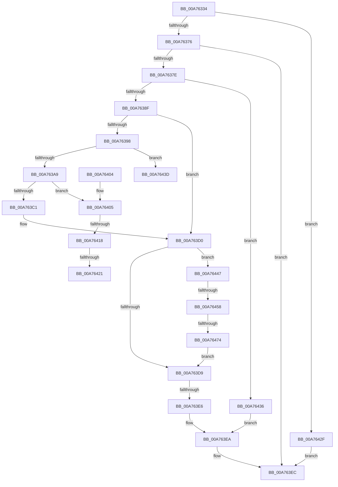

# SepDuplicateClaimAttributes

- RVA: `0x00A76334`–`0x00A76483` (길이 `335` bytes)
- VA: `0x0000000140A76334`
- 실행 섹션: `PAGE`
- PDB 이름 있음: `예`; PDB Function 태그: `예`
- unwind 정보 RVA: `0x000B5A88`
- 디코드: `94`개 명령, `335/335` bytes 표시
- 미해석 바이트: `0` (있으면 어셈블리에 `.byte`로 보존)

> 이 문서는 커널 이미지의 기계어와 PDB 기호를 분석해 생성했습니다. 4번과 5번은 함수 원형과 자료형을 바이너리 사용 방식에서 추정한 C 해석이며 원본 소스 복구 결과는 아닙니다.

## 1. Dependencies

- 직접 호출 지점: **7**; 고유 호출 대상: **5**
- 직접 호출자로 확인된 함수: **2**
- RIP 상대 이미지 참조: **0**

### Outgoing calls
- `0x00A7637E` → [AuthzBasepAllocateClaimCollectionNoLists](AuthzBasepAllocateClaimCollectionNoLists_function_00A7648C.md) (function, `0x00A7648C`)
- `0x00A76398` → [AuthzBasepAllocateSecurityAttributesList](../../text/30/AuthzBasepAllocateSecurityAttributesList_function_003013F4.md) (function, `0x003013F4`)
- `0x00A763B6` → [AuthzBasepDuplicateSecurityAttributes](../../text/30/AuthzBasepDuplicateSecurityAttributes_function_003023C0.md) (function, `0x003023C0`)
- `0x00A7640A` → [ExFreePoolWithTag](../../poolcode/B8/ExFreePoolWithTag_function_00B82870.md) (function, `0x00B82870`)
- `0x00A76424` → [AuthzBasepFreeSecurityAttributesList](../../text/30/AuthzBasepFreeSecurityAttributesList_function_00301230.md) (function, `0x00301230`)
- `0x00A76447` → [AuthzBasepAllocateSecurityAttributesList](../../text/30/AuthzBasepAllocateSecurityAttributesList_function_003013F4.md) (function, `0x003013F4`)
- `0x00A76465` → [AuthzBasepDuplicateSecurityAttributes](../../text/30/AuthzBasepDuplicateSecurityAttributes_function_003023C0.md) (function, `0x003023C0`)

### Direct callers
- [SepConvertToOwnTokenClaims](../../text/4B/SepConvertToOwnTokenClaims_function_004B0AA0.md) at `0x004B0AD5`
- [SepDuplicateTokenClaims](SepDuplicateTokenClaims_function_00A762C8.md) at `0x00A7630A`

### Static image references
- 디코드된 RIP-relative 메모리 참조가 없습니다.

## 2. Other-region calls and transfers

- 다른 실행 섹션으로 향하는 call: **6**
  - `0x00A76398` → [AuthzBasepAllocateSecurityAttributesList](../../text/30/AuthzBasepAllocateSecurityAttributesList_function_003013F4.md) (`PAGE` → `.text`)
  - `0x00A763B6` → [AuthzBasepDuplicateSecurityAttributes](../../text/30/AuthzBasepDuplicateSecurityAttributes_function_003023C0.md) (`PAGE` → `.text`)
  - `0x00A7640A` → [ExFreePoolWithTag](../../poolcode/B8/ExFreePoolWithTag_function_00B82870.md) (`PAGE` → `POOLCODE`)
  - `0x00A76424` → [AuthzBasepFreeSecurityAttributesList](../../text/30/AuthzBasepFreeSecurityAttributesList_function_00301230.md) (`PAGE` → `.text`)
  - `0x00A76447` → [AuthzBasepAllocateSecurityAttributesList](../../text/30/AuthzBasepAllocateSecurityAttributesList_function_003013F4.md) (`PAGE` → `.text`)
  - `0x00A76465` → [AuthzBasepDuplicateSecurityAttributes](../../text/30/AuthzBasepDuplicateSecurityAttributes_function_003023C0.md) (`PAGE` → `.text`)
- call이 아닌 외부 분기/꼬리 이동: **7**
  - `0x00A763E0` → [sub_00B412E4 + 0x2A](../B4/Unknown_function_00B412E4.md) (`tail-transfer`)
  - `0x00A76412` → [sub_00B412E4 + 0xC8](../B4/Unknown_function_00B412E4.md) (`tail-transfer`)
  - `0x00A7641B` → [sub_00B412E4 + 0xBE](../B4/Unknown_function_00B412E4.md) (`tail-transfer`)
  - `0x00A7642A` → [sub_00B412E4 + 0xBE](../B4/Unknown_function_00B412E4.md) (`tail-transfer`)
  - `0x00A76442` → [sub_00B412E4 + 0xD7](../B4/Unknown_function_00B412E4.md) (`tail-transfer`)
  - `0x00A76452` → [sub_00B412E4](../B4/Unknown_function_00B412E4.md) (`tail-transfer`)
  - `0x00A7646E` → [sub_00B412E4 + 0x5](../B4/Unknown_function_00B412E4.md) (`tail-transfer`)

## 3. Assembly (complete function range)

```asm
00A76334  4C 8B DC                        mov r11, rsp
00A76337  49 89 5B 08                     mov qword ptr [r11 + 8], rbx
00A7633B  55                              push rbp
00A7633C  56                              push rsi
00A7633D  57                              push rdi
00A7633E  41 54                           push r12
00A76340  41 55                           push r13
00A76342  41 56                           push r14
00A76344  41 57                           push r15
00A76346  48 83 EC 60                     sub rsp, 0x60
00A7634A  33 C0                           xor eax, eax
00A7634C  4C 8B E2                        mov r12, rdx
00A7634F  88 84 24 A8 00 00 00            mov byte ptr [rsp + 0xa8], al
00A76356  4C 8B F1                        mov r14, rcx
00A76359  41 89 43 18                     mov dword ptr [r11 + 0x18], eax
00A7635D  8B D8                           mov ebx, eax
00A7635F  49 89 43 20                     mov qword ptr [r11 + 0x20], rax
00A76363  44 8B F8                        mov r15d, eax
00A76366  8B F8                           mov edi, eax
00A76368  44 8A E8                        mov r13b, al
00A7636B  8B E8                           mov ebp, eax
00A7636D  48 85 D2                        test rdx, rdx
00A76370  0F 84 B9 00 00 00               je 0x140a7642f
00A76376  48 89 02                        mov qword ptr [rdx], rax
00A76379  48 85 C9                        test rcx, rcx
00A7637C  74 6E                           je 0x140a763ec
00A7637E  E8 09 01 00 00                  call 0x140a7648c
00A76383  48 8B F0                        mov rsi, rax
00A76386  48 85 C0                        test rax, rax
00A76389  0F 84 A7 00 00 00               je 0x140a76436
00A7638F  49 39 9E 40 02 00 00            cmp qword ptr [r14 + 0x240], rbx
00A76396  74 38                           je 0x140a763d0
00A76398  E8 57 B0 88 FF                  call 0x1403013f4
00A7639D  4C 8B F8                        mov r15, rax
00A763A0  48 85 C0                        test rax, rax
00A763A3  0F 84 94 00 00 00               je 0x140a7643d
00A763A9  49 8B 8E 40 02 00 00            mov rcx, qword ptr [r14 + 0x240]
00A763B0  45 33 C0                        xor r8d, r8d
00A763B3  48 8B D0                        mov rdx, rax
00A763B6  E8 05 C0 88 FF                  call 0x1403023c0
00A763BB  8B D8                           mov ebx, eax
00A763BD  85 C0                           test eax, eax
00A763BF  78 44                           js 0x140a76405
00A763C1  C6 84 24 A8 00 00 00 01         mov byte ptr [rsp + 0xa8], 1
00A763C9  4C 89 BE 40 02 00 00            mov qword ptr [rsi + 0x240], r15
00A763D0  49 39 BE 48 02 00 00            cmp qword ptr [r14 + 0x248], rdi
00A763D7  75 6E                           jne 0x140a76447
00A763D9  49 8B 4E 08                     mov rcx, qword ptr [r14 + 8]
00A763DD  48 85 C9                        test rcx, rcx
00A763E0  0F 85 28 AF 0C 00               jne 0x140b4130e
00A763E6  49 89 34 24                     mov qword ptr [r12], rsi
00A763EA  8B C3                           mov eax, ebx
00A763EC  48 8B 9C 24 A0 00 00 00         mov rbx, qword ptr [rsp + 0xa0]
00A763F4  48 83 C4 60                     add rsp, 0x60
00A763F8  41 5F                           pop r15
00A763FA  41 5E                           pop r14
00A763FC  41 5D                           pop r13
00A763FE  41 5C                           pop r12
00A76400  5F                              pop rdi
00A76401  5E                              pop rsi
00A76402  5D                              pop rbp
00A76403  C3                              ret
00A76404  CC                              int3
00A76405  33 D2                           xor edx, edx
00A76407  49 8B CF                        mov rcx, r15
00A7640A  E8 61 C4 10 00                  call 0x140b82870
00A7640F  48 85 FF                        test rdi, rdi
00A76412  0F 84 94 AF 0C 00               je 0x140b413ac
00A76418  45 84 ED                        test r13b, r13b
00A7641B  0F 84 81 AF 0C 00               je 0x140b413a2
00A76421  48 8B CF                        mov rcx, rdi
00A76424  E8 07 AE 88 FF                  call 0x140301230
00A76429  90                              nop
00A7642A  E9 73 AF 0C 00                  jmp 0x140b413a2
00A7642F  B8 0D 00 00 C0                  mov eax, 0xc000000d
00A76434  EB B6                           jmp 0x140a763ec
00A76436  BB 9A 00 00 C0                  mov ebx, 0xc000009a
00A7643B  EB AD                           jmp 0x140a763ea
00A7643D  BB 9A 00 00 C0                  mov ebx, 0xc000009a
00A76442  E9 74 AF 0C 00                  jmp 0x140b413bb
00A76447  E8 A8 AF 88 FF                  call 0x1403013f4
00A7644C  48 8B F8                        mov rdi, rax
00A7644F  48 85 C0                        test rax, rax
00A76452  0F 84 8C AE 0C 00               je 0x140b412e4
00A76458  49 8B 8E 48 02 00 00            mov rcx, qword ptr [r14 + 0x248]
00A7645F  45 33 C0                        xor r8d, r8d
00A76462  48 8B D0                        mov rdx, rax
00A76465  E8 56 BF 88 FF                  call 0x1403023c0
00A7646A  8B D8                           mov ebx, eax
00A7646C  85 C0                           test eax, eax
00A7646E  0F 88 75 AE 0C 00               js 0x140b412e9
00A76474  41 B5 01                        mov r13b, 1
00A76477  48 89 BE 48 02 00 00            mov qword ptr [rsi + 0x248], rdi
00A7647E  E9 56 FF FF FF                  jmp 0x140a763d9
```

## 4. C-style interpretation (structured pseudocode)

```c
__int64 __fastcall SepDuplicateClaimAttributes(__int64 a1, __int64 a2, int a3)
{
    __int64 result;
    __int64 v_rsp;
    unsigned __int8 v_stack_p10;
    unsigned __int64 v_stack_p8;

    *(unsigned __int64 *)(v_rsp + 8) = v_rbx;
    v_rsp = (v_rsp) - (96);
    result = 0;
    v_stack_p10 = 0;
    *(unsigned int *)(v_rsp + 24) = 0;
    *(unsigned __int64 *)(v_rsp + 32) = 0;
    if (a2 == 0) goto loc_00A7642F;
    *(unsigned __int64 *)(a2) = 0;
    if (a1 == 0) goto loc_00A763EC;
    result = AuthzBasepAllocateClaimCollectionNoLists(a1, a2, a3, a4);
    if (result == 0) goto loc_00A76436;
    if ((*(unsigned __int64 *)(a1 + 576)) == 0) goto loc_00A763D0;
    result = AuthzBasepAllocateSecurityAttributesList(a1, a2, a3, a4);
    if (result == 0) goto loc_00A7643D;
    a3 = 0;
    result = AuthzBasepDuplicateSecurityAttributes(*(unsigned __int64 *)(a1 + 576), result, a3, a4);
    if (sign_flag) goto loc_00A76405;
    v_stack_p10 = 1;
    *(unsigned __int64 *)(result + 576) = result;
loc_00A763D0:
    if ((*(unsigned __int64 *)(a1 + 584)) != 0) goto loc_00A76447;
loc_00A763D9:
    *(unsigned __int64 *)(a2) = result;
loc_00A763EA:
loc_00A763EC:
    v_rsp = (v_rsp) + (96);
    return (unsigned int)((unsigned int)((unsigned int)((unsigned int)(result))));
loc_00A76405:
    a2 = 0;
    result = ExFreePoolWithTag(result, a2, a3, a4);
    result = AuthzBasepFreeSecurityAttributesList(0, a2, a3, a4);
loc_00A7642F:
    goto loc_00A763EC;
loc_00A76436:
    goto loc_00A763EA;
loc_00A7643D:
loc_00A76447:
    result = AuthzBasepAllocateSecurityAttributesList(0, a2, a3, a4);
    a3 = 0;
    result = AuthzBasepDuplicateSecurityAttributes(*(unsigned __int64 *)(a1 + 584), result, a3, a4);
    *(unsigned __int64 *)(result + 584) = result;
    goto loc_00A763D9;
}
```

## 5. (Beta) C Style

```c
int64_t SepDuplicateClaimAttributes(void *Arg1, void *Arg2, int32_t Arg3)
{
    uint8_t *arg1 = (uint8_t *)Arg1;
    uint8_t *arg2 = (uint8_t *)Arg2;

    int64_t result;
    int64_t local_rsp;
    uint8_t v_stack_p10;
    uint64_t v_stack_p8;

    *(uint64_t *)(local_rsp + 0x8) = local_rbx;
    local_rsp = (local_rsp) - (96);
    result = 0;
    v_stack_p10 = 0;
    *(uint32_t *)(local_rsp + 0x18) = 0;
    *(uint64_t *)(local_rsp + 0x20) = 0;
    if (Arg2 == NULL) goto loc_00A7642F;
    *(uint64_t *)(arg2) = 0;
    if (Arg1 == NULL) goto loc_00A763EC;
    result = AuthzBasepAllocateClaimCollectionNoLists(Arg1, Arg2, Arg3, a4);
    if (result == 0) goto loc_00A76436;
    if ((*(uint64_t *)(arg1 + 0x240)) == 0) goto loc_00A763D0;
    result = AuthzBasepAllocateSecurityAttributesList(Arg1, Arg2, Arg3, a4);
    if (result == 0) goto loc_00A7643D;
    Arg3 = 0;
    result = AuthzBasepDuplicateSecurityAttributes(*(uint64_t *)(arg1 + 0x240), result, Arg3, a4);
    if (sign_flag) goto loc_00A76405;
    v_stack_p10 = 1;
    *(uint64_t *)(result + 0x240) = result;
loc_00A763D0:
    if ((*(uint64_t *)(arg1 + 0x248)) != 0) goto loc_00A76447;
loc_00A763D9:
    *(uint64_t *)(arg2) = result;
loc_00A763EA:
loc_00A763EC:
    local_rsp = (local_rsp) + (96);
    return (uint32_t)((uint32_t)((uint32_t)((uint32_t)(result))));
loc_00A76405:
    Arg2 = 0;
    result = ExFreePoolWithTag(result, Arg2, Arg3, a4);
    result = AuthzBasepFreeSecurityAttributesList(0, Arg2, Arg3, a4);
loc_00A7642F:
    goto loc_00A763EC;
loc_00A76436:
    goto loc_00A763EA;
loc_00A7643D:
loc_00A76447:
    result = AuthzBasepAllocateSecurityAttributesList(0, Arg2, Arg3, a4);
    Arg3 = 0;
    result = AuthzBasepDuplicateSecurityAttributes(*(uint64_t *)(arg1 + 0x248), result, Arg3, a4);
    *(uint64_t *)(result + 0x248) = result;
    goto loc_00A763D9;
}
```

### 관측된 메모리 오프셋

구조체 형식이 확인되지 않은 접근은 인자 기준의 오프셋으로만 기록했습니다.

| 기준 인자 | 오프셋 표현 | 폭 (bit) | 접근 |
|---|---:|---:|---|
| `Arg1` | `+ 0x8` | `64` | `R` |
| `Arg1` | `+ 0x240` | `64` | `R` |
| `Arg1` | `+ 0x248` | `64` | `R` |
| `Arg2` | `+ 0x0` | `64` | `W` |

## 6. Execution-region graph

[열기: 2D/3D 그래프와 함수 탐색 컨트롤 패널](../../../control-panel.html?section=page&rva=0x00A76334&view=graph)

- 2D 그래프는 위에서 아래로 흐르고, 3D 그래프는 빈 공간을 드래그해 회전합니다. Shift+드래그는 이동, 휠은 확대·축소, 함수 노드 선택은 대상 보고서 이동입니다.

### Static fallback


