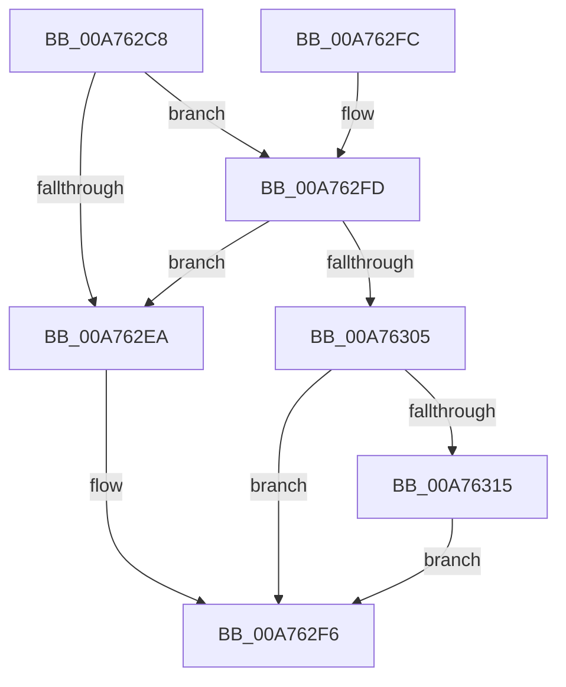

# SepDuplicateTokenClaims

- RVA: `0x00A762C8`–`0x00A7632D` (길이 `101` bytes)
- VA: `0x0000000140A762C8`
- 실행 섹션: `PAGE`
- PDB 이름 있음: `예`; PDB Function 태그: `아니요`
- unwind 정보 RVA: `0x000AAE6C`
- 디코드: `27`개 명령, `101/101` bytes 표시
- 미해석 바이트: `0` (있으면 어셈블리에 `.byte`로 보존)

> 이 문서는 커널 이미지의 기계어와 PDB 기호를 분석해 생성했습니다. 4번과 5번은 함수 원형과 자료형을 바이너리 사용 방식에서 추정한 C 해석이며 원본 소스 복구 결과는 아닙니다.

## 1. Dependencies

- 직접 호출 지점: **1**; 고유 호출 대상: **1**
- 직접 호출자로 확인된 함수: **2**
- RIP 상대 이미지 참조: **0**

### Outgoing calls
- `0x00A7630A` → [SepDuplicateClaimAttributes](SepDuplicateClaimAttributes_function_00A76334.md) (function, `0x00A76334`)

### Direct callers
- [SepDuplicateToken](../8B/SepDuplicateToken_function_008B87EC.md) at `0x008B8EF0`
- [SepFilterToken](../9C/SepFilterToken_function_009C6B80.md) at `0x009C712C`

### Static image references
- 디코드된 RIP-relative 메모리 참조가 없습니다.

## 2. Other-region calls and transfers

- 다른 실행 섹션으로 향하는 call: **0**
- 별도 외부 분기/꼬리 이동을 확인하지 못했습니다.

## 3. Assembly (complete function range)

```asm
00A762C8  40 53                           push rbx
00A762CA  48 83 EC 20                     sub rsp, 0x20
00A762CE  48 83 64 24 30 00               and qword ptr [rsp + 0x30], 0
00A762D4  4C 8D 81 48 04 00 00            lea r8, [rcx + 0x448]
00A762DB  F7 81 C8 00 00 00 00 80 00 00   test dword ptr [rcx + 0xc8], 0x8000
00A762E5  48 8B DA                        mov rbx, rdx
00A762E8  75 13                           jne 0x140a762fd
00A762EA  49 8B 00                        mov rax, qword ptr [r8]
00A762ED  48 89 82 48 04 00 00            mov qword ptr [rdx + 0x448], rax
00A762F4  33 C0                           xor eax, eax
00A762F6  48 83 C4 20                     add rsp, 0x20
00A762FA  5B                              pop rbx
00A762FB  C3                              ret
00A762FC  CC                              int3
00A762FD  49 8B 08                        mov rcx, qword ptr [r8]
00A76300  48 85 C9                        test rcx, rcx
00A76303  74 E5                           je 0x140a762ea
00A76305  48 8D 54 24 30                  lea rdx, [rsp + 0x30]
00A7630A  E8 25 00 00 00                  call 0x140a76334
00A7630F  8B C8                           mov ecx, eax
00A76311  85 C0                           test eax, eax
00A76313  78 E1                           js 0x140a762f6
00A76315  48 8B 44 24 30                  mov rax, qword ptr [rsp + 0x30]
00A7631A  0F BA AB C8 00 00 00 0F         bts dword ptr [rbx + 0xc8], 0xf
00A76322  48 89 83 48 04 00 00            mov qword ptr [rbx + 0x448], rax
00A76329  8B C1                           mov eax, ecx
00A7632B  EB C9                           jmp 0x140a762f6
```

## 4. C-style interpretation (structured pseudocode)

```c
__int64 __fastcall SepDuplicateTokenClaims(__int64 a1, __int64 a2)
{
    __int64 result;
    __int64 v_rsp;
    unsigned __int64 v_stack_p30;
    unsigned __int64 v_stack_p8;

    v_rsp = (v_rsp) - (32);
    if (((*(unsigned int *)(a1 + 200)) & (0x8000ULL)) != 0) goto loc_00A762FD;
loc_00A762EA:
    *(unsigned __int64 *)(a2 + 1096) = *(unsigned __int64 *)(a1 + 1096);
    result = 0;
loc_00A762F6:
    v_rsp = (v_rsp) + (32);
    return result;
loc_00A762FD:
    if (*(unsigned __int64 *)(a1 + 1096) == 0) goto loc_00A762EA;
    result = SepDuplicateClaimAttributes(*(unsigned __int64 *)(a1 + 1096), v_stack_p30, a1 + 1096, a4);
    if (sign_flag) goto loc_00A762F6;
    *(unsigned __int64 *)(a2 + 1096) = v_stack_p30;
    goto loc_00A762F6;
}
```

## 5. (Beta) C Style

```c
int64_t SepDuplicateTokenClaims(void *Arg1, void *Arg2)
{
    uint8_t *arg1 = (uint8_t *)Arg1;
    uint8_t *arg2 = (uint8_t *)Arg2;

    int64_t result;
    int64_t local_rsp;
    uint64_t v_stack_p30;
    uint64_t v_stack_p8;

    local_rsp = (local_rsp) - (32);
    if (((*(uint32_t *)(arg1 + 0xC8)) & (0x8000ULL)) != 0) goto loc_00A762FD;
loc_00A762EA:
    *(uint64_t *)(arg2 + 0x448) = *(uint64_t *)(arg1 + 0x448);
    result = 0;
loc_00A762F6:
    local_rsp = (local_rsp) + (32);
    return result;
loc_00A762FD:
    if (*(uint64_t *)(arg1 + 0x448) == 0) goto loc_00A762EA;
    result = SepDuplicateClaimAttributes(*(uint64_t *)(arg1 + 0x448), v_stack_p30, Arg1 + 1096, a4);
    if (sign_flag) goto loc_00A762F6;
    *(uint64_t *)(arg2 + 0x448) = v_stack_p30;
    goto loc_00A762F6;
}
```

### 관측된 메모리 오프셋

구조체 형식이 확인되지 않은 접근은 인자 기준의 오프셋으로만 기록했습니다.

| 기준 인자 | 오프셋 표현 | 폭 (bit) | 접근 |
|---|---:|---:|---|
| `Arg1` | `+ 0x0` | `64` | `R` |
| `Arg1` | `+ 0xC8` | `32` | `R` |
| `Arg1` | `+ 0x448` | `64` | `R` |
| `Arg2` | `+ 0xC8` | `32` | `R/W` |
| `Arg2` | `+ 0x448` | `64` | `W` |

## 6. Execution-region graph

[열기: 2D/3D 그래프와 함수 탐색 컨트롤 패널](../../../control-panel.html?section=page&rva=0x00A762C8&view=graph)

- 2D 그래프는 위에서 아래로 흐르고, 3D 그래프는 빈 공간을 드래그해 회전합니다. Shift+드래그는 이동, 휠은 확대·축소, 함수 노드 선택은 대상 보고서 이동입니다.

### Static fallback


