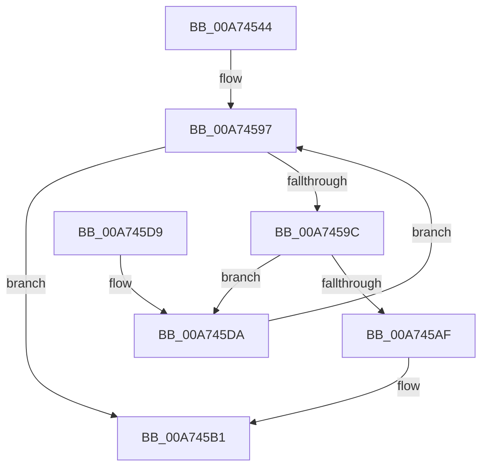

# SepFindMatchingLowBoxNumberEntry

- RVA: `0x00A74544`–`0x00A745E9` (길이 `165` bytes)
- VA: `0x0000000140A74544`
- 실행 섹션: `PAGE`
- PDB 이름 있음: `예`; PDB Function 태그: `아니요`
- unwind 정보 RVA: `0x000B57F0`
- 디코드: `50`개 명령, `165/165` bytes 표시
- 미해석 바이트: `0` (있으면 어셈블리에 `.byte`로 보존)

> 이 문서는 커널 이미지의 기계어와 PDB 기호를 분석해 생성했습니다. 4번과 5번은 함수 원형과 자료형을 바이너리 사용 방식에서 추정한 C 해석이며 원본 소스 복구 결과는 아닙니다.

## 1. Dependencies

- 직접 호출 지점: **3**; 고유 호출 대상: **3**
- 직접 호출자로 확인된 함수: **1**
- RIP 상대 이미지 참조: **0**

### Outgoing calls
- `0x00A74592` → [RtlLookupEntryHashTable](../../text/3F/RtlLookupEntryHashTable_function_003FAE50.md) (function, `0x003FAE50`)
- `0x00A745A6` → [RtlEqualSid](../../text/40/RtlEqualSid_function_00400AD0.md) (function, `0x00400AD0`)
- `0x00A745E2` → [RtlGetNextEntryHashTable](../../text/44/RtlGetNextEntryHashTable_function_00446C20.md) (function, `0x00446C20`)

### Direct callers
- [SepGetLowBoxNumberEntry](../A6/SepGetLowBoxNumberEntry_function_00A65040.md) at `0x00A65076`

### Static image references
- 디코드된 RIP-relative 메모리 참조가 없습니다.

## 2. Other-region calls and transfers

- 다른 실행 섹션으로 향하는 call: **3**
  - `0x00A74592` → [RtlLookupEntryHashTable](../../text/3F/RtlLookupEntryHashTable_function_003FAE50.md) (`PAGE` → `.text`)
  - `0x00A745A6` → [RtlEqualSid](../../text/40/RtlEqualSid_function_00400AD0.md) (`PAGE` → `.text`)
  - `0x00A745E2` → [RtlGetNextEntryHashTable](../../text/44/RtlGetNextEntryHashTable_function_00446C20.md) (`PAGE` → `.text`)
- 별도 외부 분기/꼬리 이동을 확인하지 못했습니다.

## 3. Assembly (complete function range)

```asm
00A74544  4C 8B DC                        mov r11, rsp
00A74547  49 89 5B 08                     mov qword ptr [r11 + 8], rbx
00A7454B  49 89 6B 10                     mov qword ptr [r11 + 0x10], rbp
00A7454F  49 89 73 18                     mov qword ptr [r11 + 0x18], rsi
00A74553  49 89 7B 20                     mov qword ptr [r11 + 0x20], rdi
00A74557  41 56                           push r14
00A74559  48 83 EC 40                     sub rsp, 0x40
00A7455D  33 C0                           xor eax, eax
00A7455F  4D 8B F0                        mov r14, r8
00A74562  33 DB                           xor ebx, ebx
00A74564  48 8B F2                        mov rsi, rdx
00A74567  0F 57 C0                        xorps xmm0, xmm0
00A7456A  48 8B E9                        mov rbp, rcx
00A7456D  0F 11 44 24 20                  movups xmmword ptr [rsp + 0x20], xmm0
00A74572  49 89 43 E8                     mov qword ptr [r11 - 0x18], rax
00A74576  8B FB                           mov edi, ebx
00A74578  0F B6 42 01                     movzx eax, byte ptr [rdx + 1]
00A7457C  FF C8                           dec eax
00A7457E  44 8B 44 82 08                  mov r8d, dword ptr [rdx + rax*4 + 8]
00A74583  45 85 C0                        test r8d, r8d
00A74586  49 8D 50 01                     lea rdx, [r8 + 1]
00A7458A  49 0F 45 D0                     cmovne rdx, r8
00A7458E  4D 8D 43 D8                     lea r8, [r11 - 0x28]
00A74592  E8 B9 68 98 FF                  call 0x1403fae50
00A74597  48 85 C0                        test rax, rax
00A7459A  74 15                           je 0x140a745b1
00A7459C  48 8B 50 20                     mov rdx, qword ptr [rax + 0x20]
00A745A0  48 8B CE                        mov rcx, rsi
00A745A3  48 8B F8                        mov rdi, rax
00A745A6  E8 25 C5 98 FF                  call 0x140400ad0
00A745AB  84 C0                           test al, al
00A745AD  74 2B                           je 0x140a745da
00A745AF  B3 01                           mov bl, 1
00A745B1  F6 DB                           neg bl
00A745B3  48 1B C0                        sbb rax, rax
00A745B6  48 23 C7                        and rax, rdi
00A745B9  49 89 06                        mov qword ptr [r14], rax
00A745BC  33 C0                           xor eax, eax
00A745BE  48 8B 5C 24 50                  mov rbx, qword ptr [rsp + 0x50]
00A745C3  48 8B 6C 24 58                  mov rbp, qword ptr [rsp + 0x58]
00A745C8  48 8B 74 24 60                  mov rsi, qword ptr [rsp + 0x60]
00A745CD  48 8B 7C 24 68                  mov rdi, qword ptr [rsp + 0x68]
00A745D2  48 83 C4 40                     add rsp, 0x40
00A745D6  41 5E                           pop r14
00A745D8  C3                              ret
00A745D9  CC                              int3
00A745DA  48 8D 54 24 20                  lea rdx, [rsp + 0x20]
00A745DF  48 8B CD                        mov rcx, rbp
00A745E2  E8 39 26 9D FF                  call 0x140446c20
00A745E7  EB AE                           jmp 0x140a74597
```

## 4. C-style interpretation (structured pseudocode)

```c
__int64 __fastcall SepFindMatchingLowBoxNumberEntry(__int64 a1, __int64 a2, __int64 a3)
{
    __int64 result;
    __int64 v_rbx;
    __int64 v_rsp;
    unsigned __int64 v_stack_m28;
    unsigned __int64 v_stack_p10;
    unsigned __int64 v_stack_p18;
    unsigned __int64 v_stack_p20;
    unsigned __int64 v_stack_p8;

    *(unsigned __int64 *)(v_rsp + 8) = v_rbx;
    *(unsigned __int64 *)(v_rsp + 16) = v_rbp;
    *(unsigned __int64 *)(v_rsp + 24) = v_rsi;
    *(unsigned __int64 *)(v_rsp + 32) = v_rdi;
    v_rsp = (v_rsp) - (64);
    result = 0;
    v_rbx = 0;
    v_stack_m28 = v_xmm0;
    *(unsigned __int64 *)(v_rsp - 24) = 0;
    result = (unsigned int)((*(unsigned __int8 *)(a2 + 1)) - 1);
    a2 = (unsigned int)(*(unsigned int *)(a2 + result * 4 + 8)) + 1;
    if ((unsigned int)((unsigned int)(*(unsigned int *)(a2 + result * 4 + 8))) != 0) { a2 = (unsigned int)(*(unsigned int *)(a2 + result * 4 + 8)); }
    result = RtlLookupEntryHashTable(a1, a2, v_rsp - 40, a4);
loc_00A74597:
    if (result == 0) goto loc_00A745B1;
    result = RtlEqualSid(a2, *(unsigned __int64 *)(result + 32), v_rsp - 40, a4);
    if ((unsigned __int8)(result) == 0) goto loc_00A745DA;
loc_00A745B1:
    v_rbx = (unsigned __int8)(-(1));
    result = (result) & (result);
    *(unsigned __int64 *)(a3) = result;
    result = 0;
    v_rsp = (v_rsp) + (64);
    return result;
loc_00A745DA:
    result = RtlGetNextEntryHashTable(v_stack_p10, v_stack_p20, v_rsp - 40, a4);
    goto loc_00A74597;
}
```

## 5. (Beta) C Style

```c
int64_t SepFindMatchingLowBoxNumberEntry(int64_t Arg1, void *Arg2, void *Arg3)
{
    uint8_t *arg2 = (uint8_t *)Arg2;
    uint8_t *arg3 = (uint8_t *)Arg3;

    int64_t result;
    int64_t local_rbx;
    int64_t local_rsp;
    uint64_t v_stack_m28;
    uint64_t v_stack_p10;
    uint64_t v_stack_p18;
    uint64_t v_stack_p20;
    uint64_t v_stack_p8;

    *(uint64_t *)(local_rsp + 0x8) = local_rbx;
    *(uint64_t *)(local_rsp + 0x10) = local_rbp;
    *(uint64_t *)(local_rsp + 0x18) = local_rsi;
    *(uint64_t *)(local_rsp + 0x20) = local_rdi;
    local_rsp = (local_rsp) - (64);
    result = 0;
    local_rbx = 0;
    v_stack_m28 = v_xmm0;
    *(uint64_t *)(local_rsp - 0x18) = 0;
    result = (uint32_t)((*(uint8_t *)(arg2 + 0x1)) - 1);
    Arg2 = (uint32_t)(*(uint32_t *)(arg2 + result * 4 + 0x8)) + 1;
    if ((uint32_t)((uint32_t)(*(uint32_t *)(arg2 + result * 4 + 0x8))) != 0) { Arg2 = (uint32_t)(*(uint32_t *)(arg2 + result * 4 + 0x8)); }
    result = RtlLookupEntryHashTable(Arg1, Arg2, local_rsp - 40, a4);
loc_00A74597:
    if (result == 0) goto loc_00A745B1;
    result = RtlEqualSid(Arg2, *(uint64_t *)(result + 0x20), local_rsp - 40, a4);
    if ((uint8_t)(result) == 0) goto loc_00A745DA;
loc_00A745B1:
    local_rbx = (uint8_t)(-(1));
    result = (result) & (result);
    *(uint64_t *)(arg3) = result;
    result = 0;
    local_rsp = (local_rsp) + (64);
    return result;
loc_00A745DA:
    result = RtlGetNextEntryHashTable(v_stack_p10, v_stack_p20, local_rsp - 40, a4);
    goto loc_00A74597;
}
```

### 관측된 메모리 오프셋

구조체 형식이 확인되지 않은 접근은 인자 기준의 오프셋으로만 기록했습니다.

| 기준 인자 | 오프셋 표현 | 폭 (bit) | 접근 |
|---|---:|---:|---|
| `Arg2` | `+ 0x1` | `8` | `R` |
| `Arg2` | `+ 0x8 + rax*4` | `32` | `R` |
| `Arg3` | `+ 0x0` | `64` | `W` |

## 6. Execution-region graph

[열기: 2D/3D 그래프와 함수 탐색 컨트롤 패널](../../../control-panel.html?section=page&rva=0x00A74544&view=graph)

- 2D 그래프는 위에서 아래로 흐르고, 3D 그래프는 빈 공간을 드래그해 회전합니다. Shift+드래그는 이동, 휠은 확대·축소, 함수 노드 선택은 대상 보고서 이동입니다.

### Static fallback


