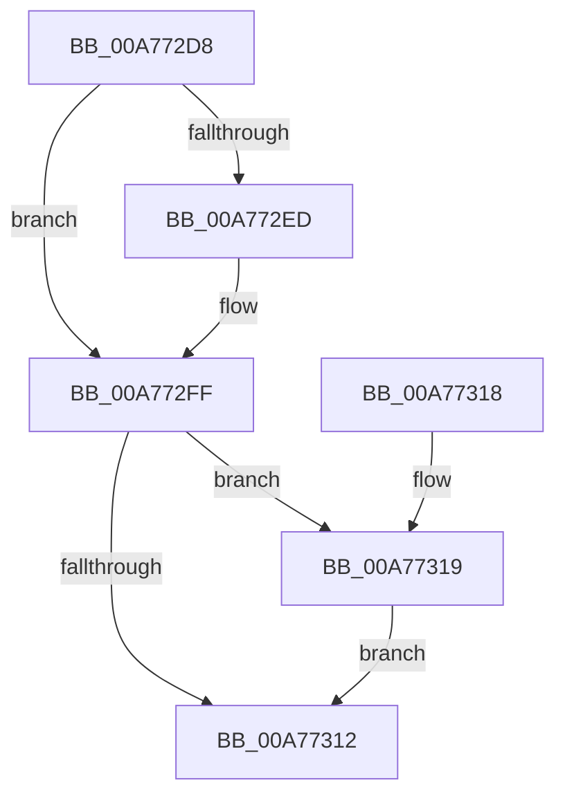

# SepFreeDefaultDacl

- RVA: `0x00A772D8`–`0x00A7733B` (길이 `99` bytes)
- VA: `0x0000000140A772D8`
- 실행 섹션: `PAGE`
- PDB 이름 있음: `예`; PDB Function 태그: `아니요`
- unwind 정보 RVA: `0x00092364`
- 디코드: `23`개 명령, `99/99` bytes 표시
- 미해석 바이트: `0` (있으면 어셈블리에 `.byte`로 보존)

> 이 문서는 커널 이미지의 기계어와 PDB 기호를 분석해 생성했습니다. 4번과 5번은 함수 원형과 자료형을 바이너리 사용 방식에서 추정한 C 해석이며 원본 소스 복구 결과는 아닙니다.

## 1. Dependencies

- 직접 호출 지점: **1**; 고유 호출 대상: **1**
- 직접 호출자로 확인된 함수: **2**
- RIP 상대 이미지 참조: **0**

### Outgoing calls
- `0x00A77326` → [memcpy](../../text/6C/memcpy_function_006C6840.md) (function, `0x006C6840`)

### Direct callers
- [SepAppendAceToTokenDefaultDacl](../../text/40/SepAppendAceToTokenDefaultDacl_function_004002F8.md) at `0x004004AB`
- [NtSetInformationToken](../AF/NtSetInformationToken_function_00AF0530.md) at `0x00AF088D`

### Static image references
- 디코드된 RIP-relative 메모리 참조가 없습니다.

## 2. Other-region calls and transfers

- 다른 실행 섹션으로 향하는 call: **1**
  - `0x00A77326` → [memcpy](../../text/6C/memcpy_function_006C6840.md) (`PAGE` → `.text`)
- 별도 외부 분기/꼬리 이동을 확인하지 못했습니다.

## 3. Assembly (complete function range)

```asm
00A772D8  40 53                           push rbx
00A772DA  48 83 EC 20                     sub rsp, 0x20
00A772DE  48 8B 81 B8 00 00 00            mov rax, qword ptr [rcx + 0xb8]
00A772E5  48 8B D9                        mov rbx, rcx
00A772E8  48 85 C0                        test rax, rax
00A772EB  74 12                           je 0x140a772ff
00A772ED  0F B7 40 02                     movzx eax, word ptr [rax + 2]
00A772F1  01 81 8C 00 00 00               add dword ptr [rcx + 0x8c], eax
00A772F7  48 83 A1 B8 00 00 00 00         and qword ptr [rcx + 0xb8], 0
00A772FF  48 8B 89 B0 00 00 00            mov rcx, qword ptr [rcx + 0xb0]
00A77306  48 8B 93 A8 00 00 00            mov rdx, qword ptr [rbx + 0xa8]
00A7730D  48 3B CA                        cmp rcx, rdx
00A77310  75 07                           jne 0x140a77319
00A77312  48 83 C4 20                     add rsp, 0x20
00A77316  5B                              pop rbx
00A77317  C3                              ret
00A77318  CC                              int3
00A77319  44 0F B6 42 01                  movzx r8d, byte ptr [rdx + 1]
00A7731E  4E 8D 04 85 08 00 00 00         lea r8, [r8*4 + 8]
00A77326  E8 15 F5 C4 FF                  call 0x1406c6840
00A7732B  48 8B 83 B0 00 00 00            mov rax, qword ptr [rbx + 0xb0]
00A77332  48 89 83 A8 00 00 00            mov qword ptr [rbx + 0xa8], rax
00A77339  EB D7                           jmp 0x140a77312
```

## 4. C-style interpretation (structured pseudocode)

```c
__int64 __fastcall SepFreeDefaultDacl(__int64 a1)
{
    __int64 result;
    __int64 v_rsp;

    v_rsp = (v_rsp) - (32);
    result = *(unsigned __int64 *)(a1 + 184);
    if (*(unsigned __int64 *)(a1 + 184) != 0) {
        result = *(unsigned __int16 *)(*(unsigned __int64 *)(a1 + 184) + 2);
    }
    if ((*(unsigned __int64 *)(a1 + 176)) != (*(unsigned __int64 *)(a1 + 168))) goto loc_00A77319;
loc_00A77312:
    v_rsp = (v_rsp) + (32);
    return result;
loc_00A77319:
    result = memcpy(*(unsigned __int64 *)(a1 + 176), *(unsigned __int64 *)(a1 + 168), *(unsigned __int8 *)(*(unsigned __int64 *)(a1 + 168) + 1) * 4 + 8, a4);
    *(unsigned __int64 *)(a1 + 168) = *(unsigned __int64 *)(a1 + 176);
    goto loc_00A77312;
}
```

## 5. (Beta) C Style

```c
int64_t SepFreeDefaultDacl(void *Arg1)
{
    uint8_t *arg1 = (uint8_t *)Arg1;

    int64_t result;
    int64_t local_rsp;

    local_rsp = (local_rsp) - (32);
    result = *(uint64_t *)(arg1 + 0xB8);
    if (*(uint64_t *)(arg1 + 0xB8) != 0) {
        result = *(uint16_t *)(*(uint64_t *)(arg1 + 0xB8) + 0x2);
    }
    if ((*(uint64_t *)(arg1 + 0xB0)) != (*(uint64_t *)(arg1 + 0xA8))) goto loc_00A77319;
loc_00A77312:
    local_rsp = (local_rsp) + (32);
    return result;
loc_00A77319:
    result = memcpy(*(uint64_t *)(arg1 + 0xB0), *(uint64_t *)(arg1 + 0xA8), *(uint8_t *)(*(uint64_t *)(arg1 + 0xA8) + 0x1) * 4 + 8, a4);
    *(uint64_t *)(arg1 + 0xA8) = *(uint64_t *)(arg1 + 0xB0);
    goto loc_00A77312;
}
```

### 관측된 메모리 오프셋

구조체 형식이 확인되지 않은 접근은 인자 기준의 오프셋으로만 기록했습니다.

| 기준 인자 | 오프셋 표현 | 폭 (bit) | 접근 |
|---|---:|---:|---|
| `Arg1` | `+ 0x8C` | `32` | `R/W` |
| `Arg1` | `+ 0xA8` | `64` | `R` |
| `Arg1` | `+ 0xA8` | `64` | `W` |
| `Arg1` | `+ 0xB0` | `64` | `R` |
| `Arg1` | `+ 0xB8` | `64` | `R` |
| `Arg1` | `+ 0xB8` | `64` | `R/W` |

## 6. Execution-region graph

[열기: 2D/3D 그래프와 함수 탐색 컨트롤 패널](../../../control-panel.html?section=page&rva=0x00A772D8&view=graph)

- 2D 그래프는 위에서 아래로 흐르고, 3D 그래프는 빈 공간을 드래그해 회전합니다. Shift+드래그는 이동, 휠은 확대·축소, 함수 노드 선택은 대상 보고서 이동입니다.

### Static fallback


