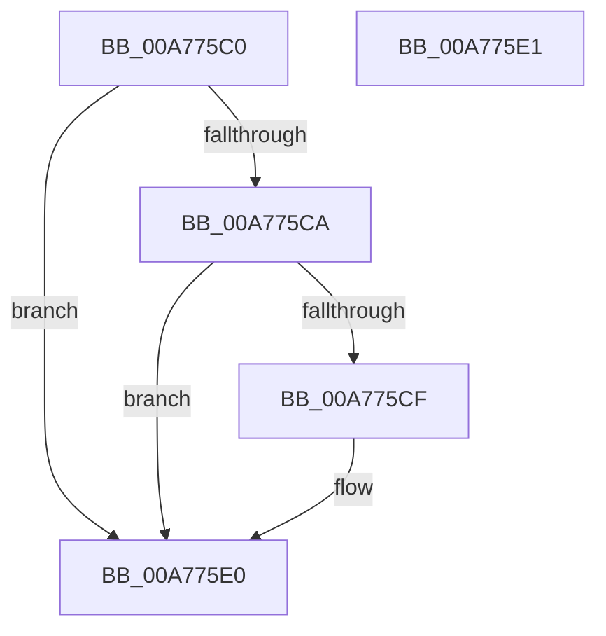

# SleepstudyHelperGetBlockerGuid

- RVA: `0x00A775C0`–`0x00A775E2` (길이 `34` bytes)
- VA: `0x0000000140A775C0`
- 실행 섹션: `PAGE`
- PDB 이름 있음: `예`; PDB Function 태그: `아니요`
- unwind 정보 RVA: `0x000DB714`
- 디코드: `11`개 명령, `34/34` bytes 표시
- 미해석 바이트: `0` (있으면 어셈블리에 `.byte`로 보존)

> 이 문서는 커널 이미지의 기계어와 PDB 기호를 분석해 생성했습니다. 4번과 5번은 함수 원형과 자료형을 바이너리 사용 방식에서 추정한 C 해석이며 원본 소스 복구 결과는 아닙니다.

## 1. Dependencies

- 직접 호출 지점: **0**; 고유 호출 대상: **0**
- 직접 호출자로 확인된 함수: **2**
- RIP 상대 이미지 참조: **0**

### Outgoing calls
- 직접 디코드된 call 명령이 없습니다.

### Direct callers
- [SleepstudyHelper_GenerateGuid](../../text/4B/SleepstudyHelper_GenerateGuid_function_004B8BD0.md) at `0x004B8C38`
- [SleepstudyHelper_RegisterPdoWithParentHandle](../77/SleepstudyHelper_RegisterPdoWithParentHandle_function_00774C00.md) at `0x00774C53`

### Static image references
- 디코드된 RIP-relative 메모리 참조가 없습니다.

## 2. Other-region calls and transfers

- 다른 실행 섹션으로 향하는 call: **0**
- 별도 외부 분기/꼬리 이동을 확인하지 못했습니다.

## 3. Assembly (complete function range)

```asm
00A775C0  B8 0D 00 00 C0                  mov eax, 0xc000000d
00A775C5  48 85 C9                        test rcx, rcx
00A775C8  74 16                           je 0x140a775e0
00A775CA  48 85 D2                        test rdx, rdx
00A775CD  74 11                           je 0x140a775e0
00A775CF  48 8B 81 30 01 00 00            mov rax, qword ptr [rcx + 0x130]
00A775D6  0F 10 40 40                     movups xmm0, xmmword ptr [rax + 0x40]
00A775DA  33 C0                           xor eax, eax
00A775DC  F3 0F 7F 02                     movdqu xmmword ptr [rdx], xmm0
00A775E0  C3                              ret
00A775E1  CC                              int3
```

## 4. C-style interpretation (structured pseudocode)

```c
__int64 __fastcall SleepstudyHelperGetBlockerGuid(__int64 a1, __int64 a2)
{
    __int64 result;

    if (a1 == 0) goto loc_00A775E0;
    result = (unsigned int)(0xC000000DULL);
    if (a2 != 0) {
        result = *(unsigned __int64 *)(a1 + 304);
        result = 0;
        *(unsigned __int64 *)(a2) = v_xmm0;
    }
    return result;
}
```

## 5. (Beta) C Style

```c
int64_t SleepstudyHelperGetBlockerGuid(int64_t Arg1, int64_t Arg2)
{
    int64_t result;

    if (Arg1 == 0) goto loc_00A775E0;
    result = (uint32_t)(0xC000000DULL);
    if (Arg2 != 0) {
        result = *(uint64_t *)(Arg1 + 0x130);
        result = 0;
        *(uint64_t *)(Arg2) = v_xmm0;
    }
    return result;
}
```

## 6. Execution-region graph

[열기: 2D/3D 그래프와 함수 탐색 컨트롤 패널](../../../control-panel.html?section=page&rva=0x00A775C0&view=graph)

- 2D 그래프는 위에서 아래로 흐르고, 3D 그래프는 빈 공간을 드래그해 회전합니다. Shift+드래그는 이동, 휠은 확대·축소, 함수 노드 선택은 대상 보고서 이동입니다.

### Static fallback


