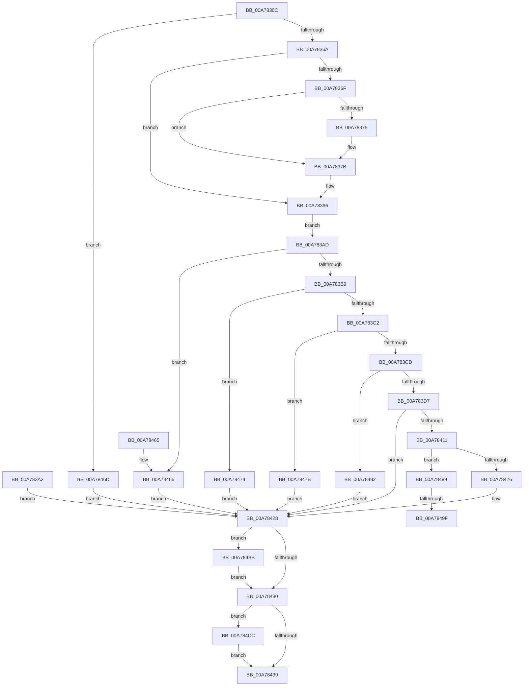

# SmProcessStoreMemoryPriorityRequest

- RVA: `0x00A7830C`–`0x00A784D9` (길이 `461` bytes)
- VA: `0x0000000140A7830C`
- 실행 섹션: `PAGE`
- PDB 이름 있음: `예`; PDB Function 태그: `예`
- unwind 정보 RVA: `0x000B5FBC`
- 디코드: `111`개 명령, `461/461` bytes 표시
- 미해석 바이트: `0` (있으면 어셈블리에 `.byte`로 보존)

> 이 문서는 커널 이미지의 기계어와 PDB 기호를 분석해 생성했습니다. 4번과 5번은 함수 원형과 자료형을 바이너리 사용 방식에서 추정한 C 해석이며 원본 소스 복구 결과는 아닙니다.

## 1. Dependencies

- 직접 호출 지점: **6**; 고유 호출 대상: **6**
- 직접 호출자로 확인된 함수: **1**
- RIP 상대 이미지 참조: **2**

### Outgoing calls
- `0x00A78375` → [ExRaiseDatatypeMisalignment](../89/ExRaiseDatatypeMisalignment_function_00899FD0.md) (function, `0x00899FD0`)
- `0x00A78401` → [ObReferenceObjectByHandle](../86/ObReferenceObjectByHandle_function_00868DB0.md) (function, `0x00868DB0`)
- `0x00A78446` → [_security_check_cookie](../../text/6A/_security_check_cookie_function_006AC640.md) (function, `0x006AC640`)
- `0x00A784B0` → [KiStackAttachProcess](../../text/21/KiStackAttachProcess_function_00216820.md) (function, `0x00216820`)
- `0x00A784C2` → [KiUnstackDetachProcess](../../text/21/KiUnstackDetachProcess_function_00217D30.md) (function, `0x00217D30`)
- `0x00A784CF` → [ObfDereferenceObject](../../text/2F/ObfDereferenceObject_function_002F9350.md) (function, `0x002F9350`)

### Direct callers
- [SmSetStoreInformation](SmSetStoreInformation_function_00A781B8.md) at `0x00A78236`

### Static image references
- `0x00A78324` → RVA `0x00E0A740` (`.data`; read)
- `0x00A783D7` → RVA `0x00FC6A98` (`ALMOSTRO`; read)

## 2. Other-region calls and transfers

- 다른 실행 섹션으로 향하는 call: **4**
  - `0x00A78446` → [_security_check_cookie](../../text/6A/_security_check_cookie_function_006AC640.md) (`PAGE` → `.text`)
  - `0x00A784B0` → [KiStackAttachProcess](../../text/21/KiStackAttachProcess_function_00216820.md) (`PAGE` → `.text`)
  - `0x00A784C2` → [KiUnstackDetachProcess](../../text/21/KiUnstackDetachProcess_function_00217D30.md) (`PAGE` → `.text`)
  - `0x00A784CF` → [ObfDereferenceObject](../../text/2F/ObfDereferenceObject_function_002F9350.md) (`PAGE` → `.text`)
- call이 아닌 외부 분기/꼬리 이동: **2**
  - `0x00A78499` → [sub_00B41A62](../B4/Unknown_function_00B41A62.md) (`tail-transfer`)
  - `0x00A784B6` → [sub_00B41A62](../B4/Unknown_function_00B41A62.md) (`tail-transfer`)

## 3. Assembly (complete function range)

```asm
00A7830C  4C 8B DC                        mov r11, rsp
00A7830F  49 89 5B 10                     mov qword ptr [r11 + 0x10], rbx
00A78313  49 89 73 18                     mov qword ptr [r11 + 0x18], rsi
00A78317  49 89 7B 20                     mov qword ptr [r11 + 0x20], rdi
00A7831B  41 56                           push r14
00A7831D  48 81 EC 90 00 00 00            sub rsp, 0x90
00A78324  48 8B 05 15 24 39 00            mov rax, qword ptr [rip + 0x392415]
00A7832B  48 33 C4                        xor rax, rsp
00A7832E  48 89 84 24 88 00 00 00         mov qword ptr [rsp + 0x88], rax
00A78336  45 8A D0                        mov r10b, r8b
00A78339  4C 8B C9                        mov r9, rcx
00A7833C  0F 57 C0                        xorps xmm0, xmm0
00A7833F  0F 11 44 24 58                  movups xmmword ptr [rsp + 0x58], xmm0
00A78344  0F 11 44 24 68                  movups xmmword ptr [rsp + 0x68], xmm0
00A78349  0F 11 44 24 78                  movups xmmword ptr [rsp + 0x78], xmm0
00A7834E  49 83 63 A0 00                  and qword ptr [r11 - 0x60], 0
00A78353  33 FF                           xor edi, edi
00A78355  48 89 7C 24 50                  mov qword ptr [rsp + 0x50], rdi
00A7835A  33 F6                           xor esi, esi
00A7835C  0F 11 44 24 40                  movups xmmword ptr [rsp + 0x40], xmm0
00A78361  83 FA 10                        cmp edx, 0x10
00A78364  0F 82 03 01 00 00               jb 0x140a7846d
00A7836A  45 84 C0                        test r8b, r8b
00A7836D  74 27                           je 0x140a78396
00A7836F  41 F6 C1 07                     test r9b, 7
00A78373  74 06                           je 0x140a7837b
00A78375  E8 56 1C E2 FF                  call 0x140899fd0
00A7837A  CC                              int3
00A7837B  48 B9 00 00 FF FF FF 7F 00 00   movabs rcx, 0x7fffffff0000
00A78385  4C 3B C9                        cmp r9, rcx
00A78388  49 0F 42 C9                     cmovb rcx, r9
00A7838C  8A 01                           mov al, byte ptr [rcx]
00A7838E  88 01                           mov byte ptr [rcx], al
00A78390  8A 41 0F                        mov al, byte ptr [rcx + 0xf]
00A78393  88 41 0F                        mov byte ptr [rcx + 0xf], al
00A78396  41 0F 10 01                     movups xmm0, xmmword ptr [r9]
00A7839A  F3 0F 7F 44 24 40               movdqu xmmword ptr [rsp + 0x40], xmm0
00A783A0  EB 0B                           jmp 0x140a783ad
00A783A2  8B D8                           mov ebx, eax
00A783A4  48 8B 7C 24 50                  mov rdi, qword ptr [rsp + 0x50]
00A783A9  8B F7                           mov esi, edi
00A783AB  EB 7B                           jmp 0x140a78428
00A783AD  8B 44 24 40                     mov eax, dword ptr [rsp + 0x40]
00A783B1  3C 01                           cmp al, 1
00A783B3  0F 85 AD 00 00 00               jne 0x140a78466
00A783B9  83 FA 10                        cmp edx, 0x10
00A783BC  0F 85 B2 00 00 00               jne 0x140a78474
00A783C2  A9 00 FC FF FF                  test eax, 0xfffffc00
00A783C7  0F 85 AE 00 00 00               jne 0x140a7847b
00A783CD  0F BA E0 08                     bt eax, 8
00A783D1  0F 83 AB 00 00 00               jae 0x140a78482
00A783D7  4C 8B 05 BA E6 54 00            mov r8, qword ptr [rip + 0x54e6ba]
00A783DE  48 83 64 24 30 00               and qword ptr [rsp + 0x30], 0
00A783E4  48 83 64 24 28 00               and qword ptr [rsp + 0x28], 0
00A783EA  48 8D 44 24 30                  lea rax, [rsp + 0x30]
00A783EF  48 89 44 24 20                  mov qword ptr [rsp + 0x20], rax
00A783F4  45 8A CA                        mov r9b, r10b
00A783F7  BA 00 20 00 00                  mov edx, 0x2000
00A783FC  48 8B 4C 24 48                  mov rcx, qword ptr [rsp + 0x48]
00A78401  E8 AA 09 DF FF                  call 0x140868db0
00A78406  8B D8                           mov ebx, eax
00A78408  48 8B 7C 24 30                  mov rdi, qword ptr [rsp + 0x30]
00A7840D  85 C0                           test eax, eax
00A7840F  78 17                           js 0x140a78428
00A78411  F0 81 8F FC 05 00 00 00 00 04 00  lock or dword ptr [rdi + 0x5fc], 0x40000
00A7841C  F7 44 24 40 00 02 00 00         test dword ptr [rsp + 0x40], 0x200
00A78424  75 63                           jne 0x140a78489
00A78426  33 DB                           xor ebx, ebx
00A78428  85 F6                           test esi, esi
00A7842A  0F 85 8B 00 00 00               jne 0x140a784bb
00A78430  48 85 FF                        test rdi, rdi
00A78433  0F 85 93 00 00 00               jne 0x140a784cc
00A78439  8B C3                           mov eax, ebx
00A7843B  48 8B 8C 24 88 00 00 00         mov rcx, qword ptr [rsp + 0x88]
00A78443  48 33 CC                        xor rcx, rsp
00A78446  E8 F5 41 C3 FF                  call 0x1406ac640
00A7844B  4C 8D 9C 24 90 00 00 00         lea r11, [rsp + 0x90]
00A78453  49 8B 5B 18                     mov rbx, qword ptr [r11 + 0x18]
00A78457  49 8B 73 20                     mov rsi, qword ptr [r11 + 0x20]
00A7845B  49 8B 7B 28                     mov rdi, qword ptr [r11 + 0x28]
00A7845F  49 8B E3                        mov rsp, r11
00A78462  41 5E                           pop r14
00A78464  C3                              ret
00A78465  CC                              int3
00A78466  BB 59 00 00 C0                  mov ebx, 0xc0000059
00A7846B  EB BB                           jmp 0x140a78428
00A7846D  BB 06 02 00 C0                  mov ebx, 0xc0000206
00A78472  EB B4                           jmp 0x140a78428
00A78474  BB 04 00 00 C0                  mov ebx, 0xc0000004
00A78479  EB AD                           jmp 0x140a78428
00A7847B  BB 0D 00 00 C0                  mov ebx, 0xc000000d
00A78480  EB A6                           jmp 0x140a78428
00A78482  BB BB 00 00 C0                  mov ebx, 0xc00000bb
00A78487  EB 9F                           jmp 0x140a78428
00A78489  65 48 8B 04 25 88 01 00 00      mov rax, qword ptr gs:[0x188]
00A78492  48 39 B8 B8 00 00 00            cmp qword ptr [rax + 0xb8], rdi
00A78499  0F 84 C3 95 0C 00               je 0x140b41a62
00A7849F  BE 01 00 00 00                  mov esi, 1
00A784A4  4C 8D 44 24 58                  lea r8, [rsp + 0x58]
00A784A9  33 D2                           xor edx, edx
00A784AB  48 8B 4C 24 30                  mov rcx, qword ptr [rsp + 0x30]
00A784B0  E8 6B E3 79 FF                  call 0x140216820
00A784B5  90                              nop
00A784B6  E9 A7 95 0C 00                  jmp 0x140b41a62
00A784BB  33 D2                           xor edx, edx
00A784BD  48 8D 4C 24 58                  lea rcx, [rsp + 0x58]
00A784C2  E8 69 F8 79 FF                  call 0x140217d30
00A784C7  E9 64 FF FF FF                  jmp 0x140a78430
00A784CC  48 8B CF                        mov rcx, rdi
00A784CF  E8 7C 0E 88 FF                  call 0x1402f9350
00A784D4  E9 60 FF FF FF                  jmp 0x140a78439
```

## 4. C-style interpretation (structured pseudocode)

```c
__int64 __fastcall SmProcessStoreMemoryPriorityRequest(__int64 a1, int a2, unsigned __int8 a3)
{
    __int64 result;
    __int64 v_rbx;
    __int64 v_rdi;
    __int64 v_rsi;
    __int64 v_rsp;
    unsigned __int64 v_stack_m10;
    unsigned __int64 v_stack_m20;
    unsigned __int64 v_stack_m30;
    unsigned __int64 v_stack_m38;
    unsigned __int64 v_stack_m40;
    unsigned __int64 v_stack_m48;
    unsigned __int64 v_stack_m50;
    unsigned __int64 v_stack_m58;
    unsigned __int64 v_stack_m60;
    unsigned __int64 v_stack_m68;
    unsigned __int64 v_stack_m70;
    unsigned __int64 v_stack_m78;
    unsigned __int64 v_stack_m8;

    *(unsigned __int64 *)(v_rsp + 16) = v_rbx;
    *(unsigned __int64 *)(v_rsp + 24) = v_rsi;
    *(unsigned __int64 *)(v_rsp + 32) = v_rdi;
    v_rsp = (v_rsp) - (144);
    result = (*(unsigned __int64 *)(v_rip + 3744789)) ^ (v_rsp);
    v_stack_m10 = result;
    v_stack_m40 = v_xmm0;
    v_stack_m30 = v_xmm0;
    v_stack_m20 = v_xmm0;
    v_rdi = 0;
    v_stack_m48 = 0;
    v_rsi = 0;
    v_stack_m58 = v_xmm0;
    if (a2 < 16) goto loc_00A7846D;
    if (a3 == 0) goto loc_00A78396;
    if ((((unsigned __int8)(a1)) & (7)) != 0) {
        result = ExRaiseDatatypeMisalignment(a1, a2, a3, a1);
    }
    if (a1 < a1) { a1 = a1; }
    *(unsigned __int8 *)(a1) = (unsigned __int8)(*(unsigned __int8 *)(a1));
    *(unsigned __int8 *)(a1 + 15) = (unsigned __int8)(*(unsigned __int8 *)(a1 + 15));
loc_00A78396:
    v_stack_m58 = v_xmm0;
    goto loc_00A783AD;
loc_00A783AD:
    if (((unsigned __int8)((unsigned int)(v_stack_m58))) != 1) goto loc_00A78466;
    if (a2 != 16) goto loc_00A78474;
    if ((((unsigned int)((unsigned int)(v_stack_m58))) & (0xFFFFFC00ULL)) != 0) goto loc_00A7847B;
    if (condition_is_above_or_equal) goto loc_00A78482;
    v_stack_m78 = v_stack_m68;
    result = ObReferenceObjectByHandle(v_stack_m50, (unsigned int)(0x2000ULL), *(unsigned __int64 *)(v_rip + 5564090), a3);
    if (sign_flag) goto loc_00A78428;
    if (((v_stack_m58) & (512)) != 0) goto loc_00A78489;
    v_rbx = 0;
loc_00A78428:
    if (0 != 0) goto loc_00A784BB;
loc_00A78430:
    if (v_stack_m68 != 0) goto loc_00A784CC;
loc_00A78439:
    a1 = (v_stack_m10) ^ (v_rsp);
    result = _security_check_cookie(a1, (unsigned int)(0x2000ULL), *(unsigned __int64 *)(v_rip + 5564090), a3);
    return result;
loc_00A78466:
    goto loc_00A78428;
loc_00A7846D:
    goto loc_00A78428;
loc_00A78474:
    goto loc_00A78428;
loc_00A7847B:
    goto loc_00A78428;
loc_00A78482:
    goto loc_00A78428;
loc_00A78489:
    a2 = 0;
    result = KiStackAttachProcess(v_stack_m60, a2, v_stack_m38, a3);
loc_00A784BB:
    a2 = 0;
    result = KiUnstackDetachProcess(v_stack_m38, a2, v_stack_m38, a3);
    goto loc_00A78430;
loc_00A784CC:
    result = ObfDereferenceObject(*(unsigned __int64 *)(v_stack_m8 + 40), a2, v_stack_m38, a3);
    goto loc_00A78439;
}
```

## 5. (Beta) C Style

```c
int64_t SmProcessStoreMemoryPriorityRequest(int64_t Arg1, int32_t Arg2, uint8_t Arg3)
{
    int64_t result;
    int64_t local_rbx;
    int64_t local_rdi;
    int64_t local_rsi;
    int64_t local_rsp;
    uint64_t v_stack_m10;
    uint64_t v_stack_m20;
    uint64_t v_stack_m30;
    uint64_t v_stack_m38;
    uint64_t v_stack_m40;
    uint64_t v_stack_m48;
    uint64_t v_stack_m50;
    uint64_t v_stack_m58;
    uint64_t v_stack_m60;
    uint64_t v_stack_m68;
    uint64_t v_stack_m70;
    uint64_t v_stack_m78;
    uint64_t v_stack_m8;

    *(uint64_t *)(local_rsp + 0x10) = local_rbx;
    *(uint64_t *)(local_rsp + 0x18) = local_rsi;
    *(uint64_t *)(local_rsp + 0x20) = local_rdi;
    local_rsp = (local_rsp) - (144);
    result = (*(uint64_t *)(v_rip + 0x392415)) ^ (local_rsp);
    v_stack_m10 = result;
    v_stack_m40 = v_xmm0;
    v_stack_m30 = v_xmm0;
    v_stack_m20 = v_xmm0;
    local_rdi = 0;
    v_stack_m48 = 0;
    local_rsi = 0;
    v_stack_m58 = v_xmm0;
    if (Arg2 < 16) goto loc_00A7846D;
    if (Arg3 == 0) goto loc_00A78396;
    if ((((uint8_t)(Arg1)) & (7)) != 0) {
        result = ExRaiseDatatypeMisalignment(Arg1, Arg2, Arg3, Arg1);
    }
    if (Arg1 < Arg1) { Arg1 = Arg1; }
    *(uint8_t *)(Arg1) = (uint8_t)(*(uint8_t *)(Arg1));
    *(uint8_t *)(Arg1 + 0xF) = (uint8_t)(*(uint8_t *)(Arg1 + 0xF));
loc_00A78396:
    v_stack_m58 = v_xmm0;
    goto loc_00A783AD;
loc_00A783AD:
    if (((uint8_t)((uint32_t)(v_stack_m58))) != 1) goto loc_00A78466;
    if (Arg2 != 16) goto loc_00A78474;
    if ((((uint32_t)((uint32_t)(v_stack_m58))) & (0xFFFFFC00ULL)) != 0) goto loc_00A7847B;
    if (condition_is_above_or_equal) goto loc_00A78482;
    v_stack_m78 = v_stack_m68;
    result = ObReferenceObjectByHandle(v_stack_m50, (uint32_t)(0x2000ULL), *(uint64_t *)(v_rip + 0x54E6BA), Arg3);
    if (sign_flag) goto loc_00A78428;
    if (((v_stack_m58) & (512)) != 0) goto loc_00A78489;
    local_rbx = 0;
loc_00A78428:
    if (0 != 0) goto loc_00A784BB;
loc_00A78430:
    if (v_stack_m68 != 0) goto loc_00A784CC;
loc_00A78439:
    Arg1 = (v_stack_m10) ^ (local_rsp);
    result = _security_check_cookie(Arg1, (uint32_t)(0x2000ULL), *(uint64_t *)(v_rip + 0x54E6BA), Arg3);
    return result;
loc_00A78466:
    goto loc_00A78428;
loc_00A7846D:
    goto loc_00A78428;
loc_00A78474:
    goto loc_00A78428;
loc_00A7847B:
    goto loc_00A78428;
loc_00A78482:
    goto loc_00A78428;
loc_00A78489:
    Arg2 = 0;
    result = KiStackAttachProcess(v_stack_m60, Arg2, v_stack_m38, Arg3);
loc_00A784BB:
    Arg2 = 0;
    result = KiUnstackDetachProcess(v_stack_m38, Arg2, v_stack_m38, Arg3);
    goto loc_00A78430;
loc_00A784CC:
    result = ObfDereferenceObject(*(uint64_t *)(v_stack_m8 + 0x28), Arg2, v_stack_m38, Arg3);
    goto loc_00A78439;
}
```

## 6. Execution-region graph

[열기: 2D/3D 그래프와 함수 탐색 컨트롤 패널](../../../control-panel.html?section=page&rva=0x00A7830C&view=graph)

- 2D 그래프는 위에서 아래로 흐르고, 3D 그래프는 빈 공간을 드래그해 회전합니다. Shift+드래그는 이동, 휠은 확대·축소, 함수 노드 선택은 대상 보고서 이동입니다.

### Static fallback


