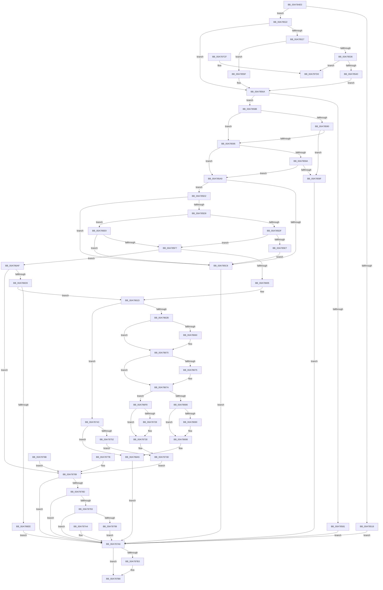

# SmProcessSystemStoreTrimRequest

- RVA: `0x00A784E0`–`0x00A787D7` (길이 `759` bytes)
- VA: `0x0000000140A784E0`
- 실행 섹션: `PAGE`
- PDB 이름 있음: `예`; PDB Function 태그: `아니요`
- unwind 정보 RVA: `0x000B6004`
- 디코드: `199`개 명령, `759/759` bytes 표시
- 미해석 바이트: `0` (있으면 어셈블리에 `.byte`로 보존)

> 이 문서는 커널 이미지의 기계어와 PDB 기호를 분석해 생성했습니다. 4번과 5번은 함수 원형과 자료형을 바이너리 사용 방식에서 추정한 C 해석이며 원본 소스 복구 결과는 아닙니다.

## 1. Dependencies

- 직접 호출 지점: **17**; 고유 호출 대상: **14**
- 직접 호출자로 확인된 함수: **1**
- RIP 상대 이미지 참조: **0**

### Outgoing calls
- `0x00A78565` → [ProbeForWrite](../8E/ProbeForWrite_function_008E91C0.md) (function, `0x008E91C0`)
- `0x00A785B6` → [memcpy](../../text/6C/memcpy_function_006C6840.md) (function, `0x006C6840`)
- `0x00A78615` → [SmpGetProcessPartition](../../text/4A/SmpGetProcessPartition_function_004A3CCC.md) (function, `0x004A3CCC`)
- `0x00A7864B` → [KeAbPreAcquire](../../text/21/KeAbPreAcquire_function_00210230.md) (function, `0x00210230`)
- `0x00A7866B` → [ExfAcquirePushLockSharedEx](../../text/21/ExfAcquirePushLockSharedEx_function_0021044C.md) (function, `0x0021044C`)
- `0x00A78693` → [ExfReleasePushLockShared](../../text/26/ExfReleasePushLockShared_function_00263440.md) (function, `0x00263440`)
- `0x00A7869B` → [KeAbPostRelease](../../text/2E/KeAbPostRelease_function_002E1600.md) (function, `0x002E1600`)
- `0x00A786A0` → [KeLeaveCriticalRegion](../../text/25/KeLeaveCriticalRegion_function_0025D8B0.md) (function, `0x0025D8B0`)
- `0x00A786CA` → [PsReferencePartitionByHandle](../90/PsReferencePartitionByHandle_function_0090337C.md) (function, `0x0090337C`)
- `0x00A78717` → [MmUpdateOldWorkingSetPages](../../text/4E/MmUpdateOldWorkingSetPages_function_004EDF18.md) (function, `0x004EDF18`)
- `0x00A7872B` → [ExfReleasePushLockShared](../../text/26/ExfReleasePushLockShared_function_00263440.md) (function, `0x00263440`)
- `0x00A78733` → [KeAbPostRelease](../../text/2E/KeAbPostRelease_function_002E1600.md) (function, `0x002E1600`)
- `0x00A78738` → [KeLeaveCriticalRegion](../../text/25/KeLeaveCriticalRegion_function_0025D8B0.md) (function, `0x0025D8B0`)
- `0x00A78755` → [SmKmStoreGet](../../text/34/SmKmStoreGet_function_00349F24.md) (function, `0x00349F24`)
- `0x00A78762` → [SMKM_STORE_MGR<SM_TRAITS>::SmTrimWsStore](../../text/4B/SMKM_STORE_MGR_SM_TRAITS_SmTrimWsStore_function_004BEB1C.md) (function, `0x004BEB1C`)
- `0x00A787B3` → [PsDereferencePartition](../../text/34/PsDereferencePartition_function_00342E70.md) (function, `0x00342E70`)
- `0x00A787D0` → [ExRaiseDatatypeMisalignment](../89/ExRaiseDatatypeMisalignment_function_00899FD0.md) (function, `0x00899FD0`)

### Direct callers
- [SmSetStoreInformation](SmSetStoreInformation_function_00A781B8.md) at `0x00A78253`

### Static image references
- 디코드된 RIP-relative 메모리 참조가 없습니다.

## 2. Other-region calls and transfers

- 다른 실행 섹션으로 향하는 call: **14**
  - `0x00A785B6` → [memcpy](../../text/6C/memcpy_function_006C6840.md) (`PAGE` → `.text`)
  - `0x00A78615` → [SmpGetProcessPartition](../../text/4A/SmpGetProcessPartition_function_004A3CCC.md) (`PAGE` → `.text`)
  - `0x00A7864B` → [KeAbPreAcquire](../../text/21/KeAbPreAcquire_function_00210230.md) (`PAGE` → `.text`)
  - `0x00A7866B` → [ExfAcquirePushLockSharedEx](../../text/21/ExfAcquirePushLockSharedEx_function_0021044C.md) (`PAGE` → `.text`)
  - `0x00A78693` → [ExfReleasePushLockShared](../../text/26/ExfReleasePushLockShared_function_00263440.md) (`PAGE` → `.text`)
  - `0x00A7869B` → [KeAbPostRelease](../../text/2E/KeAbPostRelease_function_002E1600.md) (`PAGE` → `.text`)
  - `0x00A786A0` → [KeLeaveCriticalRegion](../../text/25/KeLeaveCriticalRegion_function_0025D8B0.md) (`PAGE` → `.text`)
  - `0x00A78717` → [MmUpdateOldWorkingSetPages](../../text/4E/MmUpdateOldWorkingSetPages_function_004EDF18.md) (`PAGE` → `.text`)
  - `0x00A7872B` → [ExfReleasePushLockShared](../../text/26/ExfReleasePushLockShared_function_00263440.md) (`PAGE` → `.text`)
  - `0x00A78733` → [KeAbPostRelease](../../text/2E/KeAbPostRelease_function_002E1600.md) (`PAGE` → `.text`)
  - `0x00A78738` → [KeLeaveCriticalRegion](../../text/25/KeLeaveCriticalRegion_function_0025D8B0.md) (`PAGE` → `.text`)
  - `0x00A78755` → [SmKmStoreGet](../../text/34/SmKmStoreGet_function_00349F24.md) (`PAGE` → `.text`)
  - `0x00A78762` → [SMKM_STORE_MGR<SM_TRAITS>::SmTrimWsStore](../../text/4B/SMKM_STORE_MGR_SM_TRAITS_SmTrimWsStore_function_004BEB1C.md) (`PAGE` → `.text`)
  - `0x00A787B3` → [PsDereferencePartition](../../text/34/PsDereferencePartition_function_00342E70.md) (`PAGE` → `.text`)
- 별도 외부 분기/꼬리 이동을 확인하지 못했습니다.

## 3. Assembly (complete function range)

```asm
00A784E0  4C 8B DC                        mov r11, rsp
00A784E3  49 89 5B 10                     mov qword ptr [r11 + 0x10], rbx
00A784E7  49 89 4B 08                     mov qword ptr [r11 + 8], rcx
00A784EB  56                              push rsi
00A784EC  57                              push rdi
00A784ED  41 54                           push r12
00A784EF  41 56                           push r14
00A784F1  41 57                           push r15
00A784F3  48 83 EC 50                     sub rsp, 0x50
00A784F7  45 8A F8                        mov r15b, r8b
00A784FA  8B DA                           mov ebx, edx
00A784FC  4C 8B F1                        mov r14, rcx
00A784FF  33 FF                           xor edi, edi
00A78501  49 89 7B 20                     mov qword ptr [r11 + 0x20], rdi
00A78505  0F 57 C0                        xorps xmm0, xmm0
00A78508  33 C0                           xor eax, eax
00A7850A  0F 11 44 24 38                  movups xmmword ptr [rsp + 0x38], xmm0
00A7850F  49 89 43 D0                     mov qword ptr [r11 - 0x30], rax
00A78513  83 FA 10                        cmp edx, 0x10
00A78516  73 0A                           jae 0x140a78522
00A78518  BB 06 02 00 C0                  mov ebx, 0xc0000206
00A7851D  E9 84 02 00 00                  jmp 0x140a787a6
00A78522  45 84 FF                        test r15b, r15b
00A78525  74 43                           je 0x140a7856a
00A78527  48 8B D3                        mov rdx, rbx
00A7852A  48 8D 43 FF                     lea rax, [rbx - 1]
00A7852E  48 3D FE 0F 00 00               cmp rax, 0xffe
00A78534  77 29                           ja 0x140a7855f
00A78536  41 F6 C6 07                     test r14b, 7
00A7853A  0F 85 90 02 00 00               jne 0x140a787d0
00A78540  48 B9 00 00 FF FF FF 7F 00 00   movabs rcx, 0x7fffffff0000
00A7854A  4C 3B F1                        cmp r14, rcx
00A7854D  49 0F 42 CE                     cmovb rcx, r14
00A78551  8A 01                           mov al, byte ptr [rcx]
00A78553  88 01                           mov byte ptr [rcx], al
00A78555  8A 44 19 FF                     mov al, byte ptr [rcx + rbx - 1]
00A78559  88 44 19 FF                     mov byte ptr [rcx + rbx - 1], al
00A7855D  EB 0B                           jmp 0x140a7856a
00A7855F  41 B8 08 00 00 00               mov r8d, 8
00A78565  E8 56 0C E7 FF                  call 0x1408e91c0
00A7856A  41 0F 10 06                     movups xmm0, xmmword ptr [r14]
00A7856E  F3 0F 7F 44 24 38               movdqu xmmword ptr [rsp + 0x38], xmm0
00A78574  0F B6 4C 24 38                  movzx ecx, byte ptr [rsp + 0x38]
00A78579  8D 41 FF                        lea eax, [rcx - 1]
00A7857C  83 F8 01                        cmp eax, 1
00A7857F  76 0A                           jbe 0x140a7858b
00A78581  BB 59 00 00 C0                  mov ebx, 0xc0000059
00A78586  E9 1B 02 00 00                  jmp 0x140a787a6
00A7858B  83 F9 02                        cmp ecx, 2
00A7858E  75 05                           jne 0x140a78595
00A78590  83 FB 18                        cmp ebx, 0x18
00A78593  75 0A                           jne 0x140a7859f
00A78595  83 F9 01                        cmp ecx, 1
00A78598  75 0F                           jne 0x140a785a9
00A7859A  83 FB 10                        cmp ebx, 0x10
00A7859D  74 0A                           je 0x140a785a9
00A7859F  BB 04 00 00 C0                  mov ebx, 0xc0000004
00A785A4  E9 FD 01 00 00                  jmp 0x140a787a6
00A785A9  44 8D 43 F0                     lea r8d, [rbx - 0x10]
00A785AD  49 8D 56 10                     lea rdx, [r14 + 0x10]
00A785B1  48 8D 4C 24 48                  lea rcx, [rsp + 0x48]
00A785B6  E8 85 E2 C4 FF                  call 0x1406c6840
00A785BB  90                              nop
00A785BC  8B 74 24 38                     mov esi, dword ptr [rsp + 0x38]
00A785C0  F7 C6 00 E0 FF FF               test esi, 0xffffe000
00A785C6  74 0A                           je 0x140a785d2
00A785C8  BB 0D 00 00 C0                  mov ebx, 0xc000000d
00A785CD  E9 D4 01 00 00                  jmp 0x140a787a6
00A785D2  48 39 7C 24 40                  cmp qword ptr [rsp + 0x40], rdi
00A785D7  74 EF                           je 0x140a785c8
00A785D9  0F BA E6 08                     bt esi, 8
00A785DD  72 0A                           jb 0x140a785e9
00A785DF  F7 C6 00 1E 00 00               test esi, 0x1e00
00A785E5  74 10                           je 0x140a785f7
00A785E7  EB DF                           jmp 0x140a785c8
00A785E9  8B C6                           mov eax, esi
00A785EB  25 00 1E 00 00                  and eax, 0x1e00
00A785F0  3D 00 0C 00 00                  cmp eax, 0xc00
00A785F5  77 D1                           ja 0x140a785c8
00A785F7  48 8B 4C 24 48                  mov rcx, qword ptr [rsp + 0x48]
00A785FC  48 85 C9                        test rcx, rcx
00A785FF  0F 85 AA 00 00 00               jne 0x140a786af
00A78605  65 48 8B 04 25 88 01 00 00      mov rax, qword ptr gs:[0x188]
00A7860E  48 8B 88 B8 00 00 00            mov rcx, qword ptr [rax + 0xb8]
00A78615  E8 B2 B6 A2 FF                  call 0x1404a3ccc
00A7861A  48 8B D8                        mov rbx, rax
00A7861D  F7 44 24 38 00 01 00 00         test dword ptr [rsp + 0x38], 0x100
00A78625  0F 84 18 01 00 00               je 0x140a78743
00A7862B  48 8D B3 68 08 00 00            lea rsi, [rbx + 0x868]
00A78632  65 48 8B 04 25 88 01 00 00      mov rax, qword ptr gs:[0x188]
00A7863B  66 FF 88 E4 01 00 00            dec word ptr [rax + 0x1e4]
00A78642  90                              nop
00A78643  45 33 C0                        xor r8d, r8d
00A78646  33 D2                           xor edx, edx
00A78648  48 8B CE                        mov rcx, rsi
00A7864B  E8 E0 7B 79 FF                  call 0x140210230
00A78650  4C 8B F8                        mov r15, rax
00A78653  33 C0                           xor eax, eax
00A78655  44 8D 60 11                     lea r12d, [rax + 0x11]
00A78659  F0 4C 0F B1 26                  lock cmpxchg qword ptr [rsi], r12
00A7865E  74 10                           je 0x140a78670
00A78660  4C 8B CE                        mov r9, rsi
00A78663  4D 8B C7                        mov r8, r15
00A78666  33 D2                           xor edx, edx
00A78668  48 8B CE                        mov rcx, rsi
00A7866B  E8 DC 7D 79 FF                  call 0x14021044c
00A78670  4D 85 FF                        test r15, r15
00A78673  74 05                           je 0x140a7867a
00A78675  41 C6 47 0A 01                  mov byte ptr [r15 + 0xa], 1
00A7867A  48 8B 8B 78 08 00 00            mov rcx, qword ptr [rbx + 0x878]
00A78681  48 85 C9                        test rcx, rcx
00A78684  75 72                           jne 0x140a786f8
00A78686  49 8B C4                        mov rax, r12
00A78689  F0 48 0F B1 3E                  lock cmpxchg qword ptr [rsi], rdi
00A7868E  74 08                           je 0x140a78698
00A78690  48 8B CE                        mov rcx, rsi
00A78693  E8 A8 AD 7E FF                  call 0x140263440
00A78698  48 8B CE                        mov rcx, rsi
00A7869B  E8 60 8F 86 FF                  call 0x1402e1600
00A786A0  E8 0B 52 7E FF                  call 0x14025d8b0
00A786A5  BB 25 02 00 C0                  mov ebx, 0xc0000225
00A786AA  E9 F7 00 00 00                  jmp 0x140a787a6
00A786AF  48 8D 84 24 98 00 00 00         lea rax, [rsp + 0x98]
00A786B7  48 89 44 24 20                  mov qword ptr [rsp + 0x20], rax
00A786BC  41 B9 53 6D 54 52               mov r9d, 0x52546d53
00A786C2  45 8A C7                        mov r8b, r15b
00A786C5  BA 02 00 00 00                  mov edx, 2
00A786CA  E8 AD AC E8 FF                  call 0x14090337c
00A786CF  8B D8                           mov ebx, eax
00A786D1  85 C0                           test eax, eax
00A786D3  0F 88 B0 00 00 00               js 0x140a78789
00A786D9  48 8B 84 24 98 00 00 00         mov rax, qword ptr [rsp + 0x98]
00A786E1  48 8B 58 18                     mov rbx, qword ptr [rax + 0x18]
00A786E5  48 85 DB                        test rbx, rbx
00A786E8  0F 85 2F FF FF FF               jne 0x140a7861d
00A786EE  BB A9 01 00 C0                  mov ebx, 0xc00001a9
00A786F3  E9 AE 00 00 00                  jmp 0x140a787a6
00A786F8  44 8B 44 24 38                  mov r8d, dword ptr [rsp + 0x38]
00A786FD  41 C1 E8 09                     shr r8d, 9
00A78701  41 83 E0 0F                     and r8d, 0xf
00A78705  C7 44 24 20 03 00 00 00         mov dword ptr [rsp + 0x20], 3
00A7870D  4C 8D 4C 24 40                  lea r9, [rsp + 0x40]
00A78712  BA 08 00 00 00                  mov edx, 8
00A78717  E8 FC 57 A7 FF                  call 0x1404edf18
00A7871C  8B D8                           mov ebx, eax
00A7871E  49 8B C4                        mov rax, r12
00A78721  F0 48 0F B1 3E                  lock cmpxchg qword ptr [rsi], rdi
00A78726  74 08                           je 0x140a78730
00A78728  48 8B CE                        mov rcx, rsi
00A7872B  E8 10 AD 7E FF                  call 0x140263440
00A78730  48 8B CE                        mov rcx, rsi
00A78733  E8 C8 8E 86 FF                  call 0x1402e1600
00A78738  E8 73 51 7E FF                  call 0x14025d8b0
00A7873D  8B 74 24 38                     mov esi, dword ptr [rsp + 0x38]
00A78741  EB 46                           jmp 0x140a78789
00A78743  8B 93 E0 08 00 00               mov edx, dword ptr [rbx + 0x8e0]
00A78749  83 FA FF                        cmp edx, -1
00A7874C  0F 84 53 FF FF FF               je 0x140a786a5
00A78752  48 8B CB                        mov rcx, rbx
00A78755  E8 CA 17 8D FF                  call 0x140349f24
00A7875A  4C 8B 44 24 40                  mov r8, qword ptr [rsp + 0x40]
00A7875F  48 8B D0                        mov rdx, rax
00A78762  E8 B5 63 A4 FF                  call 0x1404beb1c
00A78767  8B D8                           mov ebx, eax
00A78769  EB D2                           jmp 0x140a7873d
00A7876B  8B D8                           mov ebx, eax
00A7876D  4C 8B B4 24 80 00 00 00         mov r14, qword ptr [rsp + 0x80]
00A78775  8B 74 24 38                     mov esi, dword ptr [rsp + 0x38]
00A78779  EB 0E                           jmp 0x140a78789
00A7877B  8B D8                           mov ebx, eax
00A7877D  4C 8B B4 24 80 00 00 00         mov r14, qword ptr [rsp + 0x80]
00A78785  8B 74 24 38                     mov esi, dword ptr [rsp + 0x38]
00A78789  85 DB                           test ebx, ebx
00A7878B  78 19                           js 0x140a787a6
00A7878D  40 80 FE 02                     cmp sil, 2
00A78791  72 13                           jb 0x140a787a6
00A78793  0F BA E6 08                     bt esi, 8
00A78797  73 0D                           jae 0x140a787a6
00A78799  48 8B 44 24 40                  mov rax, qword ptr [rsp + 0x40]
00A7879E  49 89 46 08                     mov qword ptr [r14 + 8], rax
00A787A2  EB 02                           jmp 0x140a787a6
00A787A4  8B D8                           mov ebx, eax
00A787A6  48 8B 8C 24 98 00 00 00         mov rcx, qword ptr [rsp + 0x98]
00A787AE  48 85 C9                        test rcx, rcx
00A787B1  74 05                           je 0x140a787b8
00A787B3  E8 B8 A6 8C FF                  call 0x140342e70
00A787B8  8B C3                           mov eax, ebx
00A787BA  48 8B 9C 24 88 00 00 00         mov rbx, qword ptr [rsp + 0x88]
00A787C2  48 83 C4 50                     add rsp, 0x50
00A787C6  41 5F                           pop r15
00A787C8  41 5E                           pop r14
00A787CA  41 5C                           pop r12
00A787CC  5F                              pop rdi
00A787CD  5E                              pop rsi
00A787CE  C3                              ret
00A787CF  CC                              int3
00A787D0  E8 FB 17 E2 FF                  call 0x140899fd0
00A787D5  90                              nop
00A787D6  CC                              int3
```

## 4. C-style interpretation (structured pseudocode)

```c
__int64 __fastcall SmProcessSystemStoreTrimRequest(__int64 a1, int a2, unsigned __int8 a3)
{
    __int64 result;
    __int64 v_rdi;
    __int64 v_rsp;
    unsigned __int64 v_stack_m30;
    unsigned __int64 v_stack_m38;
    unsigned __int64 v_stack_m40;
    unsigned __int64 v_stack_m58;
    unsigned __int64 v_stack_p10;
    unsigned __int64 v_stack_p20;
    unsigned __int64 v_stack_p8;

    *(unsigned __int64 *)(v_rsp + 16) = v_rbx;
    *(unsigned __int64 *)(v_rsp + 8) = a1;
    v_rsp = (v_rsp) - (80);
    v_rdi = 0;
    *(unsigned __int64 *)(v_rsp + 32) = 0;
    result = 0;
    v_stack_m40 = v_xmm0;
    *(unsigned __int64 *)(v_rsp - 48) = 0;
    if (a2 >= 16) goto loc_00A78522;
    goto loc_00A787A6;
loc_00A78522:
    if (a3 == 0) goto loc_00A7856A;
    if (((unsigned int)(0xC0000206ULL) - 1) > 0xFFEULL) goto loc_00A7855F;
    if ((((unsigned __int8)(a1)) & (7)) != 0) goto loc_00A787D0;
    if (a1 < a1) { a1 = a1; }
    *(unsigned __int8 *)(a1) = (unsigned __int8)(*(unsigned __int8 *)(a1));
    *(unsigned __int8 *)(a1 + (unsigned int)(0xC0000206ULL) * 1 - 1) = (unsigned __int8)(*(unsigned __int8 *)(a1 + (unsigned int)(0xC0000206ULL) * 1 - 1));
    goto loc_00A7856A;
loc_00A7855F:
    result = ProbeForWrite(a1, (unsigned int)(0xC0000206ULL), 8, a4);
loc_00A7856A:
    v_stack_m40 = v_xmm0;
    if (((unsigned int)(v_stack_m40 - 1)) <= 1) goto loc_00A7858B;
    goto loc_00A787A6;
loc_00A7858B:
    if (((unsigned int)(v_stack_m40)) != 2) goto loc_00A78595;
    if (((unsigned int)((unsigned int)(0xC0000059ULL))) != 24) goto loc_00A7859F;
loc_00A78595:
    if (((unsigned int)(v_stack_m40)) != 1) goto loc_00A785A9;
    if (((unsigned int)((unsigned int)(0xC0000059ULL))) == 16) goto loc_00A785A9;
loc_00A7859F:
    goto loc_00A787A6;
loc_00A785A9:
    result = memcpy(v_stack_m30, a1 + 16, (unsigned int)(0xC0000004ULL) - 16, a4);
    if ((((unsigned int)((unsigned int)(v_stack_m40))) & (0xFFFFE000ULL)) == 0) goto loc_00A785D2;
loc_00A785C8:
    goto loc_00A787A6;
loc_00A785D2:
    if (v_stack_m38 == 0) goto loc_00A785C8;
    if (v_stack_m38 < 0) goto loc_00A785E9;
    if ((((unsigned int)((unsigned int)(v_stack_m40))) & (0x1E00ULL)) == 0) goto loc_00A785F7;
    goto loc_00A785C8;
loc_00A785E9:
    result = (unsigned int)(((unsigned int)((unsigned int)((unsigned int)(v_stack_m40)))) & (0x1E00ULL));
    if (((unsigned int)(result)) > 0xC00ULL) goto loc_00A785C8;
loc_00A785F7:
    if (v_stack_m30 != 0) goto loc_00A786AF;
    result = SmpGetProcessPartition(*(unsigned __int64 *)(*(unsigned __int64 *)(gs_base + (0 + 392)) + 184), a1 + 16, (unsigned int)(0xC0000004ULL) - 16, a4);
loc_00A7861D:
    if (((v_stack_m40) & (256)) == 0) goto loc_00A78743;
    a3 = 0;
    a2 = 0;
    result = KeAbPreAcquire(result + 2152, a2, a3, a4);
    result = 0;
    if (!(condition_is_equal)) {
        a4 = result + 2152;
        a3 = 0;
        a2 = 0;
        a1 = result + 2152;
        result = ExfAcquirePushLockSharedEx(a1, a2, a3, a4);
    }
    if (result != 0) {
        *(unsigned __int8 *)(result + 10) = 1;
    }
    if (*(unsigned __int64 *)(result + 2168) != 0) goto loc_00A786F8;
    result = result + 17;
    if (*(unsigned __int64 *)(result + 2168) != 0) {
        a1 = result + 2152;
        result = ExfReleasePushLockShared(a1, a2, a3, a4);
    }
    result = KeAbPostRelease(result + 2152, a2, a3, a4);
    result = KeLeaveCriticalRegion(result + 2152, a2, a3, a4);
loc_00A786A5:
    goto loc_00A787A6;
loc_00A786AF:
    v_stack_m58 = v_stack_p20;
    result = PsReferencePartitionByHandle(result + 2152, 2, (unsigned __int8)(result), (unsigned int)(0x52546D53ULL));
    if (sign_flag) goto loc_00A78789;
    if (*(unsigned __int64 *)(v_stack_p20 + 24) != 0) goto loc_00A7861D;
    goto loc_00A787A6;
loc_00A786F8:
    a3 = (unsigned int)(((unsigned int)(v_stack_m40)) >> (9));
    a3 = (unsigned int)((a3) & (15));
    v_stack_m58 = 3;
    result = MmUpdateOldWorkingSetPages(result + 2152, 8, a3, v_stack_m38);
    result = result + 17;
    if (!(condition_is_equal)) {
        a1 = result + 2152;
        result = ExfReleasePushLockShared(a1, 8, a3, v_stack_m38);
    }
    result = KeAbPostRelease(result + 2152, 8, a3, v_stack_m38);
    result = KeLeaveCriticalRegion(result + 2152, 8, a3, v_stack_m38);
loc_00A7873D:
    goto loc_00A78789;
loc_00A78743:
    if (((unsigned int)((unsigned int)(*(unsigned int *)((unsigned int)((unsigned int)(result)) + 2272)))) == -1) goto loc_00A786A5;
    result = SmKmStoreGet((unsigned int)((unsigned int)(result)), (unsigned int)(*(unsigned int *)((unsigned int)((unsigned int)(result)) + 2272)), a3, v_stack_m38);
    result = SMKM_STORE_MGR_SM_TRAITS___SmTrimWsStore((unsigned int)((unsigned int)(result)), result, v_stack_m38, v_stack_m38);
    goto loc_00A7873D;
loc_00A78789:
    if (sign_flag) goto loc_00A787A6;
    if (((unsigned __int8)((unsigned int)(v_stack_m40))) < 2) goto loc_00A787A6;
    if (((unsigned __int8)((unsigned int)(v_stack_m40))) >= 2) goto loc_00A787A6;
    *(unsigned __int64 *)(a1 + 8) = v_stack_m38;
    goto loc_00A787A6;
loc_00A787A6:
    result = v_stack_m38;
    if (v_stack_p20 != 0) {
        result = PsDereferencePartition(v_stack_p20, result, v_stack_m38, v_stack_m38);
    }
    v_rsp = (v_rsp) + (80);
    return (unsigned int)((unsigned int)((unsigned int)((unsigned int)(result))));
loc_00A787D0:
    result = ExRaiseDatatypeMisalignment(v_stack_p20, result, v_stack_m38, v_stack_m38);
    return result;
}
```

## 5. (Beta) C Style

```c
int64_t SmProcessSystemStoreTrimRequest(int64_t Arg1, void *Arg2, uint8_t Arg3)
{
    uint8_t *arg2 = (uint8_t *)Arg2;

    int64_t result;
    int64_t local_rdi;
    int64_t local_rsp;
    uint64_t v_stack_m30;
    uint64_t v_stack_m38;
    uint64_t v_stack_m40;
    uint64_t v_stack_m58;
    uint64_t v_stack_p10;
    uint64_t v_stack_p20;
    uint64_t v_stack_p8;

    *(uint64_t *)(local_rsp + 0x10) = local_rbx;
    *(uint64_t *)(local_rsp + 0x8) = Arg1;
    local_rsp = (local_rsp) - (80);
    local_rdi = 0;
    *(uint64_t *)(local_rsp + 0x20) = 0;
    result = 0;
    v_stack_m40 = v_xmm0;
    *(uint64_t *)(local_rsp - 0x30) = 0;
    if (Arg2 >= 16) goto loc_00A78522;
    goto loc_00A787A6;
loc_00A78522:
    if (Arg3 == 0) goto loc_00A7856A;
    if (((uint32_t)(0xC0000206ULL) - 1) > 0xFFEULL) goto loc_00A7855F;
    if ((((uint8_t)(Arg1)) & (7)) != 0) goto loc_00A787D0;
    if (Arg1 < Arg1) { Arg1 = Arg1; }
    *(uint8_t *)(Arg1) = (uint8_t)(*(uint8_t *)(Arg1));
    *(uint8_t *)(Arg1 + (uint32_t)(0xC0000206ULL) * 1 - 0x1) = (uint8_t)(*(uint8_t *)(Arg1 + (uint32_t)(0xC0000206ULL) * 1 - 0x1));
    goto loc_00A7856A;
loc_00A7855F:
    result = ProbeForWrite(Arg1, (uint32_t)(0xC0000206ULL), 8, a4);
loc_00A7856A:
    v_stack_m40 = v_xmm0;
    if (((uint32_t)(v_stack_m40 - 1)) <= 1) goto loc_00A7858B;
    goto loc_00A787A6;
loc_00A7858B:
    if (((uint32_t)(v_stack_m40)) != 2) goto loc_00A78595;
    if (((uint32_t)((uint32_t)(0xC0000059ULL))) != 24) goto loc_00A7859F;
loc_00A78595:
    if (((uint32_t)(v_stack_m40)) != 1) goto loc_00A785A9;
    if (((uint32_t)((uint32_t)(0xC0000059ULL))) == 16) goto loc_00A785A9;
loc_00A7859F:
    goto loc_00A787A6;
loc_00A785A9:
    result = memcpy(v_stack_m30, Arg1 + 16, (uint32_t)(0xC0000004ULL) - 16, a4);
    if ((((uint32_t)((uint32_t)(v_stack_m40))) & (0xFFFFE000ULL)) == 0) goto loc_00A785D2;
loc_00A785C8:
    goto loc_00A787A6;
loc_00A785D2:
    if (v_stack_m38 == 0) goto loc_00A785C8;
    if (v_stack_m38 < 0) goto loc_00A785E9;
    if ((((uint32_t)((uint32_t)(v_stack_m40))) & (0x1E00ULL)) == 0) goto loc_00A785F7;
    goto loc_00A785C8;
loc_00A785E9:
    result = (uint32_t)(((uint32_t)((uint32_t)((uint32_t)(v_stack_m40)))) & (0x1E00ULL));
    if (((uint32_t)(result)) > 0xC00ULL) goto loc_00A785C8;
loc_00A785F7:
    if (v_stack_m30 != 0) goto loc_00A786AF;
    result = SmpGetProcessPartition(*(uint64_t *)(*(uint64_t *)(gs_base + (0 + 0x188)) + 0xB8), Arg1 + 16, (uint32_t)(0xC0000004ULL) - 16, a4);
loc_00A7861D:
    if (((v_stack_m40) & (256)) == 0) goto loc_00A78743;
    Arg3 = 0;
    Arg2 = 0;
    result = KeAbPreAcquire(result + 2152, Arg2, Arg3, a4);
    result = 0;
    if (!(condition_is_equal)) {
        a4 = result + 2152;
        Arg3 = 0;
        Arg2 = 0;
        Arg1 = result + 2152;
        result = ExfAcquirePushLockSharedEx(Arg1, Arg2, Arg3, a4);
    }
    if (result != 0) {
        *(uint8_t *)(result + 0xA) = 1;
    }
    if (*(uint64_t *)(result + 0x878) != 0) goto loc_00A786F8;
    result = result + 17;
    if (*(uint64_t *)(result + 0x878) != 0) {
        Arg1 = result + 2152;
        result = ExfReleasePushLockShared(Arg1, Arg2, Arg3, a4);
    }
    result = KeAbPostRelease(result + 2152, Arg2, Arg3, a4);
    result = KeLeaveCriticalRegion(result + 2152, Arg2, Arg3, a4);
loc_00A786A5:
    goto loc_00A787A6;
loc_00A786AF:
    v_stack_m58 = v_stack_p20;
    result = PsReferencePartitionByHandle(result + 2152, 2, (uint8_t)(result), (uint32_t)(0x52546D53ULL));
    if (sign_flag) goto loc_00A78789;
    if (*(uint64_t *)(v_stack_p20 + 0x18) != 0) goto loc_00A7861D;
    goto loc_00A787A6;
loc_00A786F8:
    Arg3 = (uint32_t)(((uint32_t)(v_stack_m40)) >> (9));
    Arg3 = (uint32_t)((Arg3) & (15));
    v_stack_m58 = 3;
    result = MmUpdateOldWorkingSetPages(result + 2152, 8, Arg3, v_stack_m38);
    result = result + 17;
    if (!(condition_is_equal)) {
        Arg1 = result + 2152;
        result = ExfReleasePushLockShared(Arg1, 8, Arg3, v_stack_m38);
    }
    result = KeAbPostRelease(result + 2152, 8, Arg3, v_stack_m38);
    result = KeLeaveCriticalRegion(result + 2152, 8, Arg3, v_stack_m38);
loc_00A7873D:
    goto loc_00A78789;
loc_00A78743:
    if (((uint32_t)((uint32_t)(*(uint32_t *)((uint32_t)((uint32_t)(result)) + 0x8E0)))) == -1) goto loc_00A786A5;
    result = SmKmStoreGet((uint32_t)((uint32_t)(result)), (uint32_t)(*(uint32_t *)((uint32_t)((uint32_t)(result)) + 0x8E0)), Arg3, v_stack_m38);
    result = SMKM_STORE_MGR_SM_TRAITS___SmTrimWsStore((uint32_t)((uint32_t)(result)), result, v_stack_m38, v_stack_m38);
    goto loc_00A7873D;
loc_00A78789:
    if (sign_flag) goto loc_00A787A6;
    if (((uint8_t)((uint32_t)(v_stack_m40))) < 2) goto loc_00A787A6;
    if (((uint8_t)((uint32_t)(v_stack_m40))) >= 2) goto loc_00A787A6;
    *(uint64_t *)(Arg1 + 0x8) = v_stack_m38;
    goto loc_00A787A6;
loc_00A787A6:
    result = v_stack_m38;
    if (v_stack_p20 != 0) {
        result = PsDereferencePartition(v_stack_p20, result, v_stack_m38, v_stack_m38);
    }
    local_rsp = (local_rsp) + (80);
    return (uint32_t)((uint32_t)((uint32_t)((uint32_t)(result))));
loc_00A787D0:
    result = ExRaiseDatatypeMisalignment(v_stack_p20, result, v_stack_m38, v_stack_m38);
    return result;
}
```

### 관측된 메모리 오프셋

구조체 형식이 확인되지 않은 접근은 인자 기준의 오프셋으로만 기록했습니다.

| 기준 인자 | 오프셋 표현 | 폭 (bit) | 접근 |
|---|---:|---:|---|
| `Arg2` | `- 0x1` | `64` | `R` |

## 6. Execution-region graph

[열기: 2D/3D 그래프와 함수 탐색 컨트롤 패널](../../../control-panel.html?section=page&rva=0x00A784E0&view=graph)

- 2D 그래프는 위에서 아래로 흐르고, 3D 그래프는 빈 공간을 드래그해 회전합니다. Shift+드래그는 이동, 휠은 확대·축소, 함수 노드 선택은 대상 보고서 이동입니다.

### Static fallback


