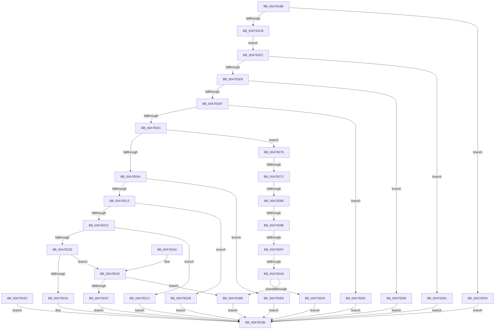

# SmSetStoreInformation

- RVA: `0x00A781B8`–`0x00A78304` (길이 `332` bytes)
- VA: `0x0000000140A781B8`
- 실행 섹션: `PAGE`
- PDB 이름 있음: `예`; PDB Function 태그: `예`
- unwind 정보 RVA: `0x000B5F88`
- 디코드: `87`개 명령, `332/332` bytes 표시
- 미해석 바이트: `0` (있으면 어셈블리에 `.byte`로 보존)

> 이 문서는 커널 이미지의 기계어와 PDB 기호를 분석해 생성했습니다. 4번과 5번은 함수 원형과 자료형을 바이너리 사용 방식에서 추정한 C 해석이며 원본 소스 복구 결과는 아닙니다.

## 1. Dependencies

- 직접 호출 지점: **7**; 고유 호출 대상: **7**
- 직접 호출자로 확인된 함수: **1**
- RIP 상대 이미지 참조: **1**

### Outgoing calls
- `0x00A781F8` → [SeSinglePrivilegeCheck](../87/SeSinglePrivilegeCheck_function_00871E20.md) (function, `0x00871E20`)
- `0x00A78236` → [SmProcessStoreMemoryPriorityRequest](SmProcessStoreMemoryPriorityRequest_function_00A7830C.md) (function, `0x00A7830C`)
- `0x00A78253` → [SmProcessSystemStoreTrimRequest](SmProcessSystemStoreTrimRequest_function_00A784E0.md) (function, `0x00A784E0`)
- `0x00A782B1` → [SmcProcessStoreCreateRequest](../7A/SmcProcessStoreCreateRequest_function_007A7E14.md) (function, `0x007A7E14`)
- `0x00A782CE` → [SmProcessConfigRequest](../7A/SmProcessConfigRequest_function_007A62E4.md) (function, `0x007A62E4`)
- `0x00A782E4` → [SmcProcessResizeRequest](../7A/SmcProcessResizeRequest_function_007A7B1C.md) (function, `0x007A7B1C`)
- `0x00A782FA` → [SmProcessResizeRequest](../7A/SmProcessResizeRequest_function_007A6D50.md) (function, `0x007A6D50`)

### Direct callers
- [NtSetSystemInformation](../AF/NtSetSystemInformation_function_00AF4A60.md) at `0x00AF5AB3`

### Static image references
- `0x00A781F1` → RVA `0x00FD9B08` (`PAGEDATA`; read)

## 2. Other-region calls and transfers

- 다른 실행 섹션으로 향하는 call: **0**
- call이 아닌 외부 분기/꼬리 이동: **5**
  - `0x00A78276` → [sub_00B419D6 + 0x75](../B4/Unknown_function_00B419D6.md) (`tail-transfer`)
  - `0x00A7827F` → [sub_00B419D6 + 0x45](../B4/Unknown_function_00B419D6.md) (`tail-transfer`)
  - `0x00A78288` → [sub_00B419D6 + 0x2E](../B4/Unknown_function_00B419D6.md) (`tail-transfer`)
  - `0x00A78291` → [sub_00B419D6 + 0x17](../B4/Unknown_function_00B419D6.md) (`tail-transfer`)
  - `0x00A7829A` → [sub_00B419D6](../B4/Unknown_function_00B419D6.md) (`tail-transfer`)

## 3. Assembly (complete function range)

```asm
00A781B8  40 53                           push rbx
00A781BA  48 83 EC 40                     sub rsp, 0x40
00A781BE  41 8A D9                        mov bl, r9b
00A781C1  41 83 F8 18                     cmp r8d, 0x18
00A781C5  0F 82 8F 00 00 00               jb 0x140a7825a
00A781CB  0F 10 02                        movups xmm0, xmmword ptr [rdx]
00A781CE  0F 11 44 24 20                  movups xmmword ptr [rsp + 0x20], xmm0
00A781D3  F2 0F 10 4A 10                  movsd xmm1, qword ptr [rdx + 0x10]
00A781D8  F2 0F 11 4C 24 30               movsd qword ptr [rsp + 0x30], xmm1
00A781DE  EB 02                           jmp 0x140a781e2
00A781E0  EB 59                           jmp 0x140a7823b
00A781E2  83 7C 24 20 01                  cmp dword ptr [rsp + 0x20], 1
00A781E7  75 78                           jne 0x140a78261
00A781E9  41 83 F8 18                     cmp r8d, 0x18
00A781ED  75 79                           jne 0x140a78268
00A781EF  8A D3                           mov dl, bl
00A781F1  48 8B 0D 10 19 56 00            mov rcx, qword ptr [rip + 0x561910]
00A781F8  E8 23 9C DF FF                  call 0x140871e20
00A781FD  84 C0                           test al, al
00A781FF  74 6E                           je 0x140a7826f
00A78201  8B 4C 24 24                     mov ecx, dword ptr [rsp + 0x24]
00A78205  83 F9 0C                        cmp ecx, 0xc
00A78208  7E 6C                           jle 0x140a78276
00A7820A  83 E9 11                        sub ecx, 0x11
00A7820D  0F 84 DB 00 00 00               je 0x140a782ee
00A78213  83 E9 01                        sub ecx, 1
00A78216  0F 84 BC 00 00 00               je 0x140a782d8
00A7821C  83 E9 01                        sub ecx, 1
00A7821F  0F 84 9D 00 00 00               je 0x140a782c2
00A78225  83 E9 01                        sub ecx, 1
00A78228  75 18                           jne 0x140a78242
00A7822A  44 8A C3                        mov r8b, bl
00A7822D  8B 54 24 30                     mov edx, dword ptr [rsp + 0x30]
00A78231  48 8B 4C 24 28                  mov rcx, qword ptr [rsp + 0x28]
00A78236  E8 D1 00 00 00                  call 0x140a7830c
00A7823B  48 83 C4 40                     add rsp, 0x40
00A7823F  5B                              pop rbx
00A78240  C3                              ret
00A78241  CC                              int3
00A78242  83 F9 01                        cmp ecx, 1
00A78245  75 71                           jne 0x140a782b8
00A78247  44 8A C3                        mov r8b, bl
00A7824A  8B 54 24 30                     mov edx, dword ptr [rsp + 0x30]
00A7824E  48 8B 4C 24 28                  mov rcx, qword ptr [rsp + 0x28]
00A78253  E8 88 02 00 00                  call 0x140a784e0
00A78258  EB E1                           jmp 0x140a7823b
00A7825A  B8 06 02 00 C0                  mov eax, 0xc0000206
00A7825F  EB DA                           jmp 0x140a7823b
00A78261  B8 59 00 00 C0                  mov eax, 0xc0000059
00A78266  EB D3                           jmp 0x140a7823b
00A78268  B8 04 00 00 C0                  mov eax, 0xc0000004
00A7826D  EB CC                           jmp 0x140a7823b
00A7826F  B8 22 00 00 C0                  mov eax, 0xc0000022
00A78274  EB C5                           jmp 0x140a7823b
00A78276  0F 84 CF 97 0C 00               je 0x140b41a4b
00A7827C  83 E9 03                        sub ecx, 3
00A7827F  0F 84 96 97 0C 00               je 0x140b41a1b
00A78285  83 E9 01                        sub ecx, 1
00A78288  0F 84 76 97 0C 00               je 0x140b41a04
00A7828E  83 E9 05                        sub ecx, 5
00A78291  0F 84 56 97 0C 00               je 0x140b419ed
00A78297  83 E9 01                        sub ecx, 1
00A7829A  0F 84 36 97 0C 00               je 0x140b419d6
00A782A0  83 F9 01                        cmp ecx, 1
00A782A3  75 13                           jne 0x140a782b8
00A782A5  44 8A C3                        mov r8b, bl
00A782A8  8B 54 24 30                     mov edx, dword ptr [rsp + 0x30]
00A782AC  48 8B 4C 24 28                  mov rcx, qword ptr [rsp + 0x28]
00A782B1  E8 5E FB D2 FF                  call 0x1407a7e14
00A782B6  EB 83                           jmp 0x140a7823b
00A782B8  B8 03 00 00 C0                  mov eax, 0xc0000003
00A782BD  E9 79 FF FF FF                  jmp 0x140a7823b
00A782C2  44 8A C3                        mov r8b, bl
00A782C5  8B 54 24 30                     mov edx, dword ptr [rsp + 0x30]
00A782C9  48 8B 4C 24 28                  mov rcx, qword ptr [rsp + 0x28]
00A782CE  E8 11 E0 D2 FF                  call 0x1407a62e4
00A782D3  E9 63 FF FF FF                  jmp 0x140a7823b
00A782D8  44 8A C3                        mov r8b, bl
00A782DB  8B 54 24 30                     mov edx, dword ptr [rsp + 0x30]
00A782DF  48 8B 4C 24 28                  mov rcx, qword ptr [rsp + 0x28]
00A782E4  E8 33 F8 D2 FF                  call 0x1407a7b1c
00A782E9  E9 4D FF FF FF                  jmp 0x140a7823b
00A782EE  44 8A C3                        mov r8b, bl
00A782F1  8B 54 24 30                     mov edx, dword ptr [rsp + 0x30]
00A782F5  48 8B 4C 24 28                  mov rcx, qword ptr [rsp + 0x28]
00A782FA  E8 51 EA D2 FF                  call 0x1407a6d50
00A782FF  E9 37 FF FF FF                  jmp 0x140a7823b
```

## 4. C-style interpretation (structured pseudocode)

```c
__int64 __fastcall SmSetStoreInformation(__int64 a1, __int64 a2, int a3, unsigned __int8 a4)
{
    __int64 result;
    __int64 v_rsp;
    unsigned __int64 v_stack_m18;
    unsigned __int64 v_stack_m20;
    unsigned int v_stack_m24;
    unsigned __int64 v_stack_m28;
    unsigned __int64 v_stack_p28;
    unsigned int v_stack_p30;

    v_rsp = (v_rsp) - (64);
    if (a3 < 24) goto loc_00A7825A;
    v_stack_m28 = v_xmm0;
    v_stack_m18 = v_xmm1;
    goto loc_00A781E2;
loc_00A781E2:
    if (v_stack_m28 != 1) goto loc_00A78261;
    if (a3 != 24) goto loc_00A78268;
    result = SeSinglePrivilegeCheck(*(unsigned __int64 *)(v_rip + 5642512), a4, a3, a4);
    if ((unsigned __int8)(result) == 0) goto loc_00A7826F;
    if (((unsigned int)((unsigned int)(v_stack_m24))) <= 12) goto loc_00A78276;
    a1 = (unsigned int)(((unsigned int)(v_stack_m24)) - (17));
    if (condition_is_equal) goto loc_00A782EE;
    a1 = (unsigned int)((a1) - (1));
    if (condition_is_equal) goto loc_00A782D8;
    a1 = (unsigned int)((a1) - (1));
    if (condition_is_equal) goto loc_00A782C2;
    a1 = (unsigned int)((a1) - (1));
    if (condition_is_not_equal) goto loc_00A78242;
    result = SmProcessStoreMemoryPriorityRequest(v_stack_m20, (unsigned int)(v_stack_m18), a4, a4);
loc_00A7823B:
    v_rsp = (v_rsp) + (64);
    return result;
loc_00A78242:
    if (((unsigned int)(v_stack_m20)) != 1) goto loc_00A782B8;
    result = SmProcessSystemStoreTrimRequest(v_stack_p28, (unsigned int)(v_stack_p30), a4, a4);
    goto loc_00A7823B;
loc_00A7825A:
    goto loc_00A7823B;
loc_00A78261:
    goto loc_00A7823B;
loc_00A78268:
    goto loc_00A7823B;
loc_00A7826F:
    goto loc_00A7823B;
loc_00A78276:
    a1 = (unsigned int)((v_stack_p28) - (3));
    a1 = (unsigned int)((a1) - (1));
    a1 = (unsigned int)((a1) - (5));
    a1 = (unsigned int)((a1) - (1));
    if (((unsigned int)(a1)) != 1) goto loc_00A782B8;
    result = SmcProcessStoreCreateRequest(v_stack_p28, (unsigned int)(v_stack_p30), a4, a4);
    goto loc_00A7823B;
loc_00A782B8:
    goto loc_00A7823B;
loc_00A782C2:
    result = SmProcessConfigRequest(v_stack_p28, (unsigned int)(v_stack_p30), a4, a4);
    goto loc_00A7823B;
loc_00A782D8:
    result = SmcProcessResizeRequest(v_stack_p28, (unsigned int)(v_stack_p30), a4, a4);
    goto loc_00A7823B;
loc_00A782EE:
    result = SmProcessResizeRequest(v_stack_p28, (unsigned int)(v_stack_p30), a4, a4);
    goto loc_00A7823B;
}
```

## 5. (Beta) C Style

```c
int64_t SmSetStoreInformation(int64_t Arg1, void *Arg2, int32_t Arg3, uint8_t Arg4)
{
    uint8_t *arg2 = (uint8_t *)Arg2;

    int64_t result;
    int64_t local_rsp;
    uint64_t v_stack_m18;
    uint64_t v_stack_m20;
    uint32_t v_stack_m24;
    uint64_t v_stack_m28;
    uint64_t v_stack_p28;
    uint32_t v_stack_p30;

    local_rsp = (local_rsp) - (64);
    if (Arg3 < 24) goto loc_00A7825A;
    v_stack_m28 = v_xmm0;
    v_stack_m18 = v_xmm1;
    goto loc_00A781E2;
loc_00A781E2:
    if (v_stack_m28 != 1) goto loc_00A78261;
    if (Arg3 != 24) goto loc_00A78268;
    result = SeSinglePrivilegeCheck(*(uint64_t *)(v_rip + 0x561910), Arg4, Arg3, Arg4);
    if ((uint8_t)(result) == 0) goto loc_00A7826F;
    if (((uint32_t)((uint32_t)(v_stack_m24))) <= 12) goto loc_00A78276;
    Arg1 = (uint32_t)(((uint32_t)(v_stack_m24)) - (17));
    if (condition_is_equal) goto loc_00A782EE;
    Arg1 = (uint32_t)((Arg1) - (1));
    if (condition_is_equal) goto loc_00A782D8;
    Arg1 = (uint32_t)((Arg1) - (1));
    if (condition_is_equal) goto loc_00A782C2;
    Arg1 = (uint32_t)((Arg1) - (1));
    if (condition_is_not_equal) goto loc_00A78242;
    result = SmProcessStoreMemoryPriorityRequest(v_stack_m20, (uint32_t)(v_stack_m18), Arg4, Arg4);
loc_00A7823B:
    local_rsp = (local_rsp) + (64);
    return result;
loc_00A78242:
    if (((uint32_t)(v_stack_m20)) != 1) goto loc_00A782B8;
    result = SmProcessSystemStoreTrimRequest(v_stack_p28, (uint32_t)(v_stack_p30), Arg4, Arg4);
    goto loc_00A7823B;
loc_00A7825A:
    goto loc_00A7823B;
loc_00A78261:
    goto loc_00A7823B;
loc_00A78268:
    goto loc_00A7823B;
loc_00A7826F:
    goto loc_00A7823B;
loc_00A78276:
    Arg1 = (uint32_t)((v_stack_p28) - (3));
    Arg1 = (uint32_t)((Arg1) - (1));
    Arg1 = (uint32_t)((Arg1) - (5));
    Arg1 = (uint32_t)((Arg1) - (1));
    if (((uint32_t)(Arg1)) != 1) goto loc_00A782B8;
    result = SmcProcessStoreCreateRequest(v_stack_p28, (uint32_t)(v_stack_p30), Arg4, Arg4);
    goto loc_00A7823B;
loc_00A782B8:
    goto loc_00A7823B;
loc_00A782C2:
    result = SmProcessConfigRequest(v_stack_p28, (uint32_t)(v_stack_p30), Arg4, Arg4);
    goto loc_00A7823B;
loc_00A782D8:
    result = SmcProcessResizeRequest(v_stack_p28, (uint32_t)(v_stack_p30), Arg4, Arg4);
    goto loc_00A7823B;
loc_00A782EE:
    result = SmProcessResizeRequest(v_stack_p28, (uint32_t)(v_stack_p30), Arg4, Arg4);
    goto loc_00A7823B;
}
```

### 관측된 메모리 오프셋

구조체 형식이 확인되지 않은 접근은 인자 기준의 오프셋으로만 기록했습니다.

| 기준 인자 | 오프셋 표현 | 폭 (bit) | 접근 |
|---|---:|---:|---|
| `Arg2` | `+ 0x0` | `128` | `R` |
| `Arg2` | `+ 0x10` | `64` | `R` |

## 6. Execution-region graph

[열기: 2D/3D 그래프와 함수 탐색 컨트롤 패널](../../../control-panel.html?section=page&rva=0x00A781B8&view=graph)

- 2D 그래프는 위에서 아래로 흐르고, 3D 그래프는 빈 공간을 드래그해 회전합니다. Shift+드래그는 이동, 휠은 확대·축소, 함수 노드 선택은 대상 보고서 이동입니다.

### Static fallback


