# SshpSessionManagerFlushControlEventBufferWorker

- RVA: `0x00A76CC0`–`0x00A770A3` (길이 `995` bytes)
- VA: `0x0000000140A76CC0`
- 실행 섹션: `PAGE`
- PDB 이름 있음: `예`; PDB Function 태그: `예`
- unwind 정보 RVA: `0x000B5D88`
- 디코드: `252`개 명령, `995/995` bytes 표시
- 미해석 바이트: `0` (있으면 어셈블리에 `.byte`로 보존)

> 이 문서는 커널 이미지의 기계어와 PDB 기호를 분석해 생성했습니다. 4번과 5번은 함수 원형과 자료형을 바이너리 사용 방식에서 추정한 C 해석이며 원본 소스 복구 결과는 아닙니다.

## 1. Dependencies

- 직접 호출 지점: **17**; 고유 호출 대상: **12**
- 직접 호출자로 확인된 함수: **0**
- RIP 상대 이미지 참조: **12**

### Outgoing calls
- `0x00A76D13` → [ExAllocatePool2](../../poolcode/B8/ExAllocatePool2_function_00B820F0.md) (function, `0x00B820F0`)
- `0x00A76D2A` → [KeAbPreAcquire](../../text/21/KeAbPreAcquire_function_00210230.md) (function, `0x00210230`)
- `0x00A76D43` → [ExfAcquirePushLockExclusiveEx](../../text/20/ExfAcquirePushLockExclusiveEx_function_0020FC90.md) (function, `0x0020FC90`)
- `0x00A76D70` → [SshpWorkItemTryAllowNextWorker](../../text/4B/SshpWorkItemTryAllowNextWorker_function_004BC078.md) (function, `0x004BC078`)
- `0x00A76E16` → [ZwFlushBuffersFile](../../text/6A/ZwFlushBuffersFile_function_006ADA30.md) (function, `0x006ADA30`)
- `0x00A76E31` → [KeAbPreAcquire](../../text/21/KeAbPreAcquire_function_00210230.md) (function, `0x00210230`)
- `0x00A76E4A` → [ExfAcquirePushLockExclusiveEx](../../text/20/ExfAcquirePushLockExclusiveEx_function_0020FC90.md) (function, `0x0020FC90`)
- `0x00A76E7C` → [SshpWorkItemTryAllowNextWorker](../../text/4B/SshpWorkItemTryAllowNextWorker_function_004BC078.md) (function, `0x004BC078`)
- `0x00A76E9C` → [KeSetEvent](../../text/33/KeSetEvent_function_0033F310.md) (function, `0x0033F310`)
- `0x00A76EA8` → [SSHSupportReleasePushLockExclusive](../../text/49/SSHSupportReleasePushLockExclusive_function_004954EC.md) (function, `0x004954EC`)
- `0x00A76EBA` → [ExFreePoolWithTag](../../poolcode/B8/ExFreePoolWithTag_function_00B82870.md) (function, `0x00B82870`)
- `0x00A76ED4` → [_security_check_cookie](../../text/6A/_security_check_cookie_function_006AC640.md) (function, `0x006AC640`)
- `0x00A76F04` → [memcpy](../../text/6C/memcpy_function_006C6840.md) (function, `0x006C6840`)
- `0x00A76F15` → [SSHSupportReleasePushLockExclusive](../../text/49/SSHSupportReleasePushLockExclusive_function_004954EC.md) (function, `0x004954EC`)
- `0x00A76F39` → [SshpSessionManagerWriteBytes](SshpSessionManagerWriteBytes_function_00A770AC.md) (function, `0x00A770AC`)
- `0x00A76F95` → [SshpSessionManagerWriteBytes](SshpSessionManagerWriteBytes_function_00A770AC.md) (function, `0x00A770AC`)
- `0x00A77033` → [ZwWriteFile](../../text/6A/ZwWriteFile_function_006AD1D0.md) (function, `0x006AD1D0`)

### Direct callers
- 이 함수 시작 RVA로 연결되는 직접 call은 확인되지 않았습니다. 간접 호출은 완전히 역산할 수 없습니다.

### Static image references
- `0x00A76CE4` → RVA `0x00E0A740` (`.data`; read)
- `0x00A76D18` → RVA `0x00F06B70` (`.data`; read)
- `0x00A76D54` → RVA `0x00F06BB0` (`.data`; read)
- `0x00A76D7D` → RVA `0x00F06C0C` (`.data`; read)
- `0x00A76D84` → RVA `0x00F06C08` (`.data`; read)
- `0x00A76D8C` → RVA `0x00F06C08` (`.data`; read/write)
- `0x00A76D9A` → RVA `0x00F06BD8` (`.data`; read)
- `0x00A76DA4` → RVA `0x00F06BE8` (`.data`; read)
- `0x00A76E0B` → RVA `0x00F06BA8` (`.data`; read)
- `0x00A76E6D` → RVA `0x00F06BE8` (`.data`; write)
- `0x00A76E93` → RVA `0x00F06BF0` (`.data`; read)
- `0x00A76EBF` → RVA `0x00F07090` (`.data`; read)

## 2. Other-region calls and transfers

- 다른 실행 섹션으로 향하는 call: **15**
  - `0x00A76D13` → [ExAllocatePool2](../../poolcode/B8/ExAllocatePool2_function_00B820F0.md) (`PAGE` → `POOLCODE`)
  - `0x00A76D2A` → [KeAbPreAcquire](../../text/21/KeAbPreAcquire_function_00210230.md) (`PAGE` → `.text`)
  - `0x00A76D43` → [ExfAcquirePushLockExclusiveEx](../../text/20/ExfAcquirePushLockExclusiveEx_function_0020FC90.md) (`PAGE` → `.text`)
  - `0x00A76D70` → [SshpWorkItemTryAllowNextWorker](../../text/4B/SshpWorkItemTryAllowNextWorker_function_004BC078.md) (`PAGE` → `.text`)
  - `0x00A76E16` → [ZwFlushBuffersFile](../../text/6A/ZwFlushBuffersFile_function_006ADA30.md) (`PAGE` → `.text`)
  - `0x00A76E31` → [KeAbPreAcquire](../../text/21/KeAbPreAcquire_function_00210230.md) (`PAGE` → `.text`)
  - `0x00A76E4A` → [ExfAcquirePushLockExclusiveEx](../../text/20/ExfAcquirePushLockExclusiveEx_function_0020FC90.md) (`PAGE` → `.text`)
  - `0x00A76E7C` → [SshpWorkItemTryAllowNextWorker](../../text/4B/SshpWorkItemTryAllowNextWorker_function_004BC078.md) (`PAGE` → `.text`)
  - `0x00A76E9C` → [KeSetEvent](../../text/33/KeSetEvent_function_0033F310.md) (`PAGE` → `.text`)
  - `0x00A76EA8` → [SSHSupportReleasePushLockExclusive](../../text/49/SSHSupportReleasePushLockExclusive_function_004954EC.md) (`PAGE` → `.text`)
  - `0x00A76EBA` → [ExFreePoolWithTag](../../poolcode/B8/ExFreePoolWithTag_function_00B82870.md) (`PAGE` → `POOLCODE`)
  - `0x00A76ED4` → [_security_check_cookie](../../text/6A/_security_check_cookie_function_006AC640.md) (`PAGE` → `.text`)
  - `0x00A76F04` → [memcpy](../../text/6C/memcpy_function_006C6840.md) (`PAGE` → `.text`)
  - `0x00A76F15` → [SSHSupportReleasePushLockExclusive](../../text/49/SSHSupportReleasePushLockExclusive_function_004954EC.md) (`PAGE` → `.text`)
  - `0x00A77033` → [ZwWriteFile](../../text/6A/ZwWriteFile_function_006AD1D0.md) (`PAGE` → `.text`)
- call이 아닌 외부 분기/꼬리 이동: **5**
  - `0x00A76EC7` → [sub_00B4173C + 0x5D](../B4/Unknown_function_00B4173C.md) (`tail-transfer`)
  - `0x00A76F9E` → [sub_00B4173C + 0x4C](../B4/Unknown_function_00B4173C.md) (`tail-transfer`)
  - `0x00A77067` → [sub_00B4173C](../B4/Unknown_function_00B4173C.md) (`tail-transfer`)
  - `0x00A77073` → [sub_00B4173C](../B4/Unknown_function_00B4173C.md) (`tail-transfer`)
  - `0x00A77095` → [sub_00B4173C + 0x54](../B4/Unknown_function_00B4173C.md) (`tail-transfer`)

## 3. Assembly (complete function range)

```asm
00A76CC0  48 89 5C 24 08                  mov qword ptr [rsp + 8], rbx
00A76CC5  48 89 74 24 10                  mov qword ptr [rsp + 0x10], rsi
00A76CCA  48 89 7C 24 18                  mov qword ptr [rsp + 0x18], rdi
00A76CCF  55                              push rbp
00A76CD0  41 54                           push r12
00A76CD2  41 55                           push r13
00A76CD4  41 56                           push r14
00A76CD6  41 57                           push r15
00A76CD8  48 8D 6C 24 A0                  lea rbp, [rsp - 0x60]
00A76CDD  48 81 EC 60 01 00 00            sub rsp, 0x160
00A76CE4  48 8B 05 55 3A 39 00            mov rax, qword ptr [rip + 0x393a55]
00A76CEB  48 33 C4                        xor rax, rsp
00A76CEE  48 89 45 50                     mov qword ptr [rbp + 0x50], rax
00A76CF2  0F 57 C0                        xorps xmm0, xmm0
00A76CF5  33 C0                           xor eax, eax
00A76CF7  BA 00 04 00 00                  mov edx, 0x400
00A76CFC  48 89 45 C0                     mov qword ptr [rbp - 0x40], rax
00A76D00  B9 00 01 00 00                  mov ecx, 0x100
00A76D05  41 B8 5F 53 50 52               mov r8d, 0x5250535f
00A76D0B  0F 11 45 B0                     movups xmmword ptr [rbp - 0x50], xmm0
00A76D0F  0F 11 45 A0                     movups xmmword ptr [rbp - 0x60], xmm0
00A76D13  E8 D8 B3 10 00                  call 0x140b820f0
00A76D18  48 8D 3D 51 FE 48 00            lea rdi, [rip + 0x48fe51]
00A76D1F  45 33 C0                        xor r8d, r8d
00A76D22  48 8B CF                        mov rcx, rdi
00A76D25  33 D2                           xor edx, edx
00A76D27  4C 8B E0                        mov r12, rax
00A76D2A  E8 01 95 79 FF                  call 0x140210230
00A76D2F  F0 48 0F BA 2F 00               lock bts qword ptr [rdi], 0
00A76D35  48 8B D8                        mov rbx, rax
00A76D38  73 0E                           jae 0x140a76d48
00A76D3A  4C 8B C7                        mov r8, rdi
00A76D3D  48 8B D0                        mov rdx, rax
00A76D40  48 8B CF                        mov rcx, rdi
00A76D43  E8 48 8F 79 FF                  call 0x14020fc90
00A76D48  48 85 DB                        test rbx, rbx
00A76D4B  74 04                           je 0x140a76d51
00A76D4D  C6 43 0A 01                     mov byte ptr [rbx + 0xa], 1
00A76D51  45 33 C0                        xor r8d, r8d
00A76D54  48 8D 0D 55 FE 48 00            lea rcx, [rip + 0x48fe55]
00A76D5B  45 33 F6                        xor r14d, r14d
00A76D5E  44 89 44 24 54                  mov dword ptr [rsp + 0x54], r8d
00A76D63  44 89 74 24 50                  mov dword ptr [rsp + 0x50], r14d
00A76D68  45 33 FF                        xor r15d, r15d
00A76D6B  33 FF                           xor edi, edi
00A76D6D  45 33 ED                        xor r13d, r13d
00A76D70  E8 03 53 A4 FF                  call 0x1404bc078
00A76D75  84 C0                           test al, al
00A76D77  0F 85 13 01 00 00               jne 0x140a76e90
00A76D7D  48 8D 05 88 FE 48 00            lea rax, [rip + 0x48fe88]
00A76D84  8B 1D 7E FE 48 00               mov ebx, dword ptr [rip + 0x48fe7e]
00A76D8A  33 F6                           xor esi, esi
00A76D8C  21 35 76 FE 48 00               and dword ptr [rip + 0x48fe76], esi
00A76D92  85 DB                           test ebx, ebx
00A76D94  0F 84 DB 00 00 00               je 0x140a76e75
00A76D9A  0F 10 05 37 FE 48 00            movups xmm0, xmmword ptr [rip + 0x48fe37]
00A76DA1  41 FF C0                        inc r8d
00A76DA4  F2 0F 10 0D 3C FE 48 00         movsd xmm1, qword ptr [rip + 0x48fe3c]
00A76DAC  44 89 44 24 54                  mov dword ptr [rsp + 0x54], r8d
00A76DB1  F2 0F 11 4D C0                  movsd qword ptr [rbp - 0x40], xmm1
00A76DB6  0F 11 45 B0                     movups xmmword ptr [rbp - 0x50], xmm0
00A76DBA  4D 85 E4                        test r12, r12
00A76DBD  0F 85 38 01 00 00               jne 0x140a76efb
00A76DC3  48 89 44 24 58                  mov qword ptr [rsp + 0x58], rax
00A76DC8  44 8B 4D BC                     mov r9d, dword ptr [rbp - 0x44]
00A76DCC  41 8B C9                        mov ecx, r9d
00A76DCF  44 8B 45 C0                     mov r8d, dword ptr [rbp - 0x40]
00A76DD3  41 2B C8                        sub ecx, r8d
00A76DD6  44 8B 55 C4                     mov r10d, dword ptr [rbp - 0x3c]
00A76DDA  41 03 CA                        add ecx, r10d
00A76DDD  3B D9                           cmp ebx, ecx
00A76DDF  0F 87 74 02 00 00               ja 0x140a77059
00A76DE5  33 D2                           xor edx, edx
00A76DE7  41 8B C0                        mov eax, r8d
00A76DEA  41 F7 F2                        div r10d
00A76DED  44 8B F3                        mov r14d, ebx
00A76DF0  41 8B C2                        mov eax, r10d
00A76DF3  2B C2                           sub eax, edx
00A76DF5  3B C3                           cmp eax, ebx
00A76DF7  44 0F 42 F0                     cmovb r14d, eax
00A76DFB  41 2B DE                        sub ebx, r14d
00A76DFE  85 F6                           test esi, esi
00A76E00  0F 89 19 01 00 00               jns 0x140a76f1f
00A76E06  44 8B 74 24 50                  mov r14d, dword ptr [rsp + 0x50]
00A76E0B  48 8B 0D 96 FD 48 00            mov rcx, qword ptr [rip + 0x48fd96]
00A76E12  48 8D 55 A0                     lea rdx, [rbp - 0x60]
00A76E16  E8 15 6C C3 FF                  call 0x1406ada30
00A76E1B  4C 39 64 24 58                  cmp qword ptr [rsp + 0x58], r12
00A76E20  75 36                           jne 0x140a76e58
00A76E22  48 8D 35 47 FD 48 00            lea rsi, [rip + 0x48fd47]
00A76E29  45 33 C0                        xor r8d, r8d
00A76E2C  48 8B CE                        mov rcx, rsi
00A76E2F  33 D2                           xor edx, edx
00A76E31  E8 FA 93 79 FF                  call 0x140210230
00A76E36  F0 48 0F BA 2E 00               lock bts qword ptr [rsi], 0
00A76E3C  48 8B D8                        mov rbx, rax
00A76E3F  73 0E                           jae 0x140a76e4f
00A76E41  4C 8B C6                        mov r8, rsi
00A76E44  48 8B D0                        mov rdx, rax
00A76E47  48 8B CE                        mov rcx, rsi
00A76E4A  E8 41 8E 79 FF                  call 0x14020fc90
00A76E4F  48 85 DB                        test rbx, rbx
00A76E52  74 04                           je 0x140a76e58
00A76E54  C6 43 0A 01                     mov byte ptr [rbx + 0xa], 1
00A76E58  0F 10 45 B0                     movups xmm0, xmmword ptr [rbp - 0x50]
00A76E5C  44 8B 44 24 54                  mov r8d, dword ptr [rsp + 0x54]
00A76E61  F2 0F 10 4D C0                  movsd xmm1, qword ptr [rbp - 0x40]
00A76E66  0F 11 05 6B FD 48 00            movups xmmword ptr [rip + 0x48fd6b], xmm0
00A76E6D  F2 0F 11 0D 73 FD 48 00         movsd qword ptr [rip + 0x48fd73], xmm1
00A76E75  48 8D 0D 34 FD 48 00            lea rcx, [rip + 0x48fd34]
00A76E7C  E8 F7 51 A4 FF                  call 0x1404bc078
00A76E81  84 C0                           test al, al
00A76E83  48 8D 05 82 FD 48 00            lea rax, [rip + 0x48fd82]
00A76E8A  0F 84 F4 FE FF FF               je 0x140a76d84
00A76E90  45 33 C0                        xor r8d, r8d
00A76E93  48 8D 0D 56 FD 48 00            lea rcx, [rip + 0x48fd56]
00A76E9A  33 D2                           xor edx, edx
00A76E9C  E8 6F 84 8C FF                  call 0x14033f310
00A76EA1  48 8D 0D C8 FC 48 00            lea rcx, [rip + 0x48fcc8]
00A76EA8  E8 3F E6 A1 FF                  call 0x1404954ec
00A76EAD  4D 85 E4                        test r12, r12
00A76EB0  74 0D                           je 0x140a76ebf
00A76EB2  BA 5F 53 50 52                  mov edx, 0x5250535f
00A76EB7  49 8B CC                        mov rcx, r12
00A76EBA  E8 B1 B9 10 00                  call 0x140b82870
00A76EBF  8B 05 CB 01 49 00               mov eax, dword ptr [rip + 0x4901cb]
00A76EC5  85 C0                           test eax, eax
00A76EC7  0F 85 CC A8 0C 00               jne 0x140b41799
00A76ECD  48 8B 4D 50                     mov rcx, qword ptr [rbp + 0x50]
00A76ED1  48 33 CC                        xor rcx, rsp
00A76ED4  E8 67 57 C3 FF                  call 0x1406ac640
00A76ED9  4C 8D 9C 24 60 01 00 00         lea r11, [rsp + 0x160]
00A76EE1  49 8B 5B 30                     mov rbx, qword ptr [r11 + 0x30]
00A76EE5  49 8B 73 38                     mov rsi, qword ptr [r11 + 0x38]
00A76EE9  49 8B 7B 40                     mov rdi, qword ptr [r11 + 0x40]
00A76EED  49 8B E3                        mov rsp, r11
00A76EF0  41 5F                           pop r15
00A76EF2  41 5E                           pop r14
00A76EF4  41 5D                           pop r13
00A76EF6  41 5C                           pop r12
00A76EF8  5D                              pop rbp
00A76EF9  C3                              ret
00A76EFA  CC                              int3
00A76EFB  4C 8B C3                        mov r8, rbx
00A76EFE  48 8B D0                        mov rdx, rax
00A76F01  49 8B CC                        mov rcx, r12
00A76F04  E8 37 F9 C4 FF                  call 0x1406c6840
00A76F09  48 8D 0D 60 FC 48 00            lea rcx, [rip + 0x48fc60]
00A76F10  4C 89 64 24 58                  mov qword ptr [rsp + 0x58], r12
00A76F15  E8 D2 E5 A1 FF                  call 0x1404954ec
00A76F1A  E9 A9 FE FF FF                  jmp 0x140a76dc8
00A76F1F  45 85 F6                        test r14d, r14d
00A76F22  74 4D                           je 0x140a76f71
00A76F24  4C 8B 44 24 58                  mov r8, qword ptr [rsp + 0x58]
00A76F29  81 C2 00 10 00 00               add edx, 0x1000
00A76F2F  48 8B 0D 72 FC 48 00            mov rcx, qword ptr [rip + 0x48fc72]
00A76F36  45 8B CE                        mov r9d, r14d
00A76F39  E8 6E 01 00 00                  call 0x140a770ac
00A76F3E  8B F0                           mov esi, eax
00A76F40  85 C0                           test eax, eax
00A76F42  0F 88 09 01 00 00               js 0x140a77051
00A76F48  41 8B C6                        mov eax, r14d
00A76F4B  48 03 F8                        add rdi, rax
00A76F4E  44 8B 45 C0                     mov r8d, dword ptr [rbp - 0x40]
00A76F52  41 8D 4D 01                     lea ecx, [r13 + 1]
00A76F56  44 8B 55 C4                     mov r10d, dword ptr [rbp - 0x3c]
00A76F5A  45 03 C6                        add r8d, r14d
00A76F5D  44 8B 4D BC                     mov r9d, dword ptr [rbp - 0x44]
00A76F61  85 F6                           test esi, esi
00A76F63  44 89 45 C0                     mov dword ptr [rbp - 0x40], r8d
00A76F67  44 0F 48 E9                     cmovs r13d, ecx
00A76F6B  0F 88 95 FE FF FF               js 0x140a76e06
00A76F71  85 DB                           test ebx, ebx
00A76F73  74 57                           je 0x140a76fcc
00A76F75  48 8B 0D 2C FC 48 00            mov rcx, qword ptr [rip + 0x48fc2c]
00A76F7C  41 8B C0                        mov eax, r8d
00A76F7F  33 D2                           xor edx, edx
00A76F81  45 8B C6                        mov r8d, r14d
00A76F84  4C 03 44 24 58                  add r8, qword ptr [rsp + 0x58]
00A76F89  44 8B CB                        mov r9d, ebx
00A76F8C  41 F7 F2                        div r10d
00A76F8F  81 C2 00 10 00 00               add edx, 0x1000
00A76F95  E8 12 01 00 00                  call 0x140a770ac
00A76F9A  8B D0                           mov edx, eax
00A76F9C  85 C0                           test eax, eax
00A76F9E  0F 88 E4 A7 0C 00               js 0x140b41788
00A76FA4  8B CB                           mov ecx, ebx
00A76FA6  48 03 F9                        add rdi, rcx
00A76FA9  44 8B 45 C0                     mov r8d, dword ptr [rbp - 0x40]
00A76FAD  41 8D 45 01                     lea eax, [r13 + 1]
00A76FB1  44 03 C3                        add r8d, ebx
00A76FB4  85 D2                           test edx, edx
00A76FB6  44 89 45 C0                     mov dword ptr [rbp - 0x40], r8d
00A76FBA  44 0F 48 E8                     cmovs r13d, eax
00A76FBE  0F 88 42 FE FF FF               js 0x140a76e06
00A76FC4  44 8B 55 C4                     mov r10d, dword ptr [rbp - 0x3c]
00A76FC8  44 8B 4D BC                     mov r9d, dword ptr [rbp - 0x44]
00A76FCC  43 8D 04 12                     lea eax, [r10 + r10]
00A76FD0  44 3B C0                        cmp r8d, eax
00A76FD3  0F 83 9F 00 00 00               jae 0x140a77078
00A76FD9  48 83 64 24 40 00               and qword ptr [rsp + 0x40], 0
00A76FDF  48 8D 44 24 78                  lea rax, [rsp + 0x78]
00A76FE4  8B 55 B4                        mov edx, dword ptr [rbp - 0x4c]
00A76FE7  0F 57 C0                        xorps xmm0, xmm0
00A76FEA  03 55 B0                        add edx, dword ptr [rbp - 0x50]
00A76FED  48 8B 0D B4 FB 48 00            mov rcx, qword ptr [rip + 0x48fbb4]
00A76FF4  41 03 D1                        add edx, r9d
00A76FF7  48 83 64 24 78 00               and qword ptr [rsp + 0x78], 0
00A76FFD  41 03 D0                        add edx, r8d
00A77000  48 89 44 24 38                  mov qword ptr [rsp + 0x38], rax
00A77005  41 03 D2                        add edx, r10d
00A77008  F7 D2                           not edx
00A7700A  C7 44 24 30 18 00 00 00         mov dword ptr [rsp + 0x30], 0x18
00A77012  48 8D 45 B0                     lea rax, [rbp - 0x50]
00A77016  89 55 B8                        mov dword ptr [rbp - 0x48], edx
00A77019  48 89 44 24 28                  mov qword ptr [rsp + 0x28], rax
00A7701E  33 D2                           xor edx, edx
00A77020  48 8D 45 90                     lea rax, [rbp - 0x70]
00A77024  45 33 C9                        xor r9d, r9d
00A77027  45 33 C0                        xor r8d, r8d
00A7702A  48 89 44 24 20                  mov qword ptr [rsp + 0x20], rax
00A7702F  0F 11 45 90                     movups xmmword ptr [rbp - 0x70], xmm0
00A77033  E8 98 61 C3 FF                  call 0x1406ad1d0
00A77038  85 C0                           test eax, eax
00A7703A  79 54                           jns 0x140a77090
00A7703C  44 8B F8                        mov r15d, eax
00A7703F  44 8B 74 24 50                  mov r14d, dword ptr [rsp + 0x50]
00A77044  41 FF C6                        inc r14d
00A77047  44 89 74 24 50                  mov dword ptr [rsp + 0x50], r14d
00A7704C  E9 BA FD FF FF                  jmp 0x140a76e0b
00A77051  44 8B FE                        mov r15d, esi
00A77054  E9 F5 FE FF FF                  jmp 0x140a76f4e
00A77059  8B C3                           mov eax, ebx
00A7705B  2B C1                           sub eax, ecx
00A7705D  44 03 C8                        add r9d, eax
00A77060  44 89 4D BC                     mov dword ptr [rbp - 0x44], r9d
00A77064  45 3B C8                        cmp r9d, r8d
00A77067  0F 86 CF A6 0C 00               jbe 0x140b4173c
00A7706D  21 75 BC                        and dword ptr [rbp - 0x44], esi
00A77070  21 75 C0                        and dword ptr [rbp - 0x40], esi
00A77073  E9 C4 A6 0C 00                  jmp 0x140b4173c
00A77078  45 2B C2                        sub r8d, r10d
00A7707B  45 2B CA                        sub r9d, r10d
00A7707E  44 3B C0                        cmp r8d, eax
00A77081  73 F5                           jae 0x140a77078
00A77083  44 89 45 C0                     mov dword ptr [rbp - 0x40], r8d
00A77087  44 89 4D BC                     mov dword ptr [rbp - 0x44], r9d
00A7708B  E9 49 FF FF FF                  jmp 0x140a76fd9
00A77090  48 83 7D 98 18                  cmp qword ptr [rbp - 0x68], 0x18
00A77095  0F 84 F5 A6 0C 00               je 0x140b41790
00A7709B  41 BF 11 00 00 C0               mov r15d, 0xc0000011
00A770A1  EB 9C                           jmp 0x140a7703f
```

## 4. C-style interpretation (structured pseudocode)

```c
__int64 __fastcall SshpSessionManagerFlushControlEventBufferWorker(void)
{
    __int64 result;
    __int64 v_r13;
    __int64 v_r14;
    __int64 v_r15;
    __int64 v_rbx;
    __int64 v_rdi;
    __int64 v_rsi;
    __int64 v_rsp;
    unsigned __int64 v_stack_m108;
    unsigned int v_stack_m110;
    unsigned __int64 v_stack_m120;
    unsigned __int64 v_stack_m128;
    unsigned __int64 v_stack_m130;
    unsigned int v_stack_m134;
    unsigned int v_stack_m138;
    unsigned __int64 v_stack_m140;
    unsigned __int64 v_stack_m28;
    unsigned __int64 v_stack_m38;
    unsigned __int64 v_stack_m88;
    unsigned int v_stack_mC4;
    unsigned __int64 v_stack_mC8;
    unsigned int v_stack_mCC;
    unsigned int v_stack_mD0;
    unsigned int v_stack_mD4;
    unsigned __int64 v_stack_mD8;
    unsigned __int64 v_stack_mE8;
    unsigned __int64 v_stack_mF0;
    unsigned __int64 v_stack_mF8;
    unsigned __int64 v_stack_p10;
    unsigned __int64 v_stack_p18;
    unsigned __int64 v_stack_p8;

    v_stack_p8 = v_rbx;
    v_stack_p10 = v_rsi;
    v_stack_p18 = v_rdi;
    v_rsp = (v_rsp) - (352);
    result = (*(unsigned __int64 *)(v_rip + 3750485)) ^ (v_rsp);
    v_stack_m38 = result;
    result = 0;
    v_stack_mC8 = 0;
    v_stack_mD8 = v_xmm0;
    v_stack_mE8 = v_xmm0;
    result = ExAllocatePool2(256, (unsigned int)(0x400ULL), (unsigned int)(0x5250535FULL), a4);
    a3 = 0;
    a2 = 0;
    result = KeAbPreAcquire(v_rip + 4783697, a2, a3, a4);
    if (!(condition_is_above_or_equal)) {
        a3 = v_rip + 4783697;
        a2 = result;
        a1 = v_rip + 4783697;
        result = ExfAcquirePushLockExclusiveEx(a1, a2, a3, a4);
    }
    if (result != 0) {
        *(unsigned __int8 *)(result + 10) = 1;
    }
    a3 = 0;
    v_r14 = 0;
    v_stack_m134 = 0;
    v_stack_m138 = 0;
    v_r15 = 0;
    v_rdi = 0;
    v_r13 = 0;
    result = SshpWorkItemTryAllowNextWorker(v_rip + 4783701, a2, a3, a4);
    if ((unsigned __int8)(result) != 0) goto loc_00A76E90;
loc_00A76D84:
    v_rsi = 0;
    if ((unsigned int)((unsigned int)(*(unsigned int *)(v_rip + 4783742))) == 0) goto loc_00A76E75;
    a3 = (unsigned int)((a3) + 1);
    v_stack_m134 = (unsigned int)(a3);
    v_stack_mC8 = v_xmm1;
    v_stack_mD8 = v_xmm0;
    if (result != 0) goto loc_00A76EFB;
    v_stack_m130 = v_rip + 4783752;
loc_00A76DC8:
    a1 = (unsigned int)(((unsigned int)((unsigned int)((unsigned int)(v_stack_mCC)))) - ((unsigned int)((unsigned int)(v_stack_mC8))));
    a1 = (unsigned int)((a1) + ((unsigned int)((unsigned int)(v_stack_mC4))));
    if (((unsigned int)((unsigned int)(*(unsigned int *)(v_rip + 4783742)))) > ((unsigned int)(a1))) goto loc_00A77059;
    a2 = 0;
    result = (unsigned int)(((unsigned int)((unsigned int)((unsigned int)(v_stack_mC4)))) - (0));
    v_r14 = (unsigned int)((unsigned int)((unsigned int)(*(unsigned int *)(v_rip + 4783742))));
    if (((unsigned int)(result)) < ((unsigned int)((unsigned int)(*(unsigned int *)(v_rip + 4783742))))) { v_r14 = (unsigned int)(result); }
    v_rbx = (unsigned int)(((unsigned int)(*(unsigned int *)(v_rip + 4783742))) - ((unsigned int)(v_r14)));
    if (!sign_flag) goto loc_00A76F1F;
loc_00A76E06:
loc_00A76E0B:
    result = ZwFlushBuffersFile(*(unsigned __int64 *)(v_rip + 4783510), v_stack_mE8, (unsigned int)(v_stack_mC8), (unsigned int)(v_stack_mCC));
    if (v_stack_m130 != result) goto loc_00A76E58;
    a3 = 0;
    a2 = 0;
    result = KeAbPreAcquire(v_rip + 4783431, a2, a3, (unsigned int)(v_stack_mCC));
    if (!(condition_is_above_or_equal)) {
        a3 = v_rip + 4783431;
        a2 = result;
        a1 = v_rip + 4783431;
        result = ExfAcquirePushLockExclusiveEx(a1, a2, a3, (unsigned int)(v_stack_mCC));
    }
    if (result != 0) {
        *(unsigned __int8 *)(result + 10) = 1;
    }
    *(unsigned __int64 *)(v_rip + 4783467) = v_xmm0;
    *(unsigned __int64 *)(v_rip + 4783475) = v_xmm1;
loc_00A76E75:
    result = SshpWorkItemTryAllowNextWorker(v_rip + 4783412, a2, (unsigned int)(v_stack_m134), (unsigned int)(v_stack_mCC));
    if ((unsigned __int8)(result) == 0) goto loc_00A76D84;
loc_00A76E90:
    a3 = 0;
    a2 = 0;
    result = KeSetEvent(v_rip + 4783446, a2, a3, (unsigned int)(v_stack_mCC));
    result = SSHSupportReleasePushLockExclusive(v_rip + 4783304, a2, a3, (unsigned int)(v_stack_mCC));
    if (result != 0) {
        a2 = 0x5250535FULL;
        a1 = result;
        result = ExFreePoolWithTag(a1, a2, a3, (unsigned int)(v_stack_mCC));
    }
    a1 = (v_stack_m38) ^ (v_rsp);
    result = _security_check_cookie(a1, a2, a3, (unsigned int)(v_stack_mCC));
    return result;
loc_00A76EFB:
    result = memcpy(result, result, *(unsigned __int64 *)(v_stack_m28 + 48), (unsigned int)(v_stack_mCC));
    v_stack_m108 = result;
    result = SSHSupportReleasePushLockExclusive(v_rip + 4783200, result, *(unsigned __int64 *)(v_stack_m28 + 48), (unsigned int)(v_stack_mCC));
    goto loc_00A76DC8;
loc_00A76F1F:
    if ((unsigned int)((unsigned int)(v_stack_m138)) == 0) goto loc_00A76F71;
    a2 = (unsigned int)((result) + (0x1000ULL));
    result = SshpSessionManagerWriteBytes(*(unsigned __int64 *)(v_rip + 4783218), a2, v_stack_m108, (unsigned int)((unsigned int)((unsigned int)(v_stack_m138))));
    if (sign_flag) goto loc_00A77051;
    v_rdi = (*(unsigned __int64 *)(v_stack_m28 + 64)) + ((unsigned int)((unsigned int)((unsigned int)(v_stack_m138))));
loc_00A76F4E:
    a3 = (unsigned int)(((unsigned int)(v_stack_mC8)) + ((unsigned int)((unsigned int)(v_stack_m138))));
    v_stack_mC8 = (unsigned int)(a3);
    if (sign_flag) { v_r13 = (unsigned int)(v_r13 + 1); }
    if (sign_flag) goto loc_00A76E06;
loc_00A76F71:
    if ((unsigned int)(*(unsigned __int64 *)(v_stack_m28 + 48)) == 0) goto loc_00A76FCC;
    a2 = 0;
    a3 = ((unsigned int)((unsigned int)((unsigned int)(v_stack_m138)))) + (v_stack_m108);
    a2 = (unsigned int)((a2) + (0x1000ULL));
    result = SshpSessionManagerWriteBytes(*(unsigned __int64 *)(v_rip + 4783148), a2, a3, (unsigned int)((unsigned int)(*(unsigned __int64 *)(v_stack_m28 + 48))));
    v_rdi = (v_rdi) + ((unsigned int)((unsigned int)(*(unsigned __int64 *)(v_stack_m28 + 48))));
    a3 = (unsigned int)(((unsigned int)(v_stack_mC8)) + ((unsigned int)(*(unsigned __int64 *)(v_stack_m28 + 48))));
    v_stack_mC8 = (unsigned int)(a3);
    if (sign_flag) { v_r13 = (unsigned int)(v_r13 + 1); }
    if (sign_flag) goto loc_00A76E06;
loc_00A76FCC:
    if (((unsigned int)(a3)) >= ((unsigned int)((unsigned int)(v_stack_mC4) + (unsigned int)(v_stack_mC4) * 1))) goto loc_00A77078;
loc_00A76FD9:
    a2 = (unsigned int)(((unsigned int)(v_stack_mD4)) + (v_stack_mD8));
    a2 = (unsigned int)((a2) + ((unsigned int)((unsigned int)(v_stack_mCC))));
    a2 = (unsigned int)((a2) + ((unsigned int)(a3)));
    v_stack_m128 = v_stack_mE8;
    a2 = (unsigned int)((a2) + ((unsigned int)((unsigned int)(v_stack_mC4))));
    a2 = (unsigned int)(~(a2));
    v_stack_m130 = 24;
    v_stack_mD0 = (unsigned int)(a2);
    v_stack_m138 = v_stack_mD8;
    a2 = 0;
    a4 = 0;
    a3 = 0;
    v_stack_m140 = v_stack_mF8;
    v_stack_mF8 = v_xmm0;
    result = ZwWriteFile(*(unsigned __int64 *)(v_rip + 4783028), a2, a3, a4);
    if (!sign_flag) goto loc_00A77090;
loc_00A7703F:
    v_r14 = (unsigned int)(((unsigned int)(v_stack_m110)) + 1);
    v_stack_m110 = (unsigned int)(v_r14);
    goto loc_00A76E0B;
loc_00A77051:
    goto loc_00A76F4E;
loc_00A77059:
    result = (unsigned int)(((unsigned int)((unsigned int)(*(unsigned __int64 *)(v_stack_m28 + 48)))) - ((unsigned int)(*(unsigned __int64 *)(v_rip + 4783028))));
    a4 = (unsigned int)((a4) + ((unsigned int)(result)));
    v_stack_mCC = (unsigned int)(a4);
loc_00A77078:
    a3 = (unsigned int)((a3) - ((unsigned int)((unsigned int)(v_stack_mC4))));
    a4 = (unsigned int)((a4) - ((unsigned int)((unsigned int)(v_stack_mC4))));
    if (((unsigned int)(a3)) >= ((unsigned int)(result))) goto loc_00A77078;
    v_stack_mC8 = (unsigned int)(a3);
    v_stack_mCC = (unsigned int)(a4);
    goto loc_00A76FD9;
loc_00A77090:
    goto loc_00A7703F;
}
```

## 5. (Beta) C Style

```c
void SshpSessionManagerFlushControlEventBufferWorker(void)
{
    int64_t result;
    int64_t local_r13;
    int64_t local_r14;
    int64_t local_r15;
    int64_t local_rbx;
    int64_t local_rdi;
    int64_t local_rsi;
    int64_t local_rsp;
    uint64_t v_stack_m108;
    uint32_t v_stack_m110;
    uint64_t v_stack_m120;
    uint64_t v_stack_m128;
    uint64_t v_stack_m130;
    uint32_t v_stack_m134;
    uint32_t v_stack_m138;
    uint64_t v_stack_m140;
    uint64_t v_stack_m28;
    uint64_t v_stack_m38;
    uint64_t v_stack_m88;
    uint32_t v_stack_mC4;
    uint64_t v_stack_mC8;
    uint32_t v_stack_mCC;
    uint32_t v_stack_mD0;
    uint32_t v_stack_mD4;
    uint64_t v_stack_mD8;
    uint64_t v_stack_mE8;
    uint64_t v_stack_mF0;
    uint64_t v_stack_mF8;
    uint64_t v_stack_p10;
    uint64_t v_stack_p18;
    uint64_t v_stack_p8;

    v_stack_p8 = local_rbx;
    v_stack_p10 = local_rsi;
    v_stack_p18 = local_rdi;
    local_rsp = (local_rsp) - (352);
    result = (*(uint64_t *)(v_rip + 0x393A55)) ^ (local_rsp);
    v_stack_m38 = result;
    result = 0;
    v_stack_mC8 = 0;
    v_stack_mD8 = v_xmm0;
    v_stack_mE8 = v_xmm0;
    result = ExAllocatePool2(256, (uint32_t)(0x400ULL), (uint32_t)(0x5250535FULL), a4);
    a3 = 0;
    a2 = 0;
    result = KeAbPreAcquire(v_rip + 4783697, a2, a3, a4);
    if (!(condition_is_above_or_equal)) {
        a3 = v_rip + 4783697;
        a2 = result;
        a1 = v_rip + 4783697;
        result = ExfAcquirePushLockExclusiveEx(a1, a2, a3, a4);
    }
    if (result != 0) {
        *(uint8_t *)(result + 0xA) = 1;
    }
    a3 = 0;
    local_r14 = 0;
    v_stack_m134 = 0;
    v_stack_m138 = 0;
    local_r15 = 0;
    local_rdi = 0;
    local_r13 = 0;
    result = SshpWorkItemTryAllowNextWorker(v_rip + 4783701, a2, a3, a4);
    if ((uint8_t)(result) != 0) goto loc_00A76E90;
loc_00A76D84:
    local_rsi = 0;
    if ((uint32_t)((uint32_t)(*(uint32_t *)(v_rip + 0x48FE7E))) == 0) goto loc_00A76E75;
    a3 = (uint32_t)((a3) + 1);
    v_stack_m134 = (uint32_t)(a3);
    v_stack_mC8 = v_xmm1;
    v_stack_mD8 = v_xmm0;
    if (result != 0) goto loc_00A76EFB;
    v_stack_m130 = v_rip + 4783752;
loc_00A76DC8:
    a1 = (uint32_t)(((uint32_t)((uint32_t)((uint32_t)(v_stack_mCC)))) - ((uint32_t)((uint32_t)(v_stack_mC8))));
    a1 = (uint32_t)((a1) + ((uint32_t)((uint32_t)(v_stack_mC4))));
    if (((uint32_t)((uint32_t)(*(uint32_t *)(v_rip + 0x48FE7E)))) > ((uint32_t)(a1))) goto loc_00A77059;
    a2 = 0;
    result = (uint32_t)(((uint32_t)((uint32_t)((uint32_t)(v_stack_mC4)))) - (0));
    local_r14 = (uint32_t)((uint32_t)((uint32_t)(*(uint32_t *)(v_rip + 0x48FE7E))));
    if (((uint32_t)(result)) < ((uint32_t)((uint32_t)(*(uint32_t *)(v_rip + 0x48FE7E))))) { local_r14 = (uint32_t)(result); }
    local_rbx = (uint32_t)(((uint32_t)(*(uint32_t *)(v_rip + 0x48FE7E))) - ((uint32_t)(local_r14)));
    if (!sign_flag) goto loc_00A76F1F;
loc_00A76E06:
loc_00A76E0B:
    result = ZwFlushBuffersFile(*(uint64_t *)(v_rip + 0x48FD96), v_stack_mE8, (uint32_t)(v_stack_mC8), (uint32_t)(v_stack_mCC));
    if (v_stack_m130 != result) goto loc_00A76E58;
    a3 = 0;
    a2 = 0;
    result = KeAbPreAcquire(v_rip + 4783431, a2, a3, (uint32_t)(v_stack_mCC));
    if (!(condition_is_above_or_equal)) {
        a3 = v_rip + 4783431;
        a2 = result;
        a1 = v_rip + 4783431;
        result = ExfAcquirePushLockExclusiveEx(a1, a2, a3, (uint32_t)(v_stack_mCC));
    }
    if (result != 0) {
        *(uint8_t *)(result + 0xA) = 1;
    }
    *(uint64_t *)(v_rip + 0x48FD6B) = v_xmm0;
    *(uint64_t *)(v_rip + 0x48FD73) = v_xmm1;
loc_00A76E75:
    result = SshpWorkItemTryAllowNextWorker(v_rip + 4783412, a2, (uint32_t)(v_stack_m134), (uint32_t)(v_stack_mCC));
    if ((uint8_t)(result) == 0) goto loc_00A76D84;
loc_00A76E90:
    a3 = 0;
    a2 = 0;
    result = KeSetEvent(v_rip + 4783446, a2, a3, (uint32_t)(v_stack_mCC));
    result = SSHSupportReleasePushLockExclusive(v_rip + 4783304, a2, a3, (uint32_t)(v_stack_mCC));
    if (result != 0) {
        a2 = 0x5250535FULL;
        a1 = result;
        result = ExFreePoolWithTag(a1, a2, a3, (uint32_t)(v_stack_mCC));
    }
    a1 = (v_stack_m38) ^ (local_rsp);
    result = _security_check_cookie(a1, a2, a3, (uint32_t)(v_stack_mCC));
    return result;
loc_00A76EFB:
    result = memcpy(result, result, *(uint64_t *)(v_stack_m28 + 0x30), (uint32_t)(v_stack_mCC));
    v_stack_m108 = result;
    result = SSHSupportReleasePushLockExclusive(v_rip + 4783200, result, *(uint64_t *)(v_stack_m28 + 0x30), (uint32_t)(v_stack_mCC));
    goto loc_00A76DC8;
loc_00A76F1F:
    if ((uint32_t)((uint32_t)(v_stack_m138)) == 0) goto loc_00A76F71;
    a2 = (uint32_t)((result) + (0x1000ULL));
    result = SshpSessionManagerWriteBytes(*(uint64_t *)(v_rip + 0x48FC72), a2, v_stack_m108, (uint32_t)((uint32_t)((uint32_t)(v_stack_m138))));
    if (sign_flag) goto loc_00A77051;
    local_rdi = (*(uint64_t *)(v_stack_m28 + 0x40)) + ((uint32_t)((uint32_t)((uint32_t)(v_stack_m138))));
loc_00A76F4E:
    a3 = (uint32_t)(((uint32_t)(v_stack_mC8)) + ((uint32_t)((uint32_t)(v_stack_m138))));
    v_stack_mC8 = (uint32_t)(a3);
    if (sign_flag) { local_r13 = (uint32_t)(local_r13 + 1); }
    if (sign_flag) goto loc_00A76E06;
loc_00A76F71:
    if ((uint32_t)(*(uint64_t *)(v_stack_m28 + 0x30)) == 0) goto loc_00A76FCC;
    a2 = 0;
    a3 = ((uint32_t)((uint32_t)((uint32_t)(v_stack_m138)))) + (v_stack_m108);
    a2 = (uint32_t)((a2) + (0x1000ULL));
    result = SshpSessionManagerWriteBytes(*(uint64_t *)(v_rip + 0x48FC2C), a2, a3, (uint32_t)((uint32_t)(*(uint64_t *)(v_stack_m28 + 0x30))));
    local_rdi = (local_rdi) + ((uint32_t)((uint32_t)(*(uint64_t *)(v_stack_m28 + 0x30))));
    a3 = (uint32_t)(((uint32_t)(v_stack_mC8)) + ((uint32_t)(*(uint64_t *)(v_stack_m28 + 0x30))));
    v_stack_mC8 = (uint32_t)(a3);
    if (sign_flag) { local_r13 = (uint32_t)(local_r13 + 1); }
    if (sign_flag) goto loc_00A76E06;
loc_00A76FCC:
    if (((uint32_t)(a3)) >= ((uint32_t)((uint32_t)(v_stack_mC4) + (uint32_t)(v_stack_mC4) * 1))) goto loc_00A77078;
loc_00A76FD9:
    a2 = (uint32_t)(((uint32_t)(v_stack_mD4)) + (v_stack_mD8));
    a2 = (uint32_t)((a2) + ((uint32_t)((uint32_t)(v_stack_mCC))));
    a2 = (uint32_t)((a2) + ((uint32_t)(a3)));
    v_stack_m128 = v_stack_mE8;
    a2 = (uint32_t)((a2) + ((uint32_t)((uint32_t)(v_stack_mC4))));
    a2 = (uint32_t)(~(a2));
    v_stack_m130 = 24;
    v_stack_mD0 = (uint32_t)(a2);
    v_stack_m138 = v_stack_mD8;
    a2 = 0;
    a4 = 0;
    a3 = 0;
    v_stack_m140 = v_stack_mF8;
    v_stack_mF8 = v_xmm0;
    result = ZwWriteFile(*(uint64_t *)(v_rip + 0x48FBB4), a2, a3, a4);
    if (!sign_flag) goto loc_00A77090;
loc_00A7703F:
    local_r14 = (uint32_t)(((uint32_t)(v_stack_m110)) + 1);
    v_stack_m110 = (uint32_t)(local_r14);
    goto loc_00A76E0B;
loc_00A77051:
    goto loc_00A76F4E;
loc_00A77059:
    result = (uint32_t)(((uint32_t)((uint32_t)(*(uint64_t *)(v_stack_m28 + 0x30)))) - ((uint32_t)(*(uint64_t *)(v_rip + 0x48FBB4))));
    a4 = (uint32_t)((a4) + ((uint32_t)(result)));
    v_stack_mCC = (uint32_t)(a4);
loc_00A77078:
    a3 = (uint32_t)((a3) - ((uint32_t)((uint32_t)(v_stack_mC4))));
    a4 = (uint32_t)((a4) - ((uint32_t)((uint32_t)(v_stack_mC4))));
    if (((uint32_t)(a3)) >= ((uint32_t)(result))) goto loc_00A77078;
    v_stack_mC8 = (uint32_t)(a3);
    v_stack_mCC = (uint32_t)(a4);
    goto loc_00A76FD9;
loc_00A77090:
    goto loc_00A7703F;
}
```

## 6. Execution-region graph

[열기: 2D/3D 그래프와 함수 탐색 컨트롤 패널](../../../control-panel.html?section=page&rva=0x00A76CC0&view=graph)

- 2D 그래프는 위에서 아래로 흐르고, 3D 그래프는 빈 공간을 드래그해 회전합니다. Shift+드래그는 이동, 휠은 확대·축소, 함수 노드 선택은 대상 보고서 이동입니다.

### Static fallback

```mermaid
flowchart TD
  bb_00A76CC0[BB_00A76CC0]
  bb_00A76D3A[BB_00A76D3A]
  bb_00A76D48[BB_00A76D48]
  bb_00A76D4D[BB_00A76D4D]
  bb_00A76D51[BB_00A76D51]
  bb_00A76D7D[BB_00A76D7D]
  bb_00A76D84[BB_00A76D84]
  bb_00A76D9A[BB_00A76D9A]
  bb_00A76DC3[BB_00A76DC3]
  bb_00A76DC8[BB_00A76DC8]
  bb_00A76DE5[BB_00A76DE5]
  bb_00A76E06[BB_00A76E06]
  bb_00A76E0B[BB_00A76E0B]
  bb_00A76E22[BB_00A76E22]
  bb_00A76E41[BB_00A76E41]
  bb_00A76E4F[BB_00A76E4F]
  bb_00A76E54[BB_00A76E54]
  bb_00A76E58[BB_00A76E58]
  bb_00A76E75[BB_00A76E75]
  bb_00A76E90[BB_00A76E90]
  bb_00A76EB2[BB_00A76EB2]
  bb_00A76EBF[BB_00A76EBF]
  bb_00A76ECD[BB_00A76ECD]
  bb_00A76EFA[BB_00A76EFA]
  bb_00A76EFB[BB_00A76EFB]
  bb_00A76F1F[BB_00A76F1F]
  bb_00A76F24[BB_00A76F24]
  bb_00A76F48[BB_00A76F48]
  bb_00A76F4E[BB_00A76F4E]
  bb_00A76F71[BB_00A76F71]
  bb_00A76F75[BB_00A76F75]
  bb_00A76FA4[BB_00A76FA4]
  bb_00A76FC4[BB_00A76FC4]
  bb_00A76FCC[BB_00A76FCC]
  bb_00A76FD9[BB_00A76FD9]
  bb_00A7703C[BB_00A7703C]
  bb_00A7703F[BB_00A7703F]
  bb_00A77051[BB_00A77051]
  bb_00A77059[BB_00A77059]
  bb_00A7706D[BB_00A7706D]
  bb_00A77078[BB_00A77078]
  bb_00A77083[BB_00A77083]
  bb_00A77090[BB_00A77090]
  bb_00A7709B[BB_00A7709B]
  bb_00A76CC0 -->|branch| bb_00A76D48
  bb_00A76CC0 -->|fallthrough| bb_00A76D3A
  bb_00A76D3A -->|flow| bb_00A76D48
  bb_00A76D48 -->|branch| bb_00A76D51
  bb_00A76D48 -->|fallthrough| bb_00A76D4D
  bb_00A76D4D -->|flow| bb_00A76D51
  bb_00A76D51 -->|branch| bb_00A76E90
  bb_00A76D51 -->|fallthrough| bb_00A76D7D
  bb_00A76D7D -->|flow| bb_00A76D84
  bb_00A76D84 -->|branch| bb_00A76E75
  bb_00A76D84 -->|fallthrough| bb_00A76D9A
  bb_00A76D9A -->|branch| bb_00A76EFB
  bb_00A76D9A -->|fallthrough| bb_00A76DC3
  bb_00A76DC3 -->|flow| bb_00A76DC8
  bb_00A76DC8 -->|branch| bb_00A77059
  bb_00A76DC8 -->|fallthrough| bb_00A76DE5
  bb_00A76DE5 -->|branch| bb_00A76F1F
  bb_00A76DE5 -->|fallthrough| bb_00A76E06
  bb_00A76E06 -->|flow| bb_00A76E0B
  bb_00A76E0B -->|branch| bb_00A76E58
  bb_00A76E0B -->|fallthrough| bb_00A76E22
  bb_00A76E22 -->|branch| bb_00A76E4F
  bb_00A76E22 -->|fallthrough| bb_00A76E41
  bb_00A76E41 -->|flow| bb_00A76E4F
  bb_00A76E4F -->|branch| bb_00A76E58
  bb_00A76E4F -->|fallthrough| bb_00A76E54
  bb_00A76E54 -->|flow| bb_00A76E58
  bb_00A76E58 -->|flow| bb_00A76E75
  bb_00A76E75 -->|branch| bb_00A76D84
  bb_00A76E75 -->|fallthrough| bb_00A76E90
  bb_00A76E90 -->|branch| bb_00A76EBF
  bb_00A76E90 -->|fallthrough| bb_00A76EB2
  bb_00A76EB2 -->|flow| bb_00A76EBF
  bb_00A76EBF -->|fallthrough| bb_00A76ECD
  bb_00A76EFA -->|flow| bb_00A76EFB
  bb_00A76EFB -->|branch| bb_00A76DC8
  bb_00A76F1F -->|branch| bb_00A76F71
  bb_00A76F1F -->|fallthrough| bb_00A76F24
  bb_00A76F24 -->|branch| bb_00A77051
  bb_00A76F24 -->|fallthrough| bb_00A76F48
  bb_00A76F48 -->|flow| bb_00A76F4E
  bb_00A76F4E -->|branch| bb_00A76E06
  bb_00A76F4E -->|fallthrough| bb_00A76F71
  bb_00A76F71 -->|branch| bb_00A76FCC
  bb_00A76F71 -->|fallthrough| bb_00A76F75
  bb_00A76F75 -->|fallthrough| bb_00A76FA4
  bb_00A76FA4 -->|branch| bb_00A76E06
  bb_00A76FA4 -->|fallthrough| bb_00A76FC4
  bb_00A76FC4 -->|flow| bb_00A76FCC
  bb_00A76FCC -->|branch| bb_00A77078
  bb_00A76FCC -->|fallthrough| bb_00A76FD9
  bb_00A76FD9 -->|branch| bb_00A77090
  bb_00A76FD9 -->|fallthrough| bb_00A7703C
  bb_00A7703C -->|flow| bb_00A7703F
  bb_00A7703F -->|branch| bb_00A76E0B
  bb_00A77051 -->|branch| bb_00A76F4E
  bb_00A77059 -->|fallthrough| bb_00A7706D
  bb_00A77078 -->|branch| bb_00A77078
  bb_00A77078 -->|fallthrough| bb_00A77083
  bb_00A77083 -->|branch| bb_00A76FD9
  bb_00A77090 -->|fallthrough| bb_00A7709B
  bb_00A7709B -->|branch| bb_00A7703F
```


