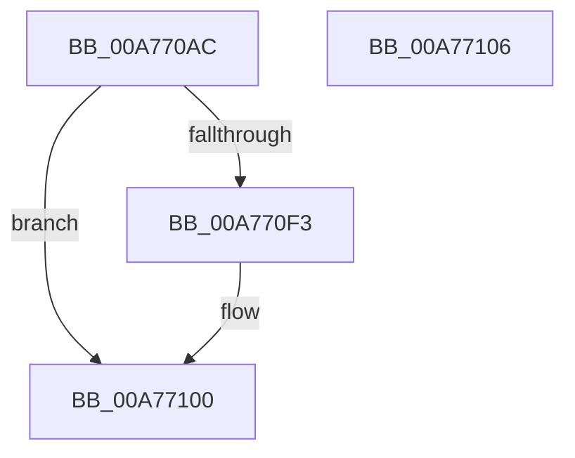

# SshpSessionManagerWriteBytes

- RVA: `0x00A770AC`–`0x00A77107` (길이 `91` bytes)
- VA: `0x0000000140A770AC`
- 실행 섹션: `PAGE`
- PDB 이름 있음: `예`; PDB Function 태그: `아니요`
- unwind 정보 RVA: `0x000B5DC4`
- 디코드: `28`개 명령, `91/91` bytes 표시
- 미해석 바이트: `0` (있으면 어셈블리에 `.byte`로 보존)

> 이 문서는 커널 이미지의 기계어와 PDB 기호를 분석해 생성했습니다. 4번과 5번은 함수 원형과 자료형을 바이너리 사용 방식에서 추정한 C 해석이며 원본 소스 복구 결과는 아닙니다.

## 1. Dependencies

- 직접 호출 지점: **1**; 고유 호출 대상: **1**
- 직접 호출자로 확인된 함수: **2**
- RIP 상대 이미지 참조: **0**

### Outgoing calls
- `0x00A770EA` → [ZwWriteFile](../../text/6A/ZwWriteFile_function_006AD1D0.md) (function, `0x006AD1D0`)

### Direct callers
- [SshpSessionManagerFlushControlEventBufferWorker](SshpSessionManagerFlushControlEventBufferWorker_function_00A76CC0.md) at `0x00A76F39`
- [SshpSessionManagerFlushControlEventBufferWorker](SshpSessionManagerFlushControlEventBufferWorker_function_00A76CC0.md) at `0x00A76F95`
- [sub_00B4173C](../B4/Unknown_function_00B4173C.md) at `0x00B41758`

### Static image references
- 디코드된 RIP-relative 메모리 참조가 없습니다.

## 2. Other-region calls and transfers

- 다른 실행 섹션으로 향하는 call: **1**
  - `0x00A770EA` → [ZwWriteFile](../../text/6A/ZwWriteFile_function_006AD1D0.md) (`PAGE` → `.text`)
- 별도 외부 분기/꼬리 이동을 확인하지 못했습니다.

## 3. Assembly (complete function range)

```asm
00A770AC  4C 8B DC                        mov r11, rsp
00A770AF  53                              push rbx
00A770B0  48 83 EC 70                     sub rsp, 0x70
00A770B4  49 83 63 C8 00                  and qword ptr [r11 - 0x38], 0
00A770B9  0F 57 C0                        xorps xmm0, xmm0
00A770BC  8B C2                           mov eax, edx
00A770BE  33 D2                           xor edx, edx
00A770C0  49 89 43 D8                     mov qword ptr [r11 - 0x28], rax
00A770C4  49 8D 43 D8                     lea rax, [r11 - 0x28]
00A770C8  49 89 43 C0                     mov qword ptr [r11 - 0x40], rax
00A770CC  49 8D 43 E0                     lea rax, [r11 - 0x20]
00A770D0  41 8B D9                        mov ebx, r9d
00A770D3  45 33 C9                        xor r9d, r9d
00A770D6  89 5C 24 30                     mov dword ptr [rsp + 0x30], ebx
00A770DA  4D 89 43 B0                     mov qword ptr [r11 - 0x50], r8
00A770DE  45 33 C0                        xor r8d, r8d
00A770E1  0F 11 44 24 58                  movups xmmword ptr [rsp + 0x58], xmm0
00A770E6  49 89 43 A8                     mov qword ptr [r11 - 0x58], rax
00A770EA  E8 E1 60 C3 FF                  call 0x1406ad1d0
00A770EF  85 C0                           test eax, eax
00A770F1  78 0D                           js 0x140a77100
00A770F3  48 39 5C 24 60                  cmp qword ptr [rsp + 0x60], rbx
00A770F8  BA 11 00 00 C0                  mov edx, 0xc0000011
00A770FD  0F 45 C2                        cmovne eax, edx
00A77100  48 83 C4 70                     add rsp, 0x70
00A77104  5B                              pop rbx
00A77105  C3                              ret
00A77106  CC                              int3
```

## 4. C-style interpretation (structured pseudocode)

```c
__int64 __fastcall SshpSessionManagerWriteBytes(__int64 a1, int a2, __int64 a3, int a4)
{
    __int64 result;
    __int64 v_rsp;
    unsigned __int64 v_stack_m18;
    unsigned __int64 v_stack_m20;
    unsigned int v_stack_m48;

    v_rsp = (v_rsp) - (112);
    a2 = 0;
    *(unsigned __int64 *)(v_rsp - 40) = (unsigned int)(a2);
    *(unsigned __int64 *)(v_rsp - 64) = v_rsp - 40;
    a4 = 0;
    v_stack_m48 = (unsigned int)((unsigned int)(a4));
    *(unsigned __int64 *)(v_rsp - 80) = a3;
    a3 = 0;
    v_stack_m20 = v_xmm0;
    *(unsigned __int64 *)(v_rsp - 88) = v_rsp - 32;
    result = ZwWriteFile(a1, a2, a3, a4);
    if (!(sign_flag)) {
        a2 = 0xC0000011ULL;
        if (v_stack_m18 != ((unsigned int)(a4))) { result = a2; }
    }
    v_rsp = (v_rsp) + (112);
    return result;
}
```

## 5. (Beta) C Style

```c
int64_t SshpSessionManagerWriteBytes(int64_t Arg1, int32_t Arg2, int64_t Arg3, int32_t Arg4)
{
    int64_t result;
    int64_t local_rsp;
    uint64_t v_stack_m18;
    uint64_t v_stack_m20;
    uint32_t v_stack_m48;

    local_rsp = (local_rsp) - (112);
    Arg2 = 0;
    *(uint64_t *)(local_rsp - 0x28) = (uint32_t)(Arg2);
    *(uint64_t *)(local_rsp - 0x40) = local_rsp - 40;
    Arg4 = 0;
    v_stack_m48 = (uint32_t)((uint32_t)(Arg4));
    *(uint64_t *)(local_rsp - 0x50) = Arg3;
    Arg3 = 0;
    v_stack_m20 = v_xmm0;
    *(uint64_t *)(local_rsp - 0x58) = local_rsp - 32;
    result = ZwWriteFile(Arg1, Arg2, Arg3, Arg4);
    if (!(sign_flag)) {
        Arg2 = 0xC0000011ULL;
        if (v_stack_m18 != ((uint32_t)(Arg4))) { result = Arg2; }
    }
    local_rsp = (local_rsp) + (112);
    return result;
}
```

## 6. Execution-region graph

[열기: 2D/3D 그래프와 함수 탐색 컨트롤 패널](../../../control-panel.html?section=page&rva=0x00A770AC&view=graph)

- 2D 그래프는 위에서 아래로 흐르고, 3D 그래프는 빈 공간을 드래그해 회전합니다. Shift+드래그는 이동, 휠은 확대·축소, 함수 노드 선택은 대상 보고서 이동입니다.

### Static fallback


