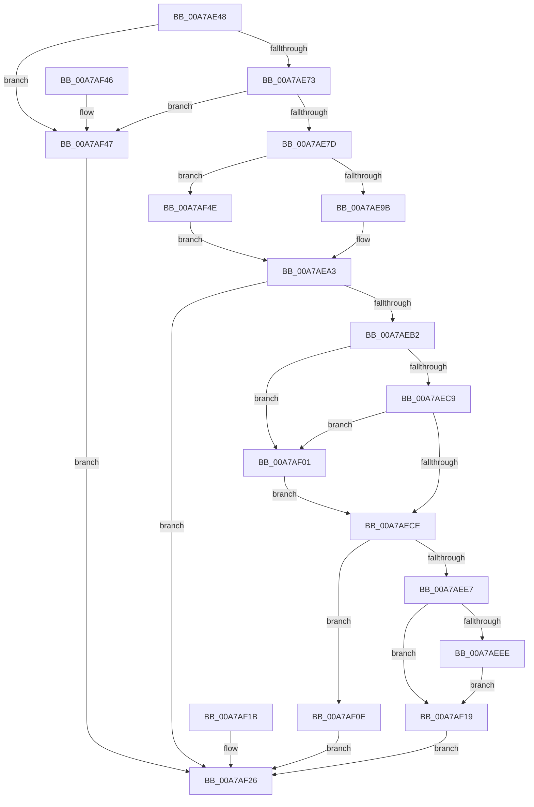

# sub_00A7AE48

- RVA: `0x00A7AE48`–`0x00A7AF58` (길이 `272` bytes)
- VA: `0x0000000140A7AE48`
- 실행 섹션: `PAGE`
- PDB 이름 있음: `아니요`; PDB Function 태그: `아니요`
- unwind 정보 RVA: `0x000B6528`
- 디코드: `75`개 명령, `272/272` bytes 표시
- 미해석 바이트: `0` (있으면 어셈블리에 `.byte`로 보존)

> 이 문서는 커널 이미지의 기계어와 PDB 기호를 분석해 생성했습니다. 4번과 5번은 함수 원형과 자료형을 바이너리 사용 방식에서 추정한 C 해석이며 원본 소스 복구 결과는 아닙니다.

## 1. Dependencies

- 직접 호출 지점: **3**; 고유 호출 대상: **2**
- 직접 호출자로 확인된 함수: **1**
- RIP 상대 이미지 참조: **0**

### Outgoing calls
- `0x00A7AE8D` → [ExAllocatePool2](../../poolcode/B8/ExAllocatePool2_function_00B820F0.md) (function, `0x00B820F0`)
- `0x00A7AEA5` → [PdcCloseEvent](../8D/PdcCloseEvent_function_008D2404.md) (function, `0x008D2404`)
- `0x00A7AF29` → [PdcCloseEvent](../8D/PdcCloseEvent_function_008D2404.md) (function, `0x008D2404`)

### Direct callers
- [sub_008D3420](../8D/Unknown_function_008D3420.md) at `0x008D3636`

### Static image references
- 디코드된 RIP-relative 메모리 참조가 없습니다.

## 2. Other-region calls and transfers

- 다른 실행 섹션으로 향하는 call: **1**
  - `0x00A7AE8D` → [ExAllocatePool2](../../poolcode/B8/ExAllocatePool2_function_00B820F0.md) (`PAGE` → `POOLCODE`)
- 별도 외부 분기/꼬리 이동을 확인하지 못했습니다.

## 3. Assembly (complete function range)

```asm
00A7AE48  48 8B C4                        mov rax, rsp
00A7AE4B  48 89 58 08                     mov qword ptr [rax + 8], rbx
00A7AE4F  48 89 70 10                     mov qword ptr [rax + 0x10], rsi
00A7AE53  48 89 78 18                     mov qword ptr [rax + 0x18], rdi
00A7AE57  41 56                           push r14
00A7AE59  48 83 EC 30                     sub rsp, 0x30
00A7AE5D  48 8B F2                        mov rsi, rdx
00A7AE60  4C 8B F1                        mov r14, rcx
00A7AE63  33 FF                           xor edi, edi
00A7AE65  48 89 78 20                     mov qword ptr [rax + 0x20], rdi
00A7AE69  41 83 F8 10                     cmp r8d, 0x10
00A7AE6D  0F 82 D4 00 00 00               jb 0x140a7af47
00A7AE73  48 83 3A 08                     cmp qword ptr [rdx], 8
00A7AE77  0F 85 CA 00 00 00               jne 0x140a7af47
00A7AE7D  33 DB                           xor ebx, ebx
00A7AE7F  8D 57 18                        lea edx, [rdi + 0x18]
00A7AE82  B9 00 01 00 00                  mov ecx, 0x100
00A7AE87  41 B8 57 41 52 42               mov r8d, 0x42524157
00A7AE8D  E8 5E 72 10 00                  call 0x140b820f0
00A7AE92  48 85 C0                        test rax, rax
00A7AE95  0F 84 B3 00 00 00               je 0x140a7af4e
00A7AE9B  48 8B F8                        mov rdi, rax
00A7AE9E  48 89 44 24 58                  mov qword ptr [rsp + 0x58], rax
00A7AEA3  33 C9                           xor ecx, ecx
00A7AEA5  E8 5A 75 E5 FF                  call 0x1408d2404
00A7AEAA  89 5C 24 24                     mov dword ptr [rsp + 0x24], ebx
00A7AEAE  85 DB                           test ebx, ebx
00A7AEB0  78 74                           js 0x140a7af26
00A7AEB2  48 8B 46 08                     mov rax, qword ptr [rsi + 8]
00A7AEB6  48 8D 48 18                     lea rcx, [rax + 0x18]
00A7AEBA  48 BA 00 00 FF FF FF 7F 00 00   movabs rdx, 0x7fffffff0000
00A7AEC4  48 3B CA                        cmp rcx, rdx
00A7AEC7  77 38                           ja 0x140a7af01
00A7AEC9  48 3B C8                        cmp rcx, rax
00A7AECC  72 33                           jb 0x140a7af01
00A7AECE  48 8B 46 08                     mov rax, qword ptr [rsi + 8]
00A7AED2  0F 10 00                        movups xmm0, xmmword ptr [rax]
00A7AED5  0F 11 07                        movups xmmword ptr [rdi], xmm0
00A7AED8  F2 0F 10 48 10                  movsd xmm1, qword ptr [rax + 0x10]
00A7AEDD  F2 0F 11 4F 10                  movsd qword ptr [rdi + 0x10], xmm1
00A7AEE2  83 3F 00                        cmp dword ptr [rdi], 0
00A7AEE5  75 27                           jne 0x140a7af0e
00A7AEE7  41 83 7E 38 00                  cmp dword ptr [r14 + 0x38], 0
00A7AEEC  74 2B                           je 0x140a7af19
00A7AEEE  8B 47 04                        mov eax, dword ptr [rdi + 4]
00A7AEF1  B9 3C 00 00 00                  mov ecx, 0x3c
00A7AEF6  3B C1                           cmp eax, ecx
00A7AEF8  0F 42 C8                        cmovb ecx, eax
00A7AEFB  41 89 4E 38                     mov dword ptr [r14 + 0x38], ecx
00A7AEFF  EB 18                           jmp 0x140a7af19
00A7AF01  8A 02                           mov al, byte ptr [rdx]
00A7AF03  48 8B 7C 24 58                  mov rdi, qword ptr [rsp + 0x58]
00A7AF08  8B 5C 24 24                     mov ebx, dword ptr [rsp + 0x24]
00A7AF0C  EB C0                           jmp 0x140a7aece
00A7AF0E  BB 0D 00 00 C0                  mov ebx, 0xc000000d
00A7AF13  89 5C 24 24                     mov dword ptr [rsp + 0x24], ebx
00A7AF17  EB 0D                           jmp 0x140a7af26
00A7AF19  EB 0B                           jmp 0x140a7af26
00A7AF1B  8B D8                           mov ebx, eax
00A7AF1D  89 44 24 24                     mov dword ptr [rsp + 0x24], eax
00A7AF21  48 8B 7C 24 58                  mov rdi, qword ptr [rsp + 0x58]
00A7AF26  48 8B CF                        mov rcx, rdi
00A7AF29  E8 D6 74 E5 FF                  call 0x1408d2404
00A7AF2E  8B C3                           mov eax, ebx
00A7AF30  48 8B 5C 24 40                  mov rbx, qword ptr [rsp + 0x40]
00A7AF35  48 8B 74 24 48                  mov rsi, qword ptr [rsp + 0x48]
00A7AF3A  48 8B 7C 24 50                  mov rdi, qword ptr [rsp + 0x50]
00A7AF3F  48 83 C4 30                     add rsp, 0x30
00A7AF43  41 5E                           pop r14
00A7AF45  C3                              ret
00A7AF46  CC                              int3
00A7AF47  BB 0D 00 00 C0                  mov ebx, 0xc000000d
00A7AF4C  EB D8                           jmp 0x140a7af26
00A7AF4E  BB 17 00 00 C0                  mov ebx, 0xc0000017
00A7AF53  E9 4B FF FF FF                  jmp 0x140a7aea3
```

## 4. C-style interpretation (structured pseudocode)

```c
__int64 __fastcall sub_00A7AE48(__int64 a1, __int64 a2, int a3)
{
    __int64 result;
    __int64 v_rbx;
    __int64 v_rdi;
    __int64 v_rsp;
    unsigned int v_stack_m14;
    unsigned __int64 v_stack_p10;
    unsigned __int64 v_stack_p18;
    unsigned __int64 v_stack_p20;
    unsigned __int64 v_stack_p8;

    *(unsigned __int64 *)(v_rsp + 8) = v_rbx;
    *(unsigned __int64 *)(v_rsp + 16) = v_rsi;
    *(unsigned __int64 *)(v_rsp + 24) = v_rdi;
    v_rsp = (v_rsp) - (48);
    v_rdi = 0;
    *(unsigned __int64 *)(v_rsp + 32) = 0;
    if (a3 < 16) goto loc_00A7AF47;
    if ((*(unsigned __int64 *)(a2)) != 8) goto loc_00A7AF47;
    v_rbx = 0;
    result = ExAllocatePool2(256, v_rdi + 24, (unsigned int)(0x42524157ULL), a4);
    if (result == 0) goto loc_00A7AF4E;
    v_stack_p20 = result;
loc_00A7AEA3:
    a1 = 0;
    result = PdcCloseEvent(a1, v_rdi + 24, (unsigned int)(0x42524157ULL), a4);
    v_stack_m14 = 0;
    if (sign_flag) goto loc_00A7AF26;
    if ((*(unsigned __int64 *)(a2 + 8) + 24) > (v_rdi + 24)) goto loc_00A7AF01;
    if ((*(unsigned __int64 *)(a2 + 8) + 24) < (*(unsigned __int64 *)(a2 + 8))) goto loc_00A7AF01;
loc_00A7AECE:
    *(unsigned __int64 *)(result) = v_xmm0;
    *(unsigned __int64 *)(result + 16) = v_xmm1;
    if ((*(unsigned int *)(result)) != 0) goto loc_00A7AF0E;
    if ((*(unsigned int *)(a1 + 56)) == 0) goto loc_00A7AF19;
    a1 = 60;
    if (((unsigned int)((unsigned int)(*(unsigned int *)(result + 4)))) < 60) { a1 = (unsigned int)((unsigned int)(*(unsigned int *)(result + 4))); }
    *(unsigned int *)(a1 + 56) = (unsigned int)(a1);
    goto loc_00A7AF19;
loc_00A7AF01:
    goto loc_00A7AECE;
loc_00A7AF0E:
    v_stack_m14 = (unsigned int)((unsigned int)(0xC000000DULL));
    goto loc_00A7AF26;
loc_00A7AF19:
    goto loc_00A7AF26;
loc_00A7AF26:
    result = PdcCloseEvent(v_stack_p20, v_rdi + 24, (unsigned int)(0x42524157ULL), a4);
    v_rsp = (v_rsp) + (48);
    return (unsigned int)((unsigned int)((unsigned int)(0xC000000DULL)));
loc_00A7AF47:
    goto loc_00A7AF26;
loc_00A7AF4E:
    goto loc_00A7AEA3;
}
```

## 5. (Beta) C Style

```c
int64_t sub_00A7AE48(void *Arg1, void *Arg2, int32_t Arg3)
{
    uint8_t *arg1 = (uint8_t *)Arg1;
    uint8_t *arg2 = (uint8_t *)Arg2;

    int64_t result;
    int64_t local_rbx;
    int64_t local_rdi;
    int64_t local_rsp;
    uint32_t v_stack_m14;
    uint64_t v_stack_p10;
    uint64_t v_stack_p18;
    uint64_t v_stack_p20;
    uint64_t v_stack_p8;

    *(uint64_t *)(local_rsp + 0x8) = local_rbx;
    *(uint64_t *)(local_rsp + 0x10) = local_rsi;
    *(uint64_t *)(local_rsp + 0x18) = local_rdi;
    local_rsp = (local_rsp) - (48);
    local_rdi = 0;
    *(uint64_t *)(local_rsp + 0x20) = 0;
    if (Arg3 < 16) goto loc_00A7AF47;
    if ((*(uint64_t *)(arg2)) != 8) goto loc_00A7AF47;
    local_rbx = 0;
    result = ExAllocatePool2(256, local_rdi + 24, (uint32_t)(0x42524157ULL), a4);
    if (result == 0) goto loc_00A7AF4E;
    v_stack_p20 = result;
loc_00A7AEA3:
    Arg1 = 0;
    result = PdcCloseEvent(Arg1, local_rdi + 24, (uint32_t)(0x42524157ULL), a4);
    v_stack_m14 = 0;
    if (sign_flag) goto loc_00A7AF26;
    if ((*(uint64_t *)(arg2 + 0x8) + 24) > (local_rdi + 24)) goto loc_00A7AF01;
    if ((*(uint64_t *)(arg2 + 0x8) + 24) < (*(uint64_t *)(arg2 + 0x8))) goto loc_00A7AF01;
loc_00A7AECE:
    *(uint64_t *)(result) = v_xmm0;
    *(uint64_t *)(result + 0x10) = v_xmm1;
    if ((*(uint32_t *)(result)) != 0) goto loc_00A7AF0E;
    if ((*(uint32_t *)(arg1 + 0x38)) == 0) goto loc_00A7AF19;
    Arg1 = 60;
    if (((uint32_t)((uint32_t)(*(uint32_t *)(result + 0x4)))) < 60) { Arg1 = (uint32_t)((uint32_t)(*(uint32_t *)(result + 0x4))); }
    *(uint32_t *)(arg1 + 0x38) = (uint32_t)(Arg1);
    goto loc_00A7AF19;
loc_00A7AF01:
    goto loc_00A7AECE;
loc_00A7AF0E:
    v_stack_m14 = (uint32_t)((uint32_t)(0xC000000DULL));
    goto loc_00A7AF26;
loc_00A7AF19:
    goto loc_00A7AF26;
loc_00A7AF26:
    result = PdcCloseEvent(v_stack_p20, local_rdi + 24, (uint32_t)(0x42524157ULL), a4);
    local_rsp = (local_rsp) + (48);
    return (uint32_t)((uint32_t)((uint32_t)(0xC000000DULL)));
loc_00A7AF47:
    goto loc_00A7AF26;
loc_00A7AF4E:
    goto loc_00A7AEA3;
}
```

### 관측된 메모리 오프셋

구조체 형식이 확인되지 않은 접근은 인자 기준의 오프셋으로만 기록했습니다.

| 기준 인자 | 오프셋 표현 | 폭 (bit) | 접근 |
|---|---:|---:|---|
| `Arg1` | `+ 0x38` | `32` | `R` |
| `Arg1` | `+ 0x38` | `32` | `W` |
| `Arg2` | `+ 0x0` | `64` | `R` |
| `Arg2` | `+ 0x8` | `64` | `R` |

## 6. Execution-region graph

[열기: 2D/3D 그래프와 함수 탐색 컨트롤 패널](../../../control-panel.html?section=page&rva=0x00A7AE48&view=graph)

- 2D 그래프는 위에서 아래로 흐르고, 3D 그래프는 빈 공간을 드래그해 회전합니다. Shift+드래그는 이동, 휠은 확대·축소, 함수 노드 선택은 대상 보고서 이동입니다.

### Static fallback


