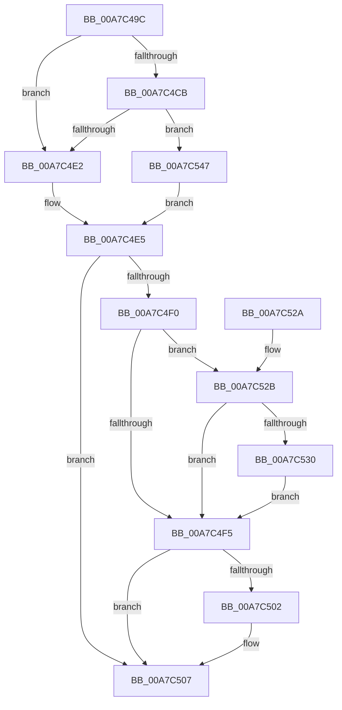

# sub_00A7C49C

- RVA: `0x00A7C49C`–`0x00A7C54E` (길이 `178` bytes)
- VA: `0x0000000140A7C49C`
- 실행 섹션: `PAGE`
- PDB 이름 있음: `아니요`; PDB Function 태그: `아니요`
- unwind 정보 RVA: `0x000B6880`
- 디코드: `58`개 명령, `178/178` bytes 표시
- 미해석 바이트: `0` (있으면 어셈블리에 `.byte`로 보존)

> 이 문서는 커널 이미지의 기계어와 PDB 기호를 분석해 생성했습니다. 4번과 5번은 함수 원형과 자료형을 바이너리 사용 방식에서 추정한 C 해석이며 원본 소스 복구 결과는 아닙니다.

## 1. Dependencies

- 직접 호출 지점: **5**; 고유 호출 대상: **3**
- 직접 호출자로 확인된 함수: **2**
- RIP 상대 이미지 참조: **0**

### Outgoing calls
- `0x00A7C4D8` → [ExAllocatePool2](../../poolcode/B8/ExAllocatePool2_function_00B820F0.md) (function, `0x00B820F0`)
- `0x00A7C4E7` → [PdcCloseEvent](../8D/PdcCloseEvent_function_008D2404.md) (function, `0x008D2404`)
- `0x00A7C4F8` → [PdcCloseEvent](../8D/PdcCloseEvent_function_008D2404.md) (function, `0x008D2404`)
- `0x00A7C50A` → [PdcCloseEvent](../8D/PdcCloseEvent_function_008D2404.md) (function, `0x008D2404`)
- `0x00A7C540` → [memcpy](../../text/6C/memcpy_function_006C6840.md) (function, `0x006C6840`)

### Direct callers
- [sub_00702150](../70/Unknown_function_00702150.md) at `0x007021C5`
- [sub_008D2B19](../8D/Unknown_function_008D2B19.md) at `0x008D2BED`

### Static image references
- 디코드된 RIP-relative 메모리 참조가 없습니다.

## 2. Other-region calls and transfers

- 다른 실행 섹션으로 향하는 call: **2**
  - `0x00A7C4D8` → [ExAllocatePool2](../../poolcode/B8/ExAllocatePool2_function_00B820F0.md) (`PAGE` → `POOLCODE`)
  - `0x00A7C540` → [memcpy](../../text/6C/memcpy_function_006C6840.md) (`PAGE` → `.text`)
- 별도 외부 분기/꼬리 이동을 확인하지 못했습니다.

## 3. Assembly (complete function range)

```asm
00A7C49C  48 89 5C 24 08                  mov qword ptr [rsp + 8], rbx
00A7C4A1  48 89 6C 24 10                  mov qword ptr [rsp + 0x10], rbp
00A7C4A6  48 89 74 24 18                  mov qword ptr [rsp + 0x18], rsi
00A7C4AB  57                              push rdi
00A7C4AC  41 56                           push r14
00A7C4AE  41 57                           push r15
00A7C4B0  48 83 EC 20                     sub rsp, 0x20
00A7C4B4  33 DB                           xor ebx, ebx
00A7C4B6  41 8B E8                        mov ebp, r8d
00A7C4B9  33 C0                           xor eax, eax
00A7C4BB  33 FF                           xor edi, edi
00A7C4BD  4D 8B F1                        mov r14, r9
00A7C4C0  44 8B FA                        mov r15d, edx
00A7C4C3  48 8B F1                        mov rsi, rcx
00A7C4C6  45 85 C0                        test r8d, r8d
00A7C4C9  74 17                           je 0x140a7c4e2
00A7C4CB  8B D5                           mov edx, ebp
00A7C4CD  B9 00 01 00 00                  mov ecx, 0x100
00A7C4D2  41 B8 57 41 52 42               mov r8d, 0x42524157
00A7C4D8  E8 13 5C 10 00                  call 0x140b820f0
00A7C4DD  48 85 C0                        test rax, rax
00A7C4E0  74 65                           je 0x140a7c547
00A7C4E2  48 8B D8                        mov rbx, rax
00A7C4E5  33 C9                           xor ecx, ecx
00A7C4E7  E8 18 5F E5 FF                  call 0x1408d2404
00A7C4EC  85 FF                           test edi, edi
00A7C4EE  78 17                           js 0x140a7c507
00A7C4F0  48 85 F6                        test rsi, rsi
00A7C4F3  75 36                           jne 0x140a7c52b
00A7C4F5  48 8B CE                        mov rcx, rsi
00A7C4F8  E8 07 5F E5 FF                  call 0x1408d2404
00A7C4FD  4D 85 F6                        test r14, r14
00A7C500  74 05                           je 0x140a7c507
00A7C502  49 89 1E                        mov qword ptr [r14], rbx
00A7C505  33 DB                           xor ebx, ebx
00A7C507  48 8B CB                        mov rcx, rbx
00A7C50A  E8 F5 5E E5 FF                  call 0x1408d2404
00A7C50F  48 8B 5C 24 40                  mov rbx, qword ptr [rsp + 0x40]
00A7C514  8B C7                           mov eax, edi
00A7C516  48 8B 6C 24 48                  mov rbp, qword ptr [rsp + 0x48]
00A7C51B  48 8B 74 24 50                  mov rsi, qword ptr [rsp + 0x50]
00A7C520  48 83 C4 20                     add rsp, 0x20
00A7C524  41 5F                           pop r15
00A7C526  41 5E                           pop r14
00A7C528  5F                              pop rdi
00A7C529  C3                              ret
00A7C52A  CC                              int3
00A7C52B  45 85 FF                        test r15d, r15d
00A7C52E  74 C5                           je 0x140a7c4f5
00A7C530  41 3B EF                        cmp ebp, r15d
00A7C533  48 8B D6                        mov rdx, rsi
00A7C536  48 8B CB                        mov rcx, rbx
00A7C539  41 0F 43 EF                     cmovae ebp, r15d
00A7C53D  44 8B C5                        mov r8d, ebp
00A7C540  E8 FB A2 C4 FF                  call 0x1406c6840
00A7C545  EB AE                           jmp 0x140a7c4f5
00A7C547  BF 17 00 00 C0                  mov edi, 0xc0000017
00A7C54C  EB 97                           jmp 0x140a7c4e5
```

## 4. C-style interpretation (structured pseudocode)

```c
__int64 __fastcall sub_00A7C49C(__int64 a1, int a2, int a3, __int64 a4)
{
    __int64 result;
    __int64 v_rbp;
    __int64 v_rbx;
    __int64 v_rdi;
    __int64 v_rsp;
    unsigned __int64 v_stack_p10;
    unsigned __int64 v_stack_p18;
    unsigned __int64 v_stack_p8;

    v_stack_p8 = v_rbx;
    v_stack_p10 = v_rbp;
    v_stack_p18 = v_rsi;
    v_rsp = (v_rsp) - (32);
    v_rbx = 0;
    result = 0;
    v_rdi = 0;
    if (a3 == 0) goto loc_00A7C4E2;
    result = ExAllocatePool2(256, (unsigned int)((unsigned int)((unsigned int)(a3))), (unsigned int)(0x42524157ULL), a4);
    if (result == 0) goto loc_00A7C547;
loc_00A7C4E2:
loc_00A7C4E5:
    a1 = 0;
    result = PdcCloseEvent(a1, (unsigned int)((unsigned int)((unsigned int)(a3))), (unsigned int)(0x42524157ULL), a4);
    if (sign_flag) goto loc_00A7C507;
    if (0 != 0) goto loc_00A7C52B;
loc_00A7C4F5:
    result = PdcCloseEvent(0, (unsigned int)((unsigned int)((unsigned int)(a3))), (unsigned int)(0x42524157ULL), a4);
    v_rbx = result;
    if (a4 != 0) {
        *(unsigned __int64 *)(a4) = result;
        v_rbx = 0;
    }
    result = PdcCloseEvent(0, (unsigned int)((unsigned int)((unsigned int)(a3))), (unsigned int)(0x42524157ULL), a4);
    v_rsp = (v_rsp) + (32);
    return 0;
loc_00A7C52B:
    if ((unsigned int)((unsigned int)(a2)) == 0) goto loc_00A7C4F5;
    v_rbp = v_stack_p10;
    if (((unsigned int)(v_stack_p10)) >= ((unsigned int)((unsigned int)(a2)))) { v_rbp = (unsigned int)((unsigned int)(a2)); }
    result = memcpy(v_stack_p8, v_stack_p18, (unsigned int)((unsigned int)(v_rbp)), a4);
    goto loc_00A7C4F5;
loc_00A7C547:
    goto loc_00A7C4E5;
}
```

## 5. (Beta) C Style

```c
int64_t sub_00A7C49C(int64_t Arg1, int32_t Arg2, int32_t Arg3, int64_t Arg4)
{
    int64_t result;
    int64_t local_rbp;
    int64_t local_rbx;
    int64_t local_rdi;
    int64_t local_rsp;
    uint64_t v_stack_p10;
    uint64_t v_stack_p18;
    uint64_t v_stack_p8;

    v_stack_p8 = local_rbx;
    v_stack_p10 = local_rbp;
    v_stack_p18 = local_rsi;
    local_rsp = (local_rsp) - (32);
    local_rbx = 0;
    result = 0;
    local_rdi = 0;
    if (Arg3 == 0) goto loc_00A7C4E2;
    result = ExAllocatePool2(256, (uint32_t)((uint32_t)((uint32_t)(Arg3))), (uint32_t)(0x42524157ULL), Arg4);
    if (result == 0) goto loc_00A7C547;
loc_00A7C4E2:
loc_00A7C4E5:
    Arg1 = 0;
    result = PdcCloseEvent(Arg1, (uint32_t)((uint32_t)((uint32_t)(Arg3))), (uint32_t)(0x42524157ULL), Arg4);
    if (sign_flag) goto loc_00A7C507;
    if (0 != 0) goto loc_00A7C52B;
loc_00A7C4F5:
    result = PdcCloseEvent(0, (uint32_t)((uint32_t)((uint32_t)(Arg3))), (uint32_t)(0x42524157ULL), Arg4);
    local_rbx = result;
    if (Arg4 != 0) {
        *(uint64_t *)(Arg4) = result;
        local_rbx = 0;
    }
    result = PdcCloseEvent(0, (uint32_t)((uint32_t)((uint32_t)(Arg3))), (uint32_t)(0x42524157ULL), Arg4);
    local_rsp = (local_rsp) + (32);
    return 0;
loc_00A7C52B:
    if ((uint32_t)((uint32_t)(Arg2)) == 0) goto loc_00A7C4F5;
    local_rbp = v_stack_p10;
    if (((uint32_t)(v_stack_p10)) >= ((uint32_t)((uint32_t)(Arg2)))) { local_rbp = (uint32_t)((uint32_t)(Arg2)); }
    result = memcpy(v_stack_p8, v_stack_p18, (uint32_t)((uint32_t)(local_rbp)), Arg4);
    goto loc_00A7C4F5;
loc_00A7C547:
    goto loc_00A7C4E5;
}
```

## 6. Execution-region graph

[열기: 2D/3D 그래프와 함수 탐색 컨트롤 패널](../../../control-panel.html?section=page&rva=0x00A7C49C&view=graph)

- 2D 그래프는 위에서 아래로 흐르고, 3D 그래프는 빈 공간을 드래그해 회전합니다. Shift+드래그는 이동, 휠은 확대·축소, 함수 노드 선택은 대상 보고서 이동입니다.

### Static fallback


