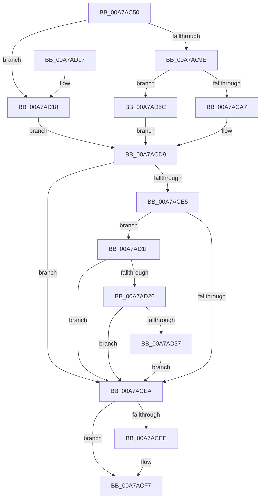

# VmDeleteMemoryRange

- RVA: `0x00A7AC50`–`0x00A7AD66` (길이 `278` bytes)
- VA: `0x0000000140A7AC50`
- 실행 섹션: `PAGE`
- PDB 이름 있음: `예`; PDB Function 태그: `아니요`
- unwind 정보 RVA: `0x000B64EC`
- 디코드: `80`개 명령, `278/278` bytes 표시
- 미해석 바이트: `0` (있으면 어셈블리에 `.byte`로 보존)

> 이 문서는 커널 이미지의 기계어와 PDB 기호를 분석해 생성했습니다. 4번과 5번은 함수 원형과 자료형을 바이너리 사용 방식에서 추정한 C 해석이며 원본 소스 복구 결과는 아닙니다.

## 1. Dependencies

- 직접 호출 지점: **5**; 고유 호출 대상: **5**
- 직접 호출자로 확인된 함수: **0**
- RIP 상대 이미지 참조: **1**

### Outgoing calls
- `0x00A7AC95` → [VmpValidateMemoryRangeParameters](VmpValidateMemoryRangeParameters_function_00A7AD6C.md) (function, `0x00A7AD6C`)
- `0x00A7ACAE` → [FsRtlAcquirePushLockExclusive](../../text/4A/FsRtlAcquirePushLockExclusive_function_004A05F4.md) (function, `0x004A05F4`)
- `0x00A7ACCC` → [VmpRemoveMemoryRange](../../text/48/VmpRemoveMemoryRange_function_00489018.md) (function, `0x00489018`)
- `0x00A7ACF2` → [PfLockExclusiveRelease](../../text/49/PfLockExclusiveRelease_function_00491D88.md) (function, `0x00491D88`)
- `0x00A7AD55` → [VmpLogCreateDeleteMemoryRange](../7A/VmpLogCreateDeleteMemoryRange_function_007AE428.md) (function, `0x007AE428`)

### Direct callers
- 이 함수 시작 RVA로 연결되는 직접 call은 확인되지 않았습니다. 간접 호출은 완전히 역산할 수 없습니다.

### Static image references
- `0x00A7ACD9` → RVA `0x00F02458` (`.data`; read)

## 2. Other-region calls and transfers

- 다른 실행 섹션으로 향하는 call: **3**
  - `0x00A7ACAE` → [FsRtlAcquirePushLockExclusive](../../text/4A/FsRtlAcquirePushLockExclusive_function_004A05F4.md) (`PAGE` → `.text`)
  - `0x00A7ACCC` → [VmpRemoveMemoryRange](../../text/48/VmpRemoveMemoryRange_function_00489018.md) (`PAGE` → `.text`)
  - `0x00A7ACF2` → [PfLockExclusiveRelease](../../text/49/PfLockExclusiveRelease_function_00491D88.md) (`PAGE` → `.text`)
- 별도 외부 분기/꼬리 이동을 확인하지 못했습니다.

## 3. Assembly (complete function range)

```asm
00A7AC50  48 89 5C 24 08                  mov qword ptr [rsp + 8], rbx
00A7AC55  48 89 6C 24 10                  mov qword ptr [rsp + 0x10], rbp
00A7AC5A  48 89 74 24 18                  mov qword ptr [rsp + 0x18], rsi
00A7AC5F  57                              push rdi
00A7AC60  41 54                           push r12
00A7AC62  41 55                           push r13
00A7AC64  41 56                           push r14
00A7AC66  41 57                           push r15
00A7AC68  48 83 EC 40                     sub rsp, 0x40
00A7AC6C  65 48 8B 04 25 88 01 00 00      mov rax, qword ptr gs:[0x188]
00A7AC75  45 33 ED                        xor r13d, r13d
00A7AC78  49 8B E9                        mov rbp, r9
00A7AC7B  4D 8B F0                        mov r14, r8
00A7AC7E  4C 8B FA                        mov r15, rdx
00A7AC81  4C 8B E1                        mov r12, rcx
00A7AC84  41 8B F5                        mov esi, r13d
00A7AC87  4C 8B 90 B8 00 00 00            mov r10, qword ptr [rax + 0xb8]
00A7AC8E  49 8B BA 70 06 00 00            mov rdi, qword ptr [r10 + 0x670]
00A7AC95  E8 D2 00 00 00                  call 0x140a7ad6c
00A7AC9A  85 C0                           test eax, eax
00A7AC9C  75 7A                           jne 0x140a7ad18
00A7AC9E  48 85 FF                        test rdi, rdi
00A7ACA1  0F 84 B5 00 00 00               je 0x140a7ad5c
00A7ACA7  48 8D 4F 78                     lea rcx, [rdi + 0x78]
00A7ACAB  8D 70 01                        lea esi, [rax + 1]
00A7ACAE  E8 41 59 A2 FF                  call 0x1404a05f4
00A7ACB3  4D 8B C4                        mov r8, r12
00A7ACB6  48 89 6C 24 20                  mov qword ptr [rsp + 0x20], rbp
00A7ACBB  49 8B D7                        mov rdx, r15
00A7ACBE  49 C1 E8 0C                     shr r8, 0xc
00A7ACC2  48 C1 EA 0C                     shr rdx, 0xc
00A7ACC6  4D 8B CE                        mov r9, r14
00A7ACC9  48 8B CF                        mov rcx, rdi
00A7ACCC  E8 47 E3 A0 FF                  call 0x140489018
00A7ACD1  85 C0                           test eax, eax
00A7ACD3  8B D8                           mov ebx, eax
00A7ACD5  41 0F 49 DD                     cmovns ebx, r13d
00A7ACD9  48 8B 0D 78 77 48 00            mov rcx, qword ptr [rip + 0x487778]
00A7ACE0  48 85 C9                        test rcx, rcx
00A7ACE3  74 05                           je 0x140a7acea
00A7ACE5  44 39 29                        cmp dword ptr [rcx], r13d
00A7ACE8  77 35                           ja 0x140a7ad1f
00A7ACEA  85 F6                           test esi, esi
00A7ACEC  74 09                           je 0x140a7acf7
00A7ACEE  48 8D 4F 78                     lea rcx, [rdi + 0x78]
00A7ACF2  E8 91 70 A1 FF                  call 0x140491d88
00A7ACF7  4C 8D 5C 24 40                  lea r11, [rsp + 0x40]
00A7ACFC  8B C3                           mov eax, ebx
00A7ACFE  49 8B 5B 30                     mov rbx, qword ptr [r11 + 0x30]
00A7AD02  49 8B 6B 38                     mov rbp, qword ptr [r11 + 0x38]
00A7AD06  49 8B 73 40                     mov rsi, qword ptr [r11 + 0x40]
00A7AD0A  49 8B E3                        mov rsp, r11
00A7AD0D  41 5F                           pop r15
00A7AD0F  41 5E                           pop r14
00A7AD11  41 5D                           pop r13
00A7AD13  41 5C                           pop r12
00A7AD15  5F                              pop rdi
00A7AD16  C3                              ret
00A7AD17  CC                              int3
00A7AD18  BB 0D 00 00 C0                  mov ebx, 0xc000000d
00A7AD1D  EB BA                           jmp 0x140a7acd9
00A7AD1F  8A 41 10                        mov al, byte ptr [rcx + 0x10]
00A7AD22  84 C0                           test al, al
00A7AD24  79 C4                           jns 0x140a7acea
00A7AD26  48 8B 49 18                     mov rcx, qword ptr [rcx + 0x18]
00A7AD2A  48 8B C1                        mov rax, rcx
00A7AD2D  25 80 00 00 00                  and eax, 0x80
00A7AD32  48 3B C1                        cmp rax, rcx
00A7AD35  75 B3                           jne 0x140a7acea
00A7AD37  89 5C 24 38                     mov dword ptr [rsp + 0x38], ebx
00A7AD3B  4D 8B CF                        mov r9, r15
00A7AD3E  48 89 6C 24 30                  mov qword ptr [rsp + 0x30], rbp
00A7AD43  4D 8B C4                        mov r8, r12
00A7AD46  4C 89 6C 24 28                  mov qword ptr [rsp + 0x28], r13
00A7AD4B  BA 01 00 00 00                  mov edx, 1
00A7AD50  4C 89 74 24 20                  mov qword ptr [rsp + 0x20], r14
00A7AD55  E8 CE 36 D3 FF                  call 0x1407ae428
00A7AD5A  EB 8E                           jmp 0x140a7acea
00A7AD5C  BB 88 00 00 C0                  mov ebx, 0xc0000088
00A7AD61  E9 73 FF FF FF                  jmp 0x140a7acd9
```

## 4. C-style interpretation (structured pseudocode)

```c
__int64 __fastcall VmDeleteMemoryRange(__int64 a1, __int64 a2, __int64 a3, __int64 a4)
{
    __int64 result;
    __int64 v_r13;
    __int64 v_rbx;
    __int64 v_rsp;
    unsigned __int64 v_stack_m10;
    unsigned __int64 v_stack_m18;
    unsigned __int64 v_stack_m20;
    unsigned __int64 v_stack_m28;
    unsigned __int64 v_stack_m48;
    unsigned int v_stack_m8;
    unsigned __int64 v_stack_p10;
    unsigned __int64 v_stack_p18;
    unsigned __int64 v_stack_p8;

    v_stack_p8 = v_rbx;
    v_stack_p10 = v_rbp;
    v_stack_p18 = v_rsi;
    v_rsp = (v_rsp) - (64);
    v_r13 = 0;
    result = VmpValidateMemoryRangeParameters(a1, a2, a3, a4);
    if ((unsigned int)(result) != 0) goto loc_00A7AD18;
    if (*(unsigned __int64 *)(*(unsigned __int64 *)(*(unsigned __int64 *)(gs_base + (0 + 392)) + 184) + 1648) == 0) goto loc_00A7AD5C;
    result = FsRtlAcquirePushLockExclusive(*(unsigned __int64 *)(*(unsigned __int64 *)(*(unsigned __int64 *)(gs_base + (0 + 392)) + 184) + 1648) + 120, a2, a3, a4);
    v_stack_m48 = a4;
    a3 = (a1) >> (12);
    a2 = (a2) >> (12);
    result = VmpRemoveMemoryRange(*(unsigned __int64 *)(*(unsigned __int64 *)(*(unsigned __int64 *)(gs_base + (0 + 392)) + 184) + 1648), a2, a3, a3);
    v_rbx = (unsigned int)((unsigned int)(result));
    if (!sign_flag) { v_rbx = 0; }
loc_00A7ACD9:
    if (*(unsigned __int64 *)(v_rip + 4749176) == 0) goto loc_00A7ACEA;
    if ((*(unsigned int *)(*(unsigned __int64 *)(v_rip + 4749176))) > 0) goto loc_00A7AD1F;
loc_00A7ACEA:
    if ((unsigned int)(result + 1) != 0) {
        a1 = *(unsigned __int64 *)(*(unsigned __int64 *)(*(unsigned __int64 *)(gs_base + (0 + 392)) + 184) + 1648) + 120;
        result = PfLockExclusiveRelease(a1, a2, a3, a3);
    }
    return (unsigned int)((unsigned int)(v_rbx));
loc_00A7AD18:
    goto loc_00A7ACD9;
loc_00A7AD1F:
    if (!sign_flag) goto loc_00A7ACEA;
    result = (unsigned int)((*(unsigned __int64 *)(a1 + 24)) & (128));
    if (result != (*(unsigned __int64 *)(a1 + 24))) goto loc_00A7ACEA;
    v_stack_m8 = (unsigned int)((unsigned int)(0xC000000DULL));
    v_stack_m10 = *(unsigned __int64 *)(v_stack_m28 + 56);
    v_stack_m18 = 0;
    v_stack_m20 = a3;
    result = VmpLogCreateDeleteMemoryRange(*(unsigned __int64 *)(a1 + 24), 1, a1, a2);
    goto loc_00A7ACEA;
loc_00A7AD5C:
    goto loc_00A7ACD9;
}
```

## 5. (Beta) C Style

```c
int64_t VmDeleteMemoryRange(int64_t Arg1, int64_t Arg2, int64_t Arg3, int64_t Arg4)
{
    int64_t result;
    int64_t local_r13;
    int64_t local_rbx;
    int64_t local_rsp;
    uint64_t v_stack_m10;
    uint64_t v_stack_m18;
    uint64_t v_stack_m20;
    uint64_t v_stack_m28;
    uint64_t v_stack_m48;
    uint32_t v_stack_m8;
    uint64_t v_stack_p10;
    uint64_t v_stack_p18;
    uint64_t v_stack_p8;

    v_stack_p8 = local_rbx;
    v_stack_p10 = local_rbp;
    v_stack_p18 = local_rsi;
    local_rsp = (local_rsp) - (64);
    local_r13 = 0;
    result = VmpValidateMemoryRangeParameters(Arg1, Arg2, Arg3, Arg4);
    if ((uint32_t)(result) != 0) goto loc_00A7AD18;
    if (*(uint64_t *)(*(uint64_t *)(*(uint64_t *)(gs_base + (0 + 0x188)) + 0xB8) + 0x670) == 0) goto loc_00A7AD5C;
    result = FsRtlAcquirePushLockExclusive(*(uint64_t *)(*(uint64_t *)(*(uint64_t *)(gs_base + (0 + 0x188)) + 0xB8) + 0x670) + 120, Arg2, Arg3, Arg4);
    v_stack_m48 = Arg4;
    Arg3 = (Arg1) >> (12);
    Arg2 = (Arg2) >> (12);
    result = VmpRemoveMemoryRange(*(uint64_t *)(*(uint64_t *)(*(uint64_t *)(gs_base + (0 + 0x188)) + 0xB8) + 0x670), Arg2, Arg3, Arg3);
    local_rbx = (uint32_t)((uint32_t)(result));
    if (!sign_flag) { local_rbx = 0; }
loc_00A7ACD9:
    if (*(uint64_t *)(v_rip + 0x487778) == 0) goto loc_00A7ACEA;
    if ((*(uint32_t *)(*(uint64_t *)(v_rip + 0x487778))) > 0) goto loc_00A7AD1F;
loc_00A7ACEA:
    if ((uint32_t)(result + 1) != 0) {
        Arg1 = *(uint64_t *)(*(uint64_t *)(*(uint64_t *)(gs_base + (0 + 0x188)) + 0xB8) + 0x670) + 120;
        result = PfLockExclusiveRelease(Arg1, Arg2, Arg3, Arg3);
    }
    return (uint32_t)((uint32_t)(local_rbx));
loc_00A7AD18:
    goto loc_00A7ACD9;
loc_00A7AD1F:
    if (!sign_flag) goto loc_00A7ACEA;
    result = (uint32_t)((*(uint64_t *)(Arg1 + 0x18)) & (128));
    if (result != (*(uint64_t *)(Arg1 + 0x18))) goto loc_00A7ACEA;
    v_stack_m8 = (uint32_t)((uint32_t)(0xC000000DULL));
    v_stack_m10 = *(uint64_t *)(v_stack_m28 + 0x38);
    v_stack_m18 = 0;
    v_stack_m20 = Arg3;
    result = VmpLogCreateDeleteMemoryRange(*(uint64_t *)(Arg1 + 0x18), 1, Arg1, Arg2);
    goto loc_00A7ACEA;
loc_00A7AD5C:
    goto loc_00A7ACD9;
}
```

## 6. Execution-region graph

[열기: 2D/3D 그래프와 함수 탐색 컨트롤 패널](../../../control-panel.html?section=page&rva=0x00A7AC50&view=graph)

- 2D 그래프는 위에서 아래로 흐르고, 3D 그래프는 빈 공간을 드래그해 회전합니다. Shift+드래그는 이동, 휠은 확대·축소, 함수 노드 선택은 대상 보고서 이동입니다.

### Static fallback


