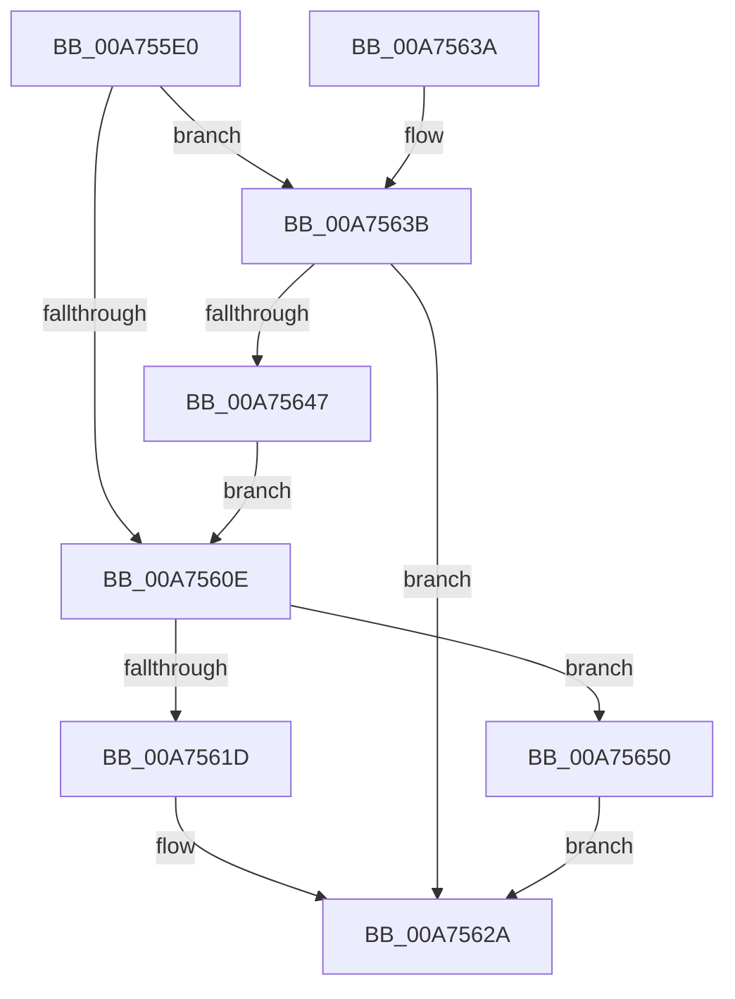

# VmPreallocateForRangeCreate

- RVA: `0x00A755E0`–`0x00A75657` (길이 `119` bytes)
- VA: `0x0000000140A755E0`
- 실행 섹션: `PAGE`
- PDB 이름 있음: `예`; PDB Function 태그: `아니요`
- unwind 정보 RVA: `0x0006F908`
- 디코드: `32`개 명령, `119/119` bytes 표시
- 미해석 바이트: `0` (있으면 어셈블리에 `.byte`로 보존)

> 이 문서는 커널 이미지의 기계어와 PDB 기호를 분석해 생성했습니다. 4번과 5번은 함수 원형과 자료형을 바이너리 사용 방식에서 추정한 C 해석이며 원본 소스 복구 결과는 아닙니다.

## 1. Dependencies

- 직접 호출 지점: **2**; 고유 호출 대상: **2**
- 직접 호출자로 확인된 함수: **0**
- RIP 상대 이미지 참조: **0**

### Outgoing calls
- `0x00A75613` → [VmpAllocateMemoryRanges](VmpAllocateMemoryRanges_function_00A75660.md) (function, `0x00A75660`)
- `0x00A7563E` → [VmpProcessContextSetup](../7A/VmpProcessContextSetup_function_007ADDC0.md) (function, `0x007ADDC0`)

### Direct callers
- 이 함수 시작 RVA로 연결되는 직접 call은 확인되지 않았습니다. 간접 호출은 완전히 역산할 수 없습니다.

### Static image references
- 디코드된 RIP-relative 메모리 참조가 없습니다.

## 2. Other-region calls and transfers

- 다른 실행 섹션으로 향하는 call: **0**
- 별도 외부 분기/꼬리 이동을 확인하지 못했습니다.

## 3. Assembly (complete function range)

```asm
00A755E0  48 89 5C 24 08                  mov qword ptr [rsp + 8], rbx
00A755E5  48 89 74 24 10                  mov qword ptr [rsp + 0x10], rsi
00A755EA  57                              push rdi
00A755EB  48 83 EC 20                     sub rsp, 0x20
00A755EF  65 48 8B 04 25 88 01 00 00      mov rax, qword ptr gs:[0x188]
00A755F8  48 8B F1                        mov rsi, rcx
00A755FB  48 8B B8 B8 00 00 00            mov rdi, qword ptr [rax + 0xb8]
00A75602  48 8B 9F 70 06 00 00            mov rbx, qword ptr [rdi + 0x670]
00A75609  48 85 DB                        test rbx, rbx
00A7560C  74 2D                           je 0x140a7563b
00A7560E  B9 01 00 00 00                  mov ecx, 1
00A75613  E8 48 00 00 00                  call 0x140a75660
00A75618  48 85 C0                        test rax, rax
00A7561B  74 33                           je 0x140a75650
00A7561D  F0 48 FF 43 70                  lock inc qword ptr [rbx + 0x70]
00A75622  48 33 C3                        xor rax, rbx
00A75625  48 89 06                        mov qword ptr [rsi], rax
00A75628  33 C0                           xor eax, eax
00A7562A  48 8B 5C 24 30                  mov rbx, qword ptr [rsp + 0x30]
00A7562F  48 8B 74 24 38                  mov rsi, qword ptr [rsp + 0x38]
00A75634  48 83 C4 20                     add rsp, 0x20
00A75638  5F                              pop rdi
00A75639  C3                              ret
00A7563A  CC                              int3
00A7563B  48 8B CA                        mov rcx, rdx
00A7563E  E8 7D 87 D3 FF                  call 0x1407addc0
00A75643  85 C0                           test eax, eax
00A75645  78 E3                           js 0x140a7562a
00A75647  48 8B 9F 70 06 00 00            mov rbx, qword ptr [rdi + 0x670]
00A7564E  EB BE                           jmp 0x140a7560e
00A75650  B8 9A 00 00 C0                  mov eax, 0xc000009a
00A75655  EB D3                           jmp 0x140a7562a
```

## 4. C-style interpretation (structured pseudocode)

```c
__int64 __fastcall VmPreallocateForRangeCreate(__int64 a1, __int64 a2)
{
    __int64 result;
    __int64 v_rsp;
    unsigned __int64 v_stack_p10;
    unsigned __int64 v_stack_p8;

    v_stack_p8 = v_rbx;
    v_stack_p10 = v_rsi;
    v_rsp = (v_rsp) - (32);
    if (*(unsigned __int64 *)(*(unsigned __int64 *)(*(unsigned __int64 *)(gs_base + (0 + 392)) + 184) + 1648) == 0) goto loc_00A7563B;
loc_00A7560E:
    result = VmpAllocateMemoryRanges(1, a2, a3, a4);
    if (result == 0) goto loc_00A75650;
    result = (result) ^ (*(unsigned __int64 *)(*(unsigned __int64 *)(*(unsigned __int64 *)(gs_base + (0 + 392)) + 184) + 1648));
    *(unsigned __int64 *)(a1) = result;
    result = 0;
loc_00A7562A:
    v_rsp = (v_rsp) + (32);
    return result;
loc_00A7563B:
    result = VmpProcessContextSetup(a2, a2, a3, a4);
    if (sign_flag) goto loc_00A7562A;
    goto loc_00A7560E;
loc_00A75650:
    goto loc_00A7562A;
}
```

## 5. (Beta) C Style

```c
int64_t VmPreallocateForRangeCreate(void *Arg1, int64_t Arg2)
{
    uint8_t *arg1 = (uint8_t *)Arg1;

    int64_t result;
    int64_t local_rsp;
    uint64_t v_stack_p10;
    uint64_t v_stack_p8;

    v_stack_p8 = local_rbx;
    v_stack_p10 = local_rsi;
    local_rsp = (local_rsp) - (32);
    if (*(uint64_t *)(*(uint64_t *)(*(uint64_t *)(gs_base + (0 + 0x188)) + 0xB8) + 0x670) == 0) goto loc_00A7563B;
loc_00A7560E:
    result = VmpAllocateMemoryRanges(1, Arg2, a3, a4);
    if (result == 0) goto loc_00A75650;
    result = (result) ^ (*(uint64_t *)(*(uint64_t *)(*(uint64_t *)(gs_base + (0 + 0x188)) + 0xB8) + 0x670));
    *(uint64_t *)(arg1) = result;
    result = 0;
loc_00A7562A:
    local_rsp = (local_rsp) + (32);
    return result;
loc_00A7563B:
    result = VmpProcessContextSetup(Arg2, Arg2, a3, a4);
    if (sign_flag) goto loc_00A7562A;
    goto loc_00A7560E;
loc_00A75650:
    goto loc_00A7562A;
}
```

### 관측된 메모리 오프셋

구조체 형식이 확인되지 않은 접근은 인자 기준의 오프셋으로만 기록했습니다.

| 기준 인자 | 오프셋 표현 | 폭 (bit) | 접근 |
|---|---:|---:|---|
| `Arg1` | `+ 0x0` | `64` | `W` |

## 6. Execution-region graph

[열기: 2D/3D 그래프와 함수 탐색 컨트롤 패널](../../../control-panel.html?section=page&rva=0x00A755E0&view=graph)

- 2D 그래프는 위에서 아래로 흐르고, 3D 그래프는 빈 공간을 드래그해 회전합니다. Shift+드래그는 이동, 휠은 확대·축소, 함수 노드 선택은 대상 보고서 이동입니다.

### Static fallback


