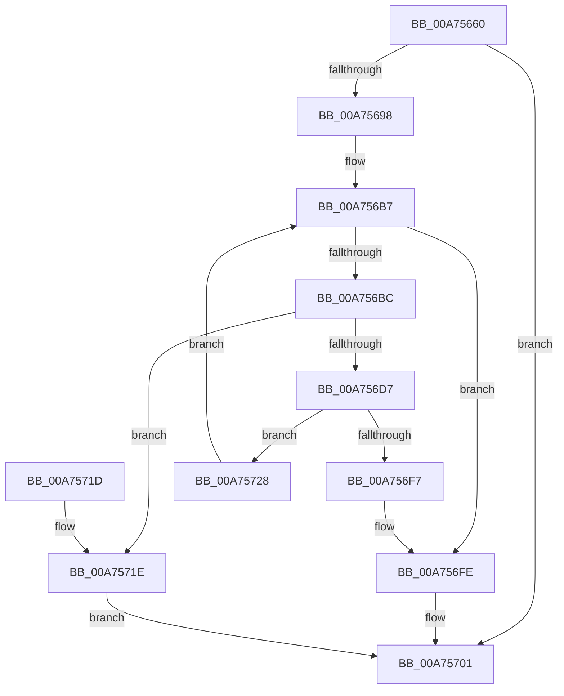

# VmpAllocateMemoryRanges

- RVA: `0x00A75660`–`0x00A7573E` (길이 `222` bytes)
- VA: `0x0000000140A75660`
- 실행 섹션: `PAGE`
- PDB 이름 있음: `예`; PDB Function 태그: `아니요`
- unwind 정보 RVA: `0x000B59B0`
- 디코드: `66`개 명령, `222/222` bytes 표시
- 미해석 바이트: `0` (있으면 어셈블리에 `.byte`로 보존)

> 이 문서는 커널 이미지의 기계어와 PDB 기호를 분석해 생성했습니다. 4번과 5번은 함수 원형과 자료형을 바이너리 사용 방식에서 추정한 C 해석이며 원본 소스 복구 결과는 아닙니다.

## 1. Dependencies

- 직접 호출 지점: **5**; 고유 호출 대상: **3**
- 직접 호출자로 확인된 함수: **3**
- RIP 상대 이미지 참조: **0**

### Outgoing calls
- `0x00A7568B` → [ExAllocatePool2](../../poolcode/B8/ExAllocatePool2_function_00B820F0.md) (function, `0x00B820F0`)
- `0x00A756A0` → [memset](../../text/6C/memset_function_006C6C40.md) (function, `0x006C6C40`)
- `0x00A756CA` → [ExAllocatePool2](../../poolcode/B8/ExAllocatePool2_function_00B820F0.md) (function, `0x00B820F0`)
- `0x00A756E0` → [memset](../../text/6C/memset_function_006C6C40.md) (function, `0x006C6C40`)
- `0x00A75721` → [VmpFreeMemoryRanges](VmpFreeMemoryRanges_function_00A75744.md) (function, `0x00A75744`)

### Direct callers
- [VmpSplitMemoryRange](../../text/42/VmpSplitMemoryRange_function_00429754.md) at `0x00429814`
- [VmCreateMemoryRange](../7A/VmCreateMemoryRange_function_007AD1D0.md) at `0x007AD2B4`
- [VmPreallocateForRangeCreate](VmPreallocateForRangeCreate_function_00A755E0.md) at `0x00A75613`

### Static image references
- 디코드된 RIP-relative 메모리 참조가 없습니다.

## 2. Other-region calls and transfers

- 다른 실행 섹션으로 향하는 call: **4**
  - `0x00A7568B` → [ExAllocatePool2](../../poolcode/B8/ExAllocatePool2_function_00B820F0.md) (`PAGE` → `POOLCODE`)
  - `0x00A756A0` → [memset](../../text/6C/memset_function_006C6C40.md) (`PAGE` → `.text`)
  - `0x00A756CA` → [ExAllocatePool2](../../poolcode/B8/ExAllocatePool2_function_00B820F0.md) (`PAGE` → `POOLCODE`)
  - `0x00A756E0` → [memset](../../text/6C/memset_function_006C6C40.md) (`PAGE` → `.text`)
- 별도 외부 분기/꼬리 이동을 확인하지 못했습니다.

## 3. Assembly (complete function range)

```asm
00A75660  48 89 5C 24 08                  mov qword ptr [rsp + 8], rbx
00A75665  48 89 6C 24 10                  mov qword ptr [rsp + 0x10], rbp
00A7566A  48 89 74 24 18                  mov qword ptr [rsp + 0x18], rsi
00A7566F  57                              push rdi
00A75670  41 56                           push r14
00A75672  41 57                           push r15
00A75674  48 83 EC 20                     sub rsp, 0x20
00A75678  33 DB                           xor ebx, ebx
00A7567A  4C 8B F9                        mov r15, rcx
00A7567D  41 B8 56 6D 56 72               mov r8d, 0x72566d56
00A75683  8D 73 50                        lea esi, [rbx + 0x50]
00A75686  8B D6                           mov edx, esi
00A75688  8D 4B 40                        lea ecx, [rbx + 0x40]
00A7568B  E8 60 CA 10 00                  call 0x140b820f0
00A75690  48 8B F8                        mov rdi, rax
00A75693  48 85 C0                        test rax, rax
00A75696  74 69                           je 0x140a75701
00A75698  44 8B C6                        mov r8d, esi
00A7569B  33 D2                           xor edx, edx
00A7569D  48 8B C8                        mov rcx, rax
00A756A0  E8 9B 15 C5 FF                  call 0x1406c6c40
00A756A5  4C 8D 77 28                     lea r14, [rdi + 0x28]
00A756A9  8B EB                           mov ebp, ebx
00A756AB  4D 89 76 08                     mov qword ptr [r14 + 8], r14
00A756AF  4D 89 36                        mov qword ptr [r14], r14
00A756B2  48 83 4F 10 FF                  or qword ptr [rdi + 0x10], 0xffffffffffffffff
00A756B7  49 3B EF                        cmp rbp, r15
00A756BA  73 42                           jae 0x140a756fe
00A756BC  BA 48 00 00 00                  mov edx, 0x48
00A756C1  41 B8 56 6D 47 72               mov r8d, 0x72476d56
00A756C7  8D 4A F8                        lea ecx, [rdx - 8]
00A756CA  E8 21 CA 10 00                  call 0x140b820f0
00A756CF  48 8B F0                        mov rsi, rax
00A756D2  48 85 C0                        test rax, rax
00A756D5  74 47                           je 0x140a7571e
00A756D7  33 D2                           xor edx, edx
00A756D9  48 8B C8                        mov rcx, rax
00A756DC  44 8D 42 48                     lea r8d, [rdx + 0x48]
00A756E0  E8 5B 15 C5 FF                  call 0x1406c6c40
00A756E5  48 83 4E 28 FF                  or qword ptr [rsi + 0x28], 0xffffffffffffffff
00A756EA  48 89 7E 10                     mov qword ptr [rsi + 0x10], rdi
00A756EE  49 8B 46 08                     mov rax, qword ptr [r14 + 8]
00A756F2  4C 39 30                        cmp qword ptr [rax], r14
00A756F5  74 31                           je 0x140a75728
00A756F7  B9 03 00 00 00                  mov ecx, 3
00A756FC  CD 29                           int 0x29
00A756FE  48 8B DF                        mov rbx, rdi
00A75701  48 8B 6C 24 48                  mov rbp, qword ptr [rsp + 0x48]
00A75706  48 8B C3                        mov rax, rbx
00A75709  48 8B 5C 24 40                  mov rbx, qword ptr [rsp + 0x40]
00A7570E  48 8B 74 24 50                  mov rsi, qword ptr [rsp + 0x50]
00A75713  48 83 C4 20                     add rsp, 0x20
00A75717  41 5F                           pop r15
00A75719  41 5E                           pop r14
00A7571B  5F                              pop rdi
00A7571C  C3                              ret
00A7571D  CC                              int3
00A7571E  48 8B CF                        mov rcx, rdi
00A75721  E8 1E 00 00 00                  call 0x140a75744
00A75726  EB D9                           jmp 0x140a75701
00A75728  4C 89 36                        mov qword ptr [rsi], r14
00A7572B  48 FF C5                        inc rbp
00A7572E  48 89 46 08                     mov qword ptr [rsi + 8], rax
00A75732  48 89 30                        mov qword ptr [rax], rsi
00A75735  49 89 76 08                     mov qword ptr [r14 + 8], rsi
00A75739  E9 79 FF FF FF                  jmp 0x140a756b7
```

## 4. C-style interpretation (structured pseudocode)

```c
__int64 __fastcall VmpAllocateMemoryRanges(__int64 a1)
{
    __int64 result;
    __int64 v_rbp;
    __int64 v_rbx;
    __int64 v_rsp;
    unsigned __int64 v_stack_p10;
    unsigned __int64 v_stack_p18;
    unsigned __int64 v_stack_p8;

    v_stack_p8 = v_rbx;
    v_stack_p10 = v_rbp;
    v_stack_p18 = v_rsi;
    v_rsp = (v_rsp) - (32);
    v_rbx = 0;
    result = ExAllocatePool2(v_rbx + 64, (unsigned int)((unsigned int)(v_rbx + 80)), (unsigned int)(0x72566D56ULL), a4);
    if (result == 0) goto loc_00A75701;
    a2 = 0;
    result = memset(result, a2, (unsigned int)((unsigned int)(v_rbx + 80)), a4);
    *(unsigned __int64 *)(result + 40 + 8) = result + 40;
    *(unsigned __int64 *)(result + 40) = result + 40;
loc_00A756B7:
    if (0 >= a1) goto loc_00A756FE;
    result = ExAllocatePool2(72 - 8, 72, (unsigned int)(0x72476D56ULL), a4);
    if (result == 0) goto loc_00A7571E;
    a2 = 0;
    result = memset(result, a2, a2 + 72, a4);
    *(unsigned __int64 *)(result + 16) = result;
    if ((*(unsigned __int64 *)(*(unsigned __int64 *)(result + 40 + 8))) == (result + 40)) goto loc_00A75728;
loc_00A756FE:
loc_00A75701:
    v_rsp = (v_rsp) + (32);
    return result;
loc_00A7571E:
    result = VmpFreeMemoryRanges(result, a2, a2 + 72, a4);
    goto loc_00A75701;
loc_00A75728:
    *(unsigned __int64 *)(v_stack_p18) = result + 40;
    v_rbp = (v_stack_p10) + 1;
    *(unsigned __int64 *)(v_stack_p18 + 8) = result;
    *(unsigned __int64 *)(result) = v_stack_p18;
    *(unsigned __int64 *)(result + 40 + 8) = v_stack_p18;
    goto loc_00A756B7;
}
```

## 5. (Beta) C Style

```c
int64_t VmpAllocateMemoryRanges(int64_t Arg1)
{
    int64_t result;
    int64_t local_rbp;
    int64_t local_rbx;
    int64_t local_rsp;
    uint64_t v_stack_p10;
    uint64_t v_stack_p18;
    uint64_t v_stack_p8;

    v_stack_p8 = local_rbx;
    v_stack_p10 = local_rbp;
    v_stack_p18 = local_rsi;
    local_rsp = (local_rsp) - (32);
    local_rbx = 0;
    result = ExAllocatePool2(local_rbx + 64, (uint32_t)((uint32_t)(local_rbx + 80)), (uint32_t)(0x72566D56ULL), a4);
    if (result == 0) goto loc_00A75701;
    a2 = 0;
    result = memset(result, a2, (uint32_t)((uint32_t)(local_rbx + 80)), a4);
    *(uint64_t *)(result + 0x28 + 0x8) = result + 40;
    *(uint64_t *)(result + 0x28) = result + 40;
loc_00A756B7:
    if (0 >= Arg1) goto loc_00A756FE;
    result = ExAllocatePool2(72 - 8, 72, (uint32_t)(0x72476D56ULL), a4);
    if (result == 0) goto loc_00A7571E;
    a2 = 0;
    result = memset(result, a2, a2 + 72, a4);
    *(uint64_t *)(result + 0x10) = result;
    if ((*(uint64_t *)(*(uint64_t *)(result + 0x28 + 0x8))) == (result + 40)) goto loc_00A75728;
loc_00A756FE:
loc_00A75701:
    local_rsp = (local_rsp) + (32);
    return result;
loc_00A7571E:
    result = VmpFreeMemoryRanges(result, a2, a2 + 72, a4);
    goto loc_00A75701;
loc_00A75728:
    *(uint64_t *)(v_stack_p18) = result + 40;
    local_rbp = (v_stack_p10) + 1;
    *(uint64_t *)(v_stack_p18 + 0x8) = result;
    *(uint64_t *)(result) = v_stack_p18;
    *(uint64_t *)(result + 0x28 + 0x8) = v_stack_p18;
    goto loc_00A756B7;
}
```

## 6. Execution-region graph

[열기: 2D/3D 그래프와 함수 탐색 컨트롤 패널](../../../control-panel.html?section=page&rva=0x00A75660&view=graph)

- 2D 그래프는 위에서 아래로 흐르고, 3D 그래프는 빈 공간을 드래그해 회전합니다. Shift+드래그는 이동, 휠은 확대·축소, 함수 노드 선택은 대상 보고서 이동입니다.

### Static fallback


