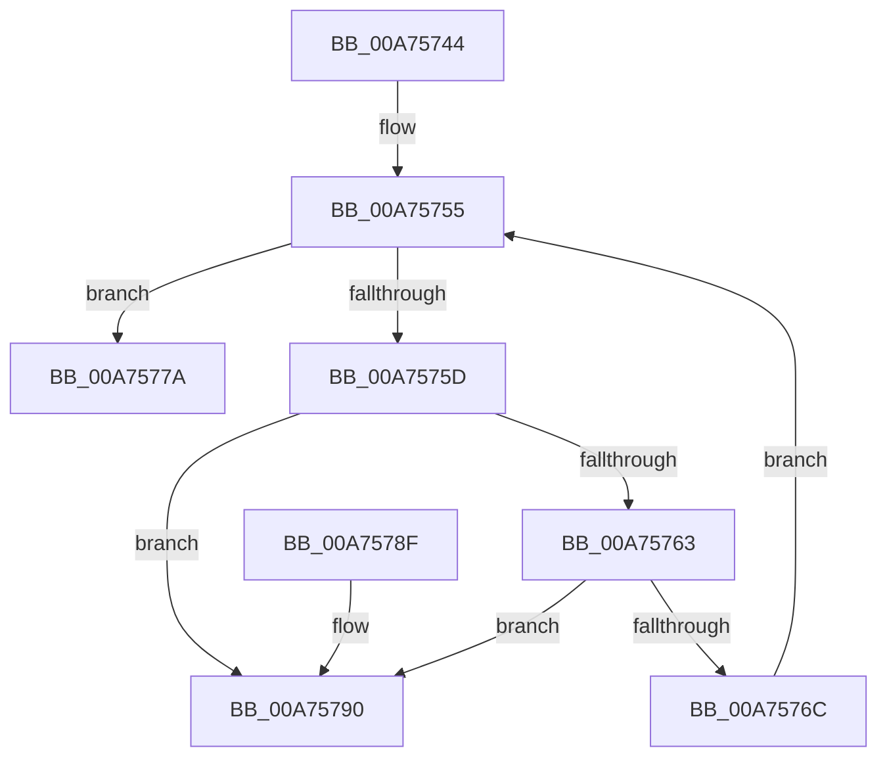

# VmpFreeMemoryRanges

- RVA: `0x00A75744`–`0x00A75797` (길이 `83` bytes)
- VA: `0x0000000140A75744`
- 실행 섹션: `PAGE`
- PDB 이름 있음: `예`; PDB Function 태그: `아니요`
- unwind 정보 RVA: `0x0006CF28`
- 디코드: `27`개 명령, `83/83` bytes 표시
- 미해석 바이트: `0` (있으면 어셈블리에 `.byte`로 보존)

> 이 문서는 커널 이미지의 기계어와 PDB 기호를 분석해 생성했습니다. 4번과 5번은 함수 원형과 자료형을 바이너리 사용 방식에서 추정한 C 해석이며 원본 소스 복구 결과는 아닙니다.

## 1. Dependencies

- 직접 호출 지점: **2**; 고유 호출 대상: **2**
- 직접 호출자로 확인된 함수: **7**
- RIP 상대 이미지 참조: **0**

### Outgoing calls
- `0x00A75773` → [CmSiFreeMemory](../../text/47/CmSiFreeMemory_function_00475D80.md) (function, `0x00475D80`)
- `0x00A7577F` → [ExFreePoolWithTag](../../poolcode/B8/ExFreePoolWithTag_function_00B82870.md) (function, `0x00B82870`)

### Direct callers
- [VmpSplitMemoryRange](../../text/42/VmpSplitMemoryRange_function_00429754.md) at `0x00429B94`
- [VmpRemoveMemoryRange](../../text/48/VmpRemoveMemoryRange_function_00489018.md) at `0x004890B1`
- [VmpMergeMemoryRanges](../../text/4D/VmpMergeMemoryRanges_function_004D9EDC.md) at `0x004DA176`
- [VmpInsertMemoryRange](../../text/64/VmpInsertMemoryRange_function_0064C9F0.md) at `0x0064CCA2`
- [VmCreateMemoryRange](../7A/VmCreateMemoryRange_function_007AD1D0.md) at `0x007AD38F`
- [VmFreePreallocationForRangeCreate](../7A/VmFreePreallocationForRangeCreate_function_007AD3C0.md) at `0x007AD3F2`
- [VmpAllocateMemoryRanges](VmpAllocateMemoryRanges_function_00A75660.md) at `0x00A75721`

### Static image references
- 디코드된 RIP-relative 메모리 참조가 없습니다.

## 2. Other-region calls and transfers

- 다른 실행 섹션으로 향하는 call: **2**
  - `0x00A75773` → [CmSiFreeMemory](../../text/47/CmSiFreeMemory_function_00475D80.md) (`PAGE` → `.text`)
  - `0x00A7577F` → [ExFreePoolWithTag](../../poolcode/B8/ExFreePoolWithTag_function_00B82870.md) (`PAGE` → `POOLCODE`)
- 별도 외부 분기/꼬리 이동을 확인하지 못했습니다.

## 3. Assembly (complete function range)

```asm
00A75744  48 89 5C 24 08                  mov qword ptr [rsp + 8], rbx
00A75749  57                              push rdi
00A7574A  48 83 EC 20                     sub rsp, 0x20
00A7574E  48 8B F9                        mov rdi, rcx
00A75751  48 8D 59 28                     lea rbx, [rcx + 0x28]
00A75755  48 8B 0B                        mov rcx, qword ptr [rbx]
00A75758  48 3B CB                        cmp rcx, rbx
00A7575B  74 1D                           je 0x140a7577a
00A7575D  48 39 59 08                     cmp qword ptr [rcx + 8], rbx
00A75761  75 2D                           jne 0x140a75790
00A75763  48 8B 01                        mov rax, qword ptr [rcx]
00A75766  48 39 48 08                     cmp qword ptr [rax + 8], rcx
00A7576A  75 24                           jne 0x140a75790
00A7576C  48 89 03                        mov qword ptr [rbx], rax
00A7576F  48 89 58 08                     mov qword ptr [rax + 8], rbx
00A75773  E8 08 06 A0 FF                  call 0x140475d80
00A75778  EB DB                           jmp 0x140a75755
00A7577A  33 D2                           xor edx, edx
00A7577C  48 8B CF                        mov rcx, rdi
00A7577F  E8 EC D0 10 00                  call 0x140b82870
00A75784  48 8B 5C 24 30                  mov rbx, qword ptr [rsp + 0x30]
00A75789  48 83 C4 20                     add rsp, 0x20
00A7578D  5F                              pop rdi
00A7578E  C3                              ret
00A7578F  CC                              int3
00A75790  B9 03 00 00 00                  mov ecx, 3
00A75795  CD 29                           int 0x29
```

## 4. C-style interpretation (structured pseudocode)

```c
__int64 __fastcall VmpFreeMemoryRanges(__int64 a1, int a2)
{
    __int64 result;
    __int64 v_rsp;
    unsigned __int64 v_stack_p8;

    v_stack_p8 = v_rbx;
    v_rsp = (v_rsp) - (32);
loc_00A75755:
    if ((*(unsigned __int64 *)(a1 + 40)) == (a1 + 40)) goto loc_00A7577A;
    if ((*(unsigned __int64 *)(*(unsigned __int64 *)(a1 + 40) + 8)) != (a1 + 40)) goto loc_00A75790;
    if ((*(unsigned __int64 *)(*(unsigned __int64 *)(*(unsigned __int64 *)(a1 + 40)) + 8)) != (*(unsigned __int64 *)(a1 + 40))) goto loc_00A75790;
    *(unsigned __int64 *)(a1 + 40) = *(unsigned __int64 *)(*(unsigned __int64 *)(a1 + 40));
    *(unsigned __int64 *)(*(unsigned __int64 *)(*(unsigned __int64 *)(a1 + 40)) + 8) = a1 + 40;
    result = CmSiFreeMemory(*(unsigned __int64 *)(a1 + 40), a2, a3, a4);
    goto loc_00A75755;
loc_00A7577A:
    a2 = 0;
    result = ExFreePoolWithTag(a1, a2, a3, a4);
    v_rsp = (v_rsp) + (32);
    return result;
loc_00A75790:
    return result;
}
```

## 5. (Beta) C Style

```c
int64_t VmpFreeMemoryRanges(void *Arg1, int32_t Arg2)
{
    uint8_t *arg1 = (uint8_t *)Arg1;

    int64_t result;
    int64_t local_rsp;
    uint64_t v_stack_p8;

    v_stack_p8 = local_rbx;
    local_rsp = (local_rsp) - (32);
loc_00A75755:
    if ((*(uint64_t *)(arg1 + 0x28)) == (Arg1 + 40)) goto loc_00A7577A;
    if ((*(uint64_t *)(*(uint64_t *)(arg1 + 0x28) + 0x8)) != (Arg1 + 40)) goto loc_00A75790;
    if ((*(uint64_t *)(*(uint64_t *)(*(uint64_t *)(arg1 + 0x28)) + 0x8)) != (*(uint64_t *)(arg1 + 0x28))) goto loc_00A75790;
    *(uint64_t *)(arg1 + 0x28) = *(uint64_t *)(*(uint64_t *)(arg1 + 0x28));
    *(void **)(*(uint64_t *)(*(uint64_t *)(arg1 + 0x28)) + 0x8) = Arg1 + 40;
    result = CmSiFreeMemory(*(uint64_t *)(arg1 + 0x28), Arg2, a3, a4);
    goto loc_00A75755;
loc_00A7577A:
    Arg2 = 0;
    result = ExFreePoolWithTag(Arg1, Arg2, a3, a4);
    local_rsp = (local_rsp) + (32);
    return result;
loc_00A75790:
    return result;
}
```

### 관측된 메모리 오프셋

구조체 형식이 확인되지 않은 접근은 인자 기준의 오프셋으로만 기록했습니다.

| 기준 인자 | 오프셋 표현 | 폭 (bit) | 접근 |
|---|---:|---:|---|
| `Arg1` | `+ 0x0` | `64` | `R` |
| `Arg1` | `+ 0x0` | `64` | `W` |
| `Arg1` | `+ 0x28` | `64` | `R` |

## 6. Execution-region graph

[열기: 2D/3D 그래프와 함수 탐색 컨트롤 패널](../../../control-panel.html?section=page&rva=0x00A75744&view=graph)

- 2D 그래프는 위에서 아래로 흐르고, 3D 그래프는 빈 공간을 드래그해 회전합니다. Shift+드래그는 이동, 휠은 확대·축소, 함수 노드 선택은 대상 보고서 이동입니다.

### Static fallback


