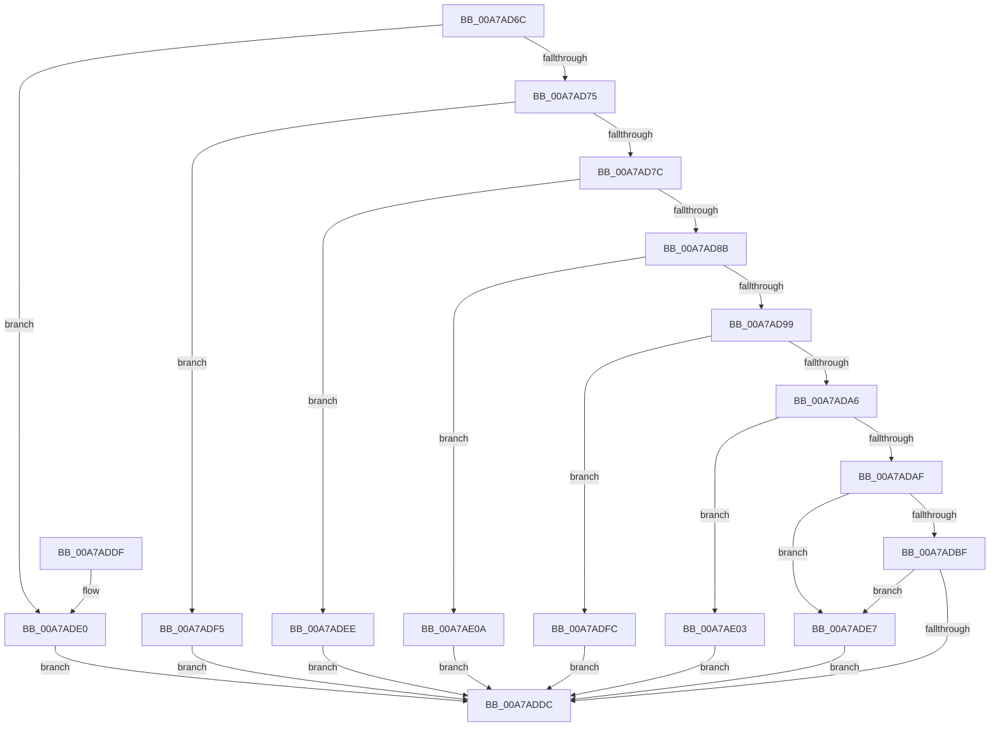

# VmpValidateMemoryRangeParameters

- RVA: `0x00A7AD6C`–`0x00A7AE11` (길이 `165` bytes)
- VA: `0x0000000140A7AD6C`
- 실행 섹션: `PAGE`
- PDB 이름 있음: `예`; PDB Function 태그: `아니요`
- unwind 정보 RVA: `0x000DB714`
- 디코드: `49`개 명령, `165/165` bytes 표시
- 미해석 바이트: `0` (있으면 어셈블리에 `.byte`로 보존)

> 이 문서는 커널 이미지의 기계어와 PDB 기호를 분석해 생성했습니다. 4번과 5번은 함수 원형과 자료형을 바이너리 사용 방식에서 추정한 C 해석이며 원본 소스 복구 결과는 아닙니다.

## 1. Dependencies

- 직접 호출 지점: **0**; 고유 호출 대상: **0**
- 직접 호출자로 확인된 함수: **2**
- RIP 상대 이미지 참조: **0**

### Outgoing calls
- 직접 디코드된 call 명령이 없습니다.

### Direct callers
- [VmCreateMemoryRange](../7A/VmCreateMemoryRange_function_007AD1D0.md) at `0x007AD272`
- [VmDeleteMemoryRange](VmDeleteMemoryRange_function_00A7AC50.md) at `0x00A7AC95`

### Static image references
- 디코드된 RIP-relative 메모리 참조가 없습니다.

## 2. Other-region calls and transfers

- 다른 실행 섹션으로 향하는 call: **0**
- 별도 외부 분기/꼬리 이동을 확인하지 못했습니다.

## 3. Assembly (complete function range)

```asm
00A7AD6C  4C 8B D1                        mov r10, rcx
00A7AD6F  49 83 F9 FF                     cmp r9, -1
00A7AD73  74 6B                           je 0x140a7ade0
00A7AD75  33 C9                           xor ecx, ecx
00A7AD77  4D 85 C0                        test r8, r8
00A7AD7A  74 79                           je 0x140a7adf5
00A7AD7C  48 B8 FF FF FF FF FF FF 0F 00   movabs rax, 0xfffffffffffff
00A7AD86  4C 3B C0                        cmp r8, rax
00A7AD89  77 63                           ja 0x140a7adee
00A7AD8B  49 8B C2                        mov rax, r10
00A7AD8E  48 0B C2                        or rax, rdx
00A7AD91  48 A9 FF 0F 00 00               test rax, 0xfff
00A7AD97  75 71                           jne 0x140a7ae0a
00A7AD99  49 C1 E0 0C                     shl r8, 0xc
00A7AD9D  4D 8D 0C 10                     lea r9, [r8 + rdx]
00A7ADA1  4C 3B CA                        cmp r9, rdx
00A7ADA4  76 56                           jbe 0x140a7adfc
00A7ADA6  4B 8D 04 10                     lea rax, [r8 + r10]
00A7ADAA  49 3B C2                        cmp rax, r10
00A7ADAD  76 54                           jbe 0x140a7ae03
00A7ADAF  4D 85 C0                        test r8, r8
00A7ADB2  49 8D 41 FF                     lea rax, [r9 - 1]
00A7ADB6  48 0F 44 C2                     cmove rax, rdx
00A7ADBA  48 3B C2                        cmp rax, rdx
00A7ADBD  72 28                           jb 0x140a7ade7
00A7ADBF  48 8D 42 FF                     lea rax, [rdx - 1]
00A7ADC3  49 03 C0                        add rax, r8
00A7ADC6  4D 85 C0                        test r8, r8
00A7ADC9  48 0F 44 C2                     cmove rax, rdx
00A7ADCD  48 BA FF FF FE FF FF 7F 00 00   movabs rdx, 0x7ffffffeffff
00A7ADD7  48 3B C2                        cmp rax, rdx
00A7ADDA  77 0B                           ja 0x140a7ade7
00A7ADDC  8B C1                           mov eax, ecx
00A7ADDE  C3                              ret
00A7ADDF  CC                              int3
00A7ADE0  B9 0A 00 00 00                  mov ecx, 0xa
00A7ADE5  EB F5                           jmp 0x140a7addc
00A7ADE7  B9 46 00 00 00                  mov ecx, 0x46
00A7ADEC  EB EE                           jmp 0x140a7addc
00A7ADEE  B9 1E 00 00 00                  mov ecx, 0x1e
00A7ADF3  EB E7                           jmp 0x140a7addc
00A7ADF5  B9 14 00 00 00                  mov ecx, 0x14
00A7ADFA  EB E0                           jmp 0x140a7addc
00A7ADFC  B9 32 00 00 00                  mov ecx, 0x32
00A7AE01  EB D9                           jmp 0x140a7addc
00A7AE03  B9 3C 00 00 00                  mov ecx, 0x3c
00A7AE08  EB D2                           jmp 0x140a7addc
00A7AE0A  B9 28 00 00 00                  mov ecx, 0x28
00A7AE0F  EB CB                           jmp 0x140a7addc
```

## 4. C-style interpretation (structured pseudocode)

```c
__int64 __fastcall VmpValidateMemoryRangeParameters(__int64 a1, __int64 a2, __int64 a3, __int64 a4)
{
    __int64 result;

    if (a4 == -1) goto loc_00A7ADE0;
    a1 = 0;
    if (a3 == 0) goto loc_00A7ADF5;
    if (a3 > result) goto loc_00A7ADEE;
    result = (0) | (a2);
    if (((result) & (0xFFFULL)) != 0) goto loc_00A7AE0A;
    a3 = (a3) << (12);
    if ((a3 + a2 * 1) <= a2) goto loc_00A7ADFC;
    if ((a3 + a1 * 1) <= 0) goto loc_00A7AE03;
    result = a3 + a2 * 1 - 1;
    if (a3 == 0) { result = a2; }
    if (result < a2) goto loc_00A7ADE7;
    result = (a2 - 1) + (a3);
    if (a3 == 0) { result = a2; }
    if (result > a2) goto loc_00A7ADE7;
loc_00A7ADDC:
    return 0;
loc_00A7ADE0:
    goto loc_00A7ADDC;
loc_00A7ADE7:
    goto loc_00A7ADDC;
loc_00A7ADEE:
    goto loc_00A7ADDC;
loc_00A7ADF5:
    goto loc_00A7ADDC;
loc_00A7ADFC:
    goto loc_00A7ADDC;
loc_00A7AE03:
    goto loc_00A7ADDC;
loc_00A7AE0A:
    goto loc_00A7ADDC;
}
```

## 5. (Beta) C Style

```c
int64_t VmpValidateMemoryRangeParameters(int64_t Arg1, void *Arg2, int64_t Arg3, int64_t Arg4)
{
    uint8_t *arg2 = (uint8_t *)Arg2;

    int64_t result;

    if (Arg4 == -1) goto loc_00A7ADE0;
    Arg1 = 0;
    if (Arg3 == 0) goto loc_00A7ADF5;
    if (Arg3 > result) goto loc_00A7ADEE;
    result = (0) | (Arg2);
    if (((result) & (0xFFFULL)) != 0) goto loc_00A7AE0A;
    Arg3 = (Arg3) << (12);
    if ((Arg3 + Arg2 * 1) <= Arg2) goto loc_00A7ADFC;
    if ((Arg3 + Arg1 * 1) <= 0) goto loc_00A7AE03;
    result = Arg3 + Arg2 * 1 - 1;
    if (Arg3 == 0) { result = Arg2; }
    if (result < Arg2) goto loc_00A7ADE7;
    result = (Arg2 - 1) + (Arg3);
    if (Arg3 == 0) { result = Arg2; }
    if (result > Arg2) goto loc_00A7ADE7;
loc_00A7ADDC:
    return 0;
loc_00A7ADE0:
    goto loc_00A7ADDC;
loc_00A7ADE7:
    goto loc_00A7ADDC;
loc_00A7ADEE:
    goto loc_00A7ADDC;
loc_00A7ADF5:
    goto loc_00A7ADDC;
loc_00A7ADFC:
    goto loc_00A7ADDC;
loc_00A7AE03:
    goto loc_00A7ADDC;
loc_00A7AE0A:
    goto loc_00A7ADDC;
}
```

### 관측된 메모리 오프셋

구조체 형식이 확인되지 않은 접근은 인자 기준의 오프셋으로만 기록했습니다.

| 기준 인자 | 오프셋 표현 | 폭 (bit) | 접근 |
|---|---:|---:|---|
| `Arg2` | `- 0x1` | `64` | `R` |

## 6. Execution-region graph

[열기: 2D/3D 그래프와 함수 탐색 컨트롤 패널](../../../control-panel.html?section=page&rva=0x00A7AD6C&view=graph)

- 2D 그래프는 위에서 아래로 흐르고, 3D 그래프는 빈 공간을 드래그해 회전합니다. Shift+드래그는 이동, 휠은 확대·축소, 함수 노드 선택은 대상 보고서 이동입니다.

### Static fallback


