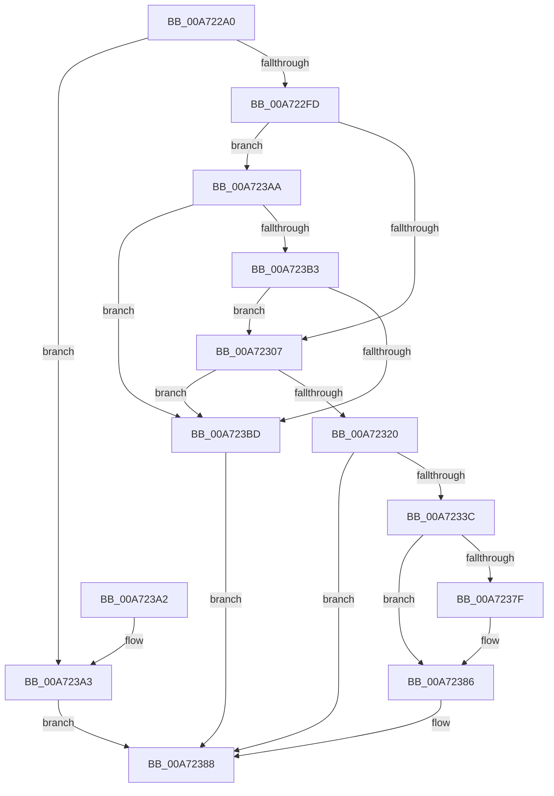

# VslCreateSecureSection

- RVA: `0x00A722A0`–`0x00A723C4` (길이 `292` bytes)
- VA: `0x0000000140A722A0`
- 실행 섹션: `PAGE`
- PDB 이름 있음: `예`; PDB Function 태그: `아니요`
- unwind 정보 RVA: `0x000B5548`
- 디코드: `80`개 명령, `292/292` bytes 표시
- 미해석 바이트: `0` (있으면 어셈블리에 `.byte`로 보존)

> 이 문서는 커널 이미지의 기계어와 PDB 기호를 분석해 생성했습니다. 4번과 5번은 함수 원형과 자료형을 바이너리 사용 방식에서 추정한 C 해석이며 원본 소스 복구 결과는 아닙니다.

## 1. Dependencies

- 직접 호출 지점: **7**; 고유 호출 대상: **6**
- 직접 호출자로 확인된 함수: **0**
- RIP 상대 이미지 참조: **1**

### Outgoing calls
- `0x00A722D7` → [memset](../../text/6C/memset_function_006C6C40.md) (function, `0x006C6C40`)
- `0x00A722E7` → [memset](../../text/6C/memset_function_006C6C40.md) (function, `0x006C6C40`)
- `0x00A7230D` → [MmSizeOfMdl](../../text/46/MmSizeOfMdl_function_00460A10.md) (function, `0x00460A10`)
- `0x00A72333` → [VslpLockPagesForTransfer](../../text/29/VslpLockPagesForTransfer_function_0029E0FC.md) (function, `0x0029E0FC`)
- `0x00A7236A` → [VslpEnterIumSecureMode](../../text/23/VslpEnterIumSecureMode_function_00235E50.md) (function, `0x00235E50`)
- `0x00A72376` → [VslpUnlockPagesForTransfer](../../text/29/VslpUnlockPagesForTransfer_function_0029EE4C.md) (function, `0x0029EE4C`)
- `0x00A7238F` → [_security_check_cookie](../../text/6A/_security_check_cookie_function_006AC640.md) (function, `0x006AC640`)

### Direct callers
- 이 함수 시작 RVA로 연결되는 직접 call은 확인되지 않았습니다. 간접 호출은 완전히 역산할 수 없습니다.

### Static image references
- `0x00A722B3` → RVA `0x00E0A740` (`.data`; read)

## 2. Other-region calls and transfers

- 다른 실행 섹션으로 향하는 call: **7**
  - `0x00A722D7` → [memset](../../text/6C/memset_function_006C6C40.md) (`PAGE` → `.text`)
  - `0x00A722E7` → [memset](../../text/6C/memset_function_006C6C40.md) (`PAGE` → `.text`)
  - `0x00A7230D` → [MmSizeOfMdl](../../text/46/MmSizeOfMdl_function_00460A10.md) (`PAGE` → `.text`)
  - `0x00A72333` → [VslpLockPagesForTransfer](../../text/29/VslpLockPagesForTransfer_function_0029E0FC.md) (`PAGE` → `.text`)
  - `0x00A7236A` → [VslpEnterIumSecureMode](../../text/23/VslpEnterIumSecureMode_function_00235E50.md) (`PAGE` → `.text`)
  - `0x00A72376` → [VslpUnlockPagesForTransfer](../../text/29/VslpUnlockPagesForTransfer_function_0029EE4C.md) (`PAGE` → `.text`)
  - `0x00A7238F` → [_security_check_cookie](../../text/6A/_security_check_cookie_function_006AC640.md) (`PAGE` → `.text`)
- 별도 외부 분기/꼬리 이동을 확인하지 못했습니다.

## 3. Assembly (complete function range)

```asm
00A722A0  40 55                           push rbp
00A722A2  53                              push rbx
00A722A3  56                              push rsi
00A722A4  57                              push rdi
00A722A5  41 56                           push r14
00A722A7  48 8D 6C 24 D1                  lea rbp, [rsp - 0x2f]
00A722AC  48 81 EC 00 01 00 00            sub rsp, 0x100
00A722B3  48 8B 05 86 84 39 00            mov rax, qword ptr [rip + 0x398486]
00A722BA  48 33 C4                        xor rax, rsp
00A722BD  48 89 45 1F                     mov qword ptr [rbp + 0x1f], rax
00A722C1  48 8B F2                        mov rsi, rdx
00A722C4  49 8B D8                        mov rbx, r8
00A722C7  33 D2                           xor edx, edx
00A722C9  48 8B F9                        mov rdi, rcx
00A722CC  48 8D 4D AF                     lea rcx, [rbp - 0x51]
00A722D0  45 8B F1                        mov r14d, r9d
00A722D3  44 8D 42 68                     lea r8d, [rdx + 0x68]
00A722D7  E8 64 49 C5 FF                  call 0x1406c6c40
00A722DC  33 D2                           xor edx, edx
00A722DE  48 8D 4C 24 30                  lea rcx, [rsp + 0x30]
00A722E3  44 8D 42 48                     lea r8d, [rdx + 0x48]
00A722E7  E8 54 49 C5 FF                  call 0x1406c6c40
00A722EC  48 83 27 00                     and qword ptr [rdi], 0
00A722F0  F7 45 7F FE FF FF FF            test dword ptr [rbp + 0x7f], 0xfffffffe
00A722F7  0F 85 A6 00 00 00               jne 0x140a723a3
00A722FD  F6 45 7F 01                     test byte ptr [rbp + 0x7f], 1
00A72301  0F 84 A3 00 00 00               je 0x140a723aa
00A72307  8B 53 28                        mov edx, dword ptr [rbx + 0x28]
00A7230A  8B 4B 2C                        mov ecx, dword ptr [rbx + 0x2c]
00A7230D  E8 FE E6 9E FF                  call 0x140460a10
00A72312  B9 FF FF FF FF                  mov ecx, 0xffffffff
00A72317  48 3B C1                        cmp rax, rcx
00A7231A  0F 87 9D 00 00 00               ja 0x140a723bd
00A72320  83 64 24 20 00                  and dword ptr [rsp + 0x20], 0
00A72325  48 8D 4C 24 30                  lea rcx, [rsp + 0x30]
00A7232A  45 33 C9                        xor r9d, r9d
00A7232D  44 8B C0                        mov r8d, eax
00A72330  48 8B D3                        mov rdx, rbx
00A72333  E8 C4 BD 82 FF                  call 0x14029e0fc
00A72338  85 C0                           test eax, eax
00A7233A  78 4C                           js 0x140a72388
00A7233C  48 8B 44 24 30                  mov rax, qword ptr [rsp + 0x30]
00A72341  4C 8D 4D AF                     lea r9, [rbp - 0x51]
00A72345  48 89 45 C7                     mov qword ptr [rbp - 0x39], rax
00A72349  BA 44 00 00 00                  mov edx, 0x44
00A7234E  48 8B 45 97                     mov rax, qword ptr [rbp - 0x69]
00A72352  45 33 C0                        xor r8d, r8d
00A72355  48 89 45 D7                     mov qword ptr [rbp - 0x29], rax
00A72359  B1 02                           mov cl, 2
00A7235B  48 8B 86 70 01 00 00            mov rax, qword ptr [rsi + 0x170]
00A72362  48 89 45 B7                     mov qword ptr [rbp - 0x49], rax
00A72366  44 89 75 BF                     mov dword ptr [rbp - 0x41], r14d
00A7236A  E8 E1 3A 7C FF                  call 0x140235e50
00A7236F  48 8D 4C 24 30                  lea rcx, [rsp + 0x30]
00A72374  8B D8                           mov ebx, eax
00A72376  E8 D1 CA 82 FF                  call 0x14029ee4c
00A7237B  85 DB                           test ebx, ebx
00A7237D  78 07                           js 0x140a72386
00A7237F  48 8B 4D CF                     mov rcx, qword ptr [rbp - 0x31]
00A72383  48 89 0F                        mov qword ptr [rdi], rcx
00A72386  8B C3                           mov eax, ebx
00A72388  48 8B 4D 1F                     mov rcx, qword ptr [rbp + 0x1f]
00A7238C  48 33 CC                        xor rcx, rsp
00A7238F  E8 AC A2 C3 FF                  call 0x1406ac640
00A72394  48 81 C4 00 01 00 00            add rsp, 0x100
00A7239B  41 5E                           pop r14
00A7239D  5F                              pop rdi
00A7239E  5E                              pop rsi
00A7239F  5B                              pop rbx
00A723A0  5D                              pop rbp
00A723A1  C3                              ret
00A723A2  CC                              int3
00A723A3  B8 F4 00 00 C0                  mov eax, 0xc00000f4
00A723A8  EB DE                           jmp 0x140a72388
00A723AA  F7 43 28 FF 0F 00 00            test dword ptr [rbx + 0x28], 0xfff
00A723B1  75 0A                           jne 0x140a723bd
00A723B3  83 7B 2C 00                     cmp dword ptr [rbx + 0x2c], 0
00A723B7  0F 84 4A FF FF FF               je 0x140a72307
00A723BD  B8 F1 00 00 C0                  mov eax, 0xc00000f1
00A723C2  EB C4                           jmp 0x140a72388
```

## 4. C-style interpretation (structured pseudocode)

```c
__int64 __fastcall VslCreateSecureSection(__int64 a1, __int64 a2, __int64 a3, int a4, unsigned __int8 a5)
{
    __int64 result;
    __int64 v_rsp;
    unsigned int v_stack_m108;
    unsigned __int64 v_stack_m38;
    unsigned __int64 v_stack_m57;
    unsigned __int64 v_stack_m80;
    unsigned __int64 v_stack_m88;
    unsigned __int64 v_stack_m90;
    unsigned int v_stack_m98;
    unsigned __int64 v_stack_mA0;
    unsigned __int64 v_stack_mA8;
    unsigned __int64 v_stack_mC0;
    unsigned __int64 v_stack_mF8;

    v_rsp = (v_rsp) - (256);
    result = (*(unsigned __int64 *)(v_rip + 3769478)) ^ (v_rsp);
    v_stack_m38 = result;
    a2 = 0;
    result = memset(v_stack_mA8, a2, a2 + 104, a4);
    a2 = 0;
    result = memset(v_stack_mF8, a2, a2 + 72, a4);
    if (((a5) & (0xFFFFFFFEULL)) != 0) goto loc_00A723A3;
    if (((a5) & (1)) == 0) goto loc_00A723AA;
loc_00A72307:
    result = MmSizeOfMdl((unsigned int)(*(unsigned int *)(a3 + 44)), (unsigned int)(*(unsigned int *)(a3 + 40)), a2 + 72, a4);
    if (result > ((unsigned int)(0xFFFFFFFFULL))) goto loc_00A723BD;
    a4 = 0;
    result = VslpLockPagesForTransfer(v_stack_mF8, a3, (unsigned int)((unsigned int)(result)), a4);
    if (sign_flag) goto loc_00A72388;
    v_stack_m90 = v_stack_mF8;
    a3 = 0;
    v_stack_m80 = v_stack_mC0;
    v_stack_mA0 = *(unsigned __int64 *)(a2 + 368);
    v_stack_m98 = (unsigned int)((unsigned int)(a4));
    result = VslpEnterIumSecureMode(2, 68, a3, v_stack_mA8);
    result = VslpUnlockPagesForTransfer(v_stack_mF8, 68, a3, v_stack_mA8);
    if (!(sign_flag)) {
        a1 = v_stack_m88;
        *(unsigned __int64 *)(a1) = a1;
    }
loc_00A72388:
    a1 = (v_stack_m38) ^ (v_rsp);
    result = _security_check_cookie(a1, 68, a3, v_stack_mA8);
    v_rsp = (v_rsp) + (256);
    return result;
loc_00A723A3:
    goto loc_00A72388;
loc_00A723AA:
    if (((*(unsigned int *)((unsigned int)((unsigned int)(result)) + 40)) & (0xFFFULL)) != 0) goto loc_00A723BD;
    if ((*(unsigned int *)((unsigned int)((unsigned int)(result)) + 44)) == 0) goto loc_00A72307;
loc_00A723BD:
    goto loc_00A72388;
}
```

## 5. (Beta) C Style

```c
int64_t VslCreateSecureSection(void *Arg1, void *Arg2, void *Arg3, int32_t Arg4, uint8_t Arg5)
{
    uint8_t *arg1 = (uint8_t *)Arg1;
    uint8_t *arg2 = (uint8_t *)Arg2;
    uint8_t *arg3 = (uint8_t *)Arg3;

    int64_t result;
    int64_t local_rsp;
    uint32_t v_stack_m108;
    uint64_t v_stack_m38;
    uint64_t v_stack_m57;
    uint64_t v_stack_m80;
    uint64_t v_stack_m88;
    uint64_t v_stack_m90;
    uint32_t v_stack_m98;
    uint64_t v_stack_mA0;
    uint64_t v_stack_mA8;
    uint64_t v_stack_mC0;
    uint64_t v_stack_mF8;

    local_rsp = (local_rsp) - (256);
    result = (*(uint64_t *)(v_rip + 0x398486)) ^ (local_rsp);
    v_stack_m38 = result;
    Arg2 = 0;
    result = memset(v_stack_mA8, Arg2, Arg2 + 104, Arg4);
    Arg2 = 0;
    result = memset(v_stack_mF8, Arg2, Arg2 + 72, Arg4);
    if (((Arg5) & (0xFFFFFFFEULL)) != 0) goto loc_00A723A3;
    if (((Arg5) & (1)) == 0) goto loc_00A723AA;
loc_00A72307:
    result = MmSizeOfMdl((uint32_t)(*(uint32_t *)(arg3 + 0x2C)), (uint32_t)(*(uint32_t *)(arg3 + 0x28)), Arg2 + 72, Arg4);
    if (result > ((uint32_t)(0xFFFFFFFFULL))) goto loc_00A723BD;
    Arg4 = 0;
    result = VslpLockPagesForTransfer(v_stack_mF8, Arg3, (uint32_t)((uint32_t)(result)), Arg4);
    if (sign_flag) goto loc_00A72388;
    v_stack_m90 = v_stack_mF8;
    Arg3 = 0;
    v_stack_m80 = v_stack_mC0;
    v_stack_mA0 = *(uint64_t *)(arg2 + 0x170);
    v_stack_m98 = (uint32_t)((uint32_t)(Arg4));
    result = VslpEnterIumSecureMode(2, 68, Arg3, v_stack_mA8);
    result = VslpUnlockPagesForTransfer(v_stack_mF8, 68, Arg3, v_stack_mA8);
    if (!(sign_flag)) {
        Arg1 = v_stack_m88;
        *(void **)(arg1) = Arg1;
    }
loc_00A72388:
    Arg1 = (v_stack_m38) ^ (local_rsp);
    result = _security_check_cookie(Arg1, 68, Arg3, v_stack_mA8);
    local_rsp = (local_rsp) + (256);
    return result;
loc_00A723A3:
    goto loc_00A72388;
loc_00A723AA:
    if (((*(uint32_t *)((uint32_t)((uint32_t)(result)) + 0x28)) & (0xFFFULL)) != 0) goto loc_00A723BD;
    if ((*(uint32_t *)((uint32_t)((uint32_t)(result)) + 0x2C)) == 0) goto loc_00A72307;
loc_00A723BD:
    goto loc_00A72388;
}
```

### 관측된 메모리 오프셋

구조체 형식이 확인되지 않은 접근은 인자 기준의 오프셋으로만 기록했습니다.

| 기준 인자 | 오프셋 표현 | 폭 (bit) | 접근 |
|---|---:|---:|---|
| `Arg1` | `+ 0x0` | `64` | `R/W` |
| `Arg1` | `+ 0x0` | `64` | `W` |
| `Arg2` | `+ 0x170` | `64` | `R` |
| `Arg3` | `+ 0x28` | `32` | `R` |
| `Arg3` | `+ 0x2C` | `32` | `R` |

## 6. Execution-region graph

[열기: 2D/3D 그래프와 함수 탐색 컨트롤 패널](../../../control-panel.html?section=page&rva=0x00A722A0&view=graph)

- 2D 그래프는 위에서 아래로 흐르고, 3D 그래프는 빈 공간을 드래그해 회전합니다. Shift+드래그는 이동, 휠은 확대·축소, 함수 노드 선택은 대상 보고서 이동입니다.

### Static fallback


