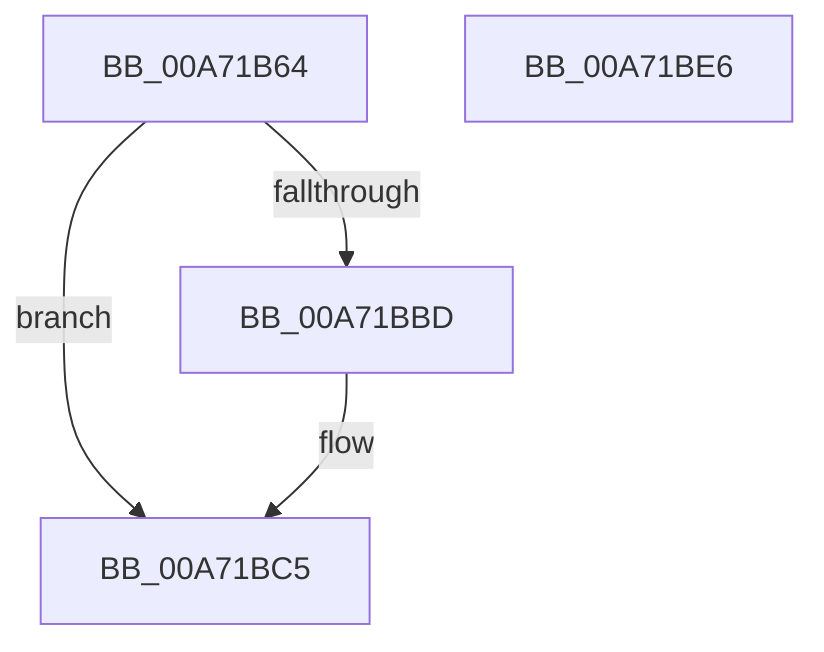

# VslGetSecurePebAddress

- RVA: `0x00A71B64`–`0x00A71BE7` (길이 `131` bytes)
- VA: `0x0000000140A71B64`
- 실행 섹션: `PAGE`
- PDB 이름 있음: `예`; PDB Function 태그: `아니요`
- unwind 정보 RVA: `0x000B53F0`
- 디코드: `31`개 명령, `131/131` bytes 표시
- 미해석 바이트: `0` (있으면 어셈블리에 `.byte`로 보존)

> 이 문서는 커널 이미지의 기계어와 PDB 기호를 분석해 생성했습니다. 4번과 5번은 함수 원형과 자료형을 바이너리 사용 방식에서 추정한 C 해석이며 원본 소스 복구 결과는 아닙니다.

## 1. Dependencies

- 직접 호출 지점: **3**; 고유 호출 대상: **3**
- 직접 호출자로 확인된 함수: **1**
- RIP 상대 이미지 참조: **1**

### Outgoing calls
- `0x00A71B94` → [memset](../../text/6C/memset_function_006C6C40.md) (function, `0x006C6C40`)
- `0x00A71BB4` → [VslpEnterIumSecureMode](../../text/23/VslpEnterIumSecureMode_function_00235E50.md) (function, `0x00235E50`)
- `0x00A71BD0` → [_security_check_cookie](../../text/6A/_security_check_cookie_function_006AC640.md) (function, `0x006AC640`)

### Direct callers
- [NtQueryInformationProcess](../9A/NtQueryInformationProcess_function_009AA250.md) at `0x009AA5EF`

### Static image references
- `0x00A71B71` → RVA `0x00E0A740` (`.data`; read)

## 2. Other-region calls and transfers

- 다른 실행 섹션으로 향하는 call: **3**
  - `0x00A71B94` → [memset](../../text/6C/memset_function_006C6C40.md) (`PAGE` → `.text`)
  - `0x00A71BB4` → [VslpEnterIumSecureMode](../../text/23/VslpEnterIumSecureMode_function_00235E50.md) (`PAGE` → `.text`)
  - `0x00A71BD0` → [_security_check_cookie](../../text/6A/_security_check_cookie_function_006AC640.md) (`PAGE` → `.text`)
- 별도 외부 분기/꼬리 이동을 확인하지 못했습니다.

## 3. Assembly (complete function range)

```asm
00A71B64  48 89 5C 24 08                  mov qword ptr [rsp + 8], rbx
00A71B69  57                              push rdi
00A71B6A  48 81 EC A0 00 00 00            sub rsp, 0xa0
00A71B71  48 8B 05 C8 8B 39 00            mov rax, qword ptr [rip + 0x398bc8]
00A71B78  48 33 C4                        xor rax, rsp
00A71B7B  48 89 84 24 90 00 00 00         mov qword ptr [rsp + 0x90], rax
00A71B83  48 8B FA                        mov rdi, rdx
00A71B86  48 8B D9                        mov rbx, rcx
00A71B89  33 D2                           xor edx, edx
00A71B8B  48 8D 4C 24 20                  lea rcx, [rsp + 0x20]
00A71B90  44 8D 42 68                     lea r8d, [rdx + 0x68]
00A71B94  E8 A7 50 C5 FF                  call 0x1406c6c40
00A71B99  48 8B 83 70 01 00 00            mov rax, qword ptr [rbx + 0x170]
00A71BA0  4C 8D 4C 24 20                  lea r9, [rsp + 0x20]
00A71BA5  BA C0 00 00 00                  mov edx, 0xc0
00A71BAA  48 89 44 24 28                  mov qword ptr [rsp + 0x28], rax
00A71BAF  45 33 C0                        xor r8d, r8d
00A71BB2  B1 02                           mov cl, 2
00A71BB4  E8 97 42 7C FF                  call 0x140235e50
00A71BB9  85 C0                           test eax, eax
00A71BBB  78 08                           js 0x140a71bc5
00A71BBD  48 8B 4C 24 30                  mov rcx, qword ptr [rsp + 0x30]
00A71BC2  48 89 0F                        mov qword ptr [rdi], rcx
00A71BC5  48 8B 8C 24 90 00 00 00         mov rcx, qword ptr [rsp + 0x90]
00A71BCD  48 33 CC                        xor rcx, rsp
00A71BD0  E8 6B AA C3 FF                  call 0x1406ac640
00A71BD5  48 8B 9C 24 B0 00 00 00         mov rbx, qword ptr [rsp + 0xb0]
00A71BDD  48 81 C4 A0 00 00 00            add rsp, 0xa0
00A71BE4  5F                              pop rdi
00A71BE5  C3                              ret
00A71BE6  CC                              int3
```

## 4. C-style interpretation (structured pseudocode)

```c
__int64 __fastcall VslGetSecurePebAddress(__int64 a1, __int64 a2)
{
    __int64 result;
    __int64 v_rsp;
    unsigned __int64 v_stack_m18;
    unsigned __int64 v_stack_m78;
    unsigned __int64 v_stack_m80;
    unsigned __int64 v_stack_m88;
    unsigned __int64 v_stack_p8;

    v_stack_p8 = v_rbx;
    v_rsp = (v_rsp) - (160);
    result = (*(unsigned __int64 *)(v_rip + 3771336)) ^ (v_rsp);
    v_stack_m18 = result;
    a2 = 0;
    result = memset(v_stack_m88, a2, a2 + 104, a4);
    v_stack_m80 = *(unsigned __int64 *)(a1 + 368);
    a3 = 0;
    result = VslpEnterIumSecureMode(2, 192, a3, v_stack_m88);
    if (!(sign_flag)) {
        a1 = v_stack_m78;
        *(unsigned __int64 *)(a2) = a1;
    }
    a1 = (v_stack_m18) ^ (v_rsp);
    result = _security_check_cookie(a1, 192, a3, v_stack_m88);
    v_rsp = (v_rsp) + (160);
    return result;
}
```

## 5. (Beta) C Style

```c
int64_t VslGetSecurePebAddress(void *Arg1, void *Arg2)
{
    uint8_t *arg1 = (uint8_t *)Arg1;
    uint8_t *arg2 = (uint8_t *)Arg2;

    int64_t result;
    int64_t local_rsp;
    uint64_t v_stack_m18;
    uint64_t v_stack_m78;
    uint64_t v_stack_m80;
    uint64_t v_stack_m88;
    uint64_t v_stack_p8;

    v_stack_p8 = local_rbx;
    local_rsp = (local_rsp) - (160);
    result = (*(uint64_t *)(v_rip + 0x398BC8)) ^ (local_rsp);
    v_stack_m18 = result;
    Arg2 = 0;
    result = memset(v_stack_m88, Arg2, Arg2 + 104, a4);
    v_stack_m80 = *(uint64_t *)(arg1 + 0x170);
    a3 = 0;
    result = VslpEnterIumSecureMode(2, 192, a3, v_stack_m88);
    if (!(sign_flag)) {
        Arg1 = v_stack_m78;
        *(void **)(arg2) = Arg1;
    }
    Arg1 = (v_stack_m18) ^ (local_rsp);
    result = _security_check_cookie(Arg1, 192, a3, v_stack_m88);
    local_rsp = (local_rsp) + (160);
    return result;
}
```

### 관측된 메모리 오프셋

구조체 형식이 확인되지 않은 접근은 인자 기준의 오프셋으로만 기록했습니다.

| 기준 인자 | 오프셋 표현 | 폭 (bit) | 접근 |
|---|---:|---:|---|
| `Arg1` | `+ 0x170` | `64` | `R` |
| `Arg2` | `+ 0x0` | `64` | `W` |

## 6. Execution-region graph

[열기: 2D/3D 그래프와 함수 탐색 컨트롤 패널](../../../control-panel.html?section=page&rva=0x00A71B64&view=graph)

- 2D 그래프는 위에서 아래로 흐르고, 3D 그래프는 빈 공간을 드래그해 회전합니다. Shift+드래그는 이동, 휠은 확대·축소, 함수 노드 선택은 대상 보고서 이동입니다.

### Static fallback


