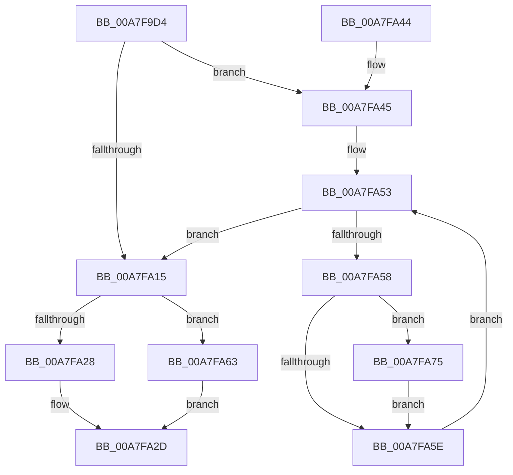

# WmipDeregisterDevice

- RVA: `0x00A7F9D4`–`0x00A7FA83` (길이 `175` bytes)
- VA: `0x0000000140A7F9D4`
- 실행 섹션: `PAGE`
- PDB 이름 있음: `예`; PDB Function 태그: `아니요`
- unwind 정보 RVA: `0x000B6E88`
- 디코드: `50`개 명령, `175/175` bytes 표시
- 미해석 바이트: `0` (있으면 어셈블리에 `.byte`로 보존)

> 이 문서는 커널 이미지의 기계어와 PDB 기호를 분석해 생성했습니다. 4번과 5번은 함수 원형과 자료형을 바이너리 사용 방식에서 추정한 C 해석이며 원본 소스 복구 결과는 아닙니다.

## 1. Dependencies

- 직접 호출 지점: **6**; 고유 호출 대상: **5**
- 직접 호출자로 확인된 함수: **1**
- RIP 상대 이미지 참조: **2**

### Outgoing calls
- `0x00A7FA00` → [KeWaitForSingleObject](../../text/20/KeWaitForSingleObject_function_0020E6B0.md) (function, `0x0020E6B0`)
- `0x00A7FA08` → [WmipFindRegEntryByDevice](../../text/46/WmipFindRegEntryByDevice_function_0046C22C.md) (function, `0x0046C22C`)
- `0x00A7FA1E` → [KeReleaseMutex](../../text/39/KeReleaseMutex_function_00396810.md) (function, `0x00396810`)
- `0x00A7FA66` → [WmipUnreferenceRegEntry](../../text/47/WmipUnreferenceRegEntry_function_0047B6F0.md) (function, `0x0047B6F0`)
- `0x00A7FA6E` → [WmipDeregisterRegEntry](../../text/47/WmipDeregisterRegEntry_function_0047B568.md) (function, `0x0047B568`)
- `0x00A7FA7C` → [WmipUnreferenceRegEntry](../../text/47/WmipUnreferenceRegEntry_function_0047B6F0.md) (function, `0x0047B6F0`)

### Direct callers
- [IoWMIRegistrationControl](../9E/IoWMIRegistrationControl_function_009E2D60.md) at `0x009E2E7C`
- [IoWMIRegistrationControl](../9E/IoWMIRegistrationControl_function_009E2D60.md) at `0x009E2E99`

### Static image references
- `0x00A7F9ED` → RVA `0x00EFFA60` (`.data`; read)
- `0x00A7FA45` → RVA `0x00E09138` (`.data`; read)

## 2. Other-region calls and transfers

- 다른 실행 섹션으로 향하는 call: **6**
  - `0x00A7FA00` → [KeWaitForSingleObject](../../text/20/KeWaitForSingleObject_function_0020E6B0.md) (`PAGE` → `.text`)
  - `0x00A7FA08` → [WmipFindRegEntryByDevice](../../text/46/WmipFindRegEntryByDevice_function_0046C22C.md) (`PAGE` → `.text`)
  - `0x00A7FA1E` → [KeReleaseMutex](../../text/39/KeReleaseMutex_function_00396810.md) (`PAGE` → `.text`)
  - `0x00A7FA66` → [WmipUnreferenceRegEntry](../../text/47/WmipUnreferenceRegEntry_function_0047B6F0.md) (`PAGE` → `.text`)
  - `0x00A7FA6E` → [WmipDeregisterRegEntry](../../text/47/WmipDeregisterRegEntry_function_0047B568.md) (`PAGE` → `.text`)
  - `0x00A7FA7C` → [WmipUnreferenceRegEntry](../../text/47/WmipUnreferenceRegEntry_function_0047B6F0.md) (`PAGE` → `.text`)
- 별도 외부 분기/꼬리 이동을 확인하지 못했습니다.

## 3. Assembly (complete function range)

```asm
00A7F9D4  48 8B C4                        mov rax, rsp
00A7F9D7  48 89 58 08                     mov qword ptr [rax + 8], rbx
00A7F9DB  48 89 68 10                     mov qword ptr [rax + 0x10], rbp
00A7F9DF  48 89 70 18                     mov qword ptr [rax + 0x18], rsi
00A7F9E3  57                              push rdi
00A7F9E4  48 83 EC 30                     sub rsp, 0x30
00A7F9E8  48 8B D9                        mov rbx, rcx
00A7F9EB  33 FF                           xor edi, edi
00A7F9ED  48 8D 0D 6C 00 48 00            lea rcx, [rip + 0x48006c]
00A7F9F4  48 89 78 E8                     mov qword ptr [rax - 0x18], rdi
00A7F9F8  45 33 C9                        xor r9d, r9d
00A7F9FB  45 33 C0                        xor r8d, r8d
00A7F9FE  33 D2                           xor edx, edx
00A7FA00  E8 AB EC 78 FF                  call 0x14020e6b0
00A7FA05  48 8B CB                        mov rcx, rbx
00A7FA08  E8 1F C8 9E FF                  call 0x14046c22c
00A7FA0D  48 8B F0                        mov rsi, rax
00A7FA10  48 85 C0                        test rax, rax
00A7FA13  75 30                           jne 0x140a7fa45
00A7FA15  33 D2                           xor edx, edx
00A7FA17  48 8D 0D 42 00 48 00            lea rcx, [rip + 0x480042]
00A7FA1E  E8 ED 6D 91 FF                  call 0x140396810
00A7FA23  48 85 F6                        test rsi, rsi
00A7FA26  75 3B                           jne 0x140a7fa63
00A7FA28  BF 0D 00 00 C0                  mov edi, 0xc000000d
00A7FA2D  48 8B 5C 24 40                  mov rbx, qword ptr [rsp + 0x40]
00A7FA32  8B C7                           mov eax, edi
00A7FA34  48 8B 6C 24 48                  mov rbp, qword ptr [rsp + 0x48]
00A7FA39  48 8B 74 24 50                  mov rsi, qword ptr [rsp + 0x50]
00A7FA3E  48 83 C4 30                     add rsp, 0x30
00A7FA42  5F                              pop rdi
00A7FA43  C3                              ret
00A7FA44  CC                              int3
00A7FA45  48 8B 1D EC 96 38 00            mov rbx, qword ptr [rip + 0x3896ec]
00A7FA4C  48 8D 2D E5 96 38 00            lea rbp, [rip + 0x3896e5]
00A7FA53  48 3B DD                        cmp rbx, rbp
00A7FA56  74 BD                           je 0x140a7fa15
00A7FA58  48 39 73 18                     cmp qword ptr [rbx + 0x18], rsi
00A7FA5C  74 17                           je 0x140a7fa75
00A7FA5E  48 8B 1B                        mov rbx, qword ptr [rbx]
00A7FA61  EB F0                           jmp 0x140a7fa53
00A7FA63  48 8B CE                        mov rcx, rsi
00A7FA66  E8 85 BC 9F FF                  call 0x14047b6f0
00A7FA6B  48 8B CE                        mov rcx, rsi
00A7FA6E  E8 F5 BA 9F FF                  call 0x14047b568
00A7FA73  EB B8                           jmp 0x140a7fa2d
00A7FA75  48 8B CE                        mov rcx, rsi
00A7FA78  48 89 7B 18                     mov qword ptr [rbx + 0x18], rdi
00A7FA7C  E8 6F BC 9F FF                  call 0x14047b6f0
00A7FA81  EB DB                           jmp 0x140a7fa5e
```

## 4. C-style interpretation (structured pseudocode)

```c
__int64 __fastcall WmipDeregisterDevice(__int64 a1, int a2, int a3, int a4)
{
    __int64 result;
    __int64 v_rdi;
    __int64 v_rsp;
    unsigned __int64 v_stack_p10;
    unsigned __int64 v_stack_p18;
    unsigned __int64 v_stack_p8;

    *(unsigned __int64 *)(v_rsp + 8) = v_rbx;
    *(unsigned __int64 *)(v_rsp + 16) = v_rbp;
    *(unsigned __int64 *)(v_rsp + 24) = v_rsi;
    v_rsp = (v_rsp) - (48);
    v_rdi = 0;
    *(unsigned __int64 *)(v_rsp - 24) = 0;
    a4 = 0;
    a3 = 0;
    a2 = 0;
    result = KeWaitForSingleObject(v_rip + 4718700, a2, a3, a4);
    result = WmipFindRegEntryByDevice(a1, a2, a3, a4);
    if (result != 0) goto loc_00A7FA45;
loc_00A7FA15:
    a2 = 0;
    result = KeReleaseMutex(v_rip + 4718658, a2, a3, a4);
    if (result != 0) goto loc_00A7FA63;
loc_00A7FA2D:
    v_rsp = (v_rsp) + (48);
    return (unsigned int)((unsigned int)((unsigned int)(0xC000000DULL)));
loc_00A7FA45:
loc_00A7FA53:
    if ((*(unsigned __int64 *)(v_rip + 3708652)) == (v_rip + 3708645)) goto loc_00A7FA15;
    if ((*(unsigned __int64 *)(*(unsigned __int64 *)(v_rip + 3708652) + 24)) == v_stack_p18) goto loc_00A7FA75;
loc_00A7FA5E:
    goto loc_00A7FA53;
loc_00A7FA63:
    result = WmipUnreferenceRegEntry(v_stack_p18, a2, a3, a4);
    result = WmipDeregisterRegEntry(v_stack_p18, a2, a3, a4);
    goto loc_00A7FA2D;
loc_00A7FA75:
    *(unsigned __int64 *)(*(unsigned __int64 *)(*(unsigned __int64 *)(v_rip + 3708652)) + 24) = (unsigned int)(0xC000000DULL);
    result = WmipUnreferenceRegEntry(v_stack_p18, a2, a3, a4);
    goto loc_00A7FA5E;
}
```

## 5. (Beta) C Style

```c
int64_t WmipDeregisterDevice(int64_t Arg1, int32_t Arg2, int32_t Arg3, int32_t Arg4)
{
    int64_t result;
    int64_t local_rdi;
    int64_t local_rsp;
    uint64_t v_stack_p10;
    uint64_t v_stack_p18;
    uint64_t v_stack_p8;

    *(uint64_t *)(local_rsp + 0x8) = local_rbx;
    *(uint64_t *)(local_rsp + 0x10) = local_rbp;
    *(uint64_t *)(local_rsp + 0x18) = local_rsi;
    local_rsp = (local_rsp) - (48);
    local_rdi = 0;
    *(uint64_t *)(local_rsp - 0x18) = 0;
    Arg4 = 0;
    Arg3 = 0;
    Arg2 = 0;
    result = KeWaitForSingleObject(v_rip + 4718700, Arg2, Arg3, Arg4);
    result = WmipFindRegEntryByDevice(Arg1, Arg2, Arg3, Arg4);
    if (result != 0) goto loc_00A7FA45;
loc_00A7FA15:
    Arg2 = 0;
    result = KeReleaseMutex(v_rip + 4718658, Arg2, Arg3, Arg4);
    if (result != 0) goto loc_00A7FA63;
loc_00A7FA2D:
    local_rsp = (local_rsp) + (48);
    return (uint32_t)((uint32_t)((uint32_t)(0xC000000DULL)));
loc_00A7FA45:
loc_00A7FA53:
    if ((*(uint64_t *)(v_rip + 0x3896EC)) == (v_rip + 3708645)) goto loc_00A7FA15;
    if ((*(uint64_t *)(*(uint64_t *)(v_rip + 0x3896EC) + 0x18)) == v_stack_p18) goto loc_00A7FA75;
loc_00A7FA5E:
    goto loc_00A7FA53;
loc_00A7FA63:
    result = WmipUnreferenceRegEntry(v_stack_p18, Arg2, Arg3, Arg4);
    result = WmipDeregisterRegEntry(v_stack_p18, Arg2, Arg3, Arg4);
    goto loc_00A7FA2D;
loc_00A7FA75:
    *(uint64_t *)(*(uint64_t *)(*(uint64_t *)(v_rip + 0x3896EC)) + 0x18) = (uint32_t)(0xC000000DULL);
    result = WmipUnreferenceRegEntry(v_stack_p18, Arg2, Arg3, Arg4);
    goto loc_00A7FA5E;
}
```

## 6. Execution-region graph

[열기: 2D/3D 그래프와 함수 탐색 컨트롤 패널](../../../control-panel.html?section=page&rva=0x00A7F9D4&view=graph)

- 2D 그래프는 위에서 아래로 흐르고, 3D 그래프는 빈 공간을 드래그해 회전합니다. Shift+드래그는 이동, 휠은 확대·축소, 함수 노드 선택은 대상 보고서 이동입니다.

### Static fallback


