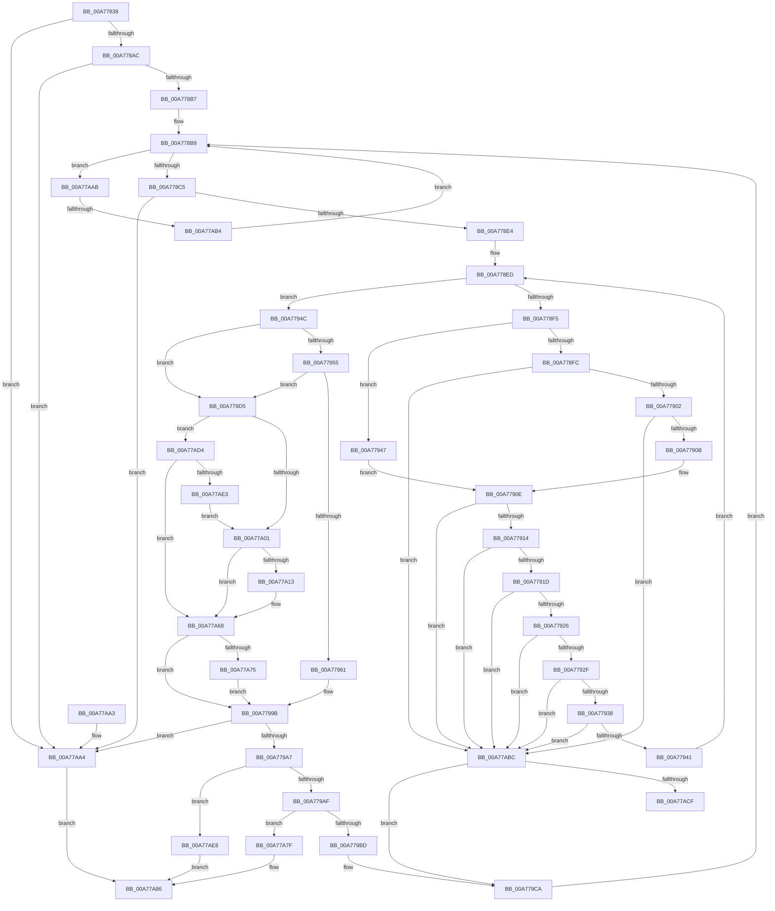

# _CmCreateOrdinalInstanceKey

- RVA: `0x00A77838`–`0x00A77AEC` (길이 `692` bytes)
- VA: `0x0000000140A77838`
- 실행 섹션: `PAGE`
- PDB 이름 있음: `예`; PDB Function 태그: `예`
- unwind 정보 RVA: `0x000B5E9C`
- 디코드: `184`개 명령, `692/692` bytes 표시
- 미해석 바이트: `0` (있으면 어셈블리에 `.byte`로 보존)

> 이 문서는 커널 이미지의 기계어와 PDB 기호를 분석해 생성했습니다. 4번과 5번은 함수 원형과 자료형을 바이너리 사용 방식에서 추정한 C 해석이며 원본 소스 복구 결과는 아닙니다.

## 1. Dependencies

- 직접 호출 지점: **10**; 고유 호출 대상: **8**
- 직접 호출자로 확인된 함수: **1**
- RIP 상대 이미지 참조: **3**

### Outgoing calls
- `0x00A7787C` → [wcstoul](../../text/50/wcstoul_function_005024A0.md) (function, `0x005024A0`)
- `0x00A77891` → [wcstoul](../../text/50/wcstoul_function_005024A0.md) (function, `0x005024A0`)
- `0x00A778D7` → [swprintf_s](../../text/50/swprintf_s_function_00504B20.md) (function, `0x00504B20`)
- `0x00A77994` → [RegRtlCreateKeyTransacted](../93/RegRtlCreateKeyTransacted_function_0093207C.md) (function, `0x0093207C`)
- `0x00A779BD` → [ZwClose](../../text/6A/ZwClose_function_006AD2B0.md) (function, `0x006AD2B0`)
- `0x00A779F4` → [RegRtlIsPredefinedKey](../93/RegRtlIsPredefinedKey_function_009321CC.md) (function, `0x009321CC`)
- `0x00A77A08` → [RtlInitUnicodeStringEx](../../text/46/RtlInitUnicodeStringEx_function_00463960.md) (function, `0x00463960`)
- `0x00A77A61` → [ZwCreateKey](../../text/6A/ZwCreateKey_function_006AD470.md) (function, `0x006AD470`)
- `0x00A77A75` → [ZwClose](../../text/6A/ZwClose_function_006AD2B0.md) (function, `0x006AD2B0`)
- `0x00A77AD8` → [RegRtlOpenPredefinedKey](../83/RegRtlOpenPredefinedKey_function_00832A14.md) (function, `0x00832A14`)

### Direct callers
- [sub_00B2BA82](../B2/Unknown_function_00B2BA82.md) at `0x00B2BCB8`

### Static image references
- `0x00A77871` → RVA `0x00B0D500` (` ?? ::NNGAKEGL::`string'`; read)
- `0x00A77887` → RVA `0x00B0D510` (` ?? ::NNGAKEGL::`string'`; read)
- `0x00A778C8` → RVA `0x00AFD4D0` (` ?? ::NNGAKEGL::`string'`; read)

## 2. Other-region calls and transfers

- 다른 실행 섹션으로 향하는 call: **7**
  - `0x00A7787C` → [wcstoul](../../text/50/wcstoul_function_005024A0.md) (`PAGE` → `.text`)
  - `0x00A77891` → [wcstoul](../../text/50/wcstoul_function_005024A0.md) (`PAGE` → `.text`)
  - `0x00A778D7` → [swprintf_s](../../text/50/swprintf_s_function_00504B20.md) (`PAGE` → `.text`)
  - `0x00A779BD` → [ZwClose](../../text/6A/ZwClose_function_006AD2B0.md) (`PAGE` → `.text`)
  - `0x00A77A08` → [RtlInitUnicodeStringEx](../../text/46/RtlInitUnicodeStringEx_function_00463960.md) (`PAGE` → `.text`)
  - `0x00A77A61` → [ZwCreateKey](../../text/6A/ZwCreateKey_function_006AD470.md) (`PAGE` → `.text`)
  - `0x00A77A75` → [ZwClose](../../text/6A/ZwClose_function_006AD2B0.md) (`PAGE` → `.text`)
- call이 아닌 외부 분기/꼬리 이동: **2**
  - `0x00A77AAE` → [sub_00B4192E](../B4/Unknown_function_00B4192E.md) (`tail-transfer`)
  - `0x00A77ACF` → [sub_00B4192E + 0x25](../B4/Unknown_function_00B4192E.md) (`tail-transfer`)

## 3. Assembly (complete function range)

```asm
00A77838  48 8B C4                        mov rax, rsp
00A7783B  48 89 58 10                     mov qword ptr [rax + 0x10], rbx
00A7783F  44 89 48 20                     mov dword ptr [rax + 0x20], r9d
00A77843  48 89 48 08                     mov qword ptr [rax + 8], rcx
00A77847  55                              push rbp
00A77848  56                              push rsi
00A77849  57                              push rdi
00A7784A  41 54                           push r12
00A7784C  41 55                           push r13
00A7784E  41 56                           push r14
00A77850  41 57                           push r15
00A77852  48 8D 68 B1                     lea rbp, [rax - 0x4f]
00A77856  48 81 EC A0 00 00 00            sub rsp, 0xa0
00A7785D  33 DB                           xor ebx, ebx
00A7785F  4D 8B F8                        mov r15, r8
00A77862  4C 8B E2                        mov r12, rdx
00A77865  89 5D 6F                        mov dword ptr [rbp + 0x6f], ebx
00A77868  48 8B F9                        mov rdi, rcx
00A7786B  48 89 5D C7                     mov qword ptr [rbp - 0x39], rbx
00A7786F  33 D2                           xor edx, edx
00A77871  48 8D 0D 88 5C 09 00            lea rcx, [rip + 0x95c88]
00A77878  44 8D 43 24                     lea r8d, [rbx + 0x24]
00A7787C  E8 1F AC A8 FF                  call 0x1405024a0
00A77881  33 D2                           xor edx, edx
00A77883  44 8D 43 24                     lea r8d, [rbx + 0x24]
00A77887  48 8D 0D 82 5C 09 00            lea rcx, [rip + 0x95c82]
00A7788E  44 8B E8                        mov r13d, eax
00A77891  E8 0A AC A8 FF                  call 0x1405024a0
00A77896  8B C8                           mov ecx, eax
00A77898  89 45 77                        mov dword ptr [rbp + 0x77], eax
00A7789B  41 8D 45 FF                     lea eax, [r13 - 1]
00A7789F  BA FD FF FF FF                  mov edx, 0xfffffffd
00A778A4  3B C2                           cmp eax, edx
00A778A6  0F 87 F8 01 00 00               ja 0x140a77aa4
00A778AC  8D 41 FF                        lea eax, [rcx - 1]
00A778AF  3B C2                           cmp eax, edx
00A778B1  0F 87 ED 01 00 00               ja 0x140a77aa4
00A778B7  8B F3                           mov esi, ebx
00A778B9  81 FE 0F 27 00 00               cmp esi, 0x270f
00A778BF  0F 87 E6 01 00 00               ja 0x140a77aab
00A778C5  44 8B CE                        mov r9d, esi
00A778C8  4C 8D 05 01 5C 08 00            lea r8, [rip + 0x85c01]
00A778CF  BA 05 00 00 00                  mov edx, 5
00A778D4  49 8B CF                        mov rcx, r15
00A778D7  E8 44 D2 A8 FF                  call 0x140504b20
00A778DC  85 C0                           test eax, eax
00A778DE  0F 88 C0 01 00 00               js 0x140a77aa4
00A778E4  41 BE 01 00 00 00               mov r14d, 1
00A778EA  49 8B D7                        mov rdx, r15
00A778ED  0F B7 02                        movzx eax, word ptr [rdx]
00A778F0  66 85 C0                        test ax, ax
00A778F3  74 57                           je 0x140a7794c
00A778F5  8B C8                           mov ecx, eax
00A778F7  83 F8 61                        cmp eax, 0x61
00A778FA  77 4B                           ja 0x140a77947
00A778FC  0F 84 BA 01 00 00               je 0x140a77abc
00A77902  83 E9 41                        sub ecx, 0x41
00A77905  0F 84 B1 01 00 00               je 0x140a77abc
00A7790B  83 E9 04                        sub ecx, 4
00A7790E  0F 84 A8 01 00 00               je 0x140a77abc
00A77914  83 E9 04                        sub ecx, 4
00A77917  0F 84 9F 01 00 00               je 0x140a77abc
00A7791D  83 E9 06                        sub ecx, 6
00A77920  0F 84 96 01 00 00               je 0x140a77abc
00A77926  83 E9 06                        sub ecx, 6
00A77929  0F 84 8D 01 00 00               je 0x140a77abc
00A7792F  41 2B CE                        sub ecx, r14d
00A77932  0F 84 84 01 00 00               je 0x140a77abc
00A77938  83 F9 03                        cmp ecx, 3
00A7793B  0F 84 7B 01 00 00               je 0x140a77abc
00A77941  48 83 C2 02                     add rdx, 2
00A77945  EB A6                           jmp 0x140a778ed
00A77947  83 E9 65                        sub ecx, 0x65
00A7794A  EB C2                           jmp 0x140a7790e
00A7794C  48 85 FF                        test rdi, rdi
00A7794F  0F 84 80 00 00 00               je 0x140a779d5
00A77955  48 8B 87 E0 00 00 00            mov rax, qword ptr [rdi + 0xe0]
00A7795C  48 85 C0                        test rax, rax
00A7795F  74 74                           je 0x140a779d5
00A77961  48 8B 48 08                     mov rcx, qword ptr [rax + 8]
00A77965  45 33 C0                        xor r8d, r8d
00A77968  38 58 10                        cmp byte ptr [rax + 0x10], bl
00A7796B  45 8B CE                        mov r9d, r14d
00A7796E  48 89 4C 24 40                  mov qword ptr [rsp + 0x40], rcx
00A77973  48 8D 45 6F                     lea rax, [rbp + 0x6f]
00A77977  48 89 44 24 38                  mov qword ptr [rsp + 0x38], rax
00A7797C  49 8B D7                        mov rdx, r15
00A7797F  48 8D 45 C7                     lea rax, [rbp - 0x39]
00A77983  49 8B CC                        mov rcx, r12
00A77986  48 89 44 24 30                  mov qword ptr [rsp + 0x30], rax
00A7798B  88 5C 24 28                     mov byte ptr [rsp + 0x28], bl
00A7798F  48 89 5C 24 20                  mov qword ptr [rsp + 0x20], rbx
00A77994  E8 E3 A6 EB FF                  call 0x14093207c
00A77999  8B F8                           mov edi, eax
00A7799B  81 FF 7C 01 00 C0               cmp edi, 0xc000017c
00A779A1  0F 84 FD 00 00 00               je 0x140a77aa4
00A779A7  85 FF                           test edi, edi
00A779A9  0F 88 39 01 00 00               js 0x140a77ae8
00A779AF  48 8B 4D C7                     mov rcx, qword ptr [rbp - 0x39]
00A779B3  44 39 75 6F                     cmp dword ptr [rbp + 0x6f], r14d
00A779B7  0F 84 C2 00 00 00               je 0x140a77a7f
00A779BD  E8 EE 58 C3 FF                  call 0x1406ad2b0
00A779C2  48 8B 7D 57                     mov rdi, qword ptr [rbp + 0x57]
00A779C6  48 89 5D C7                     mov qword ptr [rbp - 0x39], rbx
00A779CA  8B 4D 77                        mov ecx, dword ptr [rbp + 0x77]
00A779CD  41 03 F6                        add esi, r14d
00A779D0  E9 E4 FE FF FF                  jmp 0x140a778b9
00A779D5  33 C0                           xor eax, eax
00A779D7  48 89 5D CF                     mov qword ptr [rbp - 0x31], rbx
00A779DB  0F 57 C0                        xorps xmm0, xmm0
00A779DE  48 89 45 07                     mov qword ptr [rbp + 7], rax
00A779E2  49 8B CC                        mov rcx, r12
00A779E5  89 45 0F                        mov dword ptr [rbp + 0xf], eax
00A779E8  0F 11 45 E7                     movups xmmword ptr [rbp - 0x19], xmm0
00A779EC  0F 11 45 F7                     movups xmmword ptr [rbp - 9], xmm0
00A779F0  0F 11 45 D7                     movups xmmword ptr [rbp - 0x29], xmm0
00A779F4  E8 D3 A7 EB FF                  call 0x1409321cc
00A779F9  84 C0                           test al, al
00A779FB  0F 85 D3 00 00 00               jne 0x140a77ad4
00A77A01  49 8B D7                        mov rdx, r15
00A77A04  48 8D 4D D7                     lea rcx, [rbp - 0x29]
00A77A08  E8 53 BF 9E FF                  call 0x140463960
00A77A0D  8B F8                           mov edi, eax
00A77A0F  85 C0                           test eax, eax
00A77A11  78 55                           js 0x140a77a68
00A77A13  48 39 5D CF                     cmp qword ptr [rbp - 0x31], rbx
00A77A17  4C 8D 45 E7                     lea r8, [rbp - 0x19]
00A77A1B  0F 57 C0                        xorps xmm0, xmm0
00A77A1E  C7 45 E7 30 00 00 00            mov dword ptr [rbp - 0x19], 0x30
00A77A25  49 8B C4                        mov rax, r12
00A77A28  C7 45 FF C0 02 00 00            mov dword ptr [rbp - 1], 0x2c0
00A77A2F  48 0F 45 45 CF                  cmovne rax, qword ptr [rbp - 0x31]
00A77A34  48 8D 4D C7                     lea rcx, [rbp - 0x39]
00A77A38  48 89 45 EF                     mov qword ptr [rbp - 0x11], rax
00A77A3C  45 33 C9                        xor r9d, r9d
00A77A3F  48 8D 45 D7                     lea rax, [rbp - 0x29]
00A77A43  41 8B D6                        mov edx, r14d
00A77A46  48 89 45 F7                     mov qword ptr [rbp - 9], rax
00A77A4A  48 8D 45 6F                     lea rax, [rbp + 0x6f]
00A77A4E  48 89 44 24 30                  mov qword ptr [rsp + 0x30], rax
00A77A53  89 5C 24 28                     mov dword ptr [rsp + 0x28], ebx
00A77A57  48 89 5C 24 20                  mov qword ptr [rsp + 0x20], rbx
00A77A5C  F3 0F 7F 45 07                  movdqu xmmword ptr [rbp + 7], xmm0
00A77A61  E8 0A 5A C3 FF                  call 0x1406ad470
00A77A66  8B F8                           mov edi, eax
00A77A68  48 8B 4D CF                     mov rcx, qword ptr [rbp - 0x31]
00A77A6C  48 85 C9                        test rcx, rcx
00A77A6F  0F 84 26 FF FF FF               je 0x140a7799b
00A77A75  E8 36 58 C3 FF                  call 0x1406ad2b0
00A77A7A  E9 1C FF FF FF                  jmp 0x140a7799b
00A77A7F  48 8B 45 7F                     mov rax, qword ptr [rbp + 0x7f]
00A77A83  48 89 08                        mov qword ptr [rax], rcx
00A77A86  8B C3                           mov eax, ebx
00A77A88  48 8B 9C 24 E8 00 00 00         mov rbx, qword ptr [rsp + 0xe8]
00A77A90  48 81 C4 A0 00 00 00            add rsp, 0xa0
00A77A97  41 5F                           pop r15
00A77A99  41 5E                           pop r14
00A77A9B  41 5D                           pop r13
00A77A9D  41 5C                           pop r12
00A77A9F  5F                              pop rdi
00A77AA0  5E                              pop rsi
00A77AA1  5D                              pop rbp
00A77AA2  C3                              ret
00A77AA3  CC                              int3
00A77AA4  BB E5 00 00 C0                  mov ebx, 0xc00000e5
00A77AA9  EB DB                           jmp 0x140a77a86
00A77AAB  41 3B F5                        cmp esi, r13d
00A77AAE  0F 83 7A 9E 0C 00               jae 0x140b4192e
00A77AB4  41 8B F5                        mov esi, r13d
00A77AB7  E9 FD FD FF FF                  jmp 0x140a778b9
00A77ABC  49 2B D7                        sub rdx, r15
00A77ABF  B8 03 00 00 00                  mov eax, 3
00A77AC4  48 D1 FA                        sar rdx, 1
00A77AC7  2B C2                           sub eax, edx
00A77AC9  0F 84 FB FE FF FF               je 0x140a779ca
00A77ACF  E9 7F 9E 0C 00                  jmp 0x140b41953
00A77AD4  48 8D 55 CF                     lea rdx, [rbp - 0x31]
00A77AD8  E8 37 AF DB FF                  call 0x140832a14
00A77ADD  8B F8                           mov edi, eax
00A77ADF  85 C0                           test eax, eax
00A77AE1  78 85                           js 0x140a77a68
00A77AE3  E9 19 FF FF FF                  jmp 0x140a77a01
00A77AE8  8B DF                           mov ebx, edi
00A77AEA  EB 9A                           jmp 0x140a77a86
```

## 4. C-style interpretation (structured pseudocode)

```c
__int64 __fastcall _CmCreateOrdinalInstanceKey(__int64 a1, __int64 a2, __int64 a3, int a4)
{
    __int64 result;
    __int64 v_rbx;
    __int64 v_rdi;
    __int64 v_rsi;
    __int64 v_rsp;
    unsigned __int64 v_stack_m98;
    unsigned __int64 v_stack_mA0;
    unsigned __int64 v_stack_mA8;
    unsigned __int8 v_stack_mB0;
    unsigned __int64 v_stack_mB8;
    unsigned __int64 v_stack_p10;

    *(unsigned __int64 *)(v_rsp + 16) = v_rbx;
    *(unsigned int *)(v_rsp + 32) = a4;
    *(unsigned __int64 *)(v_rsp + 8) = a1;
    v_rsp = (v_rsp) - (160);
    v_rbx = 0;
    *(unsigned int *)(v_rsp - 79 + 111) = 0;
    *(unsigned __int64 *)(v_rsp - 79 - 57) = 0;
    a2 = 0;
    result = wcstoul(v_rip + 613512, a2, v_rbx + 36, a4);
    a2 = 0;
    result = wcstoul(v_rip + 613506, a2, v_rbx + 36, a4);
    *(unsigned int *)(v_rsp - 79 + 119) = (unsigned int)(result);
    if (((unsigned int)((unsigned int)((unsigned int)(result)) - 1)) > ((unsigned int)((unsigned int)(0xFFFFFFFDULL)))) goto loc_00A77AA4;
    if (((unsigned int)((unsigned int)((unsigned int)(result)) - 1)) > ((unsigned int)((unsigned int)(0xFFFFFFFDULL)))) goto loc_00A77AA4;
loc_00A778B9:
    if (0 > 0x270FULL) goto loc_00A77AAB;
    result = swprintf_s(a3, 5, v_rip + 547841, 0);
    if (sign_flag) goto loc_00A77AA4;
loc_00A778ED:
    if ((unsigned __int16)(*(unsigned __int16 *)(a3)) == 0) goto loc_00A7794C;
    if (((unsigned int)(*(unsigned __int16 *)(a3))) > 97) goto loc_00A77947;
    if (((unsigned int)(*(unsigned __int16 *)(a3))) == 97) goto loc_00A77ABC;
    a1 = (unsigned int)(((unsigned int)((unsigned int)(*(unsigned __int16 *)(a3)))) - (65));
    if (condition_is_equal) goto loc_00A77ABC;
    a1 = (unsigned int)((a1) - (4));
loc_00A7790E:
    if (condition_is_equal) goto loc_00A77ABC;
    a1 = (unsigned int)((a1) - (4));
    if (condition_is_equal) goto loc_00A77ABC;
    a1 = (unsigned int)((a1) - (6));
    if (condition_is_equal) goto loc_00A77ABC;
    a1 = (unsigned int)((a1) - (6));
    if (condition_is_equal) goto loc_00A77ABC;
    a1 = (unsigned int)((a1) - (1));
    if (condition_is_equal) goto loc_00A77ABC;
    if (((unsigned int)(a1)) == 3) goto loc_00A77ABC;
    a2 = (a3) + (2);
    goto loc_00A778ED;
loc_00A77947:
    a1 = (unsigned int)((a1) - (101));
    goto loc_00A7790E;
loc_00A7794C:
    if (a1 == 0) goto loc_00A779D5;
    if (*(unsigned __int64 *)(a1 + 224) == 0) goto loc_00A779D5;
    a3 = 0;
    v_stack_m98 = *(unsigned __int64 *)(*(unsigned __int64 *)(a1 + 224) + 8);
    v_stack_mA0 = v_rsp - 79 + 111;
    v_stack_mA8 = v_rsp - 79 - 57;
    v_stack_mB0 = 0;
    v_stack_mB8 = 0;
    result = RegRtlCreateKeyTransacted(a2, 0, a3, 1);
loc_00A7799B:
    if (((unsigned int)((unsigned int)((unsigned int)(result)))) == 0xC000017CULL) goto loc_00A77AA4;
    if (sign_flag) goto loc_00A77AE8;
    if ((*(unsigned int *)(v_rsp - 79 + 111)) == 1) goto loc_00A77A7F;
    result = ZwClose(*(unsigned __int64 *)(v_rsp - 79 - 57), 0, a3, 1);
    *(unsigned __int64 *)(v_rsp - 79 - 57) = 0;
loc_00A779CA:
    v_rsi = (unsigned int)((0) + (1));
    goto loc_00A778B9;
loc_00A779D5:
    result = 0;
    *(unsigned __int64 *)(v_rsp - 79 - 49) = 0;
    *(unsigned __int64 *)(v_rsp - 79 + 7) = 0;
    *(unsigned int *)(v_rsp - 79 + 15) = 0;
    *(unsigned __int64 *)(v_rsp - 79 - 25) = v_xmm0;
    *(unsigned __int64 *)(v_rsp - 79 - 9) = v_xmm0;
    *(unsigned __int64 *)(v_rsp - 79 - 41) = v_xmm0;
    result = RegRtlIsPredefinedKey(a2, 0, a3, 1);
    if ((unsigned __int8)(result) != 0) goto loc_00A77AD4;
loc_00A77A01:
    result = RtlInitUnicodeStringEx(v_rsp - 79 - 41, 0, a3, 1);
    v_rdi = (unsigned int)((unsigned int)(result));
    if (!(sign_flag)) {
        a3 = v_rsp - 79 - 25;
        *(unsigned int *)(v_rsp - 79 - 25) = 48;
        result = a2;
        *(unsigned int *)(v_rsp - 79 - 1) = 704;
        if ((*(unsigned __int64 *)(v_rsp - 79 - 49)) != 0) { result = *(unsigned __int64 *)(v_rsp - 79 - 49); }
        a1 = v_rsp - 79 - 57;
        *(unsigned __int64 *)(v_rsp - 79 - 17) = result;
        a4 = 0;
        result = v_rsp - 79 - 41;
        a2 = 1;
        *(unsigned __int64 *)(v_rsp - 79 - 9) = result;
        result = v_rsp - 79 + 111;
        v_stack_mA8 = result;
        v_stack_mB0 = 0;
        v_stack_mB8 = 0;
        *(unsigned __int64 *)(v_rsp - 79 + 7) = v_xmm0;
        result = ZwCreateKey(a1, a2, a3, a4);
        v_rdi = (unsigned int)(result);
    }
    if (*(unsigned __int64 *)(v_rsp - 79 - 49) == 0) goto loc_00A7799B;
    result = ZwClose(*(unsigned __int64 *)(v_rsp - 79 - 49), a2, a3, a4);
    goto loc_00A7799B;
loc_00A77A7F:
    *(unsigned __int64 *)(*(unsigned __int64 *)(v_rsp - 79 + 127)) = *(unsigned __int64 *)(v_rsp - 79 - 49);
loc_00A77A86:
    v_rsp = (v_rsp) + (160);
    return 0;
loc_00A77AA4:
    goto loc_00A77A86;
loc_00A77AAB:
    goto loc_00A778B9;
loc_00A77ABC:
    a2 = (a2) - (a3);
    a2 = (a2) >> (1);
    result = (unsigned int)((3) - ((unsigned int)(a2)));
    if (condition_is_equal) goto loc_00A779CA;
loc_00A77AD4:
    result = RegRtlOpenPredefinedKey(*(unsigned __int64 *)(v_rsp - 79 - 49), v_rsp - 79 - 49, a3, a4);
    if (sign_flag) goto loc_00A77A68;
    goto loc_00A77A01;
loc_00A77AE8:
    goto loc_00A77A86;
}
```

## 5. (Beta) C Style

```c
int64_t _CmCreateOrdinalInstanceKey(int64_t Arg1, int64_t Arg2, void *Arg3, int32_t Arg4)
{
    uint8_t *arg3 = (uint8_t *)Arg3;

    int64_t result;
    int64_t local_rbx;
    int64_t local_rdi;
    int64_t local_rsi;
    int64_t local_rsp;
    uint64_t v_stack_m98;
    uint64_t v_stack_mA0;
    uint64_t v_stack_mA8;
    uint8_t v_stack_mB0;
    uint64_t v_stack_mB8;
    uint64_t v_stack_p10;

    *(uint64_t *)(local_rsp + 0x10) = local_rbx;
    *(uint32_t *)(local_rsp + 0x20) = Arg4;
    *(uint64_t *)(local_rsp + 0x8) = Arg1;
    local_rsp = (local_rsp) - (160);
    local_rbx = 0;
    *(uint32_t *)(local_rsp - 0x4F + 0x6F) = 0;
    *(uint64_t *)(local_rsp - 0x4F - 0x39) = 0;
    Arg2 = 0;
    result = wcstoul(v_rip + 613512, Arg2, local_rbx + 36, Arg4);
    Arg2 = 0;
    result = wcstoul(v_rip + 613506, Arg2, local_rbx + 36, Arg4);
    *(uint32_t *)(local_rsp - 0x4F + 0x77) = (uint32_t)(result);
    if (((uint32_t)((uint32_t)((uint32_t)(result)) - 1)) > ((uint32_t)((uint32_t)(0xFFFFFFFDULL)))) goto loc_00A77AA4;
    if (((uint32_t)((uint32_t)((uint32_t)(result)) - 1)) > ((uint32_t)((uint32_t)(0xFFFFFFFDULL)))) goto loc_00A77AA4;
loc_00A778B9:
    if (0 > 0x270FULL) goto loc_00A77AAB;
    result = swprintf_s(Arg3, 5, v_rip + 547841, 0);
    if (sign_flag) goto loc_00A77AA4;
loc_00A778ED:
    if ((uint16_t)(*(uint16_t *)(arg3)) == 0) goto loc_00A7794C;
    if (((uint32_t)(*(uint16_t *)(arg3))) > 97) goto loc_00A77947;
    if (((uint32_t)(*(uint16_t *)(arg3))) == 97) goto loc_00A77ABC;
    Arg1 = (uint32_t)(((uint32_t)((uint32_t)(*(uint16_t *)(arg3)))) - (65));
    if (condition_is_equal) goto loc_00A77ABC;
    Arg1 = (uint32_t)((Arg1) - (4));
loc_00A7790E:
    if (condition_is_equal) goto loc_00A77ABC;
    Arg1 = (uint32_t)((Arg1) - (4));
    if (condition_is_equal) goto loc_00A77ABC;
    Arg1 = (uint32_t)((Arg1) - (6));
    if (condition_is_equal) goto loc_00A77ABC;
    Arg1 = (uint32_t)((Arg1) - (6));
    if (condition_is_equal) goto loc_00A77ABC;
    Arg1 = (uint32_t)((Arg1) - (1));
    if (condition_is_equal) goto loc_00A77ABC;
    if (((uint32_t)(Arg1)) == 3) goto loc_00A77ABC;
    Arg2 = (Arg3) + (2);
    goto loc_00A778ED;
loc_00A77947:
    Arg1 = (uint32_t)((Arg1) - (101));
    goto loc_00A7790E;
loc_00A7794C:
    if (Arg1 == 0) goto loc_00A779D5;
    if (*(uint64_t *)(Arg1 + 0xE0) == 0) goto loc_00A779D5;
    Arg3 = 0;
    v_stack_m98 = *(uint64_t *)(*(uint64_t *)(Arg1 + 0xE0) + 0x8);
    v_stack_mA0 = local_rsp - 79 + 111;
    v_stack_mA8 = local_rsp - 79 - 57;
    v_stack_mB0 = 0;
    v_stack_mB8 = 0;
    result = RegRtlCreateKeyTransacted(Arg2, 0, Arg3, 1);
loc_00A7799B:
    if (((uint32_t)((uint32_t)((uint32_t)(result)))) == 0xC000017CULL) goto loc_00A77AA4;
    if (sign_flag) goto loc_00A77AE8;
    if ((*(uint32_t *)(local_rsp - 0x4F + 0x6F)) == 1) goto loc_00A77A7F;
    result = ZwClose(*(uint64_t *)(local_rsp - 0x4F - 0x39), 0, Arg3, 1);
    *(uint64_t *)(local_rsp - 0x4F - 0x39) = 0;
loc_00A779CA:
    local_rsi = (uint32_t)((0) + (1));
    goto loc_00A778B9;
loc_00A779D5:
    result = 0;
    *(uint64_t *)(local_rsp - 0x4F - 0x31) = 0;
    *(uint64_t *)(local_rsp - 0x4F + 0x7) = 0;
    *(uint32_t *)(local_rsp - 0x4F + 0xF) = 0;
    *(uint64_t *)(local_rsp - 0x4F - 0x19) = v_xmm0;
    *(uint64_t *)(local_rsp - 0x4F - 0x9) = v_xmm0;
    *(uint64_t *)(local_rsp - 0x4F - 0x29) = v_xmm0;
    result = RegRtlIsPredefinedKey(Arg2, 0, Arg3, 1);
    if ((uint8_t)(result) != 0) goto loc_00A77AD4;
loc_00A77A01:
    result = RtlInitUnicodeStringEx(local_rsp - 79 - 41, 0, Arg3, 1);
    local_rdi = (uint32_t)((uint32_t)(result));
    if (!(sign_flag)) {
        Arg3 = local_rsp - 79 - 25;
        *(uint32_t *)(local_rsp - 0x4F - 0x19) = 48;
        result = Arg2;
        *(uint32_t *)(local_rsp - 0x4F - 0x1) = 704;
        if ((*(uint64_t *)(local_rsp - 0x4F - 0x31)) != 0) { result = *(uint64_t *)(local_rsp - 0x4F - 0x31); }
        Arg1 = local_rsp - 79 - 57;
        *(uint64_t *)(local_rsp - 0x4F - 0x11) = result;
        Arg4 = 0;
        result = local_rsp - 79 - 41;
        Arg2 = 1;
        *(uint64_t *)(local_rsp - 0x4F - 0x9) = result;
        result = local_rsp - 79 + 111;
        v_stack_mA8 = result;
        v_stack_mB0 = 0;
        v_stack_mB8 = 0;
        *(uint64_t *)(local_rsp - 0x4F + 0x7) = v_xmm0;
        result = ZwCreateKey(Arg1, Arg2, Arg3, Arg4);
        local_rdi = (uint32_t)(result);
    }
    if (*(uint64_t *)(local_rsp - 0x4F - 0x31) == 0) goto loc_00A7799B;
    result = ZwClose(*(uint64_t *)(local_rsp - 0x4F - 0x31), Arg2, Arg3, Arg4);
    goto loc_00A7799B;
loc_00A77A7F:
    *(uint64_t *)(*(uint64_t *)(local_rsp - 0x4F + 0x7F)) = *(uint64_t *)(local_rsp - 0x4F - 0x31);
loc_00A77A86:
    local_rsp = (local_rsp) + (160);
    return 0;
loc_00A77AA4:
    goto loc_00A77A86;
loc_00A77AAB:
    goto loc_00A778B9;
loc_00A77ABC:
    Arg2 = (Arg2) - (Arg3);
    Arg2 = (Arg2) >> (1);
    result = (uint32_t)((3) - ((uint32_t)(Arg2)));
    if (condition_is_equal) goto loc_00A779CA;
loc_00A77AD4:
    result = RegRtlOpenPredefinedKey(*(uint64_t *)(local_rsp - 0x4F - 0x31), local_rsp - 79 - 49, Arg3, Arg4);
    if (sign_flag) goto loc_00A77A68;
    goto loc_00A77A01;
loc_00A77AE8:
    goto loc_00A77A86;
}
```

### 관측된 메모리 오프셋

구조체 형식이 확인되지 않은 접근은 인자 기준의 오프셋으로만 기록했습니다.

| 기준 인자 | 오프셋 표현 | 폭 (bit) | 접근 |
|---|---:|---:|---|
| `Arg3` | `+ 0x0` | `16` | `R` |

## 6. Execution-region graph

[열기: 2D/3D 그래프와 함수 탐색 컨트롤 패널](../../../control-panel.html?section=page&rva=0x00A77838&view=graph)

- 2D 그래프는 위에서 아래로 흐르고, 3D 그래프는 빈 공간을 드래그해 회전합니다. Shift+드래그는 이동, 휠은 확대·축소, 함수 노드 선택은 대상 보고서 이동입니다.

### Static fallback


